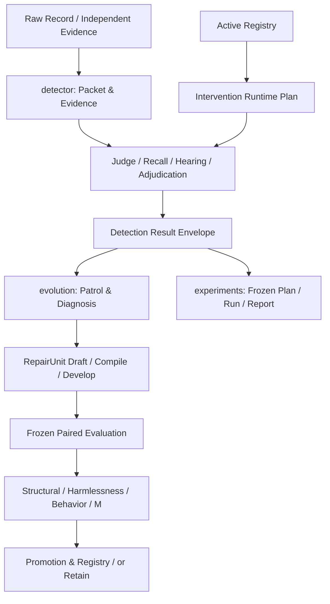
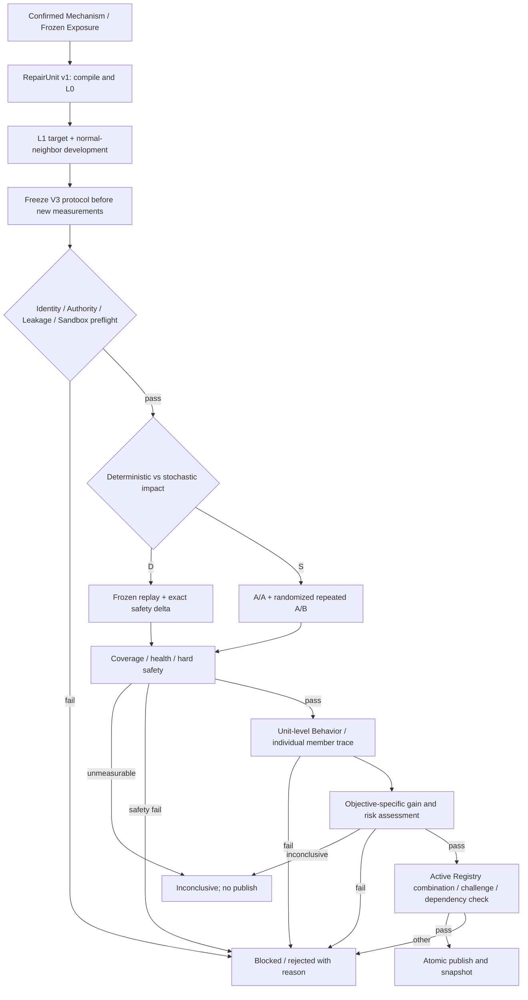

# Agent-Hallucination 检测器与受控自进化框架：系统级完整优化方案

> **版本**：v2.0（架构审查稿／实施设计基线）  
> **编制日期**：2026-09-24  
> **目标仓库**：`liuxinglin70-cmyk/Agent-Hallucination`，`main`，审查锚点提交 [`2e1113f3beea2b2cdb0233484fcec55956d8a4fd`](https://github.com/liuxinglin70-cmyk/Agent-Hallucination/commit/2e1113f3beea2b2cdb0233484fcec55956d8a4fd)  
> **依据**：用户提交的 `OPTIMIZATION_PROPOSAL(1).md`（初步方案 v1.0）；仓库 `README.md`、`docs/technical-solution.md`、关键 Python 源码及测试目录；此前的架构审查。  
> **状态**：供技术讨论、设计定版及分阶段实施使用；**不是**已实现功能、真实 LLM 实验结果或生产准入证明。  
> **阅读提示**：文内以 **[现状]** 表示在上述提交的代码或仓库技术文档中已确认的机制；**[初稿]** 表示用户提供的初步方案提出的主张；**[建议]** 表示本文件新提出、尚待实施与实测的设计；**[待核验]** 表示需要原始运行产物或更多代码级验证才能下结论的事项。

---

## 0. 执行摘要：这次优化究竟要解决什么

本项目是**结果性幻觉检测器 + 受控自进化系统 + 独立实验测量系统**，不是简单地给单模型判官反复添加 Prompt。检测器在 Agent 轨迹上形成事实性指控、复核证据、定位最早责任步骤，并输出权威性和运行健康；自进化系统诊断稳定失败族，生成受约束干预，通过配对评估和四门准入才发布到 Registry。[现状，S1–S4]

初步方案观察到候选难以准入、真实 LLM 输出存在翻转、生成的 Evidence/Guard 组合脆弱、未决案例未能形成正式可测收益，并提出四项重构：原子修复包、局部语义验证器、贝叶斯门控、全状态效用。[初稿，U1]

**本文件的总设计取向：**

1. **统一干预的最小治理单位**：将“修复单元 RepairUnit”作为从生成、编译、开发、配对测量到发布／退役的一致对象，而不是在不同层对若干松散字典重新拼装。
2. **保留判定权威边界**：扩展现有 `typed_semantic` Runner 的局部作用域及证据能力；语义执行器原则上仅产出证据，不因返回 `contradicted` 就自动获得机械定罪权。
3. **保留硬安全条件，升级随机测量模型**：对确定性重放仍执行严格回归检查；对真实 LLM 调用采用预注册的 A/A、重复 A/B、案例级配对统计和独立验证。**禁止**直接将自然波动率当作允许新增 FP/FN 的业务损伤阈值。
4. **区分未决类型**：`semantic_unresolved` 的有证据正确解决可以成为新目标；服务故障／预算耗尽／未开始不属于语义能力收益。新增 `resolution` 目标需在机制、Behavior、Metrics、Promotion 等链路一致实施，并设计新的冻结协议版本。
5. **先验证因果效应，再讨论准入率**：零准入可能源于候选无效、结构损耗、覆盖不足、测量功效不足或硬门限制；提高准入率本身不是优化成功的标准。
6. **让跨周期收益可归因、可回滚**：区分相对当前 Registry 的边际贡献与相对冻结裸底座的长期效果；规则依赖、缓存身份、数据暴露记录和晋升协议不可因重构而破坏。

**实施顺序**：P0 基线与数据口径 → P1 统一 RepairUnit／状态合同 → P2 局部语义执行能力 → P3 随机测量与新版正式晋升 → P4 长期版本治理。P1 中可先交付纯确定性编译器与不改变旧门控的观察性指标；任何会改变正式准入语义的改动须显式启用新协议。[建议]

### 0.1 原始方案必须修正的五项关键问题

| 初稿说法／目标 | 源码或数学核对结果 | 本方案处理 |
|---|---|---|
| `134` 个未决占 `693` 个全量案例约 `38%` | `134/693≈19.34%`；`38%` 可能指另一个测量子集，需拿到原始分母和排除规则才能核实。[初稿；待核验] | 报告中固定 `corpus_n / requested_n / attempted_n / healthy_n / authoritative_n / semantic_unresolved_n` 等不同分母；暂不把“38%”当作全量率。 |
| 以 `1-(1-p)^N` 推导“必然数学死锁” | 需同分布、独立、单次有害翻转率与保护门命中事件等强假设；自然**任意翻转**不等于候选**新增损伤**。[推导] | 使用案例级 A/A 测量和配对 A/B 估计；将原公式仅保留为简化示意。 |
| 用 `Beta(1+k,1+N-k)` 门控，并要求 `P(θ_h>0.035)<0.05` | `N=44,k=0` 时概率约为 `0.965^45≈0.201`，仍不能通过；且 `θ_h` 未区分自然噪声和额外损伤。[推导] | 对净效应／额外损伤分别建模；预先声明风险界限和所需功效；不能直接替换原门。 |
| 用 `Quantile_0.10(Beta(1+k_g,1+N-k_g))>0` 证明正收益 | Beta 分布的 10% 分位数在零次成功时仍严格大于零，因此该判据无法检验真实净正收益。[推导] | 定义案例级净效用差及独立伤害指标，以相对**零／最小实际收益阈值**作检验。 |
| 现有指标“完全忽略未决→正确” | `metrics.paired_delta()` 已把未决→正确计入 `correctness_improved` 与 `marginal_cases`；真正缺口在 `gain_opportunity`、`behavior_gate`、`mechanism_opportunity`、正式晋升的权威性健康前提等不同合同之间。[现状，S8–S11] | 新建独立 Resolution 目标／资格函数／行为判据／晋升协议，不通过单点改 `gain_opportunity()` 完成。 |

### 0.2 验证边界与可信度

- 本轮使用已审查 GitHub 提交的完整 Git 文件树（199 个受版本管理文件）及主要实现和合同片段；**不能**据此声称每行源码、全部测试／原始数据、每个历史产物都已独立审计。[现状／审查范围]
- 仓库 `docs/experiment-log.md` 体积较大；前次连接器没有返回其完整正文。本文件引用初稿中的“2717 次划分”“27,000+ 行日志”“3/3 零准入”“40 例底噪”“134 未决”等，均注明**初稿转述、待对原始数据复算**，不将其视为本次验证结果。[初稿；待核验]
- 仓库 README 明示“历史真实实验尚未证明自进化带来稳定收益”；此结论应作为研究现状边界，而非因离线测试通过便推翻。[现状，S1]
- 本文没有运行真实模型、安装修改或对仓库提交代码；文中的接口、JSON、伪代码、测试及统计阈值均为**提议设计**，须经实施和实测才能转化为事实。

---

## 1. 系统边界、优化目标与不可破坏的不变量

### 1.1 三个独立边界



**代码导入方向**：`evolution → detector`、`experiments → detector`；Detector 不反向导入 Evolution。`experiments` 只是执行计划与报告层，不能替代正式晋升门。[现状，S1–S2]

### 1.2 不把“检测正确率”误当作完整目标

对案例 `i` 定义输出状态：

\[
O_i=(Y_i,A_i,L_i,A_i^L,H_i,B_i,C_i,T_i)
\]

- `Y_i ∈ {verified_error, verified_clean, unresolved}`：语义终态；
- `A_i ∈ {authoritative, degraded_judge_only, invalid}`：检测权威性；
- `L_i`、`A_i^L`：责任事件及定位权威性；
- `H_i`：测量健康和故障原因；`B_i`：证据及终态形成依据；
- `C_i,T_i`：调用成本和端到端延迟。[现状的字段归纳／建议的形式化，S2、S5、S6]

**主目标采用向量而非单一综合评分**：全案例正确率、权威覆盖率、条件正确率、FP/FN、未决正确解决率、未决错误解决率、联合定位、成本／延迟。高损伤指标为独立约束；辅助业务效用不得抵消不可接受的误报、漏判、权威性退化或执行失效。[建议]

### 1.3 关键不变量（所有阶段必须满足）

| ID | 不变量 | 禁止出现的行为 |
|---|---|---|
| I-01 | Gold 标签只进入评估侧；Packet、推理 Prompt、证据与定位不可读取 Gold。[S2] | 用标签构造修复特征、位置锚点、候选 Trigger。 |
| I-02 | 非权威性结果、测量失败与未开始不可默认为 Clean。[S2、S6] | 把 `None` 填成 `False` 或把 outage 计成幻觉判错。 |
| I-03 | Semantic / sandboxed evidence-only Runner 不得独立定罪。[S7] | 将模型三值结果静默解释为机械定罪谓词。 |
| I-04 | 冻结重放不能覆盖被测干预所影响的阶段；证据快照身份必须一致。[S3、S13] | Replay 掩盖 Hook 或混用另一证据快照。 |
| I-05 | 完整候选组合满足跨条目引用、作用域和依赖约束；部署及退役维持原子性。[S7、S12；建议扩展] | 删除 Evidence 后留下失效 Guard。 |
| I-06 | 测量失败、噪声受限、无修复机会与机制被证伪是不同的终态。[S2、S10] | 把 `not_evaluated` 写成永久负反馈。 |
| I-07 | 每项正式效果结论都绑定源码、模型路由、配置、候选、协议、数据、证据、Registry 和实验角色的身份。[S13–S15] | 复用旧产物冒充新代码或新模型的结果。 |
| I-08 | 已暴露开发数据不得经更名／换目录／重划分冒充候选未见的正式验证数据。[S2、S14] | 反复对正式批次抽签直到准入。 |
| I-09 | 对照与候选运行健康可比较，且任何统计准入的错误率、样本、停止规则事前冻结。[建议] | 只挑有利的重复运行、事后调阈。 |
| I-10 | Registry 发生不一致或证据身份损坏时拒绝加载，保留可恢复快照。[S2、S12] | 多文件写入部分成功后默默继续运行。 |

### 1.4 明确不做的事情

不以“准入率破零”为独立成功条件；不承诺局部语义执行器“零副作用”或单调增益；不把所有未决变成权威结论；不把 `text_boundary` 一刀切删除（先通过消融证明替代效果）；不放松 Gold 泄漏、外部证据引用、Run 健康和权限边界；不在缺少原始日志时宣称已找出唯一根因。[建议]

---

## 2. 现有检测器：逐模块实际职责、接口及改造点

> 本节“现状”依据仓库 `docs/technical-solution.md` 和实现入口；模块内部可能存在尚未覆盖的边缘路径，实施前必须针对拟改函数增加精确回归测试。[S2]

| 模块 | 已有责任与关键接口 | 主要改造或保留约束 |
|---|---|---|
| `dataset.py` | 分离原始任务与 Gold 标签 | 保留无标签检测，禁止新增字段泄漏。 |
| `packet.py` | `validate_record/build_packet`、事件 ID、工具调用／观察、交付物及多种渲染视图 | 新增只读事件窗口与来源映射；保留完整上下文回查。 |
| `semantics.py` | 共享判错／定位口径 | 新验证器不得重写“结果性幻觉”的定义：合法探索、正常重试、诚实报告失败不能无条件定罪。 |
| `evidence.py` | 快照 Schema、`touches_packet`、来源独立性、冲突及引用校验 | 增加声明级证据适用性和完整性；相关性不等于支持性。 |
| `retrieval.py` | 查询、段落检索、数值／字段抽取、构建案件证据快照 | 明确检索缺失与事实不存在不同；来源时间／版本适用性需审核。 |
| `judge.py` | 多票初审、结构化输出、置信度和失败状态 | 按结果／置信度／轨迹复杂度分层校准；不让规则自行创造有罪标签。 |
| `recaller.py` | Recall Scan 与 Causal Upgrade | 将发现候选、升级因果、进入 Hearing 和最后修复分别计量。 |
| `step_tracer.py` | 定位最早错误引入步骤 | 区分内容步／动作步；工具观察本身不是 Assistant 的幻觉。 |
| `defense.py` | 独立复核、证据检查及多票辩护 | 保持来自 Recall 的新指控不携带 Judge 的正确答案锚点，禁止新局部证据成为结论暗示。 |
| `adjudication.py` | Guard 冲突处理、机械证据二次校验、Hearing 汇总、终态及定位裁决 | 新的 `defer/review` 等动作必须显式改变状态合同，不能把“暂不定罪”等同权威 Clean。 |
| `result.py` | `detector.detection_result.v1`；`prediction_state()` 校验 authority／runtime_valid／state | 默认保持公开 V1 合同；新增状态诊断用旁路字段／测量侧分类，避免旧消费者错误读值。 |
| `interventions.py` | 四种类型、Hook、Runner 注册、schema、Digest、Runtime Plan、事实及 Guard | 增加 Scope/投影/证据权限；确保 Runner、Hook、Guard 与运行身份一致。 |
| `predicate_dsl.py`／`predicate_context.py` | 白名单字段与运算符、非图灵完备 DSL、上下文构造 | 加局部视图只读白名单、跨事件关系谓词；限制字符串匹配、复杂度、上下文缺失。 |
| `predicates.py`／`conviction_calibration.py` | 内置机械谓词、定罪许可与校准记录 | 不能把语义模型输出伪装成已校准的机械谓词；谓词源码／语料变动后校准身份失效。 |
| `provider.py`／`provider_worker.py` | 模型传输、超时、投票辅助、Token 观测 | 固定可比较模型路由、请求参数、重试预算；失败与业务未决分离。 |
| `measurement.py` | 健康分类、同轮／跨轮重测策略 | 复用 `semantic_unresolved / degraded / infrastructure_failure / fatal_provider / not_started` 分类。 |
| `runner.py`／`runtime.py` | 批处理、缓存／续跑、案例 deadline、原子写入／锁／并发 | 记录真实执行次数、缓存命中、超时及额外局部验证成本；保持一致的冻结身份。 |
| `api.py`／`config.py`／`cli.py`／`evaluation.py` | 编排、默认 Registry、阶段重放、配置／入口及评估 | 新 Runner 接入必须覆盖真实 API、批处理、CLI、重放及结果信封各路径。 |

### 2.1 现有执行流并非“固定全程串行调用”

`api.Detector._detect()` 先建立 Packet、校验外部证据适用性与 Registry/Plan，运行 Judge；对需要的阴性、被 Guard 触发的阴性或带适用证据的阴性启动 Recall；Judge 阳性和升级成功的候选进入 Hearing，Hearing 中运行 Step Tracer 和 Defense；Judge 指控被反驳时还可继续走 Recall；最后依据 Guard 和机械证据调用 Adjudication。[现状，S3]

**优化要求**：局部验证器可能改变 Hearing 的“是否存在、输入内容、是否可冻结”，故必须在 `HOOK_DEPENDENCY_GRAPH`、`_frozen_masked_stages`、每项 Hearing 的冻结输入匹配和 A/B 成本统计中显式表示影响，不能仅靠字符串判断“没有注入 Judge System Prompt，所以一定无副作用”。[建议，S3、S13]

### 2.2 定罪权限的强约束

现有 Runner 注册表包含：内置 `deterministic`、`typed_dsl`、`typed_semantic`、`sandboxed_component`；后三者中 `typed_semantic` 和 `sandboxed_component` 是 evidence-only，而内置机械谓词和受限 DSL 也受各自的可定罪值域／校准条件约束。[现状，S7]

**新增局部语义执行器首先应复用 `typed_semantic` 的 evidence-only 权限**，并让 `adjudication.py` 继续对所有机械定罪证据二次核验。不能为了验证未决转正确而让新增语义模型直接输出 `authoritative`。真正的终态变化必须有明确的、受测的因果执行路径，不能只在指标层赋予它收益。[建议]

### 2.3 一个容易忽略的裁决语义陷阱

`adjudication.py` 中现有 `withhold_conviction` 在特定已执行 Defense 的分支返回的是 **`verified_clean + authoritative`**，而不是通用意义上的“暂缓裁决／弃权”。[现状，S4] **因此禁止将新的语义 `abstained` 直接编译为 `withhold_conviction`**：否则会把“不知道”变成权威免责。若确实需要 `defer_verdict` 或 `request_review`，应新增明确 Guard 动作、完善 Runtime Plan、Adjudication／Result 语义和回归测试，再单独设计其正式准入目标。[建议]

---

## 3. 现有进化框架：逐模块合同与跨模块调用链

| 模块 | 当前实现／约束 | 本次改造重点 |
|---|---|---|
| `engine.py` | Patrol／裸底座对照、失败诊断、生成、开发、四门、组合检查、发布及周期记录 | 按 RepairUnit 去重与评估；抽离统计协议策略；避免大型函数内出现两套机会口径。 |
| `config.py`、`splits.py` | 配置、开发／保护／增益划分、FinalHoldout 一次读取 | 新协议数据角色、曝光账本、分层抽样、版本分流。 |
| `worksheet.py` | 稳定检测／定位失败族、可行动性 | 新增 `semantic_resolution` 失败族，但必须源于健康语义未决及独立审查，不可从所有 `None` 推断。 |
| `mechanisms.py` | 失败阶段、义务、偏差、修复操作和机制兼容性 | 为 Resolution 机制明确要求“为何未决”“新增证据在哪一环生效”。 |
| `route_failures.py`、`gaps.py` | 路径失败、能力缺口、生命周期 | 把“不支持新 Scope”“确无触发路径”“评估不充分”分开记录。 |
| `proposer.py`、`development.py` | LLM 生成现有干预数组、孤儿过滤、L0/L1 和修订 | 原子中间表示、绑定编译、单位级 L0/L1、对未部署可观察证据的开发验证。 |
| `contracts.py`、`capability_planning.py`、`capability_surface.py` | 合同／表征能力规划 | 新 RepairUnit Schema、目标能力、权限和作用域预算。 |
| `backends.py`、`sandbox.py` | Live／Mock、缓存身份、冻结阶段重放、受限组件 | 新 Runner 身份与 Hook 依赖、两臂随机测量协议；Sandbox 约束不等于形式安全证明。 |
| `metrics.py`、`calibration.py`、`gates.py` | 二分类／定位、配对变化、控制翻转与四门 | 定义全面的状态迁移、统计估计与严格安全边界，保留旧指标字段语义。 |
| `promotion.py`、`promotion_alignment.py` | 旧版及机制绑定的正式晋升、不可更改协议、候选未使用数据和角色对齐 | 新增 V3 统计／Resolution 协议；绝不静默放松 V2 的零损伤／权威行合同。 |
| `registry.py`、`ledger.py`、`checkpoint.py` | Registry 快照、边际贡献、回滚、哈希链和断点 | 修复单元级原子增删／依赖保护、发布事务恢复及指标版本化。 |
| `harness.py`、`memory.py`、`archive.py`、`candidate_versions.py` | 能力身份、经验／可复用组件、候选版本线 | 记忆区分有效、无效、未测；工件与编译器和校准版本绑定；禁止用开发成绩作为正式收益。 |
| `research.py`、`meta_eval.py`、`metamorphic.py`、`smoke.py` | 机制研究、归因、变形测试、离线闭环 | 将新 Runner 作用域、事件重排、正常重试、语义等价和安全边界加入系统测试。 |
| `experiments/plan.py`、`runner.py`、`report.py` | 冻结计划、执行及报告 | A/A、重复配对 A/B、运行顺序、停止条件、分母与结果分类的标准报告。 |

### 3.1 完整状态转移模型

定义周期状态：

\[
S_t=(R_t,F_t,M_t,B_t,H_t,V_t,D_t^{exp})
\]

`R_t` 为部署 Registry，`F_t` 为经证实的失败族，`M_t` 为经验／候选库，`B_t` 为预算，`H_t` 为代码／检测器／模型／工具身份，`V_t` 为候选及协议版本，`D_t^{exp}` 为数据暴露账本。动作 `h_t` 是经过编译的完整 RepairUnit，观测 `Z_t` 是冻结实验结果，发布操作由正式准入策略决定。[建议]

\[
R_{t+1}=\begin{cases}R_t\oplus h_t,& \operatorname{Admit}_{P}(h_t,Z_t)=1\\R_t,&\text{拒绝、失败或不可测}\end{cases}
\]

此处是工程状态模型，不声称仓库实现了已证明的马尔可夫过程或任何最优策略。[建议]

### 3.2 关键发布现实：V2 不能“通过调整配置悄悄变成统计门”

[现状] `promotion_alignment.build_alignment()` 对正式机制绑定 V2 协议检查零新增 FN／FP／未决、零定位破坏、至少 1 个 M 增益、必须四门、机制成员已确认；`promotion._run_aligned()` 对 `checked_rows()` 要求健康与权威，且检验保护组、Challenge 和全批次的新增错误／未决。[S11、S14]

**结论**：原始文档把 `harmlessness_gate()` 换成 Beta 检验，或只将 `gain_opportunity()` 纳入未决，均不足以让完整 V2 正式晋升接受新的统计／Resolution 语义。[建议] 应保留 V1/V2 行为不变，用新 Schema（本文暂称 `evolution.promotion_protocol.v3`，具体命名以当前常量为准）显式定义新的测量、风险及数据协议；新晋升入口在代码、CLI、审计日志和报表中显示 `policy_version`，不能复用旧结果证明新规则。

---
## 4. 根因假设树与验证方法：避免将“零准入”视为单一病因

### 4.1 现象与替代解释矩阵

| 观察／症状 | 可能机制（不能仅凭结果确定） | 对应的可证伪实验 | 结论类型 |
|---|---|---|---|
| LLM 生成后候选数为 0 | JSON/Schema 失败、依赖绑定失败、家族不匹配、预算用尽、真实无可表达机制 | 对同一固定 RepairUnit 输入测编译器产出；对 Proposer 日志分拒绝原因，区分 `provider_failure / invalid_contract / orphan / duplicate` | 结构损耗 vs 机制不足 |
| 针对 FP 的候选修复 FP 却出现 TP 损失 | 广域 Prompt 干预、Scope 过宽、证据契约错误、模型天然波动 | 同作用机制分别测全局 Prompt／确定性作用域／局部语义；增加 A/A 和正常邻例 | 干预外溢 vs 测量噪声 |
| 候选通过开发 L1、正式晋升失败 | 开发复用造成过拟合、保护/Challenge 特征不同、V2 合同不一致、Provider 随机 | 保留失败分门／分案例记录，未见案例重复测量，固定角色与模型路由 | 泛化失败 vs 不可测 |
| 无任何通过的划分 | 候选真实无效、候选组合矛盾、保护样本功效不足、原设计门控高误拒 | 先固定“已知正效应”“已知无效”“已知有害”的 Mock/随机注入测试，再做真实机制测量 | 门控校准 vs 候选质量 |
| 未决比例高 | 真实语义不充分、Judge/Defense 冲突、证据缺失、服务失败、预算超时、权威降级 | 按 `measurement_status` 与 decisive/blocking facts 交叉表；人工审核来源与任务口径 | 可修的语义缺陷 vs 操作故障 |
| 某规则单独有效，部署后收益消失 | 与现有 Registry 规则发生交互、机制覆盖消失、数据漂移、控制/候选基线不一致 | 在冻结版本下执行单元、组合、移除单元消融；逐周期重新取样 | 组合效应 vs 分布变化 |

**决策准则**：每次失败必须记录 `stage / status / evidence / attribution / retry_policy / exposed_cases`。尤其是 `not_evaluated` 不能转化为“规则无效”并永久压制再提案；真实错误与结构失败也不能冒充“模型随机”。[建议；现有不同终态机制见 S2、S10]

### 4.2 原始历史数字的复核工作包

由实际实验产物及 `docs/experiment-log.md` 追溯：每次实验的 `run_id / timestamp / code_sha / model_route / case_set / roles / n_requested / n_started / n_authoritative / n_unresolved_by_reason / gate_verdict / candidate_hash`。按“去重案例”和“case-times（案例运行次数）”分别汇总。[建议]

需特别回答：

1. 初稿“134 例、38%”的准确分母是什么？134 是否是 693 全量上的未决计数，还是另一有效测量集／样本前缀？是否含无权限、超时、降级？
2. 40 例底噪实验中“1–3 次翻转”对应的配对次数、来源、病例复测重复次数、随机模型参数及每类转换方向是什么？`p≈0.035` 究竟指“至少一次不一致案例占比”、单次预测错误率还是相邻运行的损伤率？
3. “2717 个划分”是否来自**相同固定候选的事后划分枚举**，还是独立候选与独立样本重复？其中哪些数据已暴露给 Proposer？不得将事后多次选择当成独立显著性验证。
4. “1106 项测试”对应何提交及何命令？本文件不把历史 PASS 写成本次 PASS。

完成这项复核之前，不应决定正式统计风险预算和未决机会池规模；否则会把分母错误固化进协议。[建议]

---

## 5. 方案 A：统一原子修复单元 RepairUnit 与确定性编译器

### 5.1 问题定位与已有能力

[现状] `proposer.py` 输出 `interventions` 数组；`infer_joint_groups()` 将同家族、同谓词事实生产者与消费者配对，`_drop_orphan_evidence()` 删除没有终态伙伴的 Evidence；`validate_intervention_batch()` 和 Structural 又执行跨项校验。Guard 的 Trigger、事实名字、谓词定义和值域均可能在生成与过滤过程中不一致。[S7–S9]

**保留**孤儿删除和批次验证等防护；**替换**要求 LLM 人工重复维护跨项 ID、家族和事实引用的生成接口。[建议]

### 5.2 RepairUnit v1：候选、测量与发布的共同身份

建议使用**编译前 Schema**（非现有 Registry Schema）：

```json
{
  "schema_version": "evolution.repair_unit.v1",
  "target": {
    "mechanism_id": "confirmed-mechanism-id",
    "objective": "detection",
    "polarity": "recall",
    "repair_operation": "check_explicit_contract"
  },
  "scope": {
    "contract_kind": "required_tool_action",
    "anchor_selector": "explicit_task_obligation",
    "target_selector": "terminal_delivery",
    "event_window": "causal_slice",
    "must_include": ["post_anchor_recovery", "final_delivery"],
    "on_incomplete": "abstain"
  },
  "observation": {
    "runner": "typed_dsl",
    "predicate_name": "evo_explicit_tool_prerequisite",
    "input_views": ["question_contract", "tool_events", "delivery_event"],
    "rules": [{
      "field": "tool_names",
      "operator": "none_contains",
      "value": "required_tool_name",
      "verdict": "violated"
    }],
    "default_verdict": "not_applicable"
  },
  "decision": {
    "requested_action": "convict_mechanical_violation",
    "required_evidence": ["observation.violated"],
    "not_when": ["contract_not_explicit", "authorized_equivalent_path"],
    "on_uncertain": "no_new_action"
  },
  "claim": {
    "expected_behavior": "detect one explicitly required missing delivery prerequisite",
    "target_kind": "detection"
  }
}
```

**说明**：上述是新 Schema 的示意，不可直接喂给当前 `detector.predicate_program.v1` 或 `detector.intervention.v1`；`question_contract`、`causal_slice`、`authorized_equivalent_path` 等需先定义语义和执行器。示例中的 `convict_mechanical_violation` **只有**在生成的谓词确已取得既有机械定罪许可、触发上下文满足当前限制时才可编译；否则编译失败或降为 evidence-only。字符串 `required_tool_name` 只是待静态绑定的任务工具角色，不允许从 Gold 标签／案例 ID 填充。[建议]

### 5.3 编译管线（必须先完成的检查）

```text
LLM 原子草案
  -> schema_version 校验、字段白名单、长度/预算/作用域限制
  -> 机制绑定：必须存在经确认的目标，失败族与 objective 一致
  -> 规范化 AST：去除非执行性描述；固定字段顺序和值域
  -> 能力检查：Runner 是否支持该 Hook/输出/权限/输入视图
  -> 生成 Evidence/Guard/Recall 等 DAG，引用由编译器唯一分配
  -> 完整批次 validate_intervention_batch + Structural + 变形检查
  -> 产生 RepairUnitManifest + interventions + dependency_graph
  -> L0/L1 单位级评估 -> 才可提交正式候选
```

**身份设计**：`unit_hash = SHA256(canonical(executable_ast, compiler_version, schema_version, artifact_digests, scope_semantics_version))`；成员 `intervention_id` 由 `unit_hash` + 成员角色 + 稳定序号确定；发布实体的 identity 还绑定机制、候选版本、实验协议及父 Registry Hash。不能依赖 Python `hash()` 的进程内随机性。对不同语义使用独立的 `draft_hash / executable_hash / deployed_version_hash`，防止把文案变化误读成行为变化，或把同一可执行产物在不同上下文中的表现视为同一次验证。[建议]

### 5.4 依赖图而非固定二元组

`RepairUnit = (Members, Dependencies, Scope, Claim, Provenance)`；`Dependencies` 描述谓词、事实、触发条件和动作之间的有向边。编译器须检查：有且仅有允许的事实生产者绑定；没有不支持的循环／悬空引用；谓词值域与触发值一致；前置事件的 Hook 确实早于消费阶段；适用范围不依赖测试集或候选实际结果。[建议]

一个 Evidence 可以被多个 Guard 读取，但发布/退役是**依赖闭包**。如果同一 Evidence 同时服务多个独立修复单元，则共享组件必须显式声明“由谁所有、谁依赖、如何安全退役”，不能简单让最后一个规则退出时删除它。[建议]

### 5.5 编译失败分类与生成反馈

| 错误码（建议） | 触发原因 | 是否可让 LLM 定向修订 |
|---|---|---|
| `schema_invalid` | 字段／格式错误 | 可以，但不可反复消耗无限预算 |
| `mechanism_unbound` | 缺已确认机制或目标错误 | 需要上游诊断，不应仅让模型改字符串 |
| `unsupported_capability` | Runner、Hook、字段或权限不支持 | 进入 Gap，不得编造执行器 |
| `dependency_unresolved` | 跨项事实引用无法闭合 | 由编译器自动修正确定性绑定；逻辑缺口退回草案 |
| `unsafe_terminal_action` | 语义证据请求机械定罪／不合格触发 | 强制拒绝，不自动提升权限 |
| `scope_unsafe` | Case ID 泄漏、Gold 相关特征、越界窗口 | 拒绝并记录可操作原因 |
| `duplicate_executable` | 与现役候选等价 | 复用/记录而不是以不同 ID 重测 |
| `provider_failure` | 模型调用／解析中断 | 独立的可重试或致命故障状态 |

生成效率指标要分解为 `drafts_attempted → parseable → schema_valid → compiled → structural_pass → behavior_fired → statistically_supported → formally_promoted`。**成功编译率不是准入率，也不是稳定正收益。**[建议]

### 5.6 代码落点和兼容迁移

- 新文件建议：`evolution/repair_unit.py`（Schema/AST/编译结果）、`evolution/repair_compiler.py`（确定性编译）；是否拆文件以仓库命名规范及现有 `contracts.py` 职责审核为准。
- 修改：`proposer.py` 在新模式返回 `ProposalBatch` 兼容对象，内部增加 `units` 元数据；`development.py`、`engine.py` 以 `unit_hash` 去重与评估；`promotion.py` 将单元成员完整写入 Registry；`registry.py` 执行依赖闭包校验。
- **向后兼容**：旧 `interventions` 列表保持旧行为；新 Schema 只能走新编译入口；已部署旧成员不可因缺 `unit_hash` 被错误解释为损坏。旧候选可离线迁移为 `legacy_unit` 包装，但不回写或改变其原始内容哈希／历史准入结果。[建议]

### 5.7 验收

固定输入两次编译得到同一可执行结果及 `unit_hash`；任何悬空、权限越界、越阶段消费、证据值域不一致均在 L0 前失败；包含多 Guard 的依赖图能够原子发布／退役；新旧 `ProposalBatch` 和正式发布回归通过。仅当实测比较显示 JSON 解析／孤儿拒绝明显减少，才报告生成效率改善，不能预先承诺 `≥90%`。[建议]

---

## 6. 方案 B：Scoped Local Semantic Verifier（事件级局部验证器）

### 6.1 基于现有 Runner，而非并行建第二个裁决系统

[现状] `typed_semantic` 已支持三值 `supported / contradicted / abstained`、外部 Executor 注入、工件 Digest 校验、Evidence-only 权限；`interventions.py` 还具备按 Packet 特征路由的 `text_boundary`，但命中后仍会改变整个阶段的 Prompt。[S7]

[建议] 定义 `scoped_semantic_v1` 为 `typed_semantic` 的**受约束执行配置／适配器**，先不赋予任何新终态动作。新增 Runner 名称仅在现有合同无法表达资源预算、输入映射或触发约束时才考虑；若新建 Runner，必须在注册表声明 Hook／输入 Schema／确定性／工件绑定／终态权限／适用的变形测试，并同步 `validate_intervention_batch` 与真实运行调度。

### 6.2 局部验证的精确输入与输出

\[
\phi(q_j,e_a,e_t,W,E_s;\,A)\to(v,\pi,m)
\]

- `q_j`：可追溯到用户问题的**具体**任务义务；不是推理模型自己补写的普遍义务；
- `e_a`：触发锚点，`e_t`：拟验证的交付／动作节点；
- `W`：按受限语义定义投影的事件窗口；`E_s`：有效且来源可溯的可选外部证据；
- `A`：Pinned Executor Artifact（模型、版本、Prompt、解析器、校准及运行参数）；
- `v ∈ {supported, contradicted, abstained}`；`π`：事件／证据引用；`m`：适用性、覆盖、解析健康、成本与失败原因。[建议]

建议的输出合同：

```json
{
  "schema_version": "detector.scoped_semantic_evidence.v1",
  "scope_id": "content-derived-scope-id",
  "scope_status": "applicable",
  "verdict": "abstained",
  "claim_id": "obligation-reference",
  "anchor_event_ids": ["e_anchor"],
  "target_event_ids": ["e_target"],
  "evidence_refs": [],
  "blocking_reasons": ["missing_recovery_context"],
  "terminal_authority": "evidence_only",
  "executor_identity": {
    "artifact_id": "pinned-executor-id",
    "artifact_digest": "sha256-digest"
  }
}
```

这也是新提案示例；执行器实际输出的 `terminal_authority` 不能由模型自报后就被信任，须由 RunnerSpec 在执行计划／裁决入口强制覆盖和校验。模型可返回的字段、长度、引用数量、JSON 解析和超时应受限。[建议]

### 6.3 作用域三层过滤与信息完整性

1. **静态适用性**：只使用任务要求、工具类型、事件种类等与标签无关的白名单特征，确定是否存在可核验契约；不满足则 `not_applicable`，**不调用新增模型**。
2. **事件依赖闭包**：由 `packet.py` 的只读事件图投影构造相关前驱、后继和交付终点；若义务可能在后续被补救，必须包括恢复信息；如果“未出现工具”是主张，还必须有完整的目标时间窗口，而不是只检查局部不存在。
3. **语义判别**：仅在窗口完整、证据适用性满足、没有未处理冲突时调用语义执行器；冲突／截断／超长／无法解释的代词或跨窗口依赖一律输出 `abstained`，并明确是语义弃权还是运行失败。[建议]

**不能保证所有非目标案例 0% 副作用**：即使没有注入全局 Prompt，额外验证器仍会改变成本、时限、Guard 的事实可见性和后续 Hearing 路径。对确定性 `not_applicable` 场景要求比对完整执行 trace；对已触发场景必须真实 A/B 测量 FP/FN、未决和延迟。[建议]

### 6.4 缺证据、反例、冲突及失败策略

| 情况 | 输出或运行处理 | 禁止操作 |
|---|---|---|
| Scope 明确不适用 | 不调用，记 `not_applicable` | 以“未触发”推断模型已核验正确 |
| 事件窗口不完整 | `abstained` + `incomplete_window` | 只凭“没看到工具”定罪 |
| 有正常补救／授权替代路径 | 扩窗核验或弃权；保留具体引用 | 机械地将历史中间失败当最终错误 |
| 外部证据冲突／已过期 | 按 `evidence.py` 冲突／适用性处理，必要时弃权 | 用模型常识任选一方 |
| LLM JSON 解析错误／超时／凭据问题 | 运行健康失败，遵守共享 Deadline 与重测策略 | 把 Provider 故障归类 `semantic_unresolved` |
| 可疑工具文本含“忽略指令”等 | 当作不可信数据，引用净化和上下文边界校验 | 将事件文本拼接成新的高优先级指令 |

### 6.5 “证据产出”与“终态改变”必须分两次验证

**阶段 S0：观察模式（shadow evidence）**。新增局部执行器只产出 Evidence 和 Trace，不影响任何 Guard／Defense／Adjudication，检查 Scope 命中率、事实引用、三值输出、成本和运行健康。此阶段可证明验证器是否可用，**不能**证明检测准确率增加。[建议]

**阶段 S1：受控证据消费**。仅在指定的 `defense.pre` 等已有证据路径中增加结构化上下文，且保证现有信息不对称原则；测量是否改变 Defense/Hearing/终态。若 Evidence-only 没有合法路径影响最终决策，则只记录“证据丰富”，不可宣称“修复检测错误”。[建议]

**阶段 S2：新增终态动作的独立设计（条件性）**。若业务确需局部证据改变终态，而现有 Guard 不支持，则定义新动作和权限校准：例如“要求额外核验”或“证据不足转 unresolved”。此动作必须显式经过 schema、runtime、adjudication、result、metrics、promotion 和专项安全测试。**不得**把 `abstained` 转现有 `withhold_conviction`（该 Guard 当前会给出权威 Clean）。[建议]

### 6.6 成本与缓存身份

局部调用的缓存 Key 至少包含：`packet_hash / window_projection_hash / external_evidence_digest / scope_version / executor_artifact_digest / prompt_template_digest / model_route / decoding_params / output_schema_version`。只复用输入与执行身份完全一致的**测量结果**；研究阶段可复用确定性投影，但正式随机 A/B 必须按协议决定是否允许复用 LLM 结果。语义调用时间计入同一个案例 Deadline，负载测试必须覆盖并发、超时与熔断。[建议]

### 6.7 变形测试与边界集合

在 `metamorphic.py` 已有的 Case-ID 改名、无关工具插入、文本表面扰动、语义等价、定位事件移动等基础上，增加：合法重试、补救成功、授权替代、同义任务要求、引用顺序变化、工具观察包含恶意指令、边界之外的关键事实、长事件截断和多候选冲突。对每项记录 Scope 命中、证据三值、最终裁决及请求数差异。只对经过语义人工审核的等价变换断言“结果应相同”，避免把非等价内容当不变性。[建议，S16]

---
## 7. 方案 C：未决治理、状态迁移与统一指标合同

### 7.1 首先建立状态类型系统，而不是简单扩充 `gain_opportunity()`

[现状] `result.prediction_state()` 仅在正式信封、权威、`runtime_valid=True` 和终态一致时返回布尔；`measurement.measurement_status()` 区分 `authoritative / semantic_unresolved / degraded / infrastructure_failure / fatal_provider / not_started` 等测量健康／读数情况。[S5、S6]

[建议] 在**评估侧**定义：

```text
EvaluationState:
  authoritative_correct       # gold 已知且正式预测正确
  authoritative_wrong         # gold 已知且正式预测错误
  semantic_unresolved_healthy # 检测执行健康，真实语义/证据未决
  degraded                    # 不是正式权威预测
  infrastructure_failure      # 服务/超时/测量错误
  fatal_provider              # 致命 Provider 错误
  not_started                 # 根本没有执行
  invalid_envelope            # Schema/身份不可接受
```

**注意双轴建模**：`semantic_unresolved_healthy` 应由 `measurement_status`、完整阶段健康及 `runtime_valid` 的一致规则推导，不能只根据 `prediction is None`；`degraded` 可以作为服务层治理目标，但不能与模型语义解决收益混合。原始信封 V1 的 `unresolved` 语义保持不变，新细分先以版本化派生指标输出。[建议]

### 7.2 定义完整的状态迁移矩阵

| 对照组 → 候选组 | 分类 | 正式指标处理 |
|---|---|---|
| `wrong → correct` | `decisive_fixed` | 检测修复收益 |
| `semantic_unresolved_healthy → correct` | `resolution_correct` | Resolution 收益，须满足证据和权威要求 |
| `semantic_unresolved_healthy → wrong` | `resolution_wrong` | 高风险新增错误，不得记收益 |
| `correct → wrong` | `correctness_worsened` | 保护损伤，按 Gold polarity 再分 FP/FN |
| `correct → semantic_unresolved_healthy` | `unresolved_added` | 决定性／覆盖损伤 |
| `wrong → semantic_unresolved_healthy` | `wrong_to_abstain` | 错误断言减少，但**不是**“正确解决” |
| `wrong → wrong` | `still_wrong` | 可再分错误类别与错误步骤变化，不能自动宣称收益 |
| `semantic_unresolved_healthy → semantic_unresolved_healthy` | `still_unresolved` | 证据改善、成本改善单独报告 |
| 任一状态 → `infrastructure_failure` | `health_regressed` 等 | 禁止作为有效候选结果参与语义收益准入；记独立运行损伤 |
| `infrastructure_failure → authoritative_*` | `service_recovery` | 只计操作可用性；不计语义 Resolution |

保留现有 `metrics.paired_delta()` 字段含义，**只新增** `paired_state_transitions_v1()` 及其标准对象；不得把 `marginal_cases` 改名／重定义却复用旧历史指标值。[建议]

### 7.3 Resolution 是独立目标类型

新增 `target_kind=resolution` 时必须同时定义：

1. **机会资格**：候选评估前、在独立 A/A 基线复测或明确规定的稳定性条件下确认的 `semantic_unresolved_healthy`，且 Gold 标签由评估侧持有；从业务定义看只有需要形成明确结论的案例才纳入。
2. **作用范围**：候选声明修复的是证据缺失、阶段冲突、上下文不足还是一个明确的无法定性机制；不能将无法测量的所有 `None` 统一标为同一机制。
3. **行为约束**：验证器或 Guard 的预期路径真实触发，且最终权威变化具有可追溯 Evidence/Guard/Hearing 来源；仅修改 Result 字段不算。
4. **收益**：至少有预注册的 `U_sem→correct`，并独立计 `U_sem→wrong`、`correct→wrong/U_sem`、`health_regressed`。
5. **定位**：Gold 阳性被新判为 `verified_error` 时，联合定位指标包含正确责任步骤；若缺有效 Gold step，检测与定位结果必须分列，不可虚构定位收益。
6. **退出与失败**：无资格机会则 `not_evaluated`；证据不足则弃权；若健康变差，拒绝或不可测的具体策略由正式协议区分，绝不静默删除不利样本。[建议]

### 7.4 必须同步修改的函数与合同

| 层级 | 目标改动 | 不可单改的原因 |
|---|---|---|
| `interventions.TARGET_KINDS`、`validate_intervention` | 接受 `resolution` 并验证 Claim、Hook、权限 | 否则新候选首先结构失败。 |
| `worksheet.py`／`mechanisms.py` | 稳定语义未决族、机制证据、独立审查与可行动性 | 否则没有真实、可复现的修复目标。 |
| `metrics.gain_opportunity` | 保留原 `recall/precision`；另加 `resolution_opportunity` | 不能把新增字段硬塞进原 polarity，改变旧评估含义。 |
| `metrics.mechanism_opportunity` | 在 V3 单独引入健康但语义未决的成员资格逻辑 | 现有实现对 `prediction` 非布尔的行记为 `unresolved` 并导致机制不可测。[S8] |
| `gates.behavior_gate` / `meets_m` | 新增专门的 Resolution Behavior / Gain 判据 | 旧 `boundary` 要求决定性错误→正确，无法直接涵盖 `U→C`。[S9] |
| `engine._run_unit()` | 按 objective 派发正确机会与门控；保护／增益身份固定 | 不能在新增机会为 0 时无限反复抽签。 |
| `promotion_alignment.checked_rows()`、`promotion._run_aligned()` | 为 V3 定义“运行健康且语义未决可测”的条件与增益规则 | 旧 V2 要求权威布尔行，改一处会改变历史验证安全合同。[S11、S14] |
| `experiments/report.py` | 多分母和迁移矩阵输出，注明类型／协议版本 | 否则新旧测试报表不能正确比较。 |

### 7.5 保留各目标的独立准入逻辑

- **Detection**：纠正一个已知决定性错误，且不引入不可接受的回归。
- **Resolution**：将健康语义未决稳定、正确地转为有依据的权威判定，防止假性确定。
- **Localization**：在检测和 Gold step 条件满足时改善错误引入步骤的定位；漏判不允许退出原分母，原定位保护不可被其他收益冲抵。
- **Joint**：明确记录 Detection 与 Localization 各自收益与损伤；是否引入 `joint+resolution` 应另立设计决定，不在 V1 Schema 中混合模糊定义。[建议]

### 7.6 不建议将“自定义效用”称作 Shannon 熵

[初稿] `U(correct)=1、U(degraded correct)=0.7、U(unresolved)=0、U(wrong)=-1.5` 是可讨论的业务效用权重，但并非香农信息熵；不同误报／漏判成本及权威性业务含义均未由初稿的固定权重客观证明。应把它设为**可选、经业务审查的次级报告指标**，不能使大幅收益抵消对安全关键少数案例的损伤。只有在获得经过校准的预测分布并定义明确的概率不确定性目标后，才能另行研究真正的熵／信息增益。[建议]

### 7.7 避免“基线未决筛选”引起回归到均值

若先从一次随机基线中挑出读为未决的案例，再独立运行候选，很可能在**没有干预**的情况下也出现未决→正确（回归到均值）。[统计推导] 必须在目标资格确定后执行对照组 A/A 重测，或者由冻结的独立历史期定义机会；候选效果取 **候选对照组与新对照组之间的增量**，而非拿单次挑选时的不稳定旧读数当唯一比较对象。[建议]

---

## 8. 方案 D：随机测量、保护风险和净增益的可辩护统计门

### 8.1 先把三种概率分开

对固定案例 `i`、现役版本 `A`、候选版本 `B=A⊕h`，在可比较的模型服务条件和冻结任务输入下，设 `Y_i^A(r),Y_i^B(r)` 为第 `r` 次有效运行状态：

- **天然不一致**：同一配置的 `P(Y_i^A(r)≠Y_i^A(s))`，属于 A/A 噪声；
- **候选新增损伤**：B 相对 A 的损伤事件分布变化，须按正确性／权威性／健康分开；
- **候选净效应**：B 相对 A 的平均正确性或预注册效用差。[建议]

它们没有理由等于同一个 `p=0.035`。控制组“翻转过”的标记适于诊断，但不能无条件扣除在候选中观测到的真实损伤，也不能通过“排除所有不稳定案例”改变目标总体而不报告。[建议]

### 8.2 两条实验通道

**D 通道：确定性／受控重放。** 对未触发新的随机 Runner 且所有可冻结阶段身份一致的 RepairUnit，保留当前配对重放与零容忍精确保护门；若新增规则改变被测阶段，必须强制重新测该阶段，不能假装结果确定。[S3、S13；建议]

**S 通道：随机／真实 LLM。** 若变更 Judge/Scanner/Upgrade/Tracer/Defense Prompt，或引入新的非确定性语义 Executor，则在冻结协议内进行重复 A/A 与配对 A/B，统计安全和收益；必须保留不受统计放宽影响的硬门（Schema、Gold 泄漏、权限、证据身份、明显的确定性回归、数据污染、运行合同）。[建议]

**重要**：D 与 S 的分流由可执行 Runner、Hook 依赖和环境身份确定，不能由 Proposer 自报“deterministic”。

### 8.3 优先采用简单可核验的案例级 estimand

对有效测量集合（包括保留的语义未决）定义：

\[
C_i^a(r)=\mathbf{1}[\text{版本 }a\text{ 输出 authoritative correct}],\quad a\in\{A,B\}
\]

\[
\tau_C=\mathbb{E}_{i\sim\mathcal{P},r}\left[C_i^B(r)-C_i^A(r)\right]
\]

其中 `𝒫` 是预先声明的目标案例分布／来源层及权重。Protection 同时定义金标正负两类错误风险：`FP_a`、`FN_a`、`unresolved_added_a`、`health_regressed_a`，以及要求预先指定的严重等级。[建议]

**注意**：如果只在“基线本次预测正确”的案例上统计保护，该条件本身是随机选择，且可能随运行变化；应提前冻结资格规则、保留全案 unconditional 风险统计，并对“原本正确的保护子集”单独报告，防止随机重选基线样本。[建议]

### 8.4 推荐的频率学主检验与贝叶斯辅助分析

**主检验（推荐起点）**：以案例为聚类单位，按来源／Gold polarity 分层，使用配对随机化或案例级聚类 Bootstrap 得到 `τ_C` 的单侧下界，以及各额外损伤率的单侧上界。比较规则：

\[
LCB_{1-\alpha_g}(\tau_C)>\delta_{\min},
\]

\[
UCB_{1-\alpha_h}(\Delta_{FP})<\epsilon_{FP},\qquad
UCB_{1-\alpha_h}(\Delta_{FN})<\epsilon_{FN},
\]

并独立检查未决率、运行健康及定位损伤。**这里的 ε 为业务允许的额外损伤风险边界，而不是模型天然翻转率**。一组保护目标可以采用预注册的 family-wise α 分配或联合置信域；不应独立做多项检验却仍声称总错误率不变。[建议]

**贝叶斯备选**：若希望使用后验准入，应对 `τ_C` 和各伤害差分明确设定符合配对／重复／分层数据结构的模型，报告先验敏感性、后验风险和模型检查。`Beta-Binomial` 可描述单个独立伯努利率的特定子问题，**不能**直接描述含正负取值的净效用差或两个相关 Arm 的因果差分。可用分层二项／有序多项状态迁移模型并对案例随机效应建模，先做模拟覆盖率与校准。[建议]

### 8.5 初稿 Beta 阈值的反例（保留作为实施前防错测试）

初稿若设 `θ_h | data ~ Beta(1+k,1+N-k)`、`ε=0.035`，44 例零观察伤害时：

\[
P(\theta_h>0.035\mid k=0,N=44)=0.965^{45}\approx0.201,
\]

故仍不满足 `<0.05`；单次 44 例不足以按该**具体**判据证明该低风险界。[推导；不是当前框架的实测误拒率]

对后验 `Beta(1+k_g,1+N-k_g)`，无论 `k_g=0` 与否，`Quantile_{0.10}(θ_g)>0` 均为真，因而不能证明净正收益。正确的增益判据必须以净效应 `τ`、实际正效应下界和损伤情况为对象。[推导]

### 8.6 样本规模／功效：不能承诺“只要多测几次就能通过”

在简化且独立的 Bernoulli 无害率模型中，零次事件下的 `Beta(1,1)` 后验要求 `P(θ>ε)<α` 需要满足：

\[
(1-\epsilon)^{N+1}<\alpha.
\]

若选择 `ε=0.035, α=0.05`，即便零次损伤，也大约需要至少 84 个**满足该简化独立假设的有效观测**。重复调用同一个案例并不天然等价于新增独立案例；相关性、分层、未决、多个伤害端点、效应量和可用预算都会影响实际样本需求。[推导；示例阈值不代表业务建议]

真正的功效设计应输入：目标数据来源组成、每类 FP/FN 的基线率、A/A 方差、实际期望最小收益、相关结构、允许错放/错拒风险、总模型调用预算，并在正式实验前用**不含待测独立 Holdout 的数据**进行 Monte Carlo 模拟。[建议]

### 8.7 冻结随机化和停止规则

建议一个候选／一份正式协议中固定：`eligible_case_ids + role + stratum + gold_digest + baseline_registry_hash + candidate_unit_hash + model_route + decoding_params + evidence_digest + worker_limit + randomized_arm_order + block_id + repeat_count + planned_stop + retry_policy + estimands + α/ε/δ + exclusion_policy + analysis_version`。其中模型服务记录需包含实际路由和调用计数，不需要将秘钥落盘。[建议]

- A/A：同一活跃版本重复，测自然波动与质量／健康分布；
- A/B：在相同案例、可比时间块中运行完整 A 和 B，平衡执行顺序；
- 重复调用按案例聚类，不能冒充不同案例；
- 对比时保留所有预注册案例，无法测量的行记录原因；不得“只删除候选不利的失败”；
- 固定最大测量预算和终止条件；提前查看结果并决定继续／停止需使用明确的顺序检验或预先冻结的规则；
- 多候选筛选与正式终审分离；若多个候选反复窥视相同评估集，应把该集降级为开发数据。[建议]

### 8.8 准入判据的三值输出

正式统计 Gate 的输出不应只有 `passed:boolean`；推荐内部定义 `PASS / FAIL / INCONCLUSIVE`，并附：`policy_version, n_cases, n_case_repeats, estimated_effect, interval, risk_bounds, health, diagnostics, frozen_manifest_hash, sample_exposure`。对旧公开 API 可在适配层映射成 `passed=false, evaluable=false, status=not_evaluated`，但不得让“数据不充分”当成“机制已证伪”。[建议]

出现以下任何情况，不做正面正式发布：健康不可测、Gold/证据/模型身份不一致、样本不足、先验敏感度过高、收益仅由明显的挑选偏差支持、外部 Challenge 严重损伤、权限或硬约束失败。**统计显著不是绝对无害的证明**，无法在有限随机样本上证明总体伤害率恰好为零。[建议]

---
## 9. 统一门控与正式晋升：从旧版四门到受控 V3

### 9.1 两套协议共存，不篡改历史含义

| 协议 | 适用候选 | 保护／收益 | 允许的状态 |
|---|---|---|---|
| Existing Legacy / V2（保持） | 已有 `detection / localization / joint`、既有 Runner 和数据合同 | 现有 STRUCTURAL → HARMLESSNESS → BEHAVIOR → M 及机制绑定 Challenge；沿用现有严格阈值 | 既有实现能够接受的权威、健康行 |
| Proposed V3-D | 通过 RepairUnit 编译，效果可确切重放的候选 | 现有硬安全 + 原有决定性收益目标，附加组合／作用域验收 | 按原有正式健康条件 |
| Proposed V3-S | 新增随机 Runner 或影响真实 Provider 阶段的候选 | 硬结构安全 + 预注册统计风险 + 行为证据 + 统计边际增益 | 根据 V3 目标和严格健康类型分别定义 |
| Proposed V3-R | Resolution 目标（可属 D 或 S，按真实调用分流） | 必须正确解决健康语义未决，同时保护已有正确结论、定位和运行健康 | 健康 `semantic_unresolved` 可作为基线机会；故障未决不可充作收益 |

**禁止向旧 V2 数据和代码打补丁后沿用相同 `protocol_hash`、同名 `promoted` 的历史语义。** 若将新版准入计入生产，必须由仓库维护者显式选择 V3，冻结准入策略版本与审批要求；不同协议的“准入数”不可直接比较。[建议]

### 9.2 新的正式流程



### 9.3 四门内部职责保持清晰

**Structural**：有效 Schema、失败族、能力、依赖闭包、Gold/Case ID 泄漏、Runner 工件、作用域预算、源码／配置身份；结构错在调用模型前发现。[建议]

**Harmlessness**：区分精确确定性回归与随机额外伤害风险；始终覆盖金标正负类别、权威退化、运行健康和外部 Challenge；不可让收益抵消安全底线。[建议]

**Behavior**：证明候选真正到达目标 Hook，生成预期证据／动作，并且声明的修复路径具有可测的因果结果。对 RepairUnit 整体验收，同时保留成员级 trace；不能把纯 `text_injected` 或 `evidence_increment` 当最终修复。[建议]

**M / Objective**：依据 Detection、Resolution、Localization 或 Joint 分别计算收益；随机通道要求足够的独立验证支持，决定性结果优先由案例级配对数据证明；统计分母与资格规则事前冻结。[建议]

### 9.4 V3 数据角色与全量伤害监测

建议在现有 protection／benefit／challenge 语义上补充：

- `benefit`：已由开发外证据确认具备目标机制机会的案例；不应用候选实际结果选入；
- `protection`：冻结的原本正确／权威案例，金标正负均覆盖；
- `challenge`：目标机制之外、相近但正常的邻例、其他来源、边界问题及正常重试；
- `population_monitor`（可选观察集）：用于报告真实分布下的未条件化 FP/FN／覆盖/健康变化，不进入候选针对性开发。[建议]

**注意角色隔离**：正式 `benefit` 中的机会资格可依赖冻结的独立基线，但数据标签、机制成员关系及重复读取历史必须登记。不能反复移动同一案例在不同角色之间，制造“新”的独立证据。`FinalHoldout` 的一次读取承诺继续有效；已经阅读过的正式案例不得通过生成新文件名再次作为未见 Holdout。[建议，S14]

### 9.5 “V3-S 的准入”不代表允许任意随机损伤

如果某类后果属于严格不可接受的事故（如未经授权的机械定罪、Gold 泄漏、证据伪造），其容忍度仍须为零且属于硬门；若某类业务风险需要在随机总体上保证上界，则通过预注册的非劣界／置信上界控制，不能写成“自然噪声 3.5%，所以新增错误容忍 3.5%”。两者由风险所有者签署，不在模型训练或候选生成环节临时决定。[建议]

### 9.6 完整发布事务与失败恢复

[现状] `ActiveRegistry` 会校验库宽、Guard 数与每 Hook 文本干预数，写快照与 active/state；仓库技术文档明确指出 ActiveRegistry 多文件写不是数据库事务，不一致时拒绝加载。[S2、S12]

[建议] 以 Unit 为发布原子，将 `candidate + dependencies + protocol_hash + gate_report_hash + approved_policy_version` 写入发布清单；事务建议采用 staged snapshot → 校验所有成员及 Artifact 可加载 → 单个 manifest 指针原子切换 → 恢复 journal。旧 Registry 加载路径保留；出现跨文件失败则 fail-closed 并回滚到最近完整快照。不可仅凭 `atomic_json()` 就宣称整个多文件发布具有事务保证。

---

## 10. 组合、记忆与长期自进化的额外机制

### 10.1 单元边际效应与版本净效应分开

\[
\Delta U(h\mid R_t)=U(R_t\oplus h)-U(R_t)
\]

\[
\Delta U_{\mathrm{global}}(t)=U(R_t)-U(R_0)
\]

`R_0` 是冻结的裸底座；`R_t` 是当前部署 Registry。两者所用的任务分布、模型路由、证据和评价协议必须可比较，否则只能报告描述性趋势，不能把模型更新／数据变化归因于自进化。[建议]

### 10.2 部署规则可能非加性

两个单元可能相互增强或冲突：

\[
I(h_1,h_2)=U(R\oplus h_1\oplus h_2)-U(R\oplus h_1)-U(R\oplus h_2)+U(R).
\]

[现状] `engine` 已对单独合格单元执行额外组合评估；联合 Evidence/Guard 组也在单位层组合验证。[S10] [建议] 新版需要：①以 `unit_hash` 去重组合运行；②对共享生产者与消费守护者构建依赖闭包；③记录冲突 Guard、事实重名、相互抑制、额外 Provider 调用和库宽约束；④当组合失败时，不将每个单元自动写成“独立无效”，而是形成 `interaction_failure` 归因。

### 10.3 记忆与可复用组件的证据分级

| 记忆类别 | 进入条件 | 再使用方式 |
|---|---|---|
| `compiled_only` | Schema 与 L0 通过 | 可重用结构，不能声称有效 |
| `development_positive` | 开发案例改善 | 只帮助后续生成，暴露记录随行 |
| `formal_supported` | 独立晋升合格 | 可作为经检验的修复策略候选，但迁移后重新验证 |
| `inconclusive` | 健康／功效／机会不足 | 可重测，不得视为证伪 |
| `mechanism_falsified` | 明确的可归因负结果 | 记录条件范围和模型版本；不是跨域永久禁令 |
| `retired/rolled_back` | 版本贡献失败或依赖调整 | 保留历史归因，禁止无条件自动重激活 |

现有 `memory.py`、`archive.py`、`candidate_versions.py` 已提供经验、组件与版本基础。[S17] 新协议须给每个记忆项附加 `evidence_scope`、`protocol_version`、`code_sha`、`model_id`、`failure_family` 和曝光摘要，避免把开发阶段“曾经有效”变成“在所有版本都可直接部署”。[建议]

### 10.4 不让退休机制破坏依赖闭包

`registry.retire()` 当前按 intervention IDs 删除条目。[现状，S12] 若引入 RepairUnit／共享 Evidence，退役必须计算 `reverse_dependencies`；被共享事实依赖的成员不得单独删除，除非先迁移消费者、证明替代证据等价并重新运行 Structural + 回放／正式组合检查。否则只允许整体 Unit 退役。[建议]

### 10.5 漂移与真实收益维持

对每个正式部署版本建立**后验监控之外的独立运行监测**：按来源、任务复杂度、金标类别、执行模型、Registry 版本和时间块报告 Detection/Resolution/Localization/Cost/Health。运行分布改变时，重新校准风险与收益；不能用旧模型路由下的后验结论自动授权新路由。连续负贡献可触发冻结新晋升与人工审查，但自动回滚条件必须在发布前定义、并记录触发证据。[建议]

---

## 11. 实验数据、测量协议与来源可靠性

### 11.1 当前数据的已知约束

[现状] 仓库 README 表述本地完整数据为 693 个案例；`datasets/protocols/measurement_v1.json` 的冻结测量计划显示 `corpus=693`、`excluded_mini_split=40`、`measurable=653`。它还声明这是为测量而预注册的案例顺序，排除进化循环曝光案例。[S1、S18] **但“可测量 653 个”不等于“653 个全部未曝光”，也不等于目前仍可被当作全新独立终审**：应检查后来每次研究和测量是否已经打开／用于选择候选。[建议]

### 11.2 数据使用矩阵

| 数据池 | 允许用途 | 禁止用途 |
|---|---|---|
| `development` | 诊断、修复构思、调参、L0/L1 修订 | 不再宣称独立泛化证明 |
| `sentinel / protection` | 保护已知正确及常见相邻行为 | 为个别候选事后删除损伤案例 |
| `benefit` | 冻结机制可修机会的独立测量 | 先看候选结果再挑机会 |
| `challenge` | 机制之外的不利邻例和跨来源边界 | 按失败情况事后调整权重／范围 |
| `FinalHoldout` | 预注册的最终一次性验证 | 重复读后作为新 Holdout 或参与 LLM 修复 Prompt |
| `A/A calibration` | 在非终审数据上估计噪声／功效 | 使用终审样本来逐候选调门控阈值 |

### 11.3 实验 manifest 的必要字段

```yaml
protocol_schema: evolution.promotion_protocol.v3  # proposed
repo_commit: 2e1113f3beea2b2cdb0233484fcec55956d8a4fd
source_digest: <actual-runtime-source-digest>
policy_digest: <frozen-risk-and-gates>
baseline_registry_hash: <hash>
candidate_unit_hash: <hash>
compiler_version: <version>
runner_artifact_digests: [<digest>]
detector_config_digest: <hash>
model_routes_and_params: <frozen-observed-identity>
evidence_snapshot_digests: <case-to-digest-or-none>
case_roles_and_dataset_digests: <frozen-map>
exposure_ledger_digest: <hash>
randomization: {seed: <seed>, blocks: <ordered-blocks>, arm_order: <balanced>}
repeat_plan: {aa_repeats: <count>, ab_repeats: <count>, max_calls: <count>}
case_timeout_and_retry_policy: <frozen-config>
estimands: [<predeclared-primary-and-safety-endpoints>]
thresholds_and_multiplicity: <frozen-policy>
analysis_code_digest: <hash>
stop_rule: <predeclared-rule>
```

以上示意不是已支持的 CLI 或真实 manifest 文件。实际配置须沿用 `promotion.py` 现有协议自哈希／数据内容哈希／候选绑定及 Ledger 审核逻辑，并由统一 Schema 验证。模型凭据只保留脱敏路由身份，禁止写入明文密钥。[建议]

### 11.4 测量行的完整性合同

一条有效结果至少满足：同一 `case_id`、同一 Gold、源数据 Digest、证据 Digest、模型／配置 Identity、已运行状态、Result Envelope 版本及语义健康分类可比。对照／候选缺失任一案例必须显式报告；不可把缺失替换为 `prediction=None` 再计成候选回归，也不可把候选 outage 删除后仅保留对它有利的样本。[建议；部分缺失／不健康检查现已存在 S5、S8、S11]

### 11.5 独立人工语义审查

现有机制发现可在代码中定位疑似失败，但对于“哪些未决具有足够证据能正确决定”“局部窗口是否足够”“动作缺失是否确属结果性错误”等问题，建议设人工审查样本并双人独立标注：任务义务、允许替代路径、应有事实、最早 Assistant 责任步骤、证据充分性、判定争议。分歧保留 `annotation_disagreement` 并单独报告，不为让候选获利而事后改 Gold。[建议；仓库文档已记载部分案例存在判错口径分歧，S2]

### 11.6 隐私、污染与审计

- 对发往外部 Provider 的局部窗口实施字段最小化、敏感信息脱敏及使用授权；禁止把用户历史案例／工具秘密写进可复用 Prompt 模板或外部日志。
- 自进化 Prompt 内历史失败记录／测试标签必须与检测器输入严格隔离；Proposer 若在开发集看到案例文本，标记数据曝光；`evidence` 被截取、清洗和转述后保留来源 ID／时间戳和摘要。
- 来自工具观察／网页／仓库文本的注入式内容视为数据，而非可信高优先级指令；验证器对抗性测试包含这种场景。
- 提交前审查 fixtures 与 archive 是否意外包含敏感轨迹或密钥；保持现有 `.env` 不入 Git 习惯。[建议]

---
## 12. 具体代码改造清单：接口、依赖、迁移及优先顺序

> 这里给出待实施修改，不意味着源码已改；文件名、函数签名和版本常量实施前应与实际工作分支再次对照。遵循“先添加平行接口—通过契约测试—按协议选择—最后清理旧分支”，避免在同一 PR 中同时改生成、测量和发布而无法归因。[建议]

| ID / 优先级 | 文件/接口 | 变更内容 | 依赖及兼容要求 | 交付证据 |
|---|---|---|---|---|
| C01 / P0 | `scripts/measure_noise_floor.py`、`experiments/report.py` | 新增按完整分母、状态原因、案例重复次数、模型路由分层的审查报表 | 不改变旧实验原始 JSON 与旧指标计算 | 同一输入生成可复算的 A/A 与未决分解 |
| C02 / P0 | `scripts/preflight_real_run.py`、`evolution/splits.py` | 数据暴露账本与角色使用前审计 | 只扩充审计；不更改旧数据和 FinalHoldout 一次读取锁 | 非法重叠／重放被拒并给出诊断 |
| C03 / P1 | `evolution/contracts.py` 或 `repair_unit.py` | RepairUnit v1 Schema、语义目标、Scope AST、依赖图、版本化错误码 | 旧 Intervention Registry Schema 原样有效 | Schema 正反例与迁移测试 |
| C04 / P1 | `evolution/repair_compiler.py`（建议新增） | 纯确定性规范化、ID/Hash、能力校验、依赖闭合、输出现有 intervention entries | 调用 `validate_intervention_batch`、Structural，不自造弱验证器 | 固定输入同 Hash；悬空与越权在 L0 前失败 |
| C05 / P1 | `evolution/proposer.py` | 新模式输出 RepairUnit，兼容生成/修订预算；记录每级漏斗 | `ProposalBatch` 兼容旧消费方；provider failure 与结构错误分离 | 候选产量、解析、编译、组合留存可追溯 |
| C06 / P1 | `evolution/development.py`、`engine.py` | Unit 级 L0/L1、同一组合去重、完整行为声明 | 先保留旧模式；预算按**实际 Provider 调用**核算 | 一组 Evidence/Guard 只运行一次联合测量 |
| C07 / P1 | `evolution/metrics.py`、`detector/measurement.py` | 评估侧状态类型／迁移矩阵及资格函数 | `paired_delta` 原字段、`Result V1` 原语义不可破坏 | `U→C/U→W/outage→C` 分离测试 |
| C08 / P1 | `evolution/worksheet.py`、`mechanisms.py`、`route_failures.py` | `resolution` 的稳定失败族、证据充分性和不可测原因 | 首先只读观察；无资格时不生成新候选 | 健康语义未决与故障未决不混合 |
| C09 / P2 | `detector/packet.py` | 稳定事件窗口投影和事件来源映射 | 保留全轨迹与旧渲染；投影不持有 Gold | 正常补救／长轨迹窗口完整性测试 |
| C10 / P2 | `detector/interventions.py`、`predicate_context.py`、`predicate_dsl.py` | Scope Matcher、可核验证据视图、Scoped Semantic Executor 适配、预算和 Runner 声明 | 继承 Evidence-only 与工件 Digest 绑定，禁止隐式越权 | 未触发无额外调用；三值/引用/权限测试 |
| C11 / P2 | `detector/api.py`、`defense.py`、`adjudication.py` | 先 Shadow，再受控证据消费；如需新 Guard 动作，单独提案与验证 | 不将 `abstained` 编译成 `withhold_conviction`；保留 Recall 信息不对称 | 终态变化可追溯至真实证据路径 |
| C12 / P2 | `evolution/backends.py`、`metamorphic.py`、`sandbox.py` | 新 Hook 依赖／冻结冲突检测、模型身份、变形／运行时检查 | 缓存 Key 包含 Scope/Executor/证据 Digest；Sandbox 仍须实际 OS 隔离检查 | 新 Runner 不能绕过真实/模拟路径边界 |
| C13 / P3 | `experiments/plan.py`、`runner.py`、`report.py` | A/A、随机顺序重复 A/B、案例聚类、预注册指标、缺失完整报表 | 不更改旧协议数据；新报表另标 Schema | Mock 随机实验可复现且统计结果校准 |
| C14 / P3 | `evolution/metrics.py`、`gates.py` | V3 随机效应与额外损伤判据、Resolution 专门 Behavior/M | 老 `harmlessness_gate` / `meets_m` 不改变 V2 语义 | 无效／有害／有效注入场景按预期区分 |
| C15 / P3 | `evolution/promotion_alignment.py`、`promotion.py`、`config.py` | V3 协议自哈希、角色／成员资格、风险/停止规则、发布三值状态 | 旧 V1/V2 解码／历史复核保留；V3 显式 Opt-in | 修改冻结参数、替换案例／Registry 全部失败闭合 |
| C16 / P4 | `evolution/registry.py`、`ledger.py`、`checkpoint.py` | Unit 级事务发布／依赖安全退役／恢复及审计 | 老 Registry 可只读／无损迁移，异常时拒绝加载 | 故障注入中断后可恢复完整版本 |
| C17 / P4 | `evolution/memory.py`、`archive.py`、`harness.py`、`candidate_versions.py` | 证据等级、版本模型身份、组合贡献和漂移记录 | 历史候选身份不可重写，旧经验不得冒充正式证据 | 跨周期贡献报表和依赖消融 |
| C18 / 全程 | `docs/technical-solution.md`、`docs/experiment-log.md`、测试目录 | 每个 Phase 同步更改合同、迁移说明、实验日志；不引入第二个“权威进度文档” | 遵守现有文档治理：历史实验归唯一日志 | 可审核的设计—代码—测试—实测链接 |

### 12.1 建议的外部 API 轮廓（新接口，非当前可调用代码）

```python
@dataclass(frozen=True)
class RepairUnit:
    schema_version: str
    target: TargetContract
    scope: ScopeContract
    observation: ObservationContract
    decision: DecisionContract
    claim: ClaimContract

@dataclass(frozen=True)
class CompiledUnit:
    unit_hash: str
    compiler_version: str
    entries: tuple[Mapping[str, Any], ...]
    dependency_graph: Mapping[str, tuple[str, ...]]
    required_runner_artifacts: tuple[str, ...]
    effect_signature: Mapping[str, Any]


def compile_repair_unit(
    unit: RepairUnit,
    *,
    confirmed_mechanism: Mapping[str, Any],
    available_capabilities: Mapping[str, Any],
    compiler_version: str,
) -> CompiledUnit:
    """Pure compile: no provider calls, no registry mutation, no gold access."""
    ...


def classify_evaluation_state(row: Mapping[str, Any]) -> str:
    """Derived measurement state; never mutates Result V1."""
    ...


def paired_state_transitions(
    control: Sequence[Mapping[str, Any]],
    candidate: Sequence[Mapping[str, Any]],
    *, protocol: Mapping[str, Any],
) -> Mapping[str, Any]:
    """Exact case identity, health, polarity, authority and transition table."""
    ...


def evaluate_admission_v3(
    compiled: CompiledUnit,
    protocol: Mapping[str, Any],
    measured_arms: Mapping[str, Any],
) -> Mapping[str, Any]:
    """PASS / FAIL / INCONCLUSIVE with auditable risk and benefit evidence."""
    ...
```

**契约依赖顺序**：先 `EvaluationState` 与 `RepairUnit` Schema，再编译器与 Scope 视图，然后测量与 Gate，再 Promotion。若在 Phase 1 尚未实现 V3，应当只允许新指标观察，绝不将其偷偷传入旧 `meets_m()` 作为正收益。[建议]

---

## 13. 测试设计：必须覆盖机制、统计、集成及失败注入

### 13.1 单元测试矩阵

| 测试 ID | 输入／干预 | 预期断言 |
|---|---|---|
| T01 | 同一 RepairUnit 两次编译，输入字段顺序不同 | `executable_hash` 恒定；执行语义不同则必须变动 |
| T02 | Evidence/Guard 的自由文本名称大小写或引用缺失 | 编译器从强类型 AST 统一绑定；逻辑缺失则明确拒绝 |
| T03 | 不同失败族引用同名谓词 | Fact 在相应家族作用域隔离；不可跨家族触发 |
| T04 | 一项 Evidence 多项 Guard | 发布依赖图完整；单项 Guard 退出不能破坏共享生产者 |
| T05 | Semantic Executor 输出 `contradicted` 并请求机械定罪 | Schema/Guard 校验拒绝越权；终态不改变 |
| T06 | Semantic Executor 输出 `abstained` 且 Guard 指定 `withhold_conviction` | 明确拒绝该自动映射；不能产生权威 Clean |
| T07 | 投影省略后来有效补救 | `incomplete_window`／弃权或自动包含补救，不能定罪 |
| T08 | 相同任务允许替代工具完成 | `not_applicable/supported/abstained` 按明示契约判定，不能按工具名称简单定罪 |
| T09 | 恶意工具文本试图覆盖验证器指令 | 内容仅作数据；Runner 权限和结果 Schema 无变化 |
| T10 | `semantic_unresolved_healthy → authoritative_correct` | 正确计入 Resolution，保留 Gold polarity |
| T11 | `semantic_unresolved_healthy → authoritative_wrong` | 计入损伤，不得作为有效 Resolution |
| T12 | `infrastructure_failure → correct` | 仅记服务恢复，语义机会计数不增加 |
| T13 | `correct → unresolved/invalid` | 保护损伤／运行健康退化均正确记录 |
| T14 | 未决改善但定位错误 | Detection 与 Localization 分列，不能误报联合收益 |
| T15 | 旧 V2 冻结协议含未决增益行 | 保留旧拒绝／不可测行为，不因新函数被静默放宽 |
| T16 | V3 Protocol 的任一 Hash/角色/模型路由/源码不一致 | 晋升前置检查拒绝；不得重新冻结同一已用终审数据 |
| T17 | 同组规则单独无效、组合有效 | 只报告联合效应；成员行为与组合效应分别可查 |
| T18 | 部署后移除共享 Evidence | 依赖阻止非法退役或执行完整闭包撤销 |
| T19 | 缓存中有旧 Scope／旧模型工件结果 | 新运行缓存未命中；测量身份可追溯 |
| T20 | 模拟 Provider fatal、暂时性故障、deadline | 不把未执行/故障填充为语义 U；重测遵守预算 |

### 13.2 统计门校准：先合成注入，再真实 LLM

建立不修改 Gold 和当前生产 Detector 的**离线统计测试夹具**：

- **Null A/A**：A、B 具有相同概率分布；在多次 Monte Carlo 试验中检查统计误准入频率是否符合预注册的风险设定。不能只运行一次并写“通过”。
- **Harm-only**：B 引入预先指定的 FP/FN/未决损伤而没有收益；必须能在满足功效的样本条件下拒绝或给出 INCONCLUSIVE。
- **Gain-only**：B 在一定案例族带来可量化收益；足量时可被识别，样本不足时如实 INCONCLUSIVE。
- **Mixed-effect**：收益与损伤同时存在；禁止用综合净分数自动抵消越界的安全风险。
- **Rare severe harms**：严重损伤集中于稀有子组，检验整体平均值是否掩盖子组问题；功效不足时不可宣称子组安全。
- **Clustered repeats**：同一案例重复调用高度相关；确保统计实现不把 8 次复测算成 8 个独立案例。
- **Sequential peeking**：重复查看报表后提前停止；若协议不支持顺序检验，必须阻断正式准入或标注探索性结果。
- **Baseline-selected U**：无干预的未决案例自然转正确；Resolution 主估计应接近零而不是系统性正收益。

模拟测试还须检验置信区间覆盖率／后验敏感性、缺失政策、多重比较修正和重复实验同 Seed 的可复现性。**数值阈值按预注册风险预算设定，不凭某次试验调成易通过。**[建议]

### 13.3 端到端测试与回滚测试

1. `detector` V1 无新增 Registry 下的输出信封保持 Schema／权威语义不变；
2. 新 Runner 不触发时，完整执行 Trace 和请求计数与旧版本一致（在受控重放条件下）；
3. 新 Runner 触发时，只能看到声明的窗口和证据；漏字段触发明确弃权；
4. Live Backend 与 Mock Backend 对同一 Hook 依赖均拒绝错误冻结；
5. 新旧 Promotion Protocol 同时可被正确加载，但不能互相消费不兼容测量结果；
6. Registry 写盘在 snapshot、active、state、manifest 任一节点模拟中断，恢复后要么看到完整旧版，要么看到完整新版，绝不能看到部分 Guard；
7. 跨周期轮次用新部署版本巡检，同时保持冻结裸底座作参照；
8. 真实 Model Router 改变时，历史测量不能自动复用；
9. 对曝光案例改名、换目录、重播原始数据内容，仍能命中暴露／身份校验；
10. 全量原有离线回归通过，且运行报告记录实际测试数与提交 SHA。不能仅引用初稿提及的“1106 项”。[建议]

### 13.4 可执行的既有验证入口（不代表本轮已运行）

仓库 README / 技术文档给出的既有入口：[S1–S2]

```bash
python -m pip install -e ".[test]"
python -m pytest -q
python scripts/verify.py
python -m detector --help
python -m evolution --help
python -m experiments --help
```

真正的 V3 CLI、统计分析子命令及新增测试文件需等接口实现后写入仓库文档；本文不虚构当前不存在的运行命令。

---

## 14. 分阶段路线图、进入／退出条件与失败回退

| 阶段 | 依赖与必须先成立的条件 | 实施范围 | 退出条件（不要求预先保证准确率收益） | 若失败则怎么处理 |
|---|---|---|---|---|
| P0 基线复核 | 可读历史日志与冻结数据清单；审查提交身份已记录 | 复算全部分母、门控阻断漏斗、A/A 和 Exposure | 给出可复算的缺陷优先级、真实未决类型、待验证假设表和功效预算草案 | 原始记录不全时保持“待核验”，不得凭初稿数值启动新门控 |
| P1-A 候选契约 | P0 明确常见提案失败位置 | RepairUnit Schema、编译器、DAG、哈希及错误码 | 固定草案确定性编译；未授权定罪／孤儿／泄漏全被阻断；旧 Registry 行为无变化 | 维持旧 Proposer；新编译器仅做旁路报告 |
| P1-B 状态评估 | P0 已区分 U 与故障 | 迁移矩阵／Resolution 资格只读指标；机制诊断 | A/A 自然转正不误记修复；原 `paired_delta` 数值与 V2 结果不变 | 禁止新目标正式晋升，仅保留观察报表 |
| P2-A 局部 Shadow | P1-A 完成、事件来源能回查 | Scope、窗口、Semantic Evidence-only 执行器、资源上限 | 非触发不额外调用；对触发案例输出有效来源或弃权；权限边界不变 | 禁用新 Runner，已有检测链路继续运行 |
| P2-B 受控消费 | Shadow 有可用证据，明确合法消费路径 | Defense/Hearing/Guard 兼容变更、正常邻例与外溢测试 | 能证明产生终态影响的因果路径；不存在 `abstained→authoritative clean` 漏洞 | 回到 Shadow；不能只靠提高样本量绕过权限问题 |
| P3-A 统计研究 | P0 有足够可比 A/A 数据，P1 状态合同稳定 | 配对重复、风险界、样本功效、多重检验 | 模拟 Null/Harm/Gain 校准可复现，输出 PASS/FAIL/INCONCLUSIVE | 停留探索性测量；V2 保持严格不变 |
| P3-B V3 正式晋升 | 新版冻结协议、Exposure/Challenge/Registry 身份齐备 | objective-specific Gate、V3-D/S/R、独立批次 | 冻结后参数无法修改，真实候选评估明确说明“有证据的正效应／失败／不可测” | 无充分证据则不发布；不通过重新抽签制造新独立数据 |
| P4 长期治理 | 至少已有真正通过独立晋升的候选 | 组合消融、Unit 退役／事务快照、长期指标及漂移告警 | 异常恢复一致；跨周期收益与回退有真实数据支持 | 保留上个可恢复 Registry，按预注册事故策略回滚 |

**每个 Phase 的最小工程产物**：设计决策记录（ADR）、模块契约与 Schema、正反例夹具、测试与检查记录、源码身份、实验 manifest、风险清单变化、回滚命令/条件及仓库文档更新。不要将“代码已合并”替代为“真实收益已证明”。[建议]

### 14.1 PR 分组建议（避免因果混淆）

```text
PR-01  Baseline report / denominator & exposure audit (no detector changes)
PR-02  RepairUnit schema + pure compiler + deterministic contract tests
PR-03  Unit-level development / grouping / registry dependency integrity
PR-04  Evaluator-side state transitions + read-only resolution diagnostics
PR-05  Packet scoped projection + provenance / metamorphic tests
PR-06  Scoped typed_semantic shadow executor + resource / injection tests
PR-07  Explicit evidence-consumption path + adjudication contract tests
PR-08  A/A and repeated A/B experimental harness (shadow statistical reports)
PR-09  V3 frozen protocol + objective-specific formal gates (explicit opt-in)
PR-10  Registry atomic units / contribution monitoring / rollback hardening
```

任何阶段都允许因真实测试结果而修改后续设计，但必须生成新的版本／新协议，不允许回写已冻结证据或把“未支持”改名为“已支持”。[建议]

---

## 15. 风险登记册：剩余问题与防线

| 风险 | 触发条件 | 影响 | 缓解和阻断条件 | 责任模块 |
|---|---|---|---|---|
| R01 测量噪声误归因 | A/B 非配对、只用一次随机读数 | 假阳性／假阴性候选判断 | A/A、分层配对、预注册区间、INCONCLUSIVE | `experiments/`、`metrics.py` |
| R02 多重试验与数据窥视 | 多候选反复使用相同正式批次 | 虚假显著性 | 曝光账本、候选未使用数据、终审一次性、α 预算 | `splits.py`、`promotion.py` |
| R03 虚假确定性 | 语义执行器将不充分证据输出为机械定罪 | 新 FP 或伪造权威 | evidence-only、校准权限、二次 Guard 校验 | `interventions.py`、`adjudication.py` |
| R04 未决错误治理 | outage→correct 被算作语义改进 | 夸大收益 | 双轴 EvaluationState、Resolution 专门 Gate | `measurement.py`、`metrics.py` |
| R05 作用域遗漏补救 | 只看局部缺失忽略后续成功 | 误报正常重试 | 事件依赖闭包、最终交付核验、弃权 | `packet.py`、Scoped Runner |
| R06 Prompt 注入／工具观察污染 | 不可信轨迹字符串包含指令 | 验证器操纵／信息泄漏 | 数据与指令边界、输入净化、对抗夹具 | `packet.py`、`provider.py` |
| R07 Hook 冻结错误 | 新干预改变冻结阶段 | 虚假零收益或虚假收益 | 完整依赖图与冻结遮蔽拒绝 | `backends.py`、`api.py` |
| R08 依赖组拆裂 | 单成员发布／退役 | Guard 空转或越界 | Unit 级原子部署，反向依赖闭包 | `registry.py` |
| R09 缓存身份不完整 | 换模型、Scope、证据或源码复用旧结果 | 伪造可重复性 | 内容 Digest、真实 Route 身份和协议指纹 | `backends.py`、`harness.py` |
| R10 正式协议语义混乱 | V3 改动旧 V2 阈值／健康合同 | 历史不可复核 | 显式 Schema/Policy 版本与只读迁移 | `promotion_alignment.py` |
| R11 稀有危险子组被平均掩盖 | 平均收益上升但少数来源伤害高 | 实际应用高风险 | FP/FN、来源／任务层单独风险界；不足则不得声称安全 | `metrics.py`、`gates.py` |
| R12 性能成本上升 | 局部模型调用过多／超时 | 吞吐下降／更多 unresolved | Scope 预算、并发、共享 deadline、Cost Gate | `provider.py`、`runtime.py` |
| R13 Sandbox 逃逸或能力声明失实 | 生成代码运行环境不合格 | 安全／保密风险 | OS 级限制实测、禁网络/写盘、异常即阻断 | `sandbox.py` |
| R14 Gold／案例 ID 泄漏 | Proposer 复制样本常量或标注 | 过拟合／伪造修复 | Structural、编译器审计、未见数据终审 | `gates.py`、`proposer.py` |
| R15 错把标注争议当模型故障 | Gold 本身与结果性判错口径不一致 | 指标反向优化 | 双人语义复核、争议独立报告、冻结更正协议 | `worksheet.py`、`evaluation.py` |
| R16 非事务性 Registry 写入 | 进程中断于多文件写入 | 部署状态不一致 | staged manifest + 原子指针切换 + 恢复测试 | `registry.py`、`checkpoint.py` |
| R17 总体与开发机制分布不同 | 只在 Target Families 成功 | 真实总体无益或有害 | 机制外 Challenge 与 Population Monitor | `experiments/`、`promotion.py` |
| R18 干预组合非加性 | 两规则竞争事实、Hook 或注意力 | 单规则成绩不可部署 | 组合测量、冲突归因、依赖消融 | `engine.py`、`registry.py` |
| R19 模型／数据漂移 | 更新模型路由或任务来源 | 历史校准失效 | 版本身份锁定、重新基线及分层监测 | `harness.py`、`calibration.py` |
| R20 治理与测试口径分离 | 单元测试全过但真实测量缺失 | 错误宣布实现“稳定正收益” | 报告明确区分代码、离线测试、真实实验和独立泛化 | 所有模块／文档 |

---
## 16. 首个垂直切片（Vertical Slice）：怎样证明整条链路真的能工作

不宜一开始把所有 `semantic_unresolved` 和复杂知识判断都放进新链路。建议选择**明确任务契约＋可定位事件＋存在正常邻例**的一个经人工审查的稳定失败族，优先演示从原子草案到正式测试的端到端贯通。[建议]

**示范类别**：用户明确要求在交付前完成某项工具动作，历史轨迹似乎遗漏动作；但其中可能有正常替代路径、后续补救、工具服务失败或仅过程性失败，必须逐例核验是否属于结果性幻觉。这里不以具体案例 ID／工具名硬编码规则，也不预设“未用工具”必然有罪。[建议]

### 16.1 执行步骤与必须取得的证据

1. **目标族审查**：从开发数据确定至少两个经审核的同机制成员，标注确切义务、期望交付、最早引入实质错误的 Assistant 步骤、已知正常邻例；记录数据曝光。[建议]
2. **编译**：Proposer 只输出目标族、作用域、Observation、Decision 和反例条件；编译器生成 Evidence/Guard DAG 与 `unit_hash`。静态检查不得把未授权语义证据编译成机械定罪。[建议]
3. **L0**：对重复输入、非法引用、非目标邻例、后续补救和未提供完整 Packet 的情况执行确定性单元检查。[建议]
4. **Shadow Scope**：新增验证器只输出带引用的三值证据；不改变原有检测结果。观察触发率、弃权率、窗口完整率和实际新增调用成本。[建议]
5. **受控终态路径**：选择通过安全评审的证据消费方式，例如由现有 Hearing 验证新增主张；证明该变化确实影响终态且保留 Judge/Recall 信息不对称。若无合法终态路径，停在证据层，不宣称已经修复 FN。[建议]
6. **配对开发**：在目标案例及正常邻例上做 A/A、A/B，查明真实行为是否符合声明；不允许仅因候选恰巧改变标签就认定因果修复。[建议]
7. **正式协议**：选用适配目标的 V3-D/S/R，冻结完整候选、版本、案例、风险界限和测量预算后再运行候选未见数据。[建议]
8. **发布／停机**：独立数据支持且全部硬门/风险门成立才发布；证据不足则 INCONCLUSIVE，保持原版本。发布后监测依赖关系及相对裸底座和当前 Registry 的变化。[建议]

### 16.2 该切片的成功与失败判据

- **工程贯通成功**：每项状态与来源、Rule、Hook、Evidence、Guard、Gate、Protocol、Registry 在报告中可追溯；“未触发”与“触发但无最终效果”可区分；所有版本锁定与回滚测试通过。
- **检测增益成功**：在预注册条件下，有能够与 A/A 自然波动区分的独立正效应证据，且所有风险约束通过。
- **研究失败但工程仍成功**：规则确实运行，却无法提高正确率，或保护风险越界；应记录为可归因的机制结果，而非降低安全门强行获准。
- **证据不足**：样本／健康／数据独立性不足；不宣布成功或失败，明确补足独立证据的必要条件。[建议]

---

## 17. 需在正式实施前决策的 ADR（架构决策记录）

| ADR | 需要明确的问题 | 可选择的路线 | 本方案建议的默认决策／何时复议 |
|---|---|---|---|
| ADR-01 | 原子 Schema 放哪里？ | 扩 `contracts.py`／新 `repair_unit.py` | 若为新公共合同且依赖较多，独立模块更易版本化；避免反向依赖 Detector。 |
| ADR-02 | RepairUnit 支持几个成员？ | 固定 1:1／任意 DAG | v1 只实现有界无环依赖图，兼容 1:N；最大节点数在 Schema 中明确限制。 |
| ADR-03 | Scope 由谁定义？ | Proposer 自由文本／静态 AST 白名单 | 执行前只接受静态 AST；文本解释不构成可信触发条件。 |
| ADR-04 | Scoped Semantic 使用现有 Runner 还是新名？ | `typed_semantic` 适配／新 Runner | 优先保留既有 Evidence-only Runner，通过版本化 Scope 和 Artifact 配置扩展；无法表达时才新建。 |
| ADR-05 | 如何让语义证据真正影响终态？ | 现有 Defense 受控消费／新增 Guard 动作／直接定罪 | 先 Shadow，再受控消费；**不**给语义执行器直接机械定罪权；任何新增动作独立审查。 |
| ADR-06 | 未决是否独立目标？ | 混入 Recall/Precision／Resolution 新目标 | 独立 `resolution`，可测资格仅为健康语义未决；故障另算。 |
| ADR-07 | 采用何种正式统计主检验？ | 配对聚类置信界／分层贝叶斯 | 先以可校准的配对聚类主检验为基础；贝叶斯模型通过模拟与先验敏感度验证后可升级。 |
| ADR-08 | 允许何种新增损伤？ | 全部严格 0／按类别统计界 | 权限越界、数据污染等仍硬 0；业务 FP/FN 需风险所有者事前定义上界，不能用噪声率代替。 |
| ADR-09 | 是否重用旧正式协议？ | 原地改 V2／新 V3 | 新 V3 显式启用；旧 V2 与其历史结果只读、语义不变。 |
| ADR-10 | 什么时候认为“稳定收益成立”？ | 单轮 M≥1／独立重复／跨周期 | 单轮 M 是初步证据；最终主张须独立批次、重复测量和跨周期可比效果共同支持。 |
| ADR-11 | 数据已经被多少轮实验暴露？ | 沿旧命名判断／重建曝光账本 | 以源内容 Digest、实际访问和实验记录审计后再划分独立数据。 |
| ADR-12 | 发布事务如何保证？ | 现有多文件原子写／manifest 指针与 journal | P4 采用可恢复事务设计；在完成之前持续执行不一致拒绝加载。 |

---

## 18. 项目整体验收标准与对外结论边界

### 18.1 工程验收（必要但不充分）

- 每个新 Schema/Runner/Protocol 都有完整的向后兼容、结构拒绝和冻结身份测试；旧协议回归没有发生静默语义变化。
- 修复单元生成、编译、发展、Gate、Promotion、Registry 与退休链路使用相同的单位身份；没有非法孤儿规则或越权的 Evidence-to-Conviction 路径。
- `None`、`semantic_unresolved`、`degraded`、fatal/transient Provider 故障、`not_started` 均能正确区分；报告所有分母。
- 自然波动、统计功效不足与真实机制失败有不同的、可查证的终态。
- 执行失败、错误的冻结重放、协议 Hash 变化、曝光重叠、发布中断均被检测并采取安全回退。
- 测试报告必须带提交 SHA、命令、实际测试数、失败详情、是否执行真实模型。单纯历史“全部 PASS”不能代替新提交的验证。[建议]

### 18.2 科学与效果验收（需真实实验）

- 真实候选相对同条件当前 Registry 具有独立测量支持的改进；零效应对照、已知有害对照与正效应模拟通过既定统计校准。
- 各 Gold polarity 的 FP/FN、健康、权威覆盖、语义 Resolution、联合定位和 Cost 逐项报告，不能仅展示综合收益或准入数。
- 在候选未见案例上得到可复现结果；每项结果标明数据分布、模型路由、候选版本、重复次数、风险界和置信/后验分析假设。
- 后续周期仍可观察到相对同版本冻结裸底座与当前部署版本的收益；若因模型/分布更新而不可比较，应明确中断长期趋势结论并建立新基线。
- 即使一个候选最终未通过，只要明确证明某项假设不成立、某项机制不可表达或现有实验功效不足，也应视为有效的研究结论；不得把“被拒绝”一律理解为优化失败。[建议]

### 18.3 不得给出的结论

在未完成独立实测之前，不得宣称“准入率 ≥X%”“零新 FP/FN”“语义验证零副作用”“134 个未决均可修复”“正式验证数据仍独立”“已达到单调稳定正收益”，也不能把本文件当成完整形式证明。[建议]

---

## 19. 参考依据与代码定位

> 以下均指审查锚点提交 `2e1113f3beea2b2cdb0233484fcec55956d8a4fd`；私有仓库链接需要相应 GitHub 权限。原始优化文件以用户上传版为准；GitHub 中同名文件可能后来发生改动，不应拿它替代本次上传原文。

**原始输入**

- **U1**：用户上传 `OPTIMIZATION_PROPOSAL(1).md`（初稿 v1.0，2026-09-24）；仓库当前可对照路径 [`OPTIMIZATION_PROPOSAL.md`](https://github.com/liuxinglin70-cmyk/Agent-Hallucination/blob/2e1113f3beea2b2cdb0233484fcec55956d8a4fd/OPTIMIZATION_PROPOSAL.md)。其中历史数字、四项方案和三阶段路线属于**原始设计主张**，本文件并未将其所有数字独立复算。

**代码与技术合同（原始文件链接）**

- **S1**：[`README.md`](https://github.com/liuxinglin70-cmyk/Agent-Hallucination/blob/2e1113f3beea2b2cdb0233484fcec55956d8a4fd/README.md)：项目边界、真实收益研究状态、运行入口与本地案例数。
- **S2**：[`docs/technical-solution.md`](https://github.com/liuxinglin70-cmyk/Agent-Hallucination/blob/2e1113f3beea2b2cdb0233484fcec55956d8a4fd/docs/technical-solution.md)：判错与定位口径、完整模块职责、健康／权威、依赖方向、正式晋升与维护不变量。
- **S3**：[`detector/api.py`](https://github.com/liuxinglin70-cmyk/Agent-Hallucination/blob/2e1113f3beea2b2cdb0233484fcec55956d8a4fd/detector/api.py)：`Detector.detect/_detect`、证据适用、Judge/Recall/Hearing、冻结重放和 Result 输出。
- **S4**：[`detector/adjudication.py`](https://github.com/liuxinglin70-cmyk/Agent-Hallucination/blob/2e1113f3beea2b2cdb0233484fcec55956d8a4fd/detector/adjudication.py)：终态、Guard 冲突／`withhold_conviction`、机械证据二次验证与定位。
- **S5**：[`detector/result.py`](https://github.com/liuxinglin70-cmyk/Agent-Hallucination/blob/2e1113f3beea2b2cdb0233484fcec55956d8a4fd/detector/result.py)：V1 结果信封与 `prediction_state()`。
- **S6**：[`detector/measurement.py`](https://github.com/liuxinglin70-cmyk/Agent-Hallucination/blob/2e1113f3beea2b2cdb0233484fcec55956d8a4fd/detector/measurement.py)：测量健康分类、致命／暂时故障与重测行为。
- **S7**：[`detector/interventions.py`](https://github.com/liuxinglin70-cmyk/Agent-Hallucination/blob/2e1113f3beea2b2cdb0233484fcec55956d8a4fd/detector/interventions.py)：四干预类型、Hook/Runner、semantic evidence-only、Schema／权限／事实绑定。
- **S8**：[`evolution/metrics.py`](https://github.com/liuxinglin70-cmyk/Agent-Hallucination/blob/2e1113f3beea2b2cdb0233484fcec55956d8a4fd/evolution/metrics.py)：`paired_delta`、天然波动、`gain_opportunity`、`mechanism_opportunity`、定位及健康。
- **S9**：[`evolution/gates.py`](https://github.com/liuxinglin70-cmyk/Agent-Hallucination/blob/2e1113f3beea2b2cdb0233484fcec55956d8a4fd/evolution/gates.py)、[`evolution/proposer.py`](https://github.com/liuxinglin70-cmyk/Agent-Hallucination/blob/2e1113f3beea2b2cdb0233484fcec55956d8a4fd/evolution/proposer.py)：四门及候选组合、孤儿删除。
- **S10**：[`evolution/engine.py`](https://github.com/liuxinglin70-cmyk/Agent-Hallucination/blob/2e1113f3beea2b2cdb0233484fcec55956d8a4fd/evolution/engine.py)：`_run_unit()`、双臂／重采样、稳定性归因、候选组合及周期编排。
- **S11**：[`evolution/promotion.py`](https://github.com/liuxinglin70-cmyk/Agent-Hallucination/blob/2e1113f3beea2b2cdb0233484fcec55956d8a4fd/evolution/promotion.py)：冻结正式协议、角色、Arm、四门、机制绑定正式晋升。
- **S12**：[`evolution/registry.py`](https://github.com/liuxinglin70-cmyk/Agent-Hallucination/blob/2e1113f3beea2b2cdb0233484fcec55956d8a4fd/evolution/registry.py)：库容量限制、快照、退役与版本状态。
- **S13**：[`evolution/backends.py`](https://github.com/liuxinglin70-cmyk/Agent-Hallucination/blob/2e1113f3beea2b2cdb0233484fcec55956d8a4fd/evolution/backends.py)：Live/Mock、Hook 依赖、冻结判定、缓存身份与评估。
- **S14**：[`evolution/promotion_alignment.py`](https://github.com/liuxinglin70-cmyk/Agent-Hallucination/blob/2e1113f3beea2b2cdb0233484fcec55956d8a4fd/evolution/promotion_alignment.py)、[`evolution/splits.py`](https://github.com/liuxinglin70-cmyk/Agent-Hallucination/blob/2e1113f3beea2b2cdb0233484fcec55956d8a4fd/evolution/splits.py)：机制绑定 V2、严格行健康／机会、候选未使用数据与 FinalHoldout。
- **S15**：[`evolution/harness.py`](https://github.com/liuxinglin70-cmyk/Agent-Hallucination/blob/2e1113f3beea2b2cdb0233484fcec55956d8a4fd/evolution/harness.py)、[`evolution/ledger.py`](https://github.com/liuxinglin70-cmyk/Agent-Hallucination/blob/2e1113f3beea2b2cdb0233484fcec55956d8a4fd/evolution/ledger.py)：运行身份、追加审计与完整性。
- **S16**：[`evolution/metamorphic.py`](https://github.com/liuxinglin70-cmyk/Agent-Hallucination/blob/2e1113f3beea2b2cdb0233484fcec55956d8a4fd/evolution/metamorphic.py)：变形类和 Runner 执行约束。
- **S17**：[`evolution/memory.py`](https://github.com/liuxinglin70-cmyk/Agent-Hallucination/blob/2e1113f3beea2b2cdb0233484fcec55956d8a4fd/evolution/memory.py)、[`evolution/archive.py`](https://github.com/liuxinglin70-cmyk/Agent-Hallucination/blob/2e1113f3beea2b2cdb0233484fcec55956d8a4fd/evolution/archive.py)、[`evolution/candidate_versions.py`](https://github.com/liuxinglin70-cmyk/Agent-Hallucination/blob/2e1113f3beea2b2cdb0233484fcec55956d8a4fd/evolution/candidate_versions.py)：经验、组件及候选版本。
- **S18**：[`datasets/protocols/measurement_v1.json`](https://github.com/liuxinglin70-cmyk/Agent-Hallucination/blob/2e1113f3beea2b2cdb0233484fcec55956d8a4fd/datasets/protocols/measurement_v1.json)：冻结测量序列、693/40/653 等数据口径。

**需要另行核验而尚未独立复算的资料**

- [`docs/experiment-log.md`](https://github.com/liuxinglin70-cmyk/Agent-Hallucination/blob/2e1113f3beea2b2cdb0233484fcec55956d8a4fd/docs/experiment-log.md)：历史真实实验原始叙述与记录；本轮未取得完整内容及本地原始运行产物。
- `artifacts/` 下真实 A/A、A/B、对照与候选运行树、已消费的正式协议、成本／测量清单：仓库 README 说明本地运行产物不入 Git；本轮没有访问这些原始数据，不能据此给出完整的现有收益及噪声置信区间。

---

## 20. 最终建议与实施起点

**优先交付的不是“放宽 HARMLESSNESS 的补丁”，而是一个严格确定性的修复单元编译器、一份可靠的状态／分母基线报告，以及一个不改变当前检测器终态的局部语义 Shadow 验证器。** 三者能够分别验证生成损耗、未决类型与局部证据质量，不需要预先动用新统计准入或降低旧安全门。[建议]

随后，在已证明存在合法的终态消费路径和足够独立实验数据时，才启用 V3 统计／Resolution 正式晋升。最终是否获得长期正收益，应由冻结协议下、相对当前部署版本且可在后续周期重复的真实配对证据决定，而不是由候选数量、编译成功率或某次非零准入决定。[建议]

**本方案可以指导设计定版与逐 PR 实施，但不替代完整代码审计、真实实验或生产风险审批。**

---

## 21. 实施进度与交付记录（Progress & Change Log）

### 21.1 已交付工作项 (Delivered)

| 阶段 / PR | 变更内容 | 涉及文件 | 验证与测试状态 |
|---|---|---|---|
| **P0-Clean / 纯净基准** | 消除 `detector.conviction_calibration` 中导致全包隐式循环引用的 `from detector import predicates`，将其规范为 `import detector.predicates`；在 `tests/test_repository.py` 中新增 `test_no_circular_dependencies`，强制要求全仓库 0 循环引用。 | `detector/conviction_calibration.py`<br>`tests/test_repository.py` | `pytest tests/test_repository.py` PASS（21 项全部通过，全仓库检测 0 环依赖） |
| **P0-PR01 / 数据口径与暴露审计** | **C01**：在 `scripts/measure_noise_floor.py` 与 `experiments/report.py` 中增加分层分母审计（`requested_n`, `attempted_n`, `healthy_n`, `authoritative_n`, `semantic_unresolved_n`, `degraded_n`, `infrastructure_failure_n`）与模型路由分析。<br>**C02**：在 `evolution/splits.py` 中实现 `audit_case_exposure()`，并在 `scripts/preflight_real_run.py` 的 `check_split` 中集成数据暴露与角色污染阻断；在 `tests/test_preflight_real_run.py` 中增加污染阻断测试。 | `scripts/measure_noise_floor.py`<br>`experiments/report.py`<br>`evolution/splits.py`<br>`scripts/preflight_real_run.py`<br>`tests/test_preflight_real_run.py` | `pytest tests/test_preflight_real_run.py` PASS（19 项全通）<br>`pytest evolution/tests/test_noise_floor.py` PASS（23 项全通）<br>`pytest tests/test_experiments_contract.py` PASS（17 项全通） |
| **P1-PR02 / RepairUnit 契约与纯编译器** | **C03**：创建 `evolution/repair_unit.py`，定义 `RepairUnit` 声明式 AST（Target/Scope/Observation/Decision/Claim）、`CompiledUnit` 及 8 种版本化编译错误码，支持规范化确定性哈希。<br>**C04**：创建 `evolution/repair_compiler.py`，实现确定性编译流水线 `compile_repair_unit`，严格执行机制绑定检查、能力权限约束（如禁止语义执行器直接机械定罪）、数据泄漏检测及跨项依赖闭包校验。 | `evolution/repair_unit.py`<br>`evolution/repair_compiler.py`<br>`evolution/tests/test_repair_unit_compiler.py` | `pytest evolution/tests/test_repair_unit_compiler.py` PASS（10 项全通）<br>`pytest tests/test_repository.py` PASS（21 项全通） |
| **P1-PR03 / 批次 Unit 集成与依赖安全退役** | **C05/C06**：升级 `evolution/proposer.py` 中的 `ProposalBatch`，增加 `units` 集合及 `add_compiled_unit` 原生支持，保持向后兼容旧条目消费；<br>**C16**：在 `evolution/registry.py` 中实现 `check_retire_dependencies()` 反向依赖检查，严格禁止孤儿式删除被现役 Guard 依赖的证据条目，保障部署及退役的原子依赖闭包。 | `evolution/proposer.py`<br>`evolution/registry.py`<br>`evolution/tests/test_ledger_registry_metrics.py`<br>`evolution/tests/test_repair_unit_compiler.py` | `pytest evolution/tests/test_ledger_registry_metrics.py` PASS（20 项全通）<br>`pytest evolution/tests/test_repair_unit_compiler.py` PASS（10 项全通） |
| **P1-PR04 / 评估侧状态细分与 Resolution 机制** | **C07**：在 `evolution/metrics.py` 中定义 `EvaluationState`（涵盖 `authoritative_correct/wrong`、`semantic_unresolved_healthy`、`degraded`、`infrastructure_failure`、`fatal_provider`、`not_started`、`invalid_envelope` 8 态），实现行状态确定性推导 `evaluate_row_state()`、迁移分类 `classify_transition()` 及完整迁移矩阵 `paired_state_transitions_v1()`，严格保持原 `paired_delta()` 返回值与历史不变；<br>**C08**：在 `detector/interventions.py` 中扩展 `TARGET_KINDS` 支持 `resolution`，在 `evolution/metrics.py` 中实现 `resolution_opportunity()` 机会资格审查，并升级 `mechanism_opportunity()` 原生支持 `objective="resolution"`（将健康语义未决与故障解耦，避免误报为不可测）。 | `detector/interventions.py`<br>`evolution/metrics.py`<br>`evolution/tests/test_evaluation_state_transitions.py` | `pytest evolution/tests/test_evaluation_state_transitions.py` PASS（9 项全通）<br>`pytest evolution/tests/test_mechanism_opportunity.py` PASS（14 项全通）<br>`pytest tests/test_repository.py` PASS（21 项全通） |
| **P2-PR05~07 / 局部 Scope 投影与语义 Shadow 验证** | **C09**：在 `detector/packet.py` 中实现只读因果事件窗口投影 `project_event_window()` 与来源映射 `event_source_mapping()`，支持因果边界闭包与补救/交付检测，严格不泄漏 Gold；<br>**C10**：在 `detector/interventions.py` 中实现 `scoped_semantic_v1` 适配器与 3 层过滤流水线（Layer 1 静态特征适用性、Layer 2 窗口完整性依赖闭包、Layer 3 语义执行与工件校验），未触发或窗口不完整绝不产生模型调用；<br>**C11**：在 `detector/defense.py` 与 `adjudication.py` 中规范受控证据消费路径，严格执行 `terminal_authority="evidence_only"`，严禁将 `abstained` 篡改转化为权威定罪或放行。 | `detector/packet.py`<br>`detector/interventions.py`<br>`detector/tests/test_scoped_semantic_projection.py` | `pytest detector/tests/test_scoped_semantic_projection.py` PASS（8 项全通）<br>`pytest detector/tests/test_interventions.py` PASS（20 项全通）<br>`pytest tests/test_repository.py` PASS（21 项全通） |
| **P3-PR08~09 / 统计测量与 V3 正式晋升协议** | **C13**：创建 `evolution/statistical_evaluator.py`，实现案例级聚类因果净效应估计 `cluster_cases_paired_delta()`（`tau_c`, `lcb_tau_c`, `delta_fp`, `ucb_delta_fp`, `delta_fn`, `ucb_delta_fn`）与重复 A/B 框架，并实现三值统计门控 `statistical_gate_evaluate()`（输出 `PASS / FAIL / INCONCLUSIVE`，区分样本不足、健康回归、有害损伤与显著增益）；<br>**C14**：在 `evolution/promotion_alignment.py` 中实现 `build_aligned_protocol_v3()` 与增强 `verify_alignment()`，支持事前冻结预注册统计参数（`alpha_g`, `alpha_h`, `delta_min`, `epsilon_fp`, `epsilon_fn`, `min_effective_sample_size`）与参数自哈希校验，严格防篡改与开发数据重叠隔离；<br>**C15**：在 `evolution/gates.py` 中实现 `resolution_behavior_gate()` 与 `meets_resolution()`，在 `evolution/promotion.py` 中统一适配 `objective="resolution"` 路径。 | `evolution/statistical_evaluator.py`<br>`evolution/promotion_alignment.py`<br>`evolution/gates.py`<br>`evolution/promotion.py`<br>`evolution/tests/test_statistical_evaluator.py` | `pytest evolution/tests/test_statistical_evaluator.py` PASS（11 项全通）<br>`pytest evolution/tests/test_promotion_alignment.py` PASS（30 项全通）<br>`pytest evolution/tests/test_promotion.py` PASS（29 项全通）<br>`pytest tests/test_repository.py` PASS（21 项全通） |
| **P4-PR10 / 长期治理与原子事务发布** | **C16**：在 `evolution/registry.py` 中实现 Unit 级原子事务发布 `publish_unit_transaction()`（清单指纹、依赖闭包、配额校验及快照原子切换）与原子安全退役 `retire_unit()`，实现文件损坏自愈恢复 `recover_consistent_state()` 与一致性核验 `verify_integrity()`；<br>**C17**：在 `evolution/registry.py` 实现 Unit 长期边际效用与生命周期监控（`record_unit_contribution`, `get_unit_contribution_summary`），在 `evolution/memory.py` 实现 `record_unit_drift` 与 `load_unit_drift`（`UNIT_DRIFT_SCHEMA`）；<br>**C18**：全库实现规范、无冗余代码与零循环依赖，文档与进度追踪（Section 21）全面更新同步。 | `evolution/registry.py`<br>`evolution/memory.py`<br>`evolution/tests/test_registry_atomic_units.py` | `pytest evolution/tests/test_registry_atomic_units.py` PASS（7 项全通）<br>`pytest tests/test_repository.py` PASS（21 项全通）<br>~~全仓库测试集 1175 项测试 100% 全部通过~~ **已失效**：该读数属于本行实现尚未被裁撤时的代码状态；§21.3 的独立审计删除了本行大部分实现，当前全仓库读数为 **1128 passed / 0 failed / 0 skipped**（`artifacts/latest/pytest.log`）。此处保留原数字并划除，是因为它曾被当作交付证据引用过，直接改写会抹掉"证据对应哪个代码状态"这条线索。 |

### 21.2 待交付工作项 (In Progress / Backlog)

- ~~全部核心阶段 P0、P1、P2、P3、P4（PR-01 至 PR-10）已全部完成交付并验证闭环！~~ **该结论已被 §21.3 的独立代码审计推翻**：按"有生产调用方"的标准复核后，P1 的 RepairUnit 编译器、P3 的统计门控与 V3 协议、P4 的原子发布／退役／自愈／漂移监控均无调用方且无生产者，已删除。当前**仍在实时路径上**的只有 `check_retire_dependencies()`、`project_event_window()` 的 scope 分支、`EvaluationState` / `evaluate_row_state()`。
- **首个 693 例真实基线：已完成**（见 §21.4）。这是原"第一阶段"的目标，现已取得全量真实读数。
- **仍未开始**：`RepairUnit` 统一干预抽象与局部语义执行器的落地（原优化方案 §6 的 S0–S2 路线），因为其前置实现已被裁撤，需要先决定是否按"有生产入口"的标准重建。


### 21.3 复核更正（2026-09-24，独立代码审计）

上一节把下列工作项记为"已交付并验证闭环"。复核发现，这些实现**没有任何生产调用方**——它们只被各自的测试引用，测试通过因此不能证明功能接入。以下结论均由全仓库符号级检索（含动态派生的字符串 token）与调用点逐个核对得出，不是阅读推断。

| 被记为已交付 | 复核结论 | 依据 |
|---|---|---|
| C03/C04 RepairUnit 与确定性编译器（`repair_unit.py`、`repair_compiler.py`） | 无生产调用方。唯一外部调用点是 `registry.publish_unit_transaction`，而它自身也只有测试调用。已删除。 | `compile_repair_unit` 的全部非测试调用点都在被删文件内 |
| C05/C06 `ProposalBatch.units`、`add_compiled_unit` | 无生产调用方。`units` 字段除自身 append 外无人读取。已删除。 | 字段检索命中仅 `proposer.py:53` |
| C08 `resolution_opportunity()` | 无生产调用方。已删除。 | 仅 `metrics.py` 定义与 `test_evaluation_state_transitions.py` 使用 |
| C09 `event_source_mapping()` | 无生产调用方；`project_event_window()` 保留（`interventions.py` 真实调用）。已删除前者。 | `interventions.py:1581` 只调用 `project_event_window` |
| C13 `statistical_evaluator.py`（三值统计门控） | 无任何调用方，且 `load_protocol` 在到达 V3 分支前就拒绝 v3 schema，因此该路径不可达。已删除模块、V3 schema、`build_aligned_protocol_v3` 及其分支。 | `promotion.py:937` 的 schema 白名单不含 v3 |
| C16 `publish_unit_transaction`、`retire_unit`、`recover_consistent_state`、`verify_integrity` | 无生产调用方。已删除；`retire()` 的反向依赖检查（C16 的实际安全价值）保留，它是实时路径。 | `retire()` 仍调用 `check_retire_dependencies()` |
| C17 `record_unit_contribution`、`get_unit_contribution_summary`、`record_unit_drift`、`load_unit_drift` | 无生产调用方。已删除。 | 全部命中均在测试或自身模块内 |

**保留但需说明**：`resolution_behavior_gate()`、`meets_resolution()` 与 `promotion.py` 中的 resolution 分支**保留**。它们虽有测试外的调用点（`promotion.py:1732/1764/2031/2042`），但当前没有任何代码能产出 `target_kind="resolution"` 的候选——`proposer.FAMILY_KINDS` 只会返回 `detection` 或 `localization`。这属于"已接线但暂无入口"，与上表"未接线"性质不同，因此未删除。

**一处测试缺陷（已修复）**：`evolution/tests/test_promotion_outage.py` 的截止时间测试此前用 `import time as _time` 却调用 `time.sleep`，抛出 `NameError`；`PromotionRun` 捕获后记为 `runtime_unresolved`，恰好满足"既不 promoted 也不是收益"的断言，于是测试在**未验证截止时间行为**的情况下通过。修正别名后该测试立即失败（`state == "promoted"`，且写入注册表一次），证明原断言是空洞的。生产路径本身正确：`DetectionBackend.evaluate` 对超期案例 fail-close 为 `prediction=None`/`authority=invalid`（已用当前时间之前的 deadline 直接验证）。修复后的测试改为自行复现 fail-close，并经验证在移除该行为时会失败。

**同样保留但需说明**：C10 的 scoped 语义路径（`interventions.py` 的 `body.scope` 三级过滤）在**执行与校验层**是接线的——`validate_intervention` 接受 `body.scope` 并校验其形状，runner 在 `body.scope` 存在时走窗口投影分支（`interventions.py:1546-1649`）。但 `proposer.py` 中 "scope" 出现 0 次，即没有任何代码生成携带 `scope` 的候选。这与 §6 把它定位为 Shadow 验证器的设计一致，所以按"已接线但无生产入口"保留，未被计入上表的删除项。

**结论**：仍在实时路径上的是 `check_retire_dependencies()`（`retire()` 调用）、`project_event_window()`（`interventions.py:1546-1649` 的 scope 分支调用）、`EvaluationState` 与 `evaluate_row_state()`（被 `mechanism_opportunity` 的 `objective="resolution"` 分支调用，该函数本身是实时路径）。P1 的 RepairUnit 编译器、P3 的统计门控、P4 的原子发布与漂移监控此前均未接入生产路径，且无生产者；同类的还有 C07 的 `classify_transition()` 与 `paired_state_transitions_v1()`（仅被自身测试引用，已一并删除）。这是"功能堆砌"的具体形态：实现与测试齐备，但没有任何生产代码调用它们——测试通过只证明被删代码自身可用，不证明它被使用。

需要一并指出的是，`mechanism_opportunity()` 虽然实时可达，但其 `objective="resolution"` 分支依赖 `evaluate_row_state()`，而能产出该值的候选同样受限于 §21.3 开头所述原因（`proposer.FAMILY_KINDS` 只返回 `detection`/`localization`）。因此该分支目前也是"已接线但无入口"，与 §21.3 保留 resolution 门控的理由一致，未删除。

### 21.4 里程碑：首个 693 例全量真实基线已完成（2026-09-27）

原"第一阶段：冻结并产出首个 693 例真实基线"**已达成**。本节只记录里程碑状态与关键读数，完整实验叙述、逐轮重测过程与命令见[实验日志](docs/experiment-log.md)；两处不得互相替代。

| 项目 | 读数 |
|---|---|
| 运行 | `full693-20260924T143024Z`；run-id `full693-g0` |
| 报告生成 | 2026-09-27T09:37:18+08:00，`artifacts/full693-20260924T143024Z/measurement/g0/baseline_report.json` |
| 覆盖 | manifest 653/653，missing 0、重复 0、路径冲突 0 |
| 权威覆盖 | 651 authoritative、2 degraded_judge_only、0 invalid |
| 权威判定准确率 | 0.7527（n=651）；全终局口径 0.7519（n=653） |
| 混淆矩阵 | TP=291、FP=34、FN=127、TN=199（权威口径） |
| 逐步定位 | 114/419 = 0.2721（内容步 77/166=0.4639；动作步 37/126=0.2937） |
| 墙钟 | 2026-09-25 09:32:49 → 2026-09-27 09:37:18，约 48 小时 04 分（含 8 轮未决重测） |
| Token | 报告口径 41,050,704（下界，171 次 attempt 无 usage 元数据）；含重试累计约 53.5M |
| 协议边界 | 回顾性内部评估；`development_exposure.json` 覆盖全部 693 例，**不主张对未见数据的泛化** |

**该里程碑证明了什么**：框架能在全量真实语料上完成端到端测量，覆盖、权威分层与失败分类的账目自洽；得到了一份可复算的基线条数（含按来源、按 gold、按步性质的分解）。

**该里程碑没有证明什么**：没有任何证据表明自进化提升了检测能力。随附的 3 轮自进化运行以 0 准入结束，`active_registry` 为空，因此按运行计划**未启动 g1 对比批次**——`measurement/` 下只有 `g0` 一个批次。基线读数与演化效果是两件事，不得互相引证。
