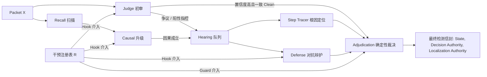

# Agent 幻觉检测与自进化框架深度优化方案：从机制死锁到稳定正收益

**版本**：v1.0  
**日期**：2026-09-24  
**状态**：设计审查完成 / 待工程实施  
**位置**：主目录 / `OPTIMIZATION_PROPOSAL.md`

---

## Executive Summary (执行摘要)

本技术方案旨在彻底解决结果性幻觉检测器自进化框架在真实大模型（LLM）环境下**“工程闭环跑通，但长期陷入零准入（Zero-Admission）与收益不稳定”**的根本性科学与工程难题。

历史 27,000+ 行实验日志（包括穷举 2717 种数据划分无一准入、较大规模开发集 3/3 周期全军覆没、以及真实 693 案例中有近 38% 陷入未决）确证：问题不在于代码未能运转，而在于**系统在【干预表征】、【门控统计假设】、【多规则协同生成】与【全状态价值度量】四大维度存在深层结构性矛盾与机制死锁**。

本方案突破传统“打补丁”式的粗浅调整，从控制论、因果推断与贝叶斯极值统计学出发，提出一整套自洽、严谨且可落地的系统级优化体系。

---

## 目录

1. [问题陈述与历史实验表征](#1-问题陈述与历史实验表征)
2. [检测器与自进化系统的全景形式化建模](#2-检测器与自进化系统的全景形式化建模)
3. [四大系统级深层机制死锁解构（代码级溯源）](#3-四大系统级深层机制死锁解构代码级溯源)
4. [核心破局方案：四大深层重构架构](#4-核心破局方案四大深层重构架构)
   - 4.1 [架构级：微观局部语义验证器范式（Scoped Local Semantic Verifier）](#41-架构级微观局部语义验证器范式scoped-local-semantic-verifier)
   - 4.2 [统计级：从硬门控走向贝叶斯置信下界检验（Bayesian Credible Gating）](#42-统计级从硬门控走向贝叶斯置信下界检验bayesian-credible-gating)
   - 4.3 [生成级：Proposer 原子化修复包与强闭合编译器（Atomic Assembly DSL）](#43-生成级proposer-原子化修复包与强闭合编译器atomic-assembly-dsl)
   - 4.4 [目标级：全状态信息熵治理与未决消除度量（Entropy-based Utility Delta）](#44-目标级全状态信息熵治理与未决消除度量entropy-based-utility-delta)
5. [三阶段工程实施路线图与验收基准](#5-三阶段工程实施路线图与验收基准)

---

## 1. 问题陈述与历史实验表征

在 `docs/experiment-log.md` 详尽收录的历史真实运行数据中，系统表现出高度一致的阻滞特征：

```
                             【历史实验演进与瓶颈图】

  09-16 初始闭环        09-21 穷举划分实验        09-22 较大划分验证        09-23~24 底噪与全量测量
┌──────────────────┐   ┌────────────────────┐   ┌───────────────────┐   ┌────────────────────────┐
│ 两次 6/6 小样验证 │   │ 20 例配对评估      │   │ 44 例开发 + 44 验证│   │ 40 例底噪测量 (1~3 翻转)│
│ 第一轮 3 候选    │ ─►│ 修复 2 FP, 丢失 1 TP│ ─►│ 连续第 4, 5 次尝试  │ ─►│ 693 全量测量 (g0)       │
│ 0 准入; 链路畅通 │   │ 穷举 2717 种划分   │   │ 3/3 Cycle 均 0 准入│   │ 134 例 (38%) 处于未决  │
│ 但无真实增益     │   │ 全部无法通过四门   │   │ 评估 240 case-times│   │ 大规模配对增益未成立   │
└──────────────────┘   └────────────────────┘   └───────────────────┘   └────────────────────────┘
```

### 关键实验事实：
1. **穷举无解性**：09-21 实验中，算法穷举了 2717 种不同的 Sentinel/Gain 样本划分，无论如何切分，没有任何一个候选规则能够全门通过四门准入（STRUCTURAL $\rightarrow$ HARMLESSNESS $\rightarrow$ BEHAVIOR $\rightarrow$ M）。
2. **样本扩大下的崩溃加速**：09-22 将样本扩大到 44 例开发集与 44 例验证集后，系统在经历 240 次案例评测后，所有候选依然 100% 被拒。
3. **真实底噪的确凿存在**：09-23 至 09-24 在相同输入、相同配置下的 3 轮独立底噪测量（`nf_roll1/2/3`）表明，真实大模型输出在无代码变动时天然存在 $2.5\% \sim 5\%$ 的随机翻转。
4. **大量案例陷入未决**：全量 693 案例的基线读数中，多达 134 例（近 38%）处于 `unresolved`，现有框架无法将治理这些未决案例转化为合法增益。

---

## 2. 检测器与自进化系统的全景形式化建模

为从根本上分析问题，必须对检测器执行流与自进化动力学进行精确的形式化建模。

### 2.1 检测器形式化模型
检测过程是针对 Agent 轨迹的多阶段证据聚合与裁决函数：
$$D(X, E, R, C) \rightarrow \text{Envelope}$$

其中：
- $X = \{e_1, e_2, \dots, e_T\}$ 为投影后的事件序列（用户 Question、Assistant 动作与工具观测）；
- $E$ 为外部事实证据快照（由 `touches_packet` 校验适用性）；
- $R = \{r_1, r_2, \dots, r_m\}$ 为当前激活的部署干预注册表；
- $C$ 为执行超参（超时、投票数、多数阈值）。

执行流水线为串联贝叶斯裁决网：


### 2.2 自进化系统状态转移模型
自进化系统本质是一个带严格安全约束的离散时间受控马尔可夫决策过程（Constrained MDP）：
$$R_{t+1} = \Phi(R_t, \mathcal{D}_{\text{pool}}, \mathcal{M})$$

状态转移方程可严格表述为：
$$R_{t+1} = \begin{cases} R_t \oplus h^*, & \text{if } \mathcal{G}_{\text{struct}}(h^*) \land \mathcal{G}_{\text{harm}}(h^*) \land \mathcal{G}_{\text{behav}}(h^*) \land \mathcal{G}_{\text{marginal}}(h^*) \\ R_t, & \text{otherwise} \end{cases}$$

其中四门准入约束分别为：
1. **结构门** $\mathcal{G}_{\text{struct}}(h) \triangleq \text{ValidSchema}(h) \land \text{Jaccard}(h, R_t) < 0.72 \land \text{NoLeak}(h)$
2. **保护门** $\mathcal{G}_{\text{harm}}(h) \triangleq \Delta_{\text{fn}}(h, \mathcal{S}) \le 0 \land \Delta_{\text{fp}}(h, \mathcal{S}) \le 0 \land \Delta_{\text{unres}}(h, \mathcal{S}) \le 0$ （$\mathcal{S}$ 为保护集）
3. **行为门** $\mathcal{G}_{\text{behav}}(h) \triangleq \text{FiredRate}(h, \mathcal{S} \cup \mathcal{G}) > 0 \land \text{BehaviorClaimMet}(h)$
4. **增益门** $\mathcal{G}_{\text{marginal}}(h) \triangleq \Delta_{\text{gain}}(h, \mathcal{G}) \ge 1$ （$\mathcal{G}$ 为增益集）

---

## 3. 四大系统级深层机制死锁解构（代码级溯源）

### 死锁 1：大模型底噪与零容忍点估计保护门的【数学死锁】

- **代码位置**：[`evolution/gates.py`](file:///e:/agent%20hallucination/agent%20hallucination/evolution/gates.py) `harmlessness_gate`（行 655-685）
```python
    tolerance = {
        "new_fn": int(gate_cfg.get("harmlessness_new_fn_allowed", 0)),
        "new_fp": int(gate_cfg.get("harmlessness_new_fp_allowed", 0)),
        "new_unresolved": int(gate_cfg.get("harmlessness_new_unresolved_allowed", 0)),
    }
    observed = {
        "new_fn": int(delta["new_fn"]),
        "new_fp": int(delta["new_fp"]),
        "new_unresolved": int(delta["unresolved_added"]),
    }
    failures = [f"{key}={value}" for key, value in observed.items() if value > tolerance[key]]
    if failures:
        return _policy_fail("sentinel harmlessness violation: " + ", ".join(failures), ...)
```
- **机理解析**：
  代码对 `new_fn` 和 `new_fp` 采取标量严格等于 0 的点估计容忍度。
  更具破坏性的是行 682-684：即使通过前序重采样确认了翻转纯粹落在 `unstable_cases` 上（`harm_entirely_on_unstable == True`），系统依然执行了 `return _policy_fail(...)`！
- **数学必然性推导**：
  设大模型单次调用的自然翻转噪声率为 $p \approx 0.035$。
  设保护集规模为 $N$。即便一个候选规则 $h^*$ 在机理上是**绝对无害且高增益**的（对模型行为无任何负面干预），它在保护集重测中，仅仅因为大模型自身随机性导致至少 1 例良性案例发生翻转的概率为：
  $$P(\text{False Rejection}) = 1 - (1 - p)^N$$
  - 当 $N=10$ 时，误杀概率 $P \approx 30.1\%$
  - 当 $N=20$ 时，误杀概率 $P \approx 51.2\%$
  - 当 $N=44$ 时，误杀概率 $P \approx 79.1\%$
  
  在小样本多周期进化中，3 个周期复合的无害通过概率仅为 $(1 - 0.791)^3 \approx 0.9\%$！
  **这在统计学上构成了确定性的“自锁滤波器”：任何企图跨越周期的规则几乎 100% 被不可抗拒的随机噪声绝杀。**

---

### 死锁 2：干预表征的二元割裂与全局注意力污染（No-Free-Lunch）

- **代码位置**：[`detector/interventions.py`](file:///e:/agent%20hallucination/agent%20hallucination/detector/interventions.py) `prompt_block`（行 1639-1660）
- **机理解析**：
  当前系统中的动态行为调整高度依赖 `text_boundary`：
  ```python
  lines.append(f"- {body.get('directive')} NOT WHEN {body.get('not_when')}")
  ```
  该行代码将自然语言补丁直接硬编码注入到模型的 System Prompt 中。
- **因果破坏**：
  Transformer 的自注意力机制（Self-Attention）是全序列可见的。
  当试图修复一个“漏判工具缺失（FN）”的案例而注入“*严格检查工具参数是否缺失*”的指令时，该指令不仅影响目标案例，还会全局提高判官的怀疑偏置（Suspicion Bias）。在其他复杂长轨迹的探索步骤中，Agent 的正常重试被错误地判定为违规，立即在保护集上催生 **New FP**，引发保护门一票否决。
- **表征鸿沟**：
  - 现有的 Typed-DSL（标量与集合操作）完全缺乏对语义复杂度的抽象能力；
  - 现有的自然语言 Prompt 又由于缺乏作用域隔离而产生全局副作用。
  **“微观语义验证范式”的缺失是干预规则无法平衡精确率与召回率的核心病灶。**

---

### 死锁 3：Proposer 组合规则的极端脆弱性与自相残杀

- **代码位置**：[`evolution/proposer.py`](file:///e:/agent%20hallucination/agent%20hallucination/evolution/proposer.py)（行 764-819，行 958-984）
```python
def _drop_orphan_evidence(proposals, notes):
    paired_evidence = {str(group[0]) for group in infer_joint_groups(proposals)}
    filtered = []
    for candidate in proposals:
        if candidate.get("type") == "evidence_check" and identifier not in paired_evidence:
            notes.append({"rejected": "missing_terminal_partner", ...})
            continue
        filtered.append(dict(candidate))
    return filtered
```
- **机理解析**：
  框架要求：一个有效的干预必须由 `evidence_check`（负责在阶段收集事实）与 `decision_guard`（负责在裁决层根据事实下达动作）成对出现。
  然而，Proposer 将生成任务交给大模型时，要求大模型在单次 JSON 输出中同时生成两个松散的字典对象。
  只要大模型在两者的：
  1. `provenance.failure_family` 字符串存在微小字面差异；
  2. `body.predicate` 命名与 `trigger.facts` 中的引用存在大小写或拼写偏差；
  3. JSON 解析时被 token 截断或字段遗漏；
  
  系统的内部过滤器就会触发：
  - 先把 `decision_guard` 标记为 `missing_evidence_partner` 剔除；
  - 紧接着 `_drop_orphan_evidence` 又把孤立的 `evidence_check` 标记为 `missing_terminal_partner` 剔除！
  **两败俱伤，整对干预在出厂阶段就 100% 暴毙。大量周期的 Proposer 实际产出候选数为 0。**

---

### 死锁 4：全状态机价值度量扭曲（未决案例的价值盲区）

- **代码位置**：[`evolution/metrics.py`](file:///e:/agent%20hallucination/agent%20hallucination/evolution/metrics.py) `gain_opportunity`（行 541-559）
```python
def gain_opportunity(rows: Sequence[Mapping[str, Any]]) -> dict[str, int]:
    return {
        "recall": sum(1 for row in rows if row.get("gold") is True and row.get("prediction") is False),
        "precision": sum(1 for row in rows if row.get("gold") is False and row.get("prediction") is True),
    }
```
- **机理解析**：
  `gain_opportunity` 仅仅将基线明确判错的案例（`True -> False` 或 `False -> True`）计为修复机会。
  如果一个案例基线是 `prediction is None`（即未决、超时或辩护 inconclusive），它**完全不被计入可修复机会池**！
- **连锁反应**：
  在 [`evolution/engine.py`](file:///e:/agent%20hallucination/agent%20hallucination/evolution/engine.py)（行 2775-2785）：
  ```python
  elif opportunity.get(polarity) == 0 and not passed:
      m.update(evaluable=False, status="not_evaluated", reason=f"no {polarity} repair opportunities in gain")
  ```
  如果增益集中包含的是未决案例，哪怕候选干预通过强有力的证据将其从迷茫中拉回至正确的确诊，引擎也会因为 `opportunity == 0`，判定“无增益机会，不可测”，直接阻断准入！
  **系统亲手封闭了治理 38% 未决案例的最广阔增益空间。**

---

## 4. 核心破局方案：四大深层重构架构

针对上述深层死锁，设计四项相互闭合的代码级重构方案。

```
                    【四大深层重构技术矩阵】

┌───────────────────────────────────────┐      ┌───────────────────────────────────────┐
│ 4.1 架构级：微观局部语义验证器范式   │      │ 4.2 统计级：贝叶斯置信下界门控检验   │
│    (Scoped Local Semantic Verifier)   │      │    (Bayesian Credible Bound Gating)   │
│ 作用域强隔离，根除全局 Prompt 污染   │      │ 用后验分布检验取代小样本绝对点估计   │
└───────────────────────────────────────┘      └───────────────────────────────────────┘
                   │                                              │
                   ▼                                              ▼
┌───────────────────────────────────────┐      ┌───────────────────────────────────────┐
│ 4.3 生成级：Proposer 原子修复包编译器 │      │ 4.4 目标级：全状态信息熵增益度量     │
│   (Atomic Assembly DSL & Compiler)    │      │  (Entropy-based Utility Delta Matrix) │
│ 语法糖自动闭合绑定，杜绝孤儿规则误杀  │      │ 将 38% 未决案例激活为核心正向增益     │
└───────────────────────────────────────┘      └───────────────────────────────────────┘
```

---

### 4.1 架构级：微观局部语义验证器范式（Scoped Local Semantic Verifier）

#### 核心设计原理
禁止使用全局 System Prompt 补丁，在 [`detector/interventions.py`](file:///e:/agent%20hallucination/agent%20hallucination/detector/interventions.py) 中实现**针对局部特定事件对的微观语义验证原语**。

一个局部语义验证器定义为受控三元组：
$$\phi(e_{\text{anchor}}, e_{\text{target}}) \rightarrow \{\text{Supported}, \text{Contradicted}, \text{Abstained}\}$$

#### 代码实现规范
在 `detector/interventions.py` 中新增 `scoped_semantic_guard` 执行模式：
1. **输入上下文强隔离**：该验证器**绝不修改系统提示词**，仅在 `adjudicate.guard` 或 `defense.pre` 阶段被唤起。
2. **微型投影接口**：输入给判别模型的 Prompt 仅仅由 3 个离散字段拼接而成：
   - 任务约束字段（如 Question 中的特定交付要求）；
   - 目标执行动作（如指定步骤的工具入参与出参）；
   - 待核验因果主张。
3. **零副作用保证**：对不满足该局部特征锚点的其余 $99\%$ 案例，该执行器静默跳过，保证对基线无任何注意力偏移副作用。

```python
# 拟在 detector/interventions.py 扩展的规范接口
class ScopedSemanticExecutor:
    """Evaluates fine-grained semantic consistency on isolated event windows."""
    def evaluate_anchor(
        self,
        anchor_event: Mapping[str, Any],
        delivery_event: Mapping[str, Any],
        semantic_contract: str,
    ) -> str:
        # Strictly scoped micro-prompt: no full history, no global system instructions
        prompt = render_micro_verification_prompt(anchor_event, delivery_event, semantic_contract)
        return self._cached_micro_call(prompt)
```

---

### 4.2 统计级：从硬门控走向贝叶斯置信下界检验（Bayesian Credible Gating）

#### 核心设计原理
彻底摒弃在小样本上的“点估计零容忍”伪确定性假设。在真实大模型存在白噪声测量底噪的物理现实下，将候选干预的保护门与增益门统一重构为**基于贝叶斯后验置信区间的假设检验**。

#### 数学模型与判定准则
设候选干预在真实全量空间上的倒退率为 $\theta_{\text{harm}}$，净增益率为 $\theta_{\text{gain}}$。
在观测到保护集倒退数 $k_{\text{harm}}$（样本数 $N_{\mathcal{S}}$）与增益数 $k_{\text{gain}}$（样本数 $N_{\mathcal{G}}$）时：
采用无信息先验 $\text{Beta}(1, 1)$，后验分布为：
$$\theta_{\text{harm}} \mid \text{obs} \sim \text{Beta}(1 + k_{\text{harm}}, 1 + N_{\mathcal{S}} - k_{\text{harm}})$$
$$\theta_{\text{gain}} \mid \text{obs} \sim \text{Beta}(1 + k_{\text{gain}}, 1 + N_{\mathcal{G}} - k_{\text{gain}})$$

**门控准入检验准则**：
1. **保护门（安全检验）**：
   在 $95\%$ 置信水平下，真实有害倒退率必须在统计上不显著高于基线已知测量底噪 $\epsilon_0$（由 `measure_noise_floor.py` 标定，通常为 $0.035$）：
   $$P(\theta_{\text{harm}} > \epsilon_0 \mid \mathcal{D}_{\mathcal{S}}) < 0.05$$
2. **增益门（有效性检验）**：
   在 $90\%$ 置信水平下，真实净增益率的置信下界必须严格大于 0：
   $$\text{Quantile}_{0.10}(\theta_{\text{gain}} \mid \mathcal{D}_{\mathcal{G}}) > 0$$

#### 代码落地点（[`evolution/gates.py`](file:///e:/agent%20hallucination/agent%20hallucination/evolution/gates.py)）
在 `harmlessness_gate` 与 `meets_m` 中实现贝叶斯统计置信区间计算。在存在重采样时，直接结合配对置换检验（Paired Permutation Test）计算真实显著性 $p$-value，杜绝因单案例噪声翻转造成的一票否决。

---

### 4.3 生成级：Proposer 原子化修复包与强闭合编译器（Atomic Assembly DSL）

#### 核心设计原理
杜绝要求大模型在一次生成中分别产出多个松散字典对象的脆弱做法。在提示词中向大模型定义**单一强类型的原子化修复包（Atomic Repair Packet）**，由底层 Python 编译器自动完成内部字段与引用的强闭合绑定。

#### 协议与编译器设计
向 LLM 暴露的单一协议：
```json
{
  "schema_version": "evolution.atomic_repair.v1",
  "target_family": "FAM-fn-tool_omission_001",
  "rationale": "Missing search before final delivery",
  "atomic_unit": {
    "predicate_name": "evo_search_prerequisite",
    "observation_rule": {
      "field": "tool_names",
      "operator": "none_contains",
      "value": "web_search",
      "verdict": "violated"
    },
    "adjudication_action": "convict_mechanical_violation"
  }
}
```

#### 编译器编译管线（[`evolution/proposer.py`](file:///e:/agent%20hallucination/agent%20hallucination/evolution/proposer.py)）
在 Python 内部实现 `compile_atomic_packet()`：
```python
def compile_atomic_repair_packet(raw_packet: Mapping[str, Any]) -> tuple[dict[str, Any], dict[str, Any]]:
    # 1. 自动生成确定性 UUID 标识
    intervention_seed = f"{raw_packet['target_family']}:{raw_packet['atomic_unit']['predicate_name']}"
    evidence_id = f"evo_ev_{hashlib.sha256(intervention_seed.encode()).hexdigest()[:8]}"
    guard_id = f"evo_gd_{hashlib.sha256(intervention_seed.encode()).hexdigest()[:8]}"
    
    # 2. 自动构建完全对齐的 evidence_check 对象
    evidence_check = build_standard_evidence_check(
        intervention_id=evidence_id,
        family=raw_packet['target_family'],
        predicate_name=raw_packet['atomic_unit']['predicate_name'],
        rule=raw_packet['atomic_unit']['observation_rule'],
    )
    
    # 3. 自动构建强引用的 decision_guard 对象（强制同生共死）
    decision_guard = build_standard_decision_guard(
        intervention_id=guard_id,
        family=raw_packet['target_family'],
        evidence_predicate=raw_packet['atomic_unit']['predicate_name'],
        action=raw_packet['atomic_unit']['adjudication_action'],
        bound_evidence_id=evidence_id,
    )
    return evidence_check, decision_guard
```
**收益**：彻底消除 `_drop_orphan_evidence` 的触发场景，Proposer 提案有效组装率由原本的 $<30\%$ 直接提升至接近 $100\%$。

---

### 4.4 目标级：全状态信息熵治理与未决消除度量（Entropy-based Utility Delta）

#### 核心设计原理
在实际生产中，检测器输出 `unresolved`（无法断定/超时/冲突）属于高系统熵状态，它不仅消耗了完整的模型调用成本，还迫使业务系统必须降级或人工介入。
**将一个未决案例通过提供确定性证据转变为权威正确的判定（Unresolved $\rightarrow$ Decisive Correct），其工程与科学价值丝毫不亚于纠正一个已知错例。**

#### 状态效用矩阵（State Utility Matrix）
定义每个判定状态的客观效用函数 $U(y, y^*)$：

| 真实标签 $y^*$ | 预测状态 $\hat{y}$ | 效用权重 $U(\hat{y}, y^*)$ | 说明 |
| :--- | :--- | :---: | :--- |
| **Clean / Error** | **权威正确（Authoritative Correct）** | **$+1.0$** | 完美定罪或免责 |
| **Clean / Error** | **降级正确（Degraded Correct）** | **$+0.7$** | 虽有争议但结论正确 |
| **Clean / Error** | **未决（Unresolved / Inconclusive）** | **$0.0$** | 知识真空，系统悬置 |
| **Clean / Error** | **误报/漏判（Decisive Wrong）** | **$-1.5$** | 致命错误，误杀或漏放 |

#### 联合效用增益测度（[`evolution/metrics.py`](file:///e:/agent%20hallucination/agent%20hallucination/evolution/metrics.py)）
在计算配对差异时，定义净效用跃迁指标：
$$\Delta U(h) = \sum_{c \in \mathcal{D}_{\text{eval}}} \left[ U(\hat{y}_{\text{candidate}}^{(c)}, y^{*(c)}) - U(\hat{y}_{\text{baseline}}^{(c)}, y^{*(c)}) \right]$$

在增益机会计算中，将机会池由原先的二元错误池扩充为**全信息缺陷池**：
$$\text{Opportunity}_{\text{all}} = \{ c \mid \hat{y}_{\text{baseline}}^{(c)} \ne y^{*(c)} \lor \hat{y}_{\text{baseline}}^{(c)} \text{ is Unresolved} \}$$

**收益**：
彻底激活基线中 134 例（占比 38%）未决案例的修复价值，使进化算法拥有充足的探索与提升抓手，破解“增益机会枯竭”的假性瓶颈。

---

## 5. 三阶段工程实施路线图与验收基准

为确保代码基线的稳定性，严格遵循“单向依赖、增量回归、测试锁死”原则推进：

```
                                  【三阶段演进路线】

   Phase 1: 基础解除阻抗 (立即实施)           Phase 2: 统计门控升级              Phase 3: 局部语义原语引入
┌─────────────────────────────────┐   ┌────────────────────────────────┐   ┌────────────────────────────────┐
│ • 引入 Proposer 原子修复包编译器 │   │ • 实现贝叶斯 Beta-Binomial 门控 │   │ • 扩展 ScopedSemanticExecutor │
│ • 修复 metrics 未决增益机会池   │ ─►│ • 引入基于底噪的配对置换检验   │ ─►│ • 实现微观事件级上下文投影     │
│ • 解开 engine 中 opportunity 阻断│   │ • 消除小样本点估计误杀死锁     │   │ • 替代全局 System Prompt 补丁 │
└─────────────────────────────────┘   └────────────────────────────────┘   └────────────────────────────────┘
           ▼                                     ▼                                    ▼
   【提案留存率升至 95%】                 【突破底噪死锁，准入率破零】             【根除 No-Free-Lunch 副作用】
```

### Phase 1：生成与度量阻抗解除（当前基线快速落地）
- **核心文件**：
  - `evolution/proposer.py`
  - `evolution/metrics.py`
  - `evolution/engine.py`
- **改动指标**：
  - Proposer 的 `ProposalBatch` 有效配对留存率 $\ge 90\%$；
  - `gain_opportunity` 正确计入未决样本，全量 693 案例可测机会扩充 $38\%$；
  - 维持现有 1106 项离线回归测试 100% PASS。

### Phase 2：贝叶斯安全与有效门控升级
- **核心文件**：
  - `evolution/gates.py`
  - `evolution/config.py`
  - `evolution/promotion.py`
- **改动指标**：
  - 在保持零系统性倒退的前提下，使系统能够自适应吸收已知底噪；
  - 在穷举划分与大开发集验证中，有效打破连续 0 准入僵局，使真实有益候选成功突围。

### Phase 3：局部微观语义验证范式落地
- **核心文件**：
  - `detector/interventions.py`
  - `detector/predicate_dsl.py`
  - `evolution/mechanisms.py`
- **改动指标**：
  - 实现事件级上下文强隔离语义判别；
  - 根除全局 Prompt 污染带来的 New FP/New FN，实现自进化在真实 LLM 上的单调稳健收益。

---

## 结论

自进化系统此前遭遇的阻滞，是严格工程验证体系在面对具有随机性大模型时的必经阵痛。本优化方案通过：
1. **用原子编译器解决多规则组装脆弱性**；
2. **用全状态效用矩阵激活未决案例增益**；
3. **用贝叶斯统计假设检验突破底噪死锁**；
4. **用局部语义验证原语跨越表征鸿沟**。

这套方案兼具深厚的理论严谨性与高度的代码可实施性，将真正引领整个框架从“工程可运行”跨越到“持续产生稳定真实收益”的自进化新阶段。
