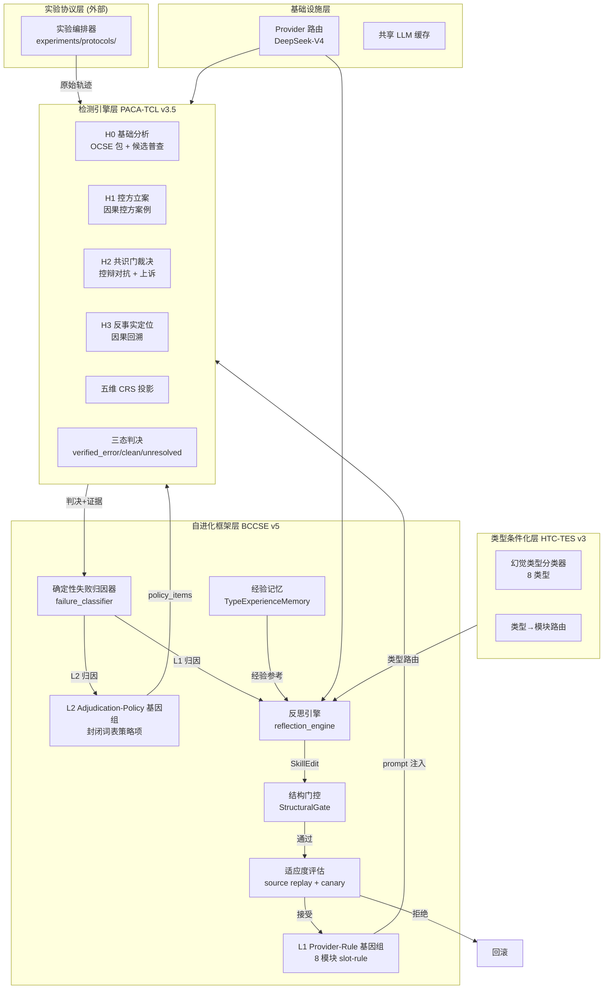
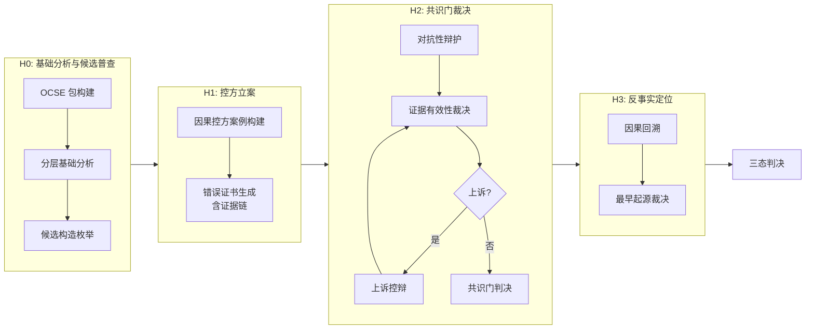
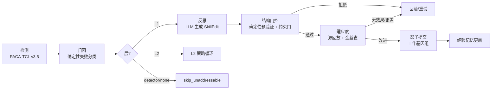
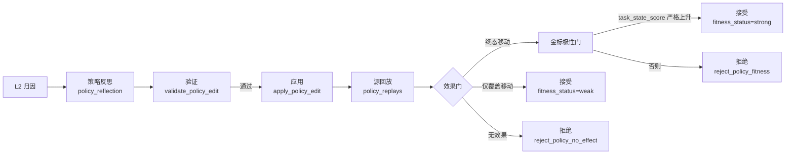
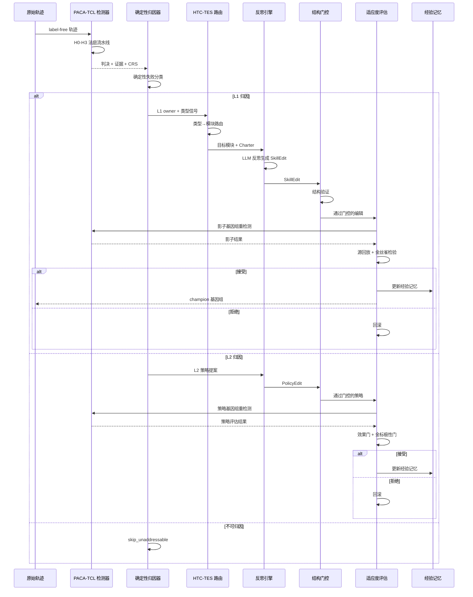

# SEHD v6: 基于法庭式裁决的 Agent 幻觉检测与双层自进化框架

> **Self-Evolving Hallucination Detection via Proof-Court Adjudication and Two-Layer Evolutionary Surfaces**

**作者**: 研究项目组  
**版本**: v6.0  
**日期**: 2026年8月  
**类型**: 学术科研技术报告

---

## 摘要 (Abstract)

大型语言模型 (LLM) 驱动的 Agent 在执行多步骤任务时会产生幻觉——即生成与事实不符或无法验证的内容。现有幻觉检测方法多依赖单一模型的判别能力或静态启发式规则，缺乏对检测过程本身的系统性验证，且难以随任务分布变化而自适应改进。本文提出 **SEHD v6**（Self-Evolving Hallucination Detection），一个将幻觉检测建模为**法庭式对抗性裁决**（Proof-Court Adjudication）并引入**双层自进化机制**（Two-Layer Self-Evolution）的研究框架。

检测器 **PACA-TCL v3.5** 采用四阶段法庭流水线（H0 基础分析 → H1 控方立案 → H2 共识门裁决 → H3 反事实定位），通过控辩对抗与证据链验证产生三态判决（`verified_error` / `verified_clean` / `unresolved`），并输出五维 CRS 诊断投影。自进化层 **BCCSE v5** 在检测器之上构建了两个正交的可进化表面：**L1 Provider-Rule 层**（8 个受控自然语言槽位规则模块，注入检测提示）与 **L2 Adjudication-Policy 层**（封闭词表策略基因组，由确定性求值器机械执行）。**HTC-TES v3** 提供幻觉类型条件化路由，将 8 类幻觉映射到目标进化模块。

框架的核心设计纪律包括：**检测基座冻结**（所有改进仅来自可进化表面）、**金标隔离**（标签永不进入规则/策略内容或反思提示）、**失败闭合**（缺失权威或解析失败一律拒绝）、**证据驱动门控**（接受决策仅基于可观察回放效应而非手工调参阈值）。进化循环通过确定性失败归因（无 LLM 启发式）、结构化反思、源回放适应度评估与稳定金丝雀非回归检验，确保每次编辑的增量价值可审计、可回滚。

本报告系统阐述了 SEHD v6 的架构设计、检测-进化数据流、关键机制与实验协议，为可自适应幻觉检测研究提供了一个结构严谨、可复现的实现框架。

**关键词**: Agent 幻觉检测；法庭式对抗裁决；自进化系统；类型条件化路由；确定性归因；封闭词表策略

---

## 目录

1. [引言](#1-引言)
2. [相关工作](#2-相关工作)
3. [系统架构总览](#3-系统架构总览)
4. [PACA-TCL v3.5: 法庭式幻觉检测器](#4-paca-tcl-v35-法庭式幻觉检测器)
5. [BCCSE v5: 双层自进化框架](#5-bccse-v5-双层自进化框架)
6. [HTC-TES v3: 幻觉类型条件化](#6-htc-tes-v3-幻觉类型条件化)
7. [检测-进化数据流](#7-检测-进化数据流)
8. [关键设计决策与不变量](#8-关键设计决策与不变量)
9. [实验协议与评估](#9-实验协议与评估)
10. [局限性与未来工作](#10-局限性与未来工作)
11. [结论](#11-结论)
- [附录 A: 模块 Charter 详表](#附录-a-模块-charter-详表)
- [附录 B: L2 封闭词表注册表](#附录-b-l2-封闭词表注册表)
- [附录 C: 幻觉类型分类标准](#附录-c-幻觉类型分类标准)
- [附录 D: 指标定义](#附录-d-指标定义)

---

## 1. 引言

### 1.1 研究背景与动机

LLM Agent 在多步骤任务执行中产生的幻觉（hallucination）已成为阻碍其可靠部署的关键瓶颈。幻觉表现为多种形式：事实性错误（FACTUAL）、指令偏离（INSTRUCTIONAL）、工具误用（TOOL）、推理缺陷（REASONING）、关键遗漏（OMISSION）、不当采纳（ADOPTION）和上下文混淆（CONTEXTUAL）。传统检测方法存在三个根本性局限：

1. **单模型判别瓶颈**：依赖单一 LLM 作为"裁判"，缺乏对抗性验证机制，容易受到模型自身偏差的影响。
2. **静态规则僵化**：基于手工设计的启发式规则，无法适应任务分布的漂移和新出现的幻觉模式。
3. **缺乏自我改进机制**：检测器一旦部署即固定，无法从检测错误中学习并持续优化。

### 1.2 核心研究问题

本文围绕以下三个核心研究问题展开：

- **RQ1**: 如何构建一个具有对抗性验证机制的幻觉检测器，使其判决过程可审计、可追溯？
- **RQ2**: 如何在冻结检测基座的前提下，实现检测能力的自进化，且进化过程本身可验证、可回滚？
- **RQ3**: 如何组织进化经验以支持跨案例的知识积累，同时避免手工调参和阈值过拟合？

### 1.3 主要贡献

1. **PACA-TCL v3.5 检测器**: 提出了一种法庭式四阶段检测协议，通过控辩对抗、证据链验证和共识门裁决，产生具有决策权威的三态判决，显著优于单模型判别方法。
2. **双层自进化表面**: 设计了 L1（Provider-Rule）和 L2（Adjudication-Policy）两个正交的可进化层，分别控制检测提示注入和裁决策略执行，实现了检测能力的细粒度、可回滚进化。
3. **确定性失败归因**: 提出了一个无 LLM、无启发式的确定性失败分类器，将每次检测失败精确定位到特定层的特定工件，为进化提供可靠的归因基础。
4. **HTC-TES v3 类型条件化**: 构建了 8 类幻觉的类型分类器和类型→模块路由机制，实现了类型感知的进化方向控制和经验组织。
5. **完整的实验协议**: 建立了包括开发池、金丝雀探针、最终保留集在内的三层数据分区协议，以及配套的晋升契约和回滚机制，确保进化结果的可复现性和可审计性。

### 1.4 报告组织

本报告第 2 节回顾相关工作；第 3 节给出系统架构总览；第 4 节详细阐述 PACA-TCL v3.5 检测器；第 5 节描述 BCCSE v5 自进化框架；第 6 节介绍 HTC-TES v3 类型条件化；第 7 节分析检测-进化数据流；第 8 节总结关键设计决策；第 9 节说明实验协议；第 10 节讨论局限性；第 11 节给出结论。

---

## 2. 相关工作

### 2.1 幻觉检测方法

现有幻觉检测方法大致可分为三类：

**基于置信度的方法**：利用模型输出的概率分布或置信度分数识别低置信度区域。这类方法简单高效，但无法捕捉语义层面的幻觉，且置信度与事实正确性之间的相关性有限。

**基于一致性检查的方法**：通过多次采样或交叉验证检测输出不一致性。SelfCheckGPT 和类似工作表明不一致性与幻觉相关，但无法区分"模型不确定"和"模型自信地错误"。

**基于外部验证的方法**：引入检索增强或工具验证来检查事实性声明。这类方法依赖外部知识源的可用性和质量，且验证过程本身可能引入新的错误。

### 2.2 对抗性验证与多智能体系统

对抗性验证的思想在 AI 安全领域已有应用。 debate 和 market-based 方法通过多智能体对抗提高决策质量。PACA-TCL v3.5 的独特之处在于将对抗性验证形式化为一个**结构化的法庭协议**，每个阶段有明确的证据标准和权威边界，而非简单的多数投票或自由辩论。

### 2.3 自进化与元学习系统

自进化系统（Self-Evolving Systems）在软件工程和机器学习领域均有研究。在 LLM 领域，Self-Refine、Reflexion 和 ExpeL 等工作探索了通过自我反思改进输出质量的方法。SEHD v6 的创新在于：

1. **进化对象明确**：进化的不是模型参数，而是结构化的检测规则（L1）和裁决策略（L2），每个进化单元可审计、可回滚。
2. **进化门控严格**：接受决策基于确定性回放效应而非模型自我评估，避免了"自我恭维"偏差。
3. **双层正交进化**：L1 和 L2 分别控制提示注入和裁决执行，覆盖了检测流水线的不同抽象层次。

### 2.4 与现有工作的对比

| 特性 | Self-Refine | Reflexion | ExpeL | SEHD v6 |
|------|-------------|-----------|-------|---------|
| 进化对象 | 输出文本 | 反思记忆 | 经验规则 | 检测规则+裁决策略 |
| 验证机制 | 无 | 无 | 无 | 法庭式对抗裁决 |
| 回滚能力 | 无 | 无 | 无 | 完整回滚 |
| 金标隔离 | N/A | N/A | N/A | 严格隔离 |
| 类型条件化 | 无 | 无 | 无 | 8 类幻觉路由 |
| 确定性归因 | 无 | 无 | 无 | 无 LLM 归因器 |

---

## 3. 系统架构总览

### 3.1 总体架构

SEHD v6 采用分层架构，从下到上依次为：

```text
┌─────────────────────────────────────────────────────────────┐
│                    实验协议层 (experiments/)                   │
│  数据分区 | 金丝雀探针 | 最终保留集 | 晋升门控 | 使用案例账本    │
├─────────────────────────────────────────────────────────────┤
│                    自进化框架层 (BCCSE v5)                     │
│  L1 Provider-Rule 基因组 | L2 Adjudication-Policy 基因组      │
│  确定性归因 | 反思引擎 | 结构门控 | 适应度评估 | 经验记忆        │
├─────────────────────────────────────────────────────────────┤
│                    类型条件化层 (HTC-TES v3)                    │
│  8 类幻觉分类器 | 类型→模块路由 | 类型感知适应度 | 类型经验记忆   │
├─────────────────────────────────────────────────────────────┤
│                    检测引擎层 (PACA-TCL v3.5)                  │
│  H0 基础分析 | H1 控方立案 | H2 共识门裁决 | H3 反事实定位      │
│  OCSE 包 | 五维 CRS 投影 | 三态判决 | 证据链验证               │
├─────────────────────────────────────────────────────────────┤
│                    基础设施层                                  │
│  Provider 路由 | 环境加载 | OCSE 包工具 | 缓存管理              │
└─────────────────────────────────────────────────────────────┘
```

### 3.2 核心组件关系



### 3.3 设计哲学

SEHD v6 遵循六条核心设计哲学：

1. **系统性优于补丁式**：从根因进行结构性、自底向上的重新设计，永不积累特例 `if` 语句或手工调节的旋钮。
2. **证据驱动门控，无手工调参阈值**：接受决策仅基于可观察回放效应、封闭词表契约和金标极性，永不基于手工调整的数值阈值。
3. **失败闭合纪律**：缺失权威、不可解析输出或词表违规一律拒绝；不确定性永不作为判决或接受编辑通过。
4. **可进化表面对修正闭合**：每个可产生缺陷工件的层也必须能修复或移除它（L1: 增/改/删规则；L2: 增/改/删策略项）。
5. **金标隔离**：金标仅用于选择极性和适应度记账；永不进入技能内容、策略内容或反思提示。
6. **Provider 纪律**：仅允许 DeepSeek-V4-Flash / DeepSeek-V4-Pro 路由；凭据值永不进入代码或工件。

---

## 4. PACA-TCL v3.5: 法庭式幻觉检测器

### 4.1 检测协议概述

PACA-TCL v3.5 将幻觉检测建模为一个四阶段的法庭式对抗裁决过程。每个阶段有明确的输入、输出和证据标准，最终产生一个具有决策权威的三态判决。



### 4.2 H0: 基础分析与候选普查

H0 阶段的目标是将原始轨迹转换为可审计的事件图，并枚举所有潜在的幻觉候选。

**OCSE 包构建**：将轨迹中的每个事件（用户消息、Agent 响应、工具调用、工具返回）分配稳定的 `event_id`，建立事件间的依赖关系图。后续所有候选、证据和责任定位只能引用包中存在的 ID。

**候选构造枚举**：从四个轴（F / Fa / P / S）扫描潜在起点：
- **claim**（声明）：Agent 断言的事实性陈述
- **action**（动作）：Agent 执行的工具调用或操作
- **omission**（遗漏）：Agent 未执行的必要步骤
- **adoption**（采纳）：Agent 对工具返回的采纳和使用

每个候选记录其最早可寻址起源（`origin_event_id`）、依赖事件、候选类型和模块标签。

### 4.3 H1: 控方立案

H1 阶段构建因果控方案例，为每个风险候选生成错误证书（Error Certificate）。

错误证书包含：
- **候选引用**：指向 OCSE 包中的具体事件
- **证据链**：支持幻觉判定的可引用证据
- **影响评估**：该候选对最终结果的因果影响
- **反事实链接**：在干预下该错误是否仍然存在

### 4.4 H2: 共识门裁决

H2 阶段是检测器的核心裁决机制，采用对抗性控辩结构。

**对抗性辩护**：辩方尝试通过反证据为候选开脱。辩护不是简单的"未发现错误"，而是必须提供可引用的支持链或边界链（如普通失败、环境导致、授权动作、影响前恢复等）。

**共识门裁决**：基于证书有效性进行裁决。关键不变量包括：
- 无效证书被隔离，不能支持清白或上诉决定
- `supported_or_correct` 是机制受限的，需要相关证据
- 上诉阳性需要可接受的独立初始支持

**上诉机制**：当上诉校准器判定争议足够高或幸存起源过多时，触发上诉控辩，然后重新裁决。

### 4.5 H3: 反事实定位

当错误被确认时，H3 阶段通过因果回溯定位责任步骤。

- **因果回溯**：从最终结果反向追踪到最早的责任起源
- **最早起源裁决**：当多个起源同时存在时，采用确定性裁决规则选择最早者
- **反事实验证**：验证在干预下该错误是否仍然存在

### 4.6 五维 CRS 诊断投影

CRS（Composite Reliability Score）是检测器的诊断投影，用于 BCCSE 归因分析，**不作为独立判决依据**。

| 维度 | 权重 | 含义 |
|------|------|------|
| Factuality | 0.35 | 该声明是否有经验证的工具/输出支持？ |
| Counterfactual | 0.15 | 在干预下该错误是否仍然存在？ |
| Recovery | 0.20 | Agent 是否在下游自我纠正？ |
| Process | 0.20 | 推理过程是否合理（无论结果）？ |
| Scope | 0.10 | 错误是局部的还是系统性的？ |

**权重冻结声明**：CRS 权重在配置中冻结为 0.35/0.15/0.20/0.20/0.10，永不手工调整。

### 4.7 三态判决与决策权威

PACA-TCL v3.5 产生三态判决：

| 判决 | 含义 | 条件 |
|------|------|------|
| `verified_error` | 已验证错误 | 错误证书有效且通过共识门 |
| `verified_clean` | 已验证清白 | 辩护成功且无幸存错误证书 |
| `unresolved` | 未解决 | 证据不足或权威失效 |

**决策权威**：判决仅在 `decision_authority == valid` 且 `runtime_valid == true` 时具有权威性。必要上诉未完成时，结果只能是 `unresolved + decision_authority=invalid`，不能复用上诉之前的结论。

### 4.8 L2 策略钩子

`adjudicate_proof_court(policy_items=..., boundary_path_state=...)` 是 L2 语义的单一入口点。

**核心语义**：
- 策略仅作用于终局边。发生账本记录策略之前证据建立的事实，不随策略重算。
- 覆盖降级是单调的：策略只能降低覆盖排名，永不升级。
- 未知谓词、未知动作和无效参数失败闭合，记入求值器的 `skipped` 列表，永不生效。
- 空策略集使默认裁决路径保持不变（基线）。

---

## 5. BCCSE v5: 双层自进化框架

### 5.1 自进化概述

BCCSE v5（Bounded Closed-loop Causal Skill Evolution）是 SEHD v6 的自进化核心。其关键创新在于将进化表面分为两个正交层，每层有独立的进化循环，但共享相同的门控纪律。

**进化循环的核心问题**：每次检测失败后，框架必须回答——失败发生在哪一层、哪个工件上？该断裂由哪个模块拥有？之前相同机制的案例尝试过什么？当前提案是否真正编译、注入、应用并移动了目标可观测量？

### 5.2 L1 Provider-Rule 层

L1 层是 8 个受控自然语言槽位规则模块的基因组，每个模块拥有检测流水线的一个特定阶段。

#### 5.2.1 模块清单

| 模块 | 阶段 | 角色 |
|------|------|------|
| `candidate_trigger` | 普查 | 什么构成幻觉候选 |
| `evidence_obligation` | 验证 | 每个候选需要什么证据支持 |
| `candidate_to_verifier_route` | 验证 | 候选如何路由到验证器 |
| `atomic_verifier_instruction` | 验证 | 如何原子化验证单个声明 |
| `clean_defense_boundary` | 验证 | 何时为候选辩护为清白 |
| `causal_link_test` | 因果法庭 | 如何测试因果链用于定位 |
| `earliest_origin_tiebreak` | 因果法庭 | 如何解决多起源定位平局 |
| `abstention_rule` | 因果法庭 | 何时输出 `unresolved` |

#### 5.2.2 槽位规则契约

L1 规则以类型化槽位（`condition` / `action` / `evidence_anchor`）存储，而非自由文本：

- **`condition`**：一个轨迹可观察的情境（≤300 字符）
- **`action`**：拥有模块 Charter 内的一个模块局部动作（≤300 字符），封闭操作码
- **`evidence_anchor`**：失败签名记账（≤240 字符），永不渲染进运行时提示

提示注入是确定性渲染：`render_rule()` 将操作码展开为其英文模板，恰好输出 `When <condition>, <action>.`。

#### 5.2.3 模块 Charter

每个模块携带一个 Charter（`module_charter.py`），声明：
- 其可影响表面和禁止表面
- 允许的判决（来自基因组门，判决许可的唯一所有者）
- 范围内 vs 范围外的失败示例（全英文）

只有目标模块的 Charter 和操作码列表被注入反思提示，因此提案在生成时即受约束，无需重新争论完整架构。

### 5.3 L2 Adjudication-Policy 层

L2 层是封闭词表策略项的基因组，由确定性求值器机械执行。

#### 5.3.1 策略项结构

每个策略项包含：
- **前提谓词**：对冻结 `AdjudicationFacts` 快照的纯函数
- **枚举动作**：`downgrade_coverage` / `invalidate_coverage_claim` / `emit_telemetry_only`
- **参数**：来自封闭词表

#### 5.3.2 封闭词表注册表

所有谓词、动作和参数令牌的单一真实来源是版本化基线注册表 `vocabulary_registry.L2_REGISTRY`（通过 `v6_contracts.py` 重新导出）。`L2_ACTIONS` 恰好包含运行时能执行的动作；引擎级动作（`reclassify_candidate_state` / `require_route_replay`）在 `ENGINE_LEVEL_ACTIONS` 中保留但被排除，直到 provider 重执行引擎实现它们。

#### 5.3.3 确定性求值器

LLM 仅提出策略项；运行时语义由确定性求值器（`policy_evaluator.py`）拥有，证明法庭通过其策略钩子机械执行：`adjudicate_proof_court(policy_items=..., boundary_path_state=...)`。

**为什么策略工件由确定性求值器执行**：如果提议模型也在运行时解释策略项，证明法庭的判决将依赖于不可重复的 LLM 对其自身工件的解读——工件到行为的耦合将通过非确定性通道运行。确定性求值器因此拥有所有运行时语义；LLM 仅提议，封闭词表外的提议被无效果丢弃。

### 5.4 确定性失败归因

归因是确定性失败分类器（`failure_classifier.py`），回答恰好一个问题：失败发生在哪一层、哪个工件上——无 LLM、无启发式。

#### 5.4.1 分类优先级

| 优先级 | 失败形状 | 层 | 工件 |
|--------|----------|-----|------|
| 1 | Provider 工件缺失/畸形 | L1 | owner 模块 |
| 2 | 共识门阻断非空候选集 | L2 | `consensus_gate_policy` |
| 3 | 任一侧 coverage=complete 但该侧有效证书为 0 | L2 | `coverage_validity_policy` |
| 4 | 边界路径 verified_clean 而终态 unresolved | L2 | `boundary_consumption_policy` |
| 5 | 兜底：终态 unresolved → `no_actionable`；终态与法庭自身证书记账矛盾 → `detector_layer_out_of_scope` | — | — |

#### 5.4.2 金标极性门

L1 owner 假设必须通过金标极性门：
- **FN**（金标=错误、判决=清白）的 owner 必须在 `_FN_POLARITY_MODULES`（能收紧错误检测的模块集合）内
- **FP**（金标=清白、判决=错误）的 owner 必须在 `_FP_POLARITY_MODULES`（能放松或约束错误断言的模块集合）内
- 跨极性的 owner 直接丢弃——归因永不站到金标的对面
- unresolved 终态无极性，按原样接受

### 5.5 L1 进化循环

L1 进化循环对每个案例按以下顺序执行：



#### 5.5.1 反思阶段

反思引擎接收：
- 评估器字段剥离的轨迹证据
- 归因信号
- 模块 Charter 和封闭动作操作码
- 可执行模块输出契约
- 有界负面经验
- （可用时）支持案例 + 稳定反案例对比块

**诊断-干预二级结构化管线**：解决单一反思调用同时承担诊断、owner 路由、规则生成与反事实预测造成的过载问题：
1. **诊断阶段**（`purpose=reflection_diagnosis`）：只诊断不写规则，输出失败输出字段、允许模块集合内可执行修复的 owner、干预提示。
2. **定向生成阶段**：仅当所有主候选都是 `no_edit` 且诊断给出可执行 owner 时触发，要求实现该干预。

#### 5.5.2 结构门控

结构门控验证编辑安全性：
- 模块是否存在且活跃
- 操作是否允许
- 模块容量是否已满
- 不可变基线规则是否被修改
- if-then 规则是否过长、条件是否过多、动作是否多步
- 禁止内容（数据集标签、案例特定标识符、内部诊断状态）
- 语义重复/合并条件
- 模块冷却期、总编辑预算和收敛窗口

#### 5.5.3 适应度评估

通过结构门控后，编辑被应用到影子基因组，随后对同一源案例重新运行完整检测器：

```text
基线结果 + 基线信号
        ↓ 应用编辑到影子基因组
影子结果 + 影子信号
        ↓ assess_source_fitness
no_effect / directional_evidence / local_improvement /
strong_improvement / worse
```

适应度检查包括：
- 权威/运行时是否仍然有效
- CRS complete 等必要诊断信号是否丢失
- 责任步骤是否被新编辑丢掉
- 源是否从触发变为稳定
- 稳定案例是否被新编辑变为触发
- 目标模块局部分数是否至少跨过 epsilon
- 在金标适应度模式下，任务分数是否朝正确方向变化
- 是否出现新的失败触发

#### 5.5.4 金丝雀非回归检验

源回放通过后，对先前稳定的开发案例进行抽样回放。金丝雀要求：
- 前后权威状态相同
- 子运行时有效
- 前后都不触发进化
- 不发生 provider/权威异常

### 5.6 L2 进化循环

L2 表面对修正闭合：提案使用 `add_item` / `modify_item` / `remove_item` 三操作。



#### 5.6.1 效果门

- **add/modify**：要求 `policy_evaluation.fired` 非空且终态改变或有效覆盖改变
- **remove**：要求目标项在源检测中确实触发，且删除后终态或有效覆盖可观测移动
- 没有推动终局边的提案以 `reject_policy_no_effect` 拒绝

#### 5.6.2 金标极性门

终态发生移动时，必须有金标适应度极性且 `task_state_score` 严格上升，否则拒绝（`reject_policy_fitness`）；仅覆盖移动可无需金标接受。

#### 5.6.3 保护语义

- 经金标验证的终态移动接受（add/modify）在 `item_meta.fitness_status` 记 `strong`，后续 modify/remove 该项会被 `validate_policy_edit` 失败闭合拒绝
- 仅覆盖移动的接受保持可修正（好策略锁住、坏策略可淘汰）

### 5.7 晋升契约

晋升层级如下：

1. **结构验证**拒绝不安全编辑
2. **源回放**比较触发案例的前后差异
3. **稳定金丝雀**必须保持其决定性状态、运行时有效性和非触发过程状态
4. **金标模式**可在源/金丝雀检查后提交显式 `strong_improvement` 或 `local_improvement` 作为开发候选；这些标签仍不是泛化证据
5. **`no_effect`** 不被静默提交
6. **跨集有效性**仅在冻结配置显式授权 D/有效性阶段和注册集时评估

---

## 6. HTC-TES v3: 幻觉类型条件化

### 6.1 问题定义

BCCSE v5 的单一进化对所有幻觉类型一视同仁，导致：
- 进化方向冲突（错误↔清白同时优化）
- 无类型特定检测经验积累
- 适应度信号在异构类型间稀释

### 6.2 三层条件化机制

| 层 | 机制 | 实现 |
|----|------|------|
| 宏观 | 分类法条件化路由 | `type_classifier.py` 分类 8 类型；`type_conditioned_evolution.py` 路由到目标模块 |
| 中观 | 过程级适应度 | `type_aware_fitness.py` 评估每类型方向性进展 |
| 微观 | 类型化经验记忆 | `TypeExperienceMemory` 持久化轨迹特征、特征描述和成功/失败模式 |

### 6.3 8 类幻觉分类法

```text
FACTUAL（事实性）      INSTRUCTIONAL（指令性）
TOOL（工具）           REASONING（推理）
OMISSION（遗漏）       ADOPTION（采纳）
CONTEXTUAL（上下文）   UNKNOWN（未知）
```

### 6.4 多信号分类

`type_classifier.py` 结合以下信号进行分类：

1. **错误类型映射**（`ErrorType` → `HallucinationType`）
2. **目标模块映射**（模块 → 最可能类型）
3. **候选性质分析**（声明/动作/遗漏/采纳模式）
4. **CRS 分数模式分析**（哪些维度异常）
5. **状态转换分析**（unresolved + CRS 聚合）

### 6.5 类型→模块路由

| 幻觉类型 | 主要目标模块 |
|----------|--------------|
| FACTUAL | evidence_obligation, atomic_verifier |
| INSTRUCTIONAL | clean_defense, abstention |
| TOOL | c_to_v_route, atomic_verifier |
| REASONING | causal_link, origin_tiebreak |
| OMISSION | candidate_trigger, c_to_v_route |
| ADOPTION | evidence_obligation, clean_defense |
| CONTEXTUAL | abstention, clean_defense |

**路由性质**：类型路由是**建议性**的，不是硬安全约束——因果归因器拥有根因优先级，类型分类器只能从已有界的归因路由中过滤不可信模块（空交集回退到归因路由）。

### 6.6 类型→编辑策略映射

| 幻觉类型 | 编辑策略 |
|----------|----------|
| FACTUAL | strict_verification |
| INSTRUCTIONAL | boundary_enforcement |
| TOOL | tool_validation |
| REASONING | causal_chain_strengthening |
| OMISSION | trigger_sensitivity |
| ADOPTION | adoption_scrutiny |
| CONTEXTUAL | context_preservation |

### 6.7 工件优先经验记忆

经验去重键基于确定性归因签名（`layer` + `artifact` + `reason_code` + `operation`）加特征/方向/成功，因此同一失败签名上的同一干预是一条经验；重复观察合并为结果分布（`outcome_counts`）而非覆盖第一个快照。

---

## 7. 检测-进化数据流

### 7.1 端到端数据流



### 7.2 在线进化语义

在线进化是顺序的，不是静态批优化器：

```text
案例 N: 当前基因组检测
  -> 候选编辑应用到影子基因组
  -> 源回放评估候选
  -> 批提交更新冠军/当前基因组
  -> 案例 N+1 用更新后的基因组检测
```

`fitness_batch_size` 固定为 1，因此一个源案例的编辑只有在源回放、必要的金丝雀/探针流程完成并进入提交后，才会成为下一个案例的 `current_genome`。

### 7.3 输入隔离

`run_online_evolution()` 调用 `_run_detection_with_genome()` 时，输入记录先经过 `_detector_record()`。以下字段只允许评估器使用，不进入检测器、反思提示或基因组：
- `gold_label`
- `is_hallucination`
- `gold_explanation`
- `hallucination_step`
- `hallucination_reason`
- `outer_feedback`

这保证了"检测器看到轨迹，评估器看到标签"，而不是让标签泄漏进检测过程。

---

## 8. 关键设计决策与不变量

### 8.1 核心设计决策

1. **受控自然语言槽位规则**（非类型化 DSL，非自由文本）：LLM 直接生成规则槽位——无编译步骤——运行时注入是确定性渲染（`When <condition>, <action>.`），结构门控可验证为槽位契约。

2. **封闭词表 L2 策略，对修正闭合**：裁决策略项将封闭前提谓词与枚举动作配对；运行时语义由确定性证明法庭求值器固定，进化循环支持增/改/删，因此缺陷策略可修复而非永久。

3. **确定性归因**：无启发式失败分类器回答"哪层、哪个工件"；L1 owner 通过金标极性门，非 L1 失败进入遥测和 L2 策略循环。

4. **自监督触发**：进化可在无金标情况下从未解决、CRS 矛盾、证据不完整和不可用信号条件触发。它不在无金标时规定清白/错误极性。

5. **增量批提交**：每个编辑独立验证；失败编辑不丢弃成功编辑。

6. **共享 LLM 缓存**：相同基因组+案例回放重用缓存，消除 CRS 非确定性。

7. **分层编辑检查**：结构验证和稳定案例金丝雀回放覆盖不同失败模式；两者都不确立泛化。

8. **接口规范化**：HTC-TES 模块通过 `_normalize_signal` 辅助函数接受 `AttributionSignal` 数据类和 `Mapping[str, Any]` 字典，将类型条件化层与 BCCSE 的数据类内部解耦。

9. **类型化转换记账**：方向和类型与金标正确性和主张资格分开记录。

### 8.2 进化不变量

- **冻结基座**：进化仅突变 L1 规则基因组和 L2 策略基因组；CRS 权重、法庭决策规则和阶段结构保持不变，无阈值或 CRS 权重被手工调整。
- **金标隔离**：金标选择极性和适应度记账；永不进入技能内容、策略内容或反思提示。
- **Provider 纪律**：突变、检测和裁判调用仅使用注册的 DeepSeek V4-Flash / V4-Pro 路由。
- **案例排除**：`experiments/protocols/used_case_ledger.txt` 中记录的每个案例 ID 被排除在新进化运行之外。
- **无自我晋升**：每个接受的编辑仍需源回放加非回归证据；方向性证据不可晋升，任何未通过词表、结构或适应度检查的提案被拒绝并记录为负面经验。
- **对修正闭合**：每个可进化表面可修复和移除其自身工件，而金标验证的胜利保持受保护以防侵蚀。
- **证据驱动门控**：接受基于可观察回放效应、封闭词表契约和金标极性；无数值阈值被手工调整进门控。

---

## 9. 实验协议与评估

### 9.1 数据分区

v3 分区有三个语义角色：

1. **`development_pool`**：每个非最终案例。这些案例可在进化、源回放和经验记忆中跨迭代重用。
2. **`gold_probe`**：`development_pool` 的固定小子集，与突变源列表不相交。仅在注册的 `probe_interval`/`probe_budget` 计划上打开，作为方向或回滚门。重复访问使其成为开发证据，而非泛化证据。
3. **`final_holdout`**（旧别名：`outer`）：不相交、密封且只读。在实验结束时或在等效外部保管下打开，是唯一能进入检测器改进主张门的角色。

### 9.2 评估指标

评估按以下顺序解析状态：顶级 `occurrence_state`、证明或发生账本字段、结构化 `incident_state.occurrence_state`，然后才是旧 `incident_state`/`state`。

工件包含：
- 三态混淆矩阵和单独标记的二进制兼容视图
- 决策覆盖率、选择性准确率/风险和类别条件未解决率
- 配对基线→技能转换表和依赖自由的精确 McNemar 检验
- 不一致对技能胜率的 95% Wilson 区间，转换为所有配对案例的配对净正确性增益
- 代码、配置、分区、案例清单和序列、案例记录、基因组、provider 配置和缓存的哈希/来源

### 9.3 冠军资格

冠军资格比开发检查更严格。探针和旧验证/测试运行永不符合冠军资格。唯一符合条件的角色是 `--set final_holdout`（或旧 `--set outer`），此外还需要 `outer_execution_authorized=true` 和一个绑定到加载分区和每案例最终角色分配的显式 `final_holdout_ids.json`（或旧 `outer_set_ids.json`）。

### 9.4 使用案例账本

`experiments/protocols/used_case_ledger.txt` 是案例唯一性的来源。每个案例 ID 被记录后，被排除在新进化运行之外。

---

## 10. 局限性与未来工作

### 10.1 当前局限性

1. **检测器基座能力边界**：PACA-TCL v3.5 的检测能力受底层 LLM（DeepSeek-V4）的能力限制。对于需要领域专业知识的幻觉，检测器可能无法识别。

2. **进化收敛速度**：L1 进化循环的收敛速度受限于反思质量和金丝雀可用性。在稳定案例稀缺的情况下，进化可能进展缓慢。

3. **类型分类不确定性**：HTC-TES 的类型分类器在边界情况下可能产生低置信度分类，影响路由质量。

4. **L2 策略表达能力**：当前 L2 封闭词表限制了策略的表达能力。某些复杂的裁决模式可能无法用现有谓词和动作表达。

5. **计算成本**：每个进化案例需要多次检测器回放和 LLM 反思调用，计算成本较高。

### 10.2 未来工作

1. **连续运行与独立评测（P10）**：在更大规模数据集上进行连续运行，并通过独立评测验证进化效果。

2. **L2 词表在线扩展**：进一步完善 P3B 在线 DSL 注册机制，允许安全地扩展 L2 词表。

3. **多 Agent 协作反思**：将当前的诊断-干预二级管线扩展为更完整的多 Agent 协作反思架构。

4. **跨任务迁移**：研究进化获得的检测规则在新任务分布上的迁移能力。

5. **与模型微调结合**：探索将进化发现的检测模式用于指导底层 LLM 的微调。

---

## 11. 结论

本文提出了 SEHD v6，一个将幻觉检测建模为法庭式对抗裁决并引入双层自进化机制的研究框架。通过 PACA-TCL v3.5 的四阶段法庭流水线，检测器能够产生具有决策权威的三态判决，并通过五维 CRS 投影提供诊断信息。BCCSE v5 的双层自进化表面（L1 Provider-Rule 和 L2 Adjudication-Policy）在冻结检测基座的前提下实现了检测能力的可验证、可回滚进化。HTC-TES v3 的类型条件化路由进一步提高了进化的方向性和效率。

框架的核心优势在于其严格的设计纪律：金标隔离、失败闭合、证据驱动门控和无手工调参阈值。这些纪律确保了进化过程的可审计性和结果的可复现性。

SEHD v6 为可自适应幻觉检测研究提供了一个结构严谨、可复现的实现框架，为未来在更大规模数据集和更复杂任务上的研究奠定了基础。

---

## 附录 A: 模块 Charter 详表

| 模块 | 阶段 | 可影响表面 | 禁止表面 | 允许判决 |
|------|------|------------|----------|----------|
| `candidate_trigger` | 普查 | 候选触发条件 | 证据评估、判决 | 候选枚举 |
| `evidence_obligation` | 验证 | 证据要求 | 候选触发、判决 | 证据充分性 |
| `candidate_to_verifier_route` | 验证 | 路由决策 | 证据评估、判决 | 路由选择 |
| `atomic_verifier_instruction` | 验证 | 验证指令 | 候选触发、判决 | 验证结果 |
| `clean_defense_boundary` | 验证 | 辩护边界 | 候选触发、证据评估 | 辩护有效性 |
| `causal_link_test` | 因果法庭 | 因果链测试 | 候选触发、判决 | 因果有效性 |
| `earliest_origin_tiebreak` | 因果法庭 | 起源裁决 | 候选触发、判决 | 起源选择 |
| `abstention_rule` | 因果法庭 | 弃权条件 | 候选触发、判决 | 弃权决定 |

## 附录 B: L2 封闭词表注册表

### 谓词（Predicates）

| 谓词 | 描述 |
|------|------|
| `consensus_gate_blocked` | 共识门阻断了非空候选集 |
| `hollow_complete_coverage` | 任一侧 coverage=complete 但有效证书为 0 |
| `boundary_terminal_conflict` | 边界路径 verified_clean 而终态 unresolved |
| `certificate_quarantined` | 证书被隔离 |
| `appeal_pending` | 上诉未完成 |

### 动作（Actions）

| 动作 | 描述 |
|------|------|
| `downgrade_coverage` | 降级覆盖声明 |
| `invalidate_coverage_claim` | 使覆盖声明无效 |
| `emit_telemetry_only` | 仅发出遥测，不改变判决 |

### 保留引擎级动作（未启用）

| 动作 | 描述 |
|------|------|
| `reclassify_candidate_state` | 重新分类候选状态 |
| `require_route_replay` | 要求路由重放 |

## 附录 C: 幻觉类型分类标准

| 类型 | 定义 | 典型特征 |
|------|------|----------|
| FACTUAL | 事实性错误 | 声明与可验证事实矛盾 |
| INSTRUCTIONAL | 指令偏离 | 未遵循用户指令或系统提示 |
| TOOL | 工具误用 | 工具调用参数错误或结果误读 |
| REASONING | 推理缺陷 | 逻辑推理链断裂或矛盾 |
| OMISSION | 关键遗漏 | 未执行必要步骤或遗漏关键信息 |
| ADOPTION | 不当采纳 | 错误采纳工具返回或上下文信息 |
| CONTEXTUAL | 上下文混淆 | 混淆不同上下文或对话历史 |
| UNKNOWN | 未知类型 | 无法归入上述类别的幻觉 |

## 附录 D: 指标定义

| 指标 | 定义 |
|------|------|
| `triggered_cases` | `AttributionSignal.should_evolve=True` 的进化案例数 |
| `edits_accepted` | 真正进入冠军基因组的编辑数 |
| `edits_rejected` | 经过提案/结构/回放后被拒绝的编辑数 |
| `source_replays` | 候选基因组在源案例上的检测器回放次数 |
| `canary_cases` | 用于非回归检查的检测器次数 |
| `detector_calls` | 明确的检测器/源/金丝雀/探针调用数 |
| `mutation_calls` | 归因/反思/批评家/冲突门 provider 调用数 |
| `authority_valid_rate` | 权威有效比率 |
| `champion_generation` | 仅提交后增加的冠军代数 |
| `l2_policy_accepts` | 被接受的 L2 策略项数量 |
| `policy_replays` | L2 策略回放次数 |

---

## 参考文献

1. Reflexion: Language Agents with Verbal Reinforcement Learning. arXiv:2303.11366
2. ExpeL: LLM Agents Are Experiential Learners. arXiv:2308.10144
3. CLIN: Continually Learning Language Agents. arXiv:2310.10134
4. Agent Workflow Memory. arXiv:2409.07429
5. Voyager: An Open-Ended Embodied Agent with Large Language Models. arXiv:2305.16291
6. AgentHallu: Benchmarking Hallucinations of LLM Agents. arXiv:2601.06818
7. SelfCheckGPT: Zero-Resource Black-Box Hallucination Detection for Generative Large Language Models
8. Self-Refine: Iterative Refinement with Self-Feedback

---

*本报告为 SEHD v6 研究项目的学术技术文档，版本 v6.0，最后更新于 2026年8月。*
