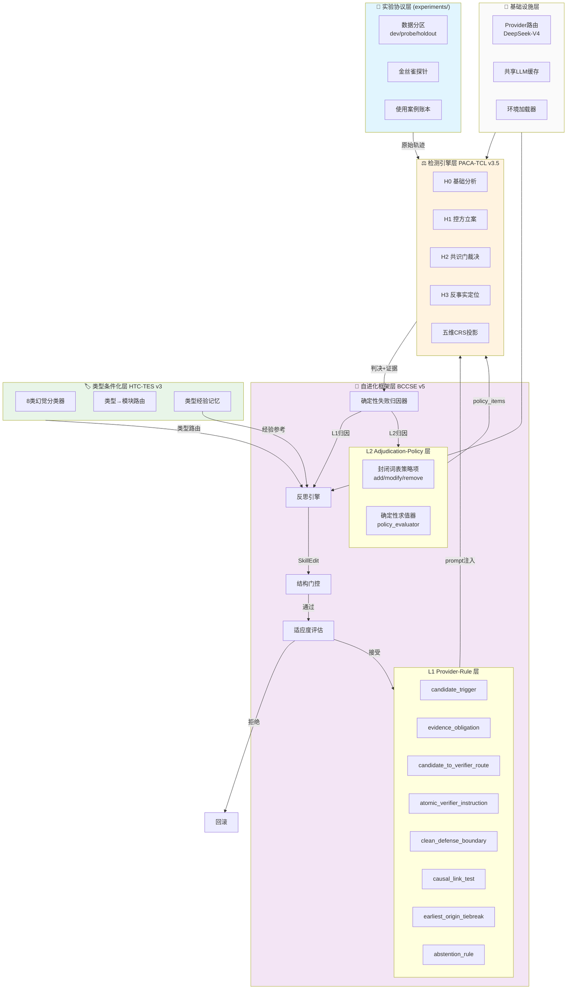
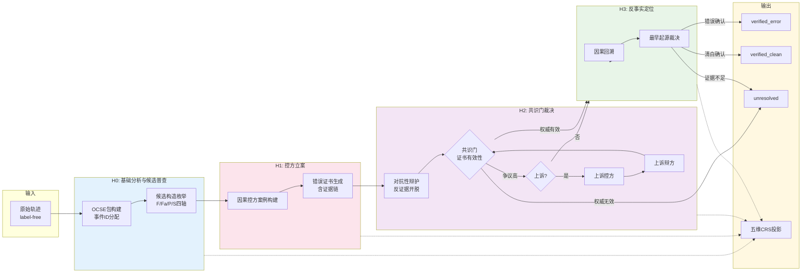
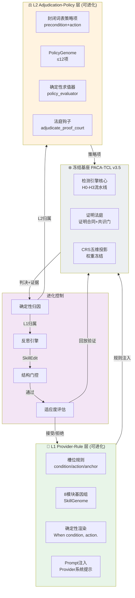
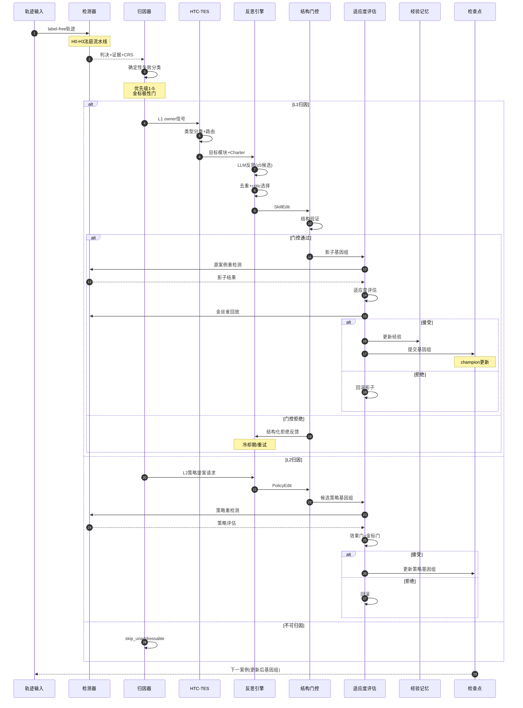
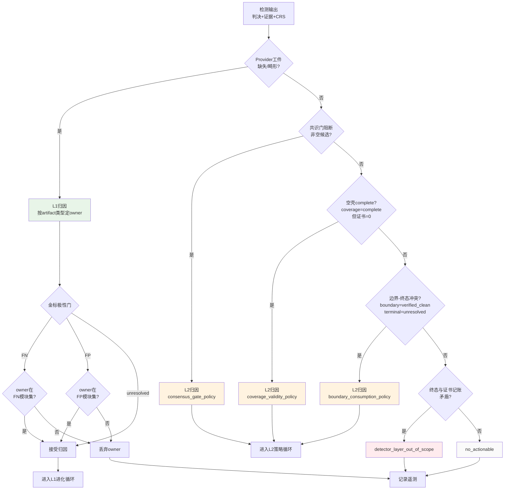
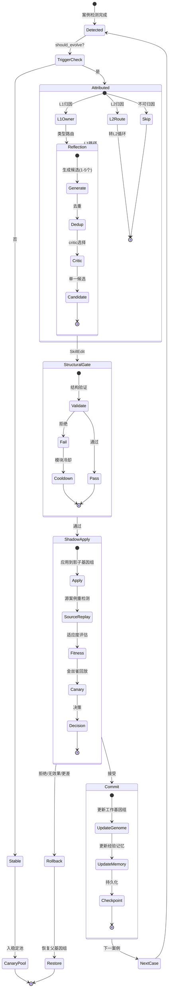
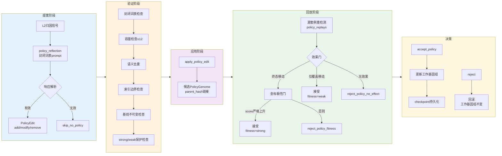
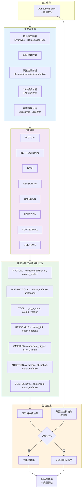
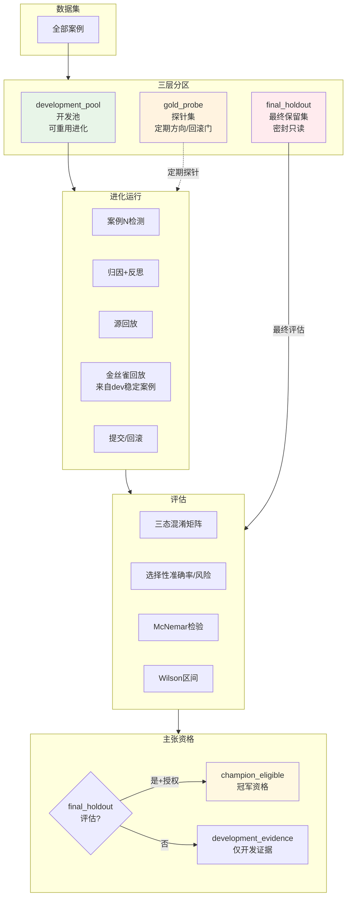
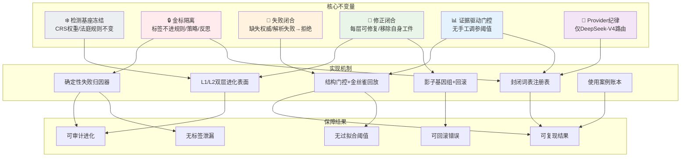

# SEHD v6 框架可视化图谱

> 本文档提供 SEHD v6 自进化幻觉检测框架的多角度可视化视图，帮助研究者快速理解系统架构、数据流和关键机制。

---

## 目录

1. [图 1: 系统总体架构](#图-1-系统总体架构)
2. [图 2: PACA-TCL v3.5 检测流水线](#图-2-paca-tcl-v35-检测流水线)
3. [图 3: 双层自进化表面](#图-3-双层自进化表面)
4. [图 4: 单案例进化闭环时序](#图-4-单案例进化闭环时序)
5. [图 5: 确定性失败归因决策树](#图-5-确定性失败归因决策树)
6. [图 6: L1 进化循环状态机](#图-6-l1-进化循环状态机)
7. [图 7: L2 策略进化循环](#图-7-l2-策略进化循环)
8. [图 8: HTC-TES 类型路由](#图-8-htc-tes-类型路由)
9. [图 9: 数据分区与评估协议](#图-9-数据分区与评估协议)
10. [图 10: 关键设计不变量关系](#图-10-关键设计不变量关系)

---

## 图 1: 系统总体架构

---

## 图 2: PACA-TCL v3.5 检测流水线

---

## 图 3: 双层自进化表面

---

## 图 4: 单案例进化闭环时序

---

## 图 5: 确定性失败归因决策树

---

## 图 6: L1 进化循环状态机

---

## 图 7: L2 策略进化循环

---

## 图 8: HTC-TES 类型路由

---

## 图 9: 数据分区与评估协议

---

## 图 10: 关键设计不变量关系

---

## 图例说明

| 颜色 | 含义 |
|------|------|
| 🟦 蓝色 | 输入/分类/分析阶段 |
| 🟪 紫色 | 进化框架核心组件 |
| 🟩 绿色 | 可进化表面/成功路径 |
| 🟨 黄色 | 评估/门控/检查点 |
| 🟥 红色 | 冻结基座/拒绝路径 |
| ⬜ 灰色 | 基础设施/回退路径 |

---

## 使用建议

1. **快速理解**: 从图 1（总体架构）开始，然后看图 4（单案例闭环）了解动态流程。
2. **深入研究**: 图 5（归因决策树）和图 6（L1 状态机）提供了进化机制的详细视图。
3. **实验设计**: 图 9（数据分区）帮助理解评估协议和冠军资格要求。
4. **架构审查**: 图 10（不变量关系）用于验证设计决策是否符合核心原则。

---

*本文档与 `docs/SEHD_V6_ACADEMIC_DOCUMENT.md` 配套使用，共同构成 SEHD v6 框架的完整技术文档。*
