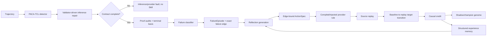

# SEHD v6 自进化源头性能审查与修复（2026-08-11）

## 结论

本轮确认的主要问题不是接受门槛、canary 数量或回归阈值，而是 detector 推理协议与 Skill 形成链之间的十一个源契约断裂：

1. proof-court 的校验谓词被误写成 provider 字段，反思器因此生成不可执行或语义错误的动作；
2. provider 重采样的随机终态变化会被归因给没有执行的 Skill，而真正执行的 Skill又会被错误的代理 observable 否决；
3. 候选动作只需属于模块词表，不必绑定本次 failure edge，因此可以靠旁路指标改善获得信用；
4. proof-court 没有输出终态的机器可读事实基，反思器只能从聚合计数猜阻塞原因；
5. 历史经验丢失 condition 和 ActionSpec 的关键字段，无法迁移完整机制；
6. 结构化 `rule_slots.condition` 在编译时被丢弃，provider 运行时再从自然语言规则的第一个逗号反向截取条件。
7. focused prosecution 的 retry 是无状态新调用，却没有重发完整输出 schema；正确语义因此被写成别的 JSON 方言并遭 quarantine；
8. appeal prosecution 只验证顶层 envelope，不做 certificate 深验证/修复，推理期格式错误泄漏到 evolution；
9. `gold=error + unresolved + defense complete` 被错误路由到 clean-side `abstention_rule`，随后必然触发极性拒绝/no-edit；
10. 已知 validator schema/invariant 失败被送进长期自进化，导致 genome 重复学习 detector 本来就知道的硬合同；
11. runtime 使用 typed condition/ActionSpec，但 genome 的运行身份只覆盖 rule text，行为不同的 genome 可能共用身份和缓存命名空间。

修复后，Skill 形成的最小闭环变为：

```text
trajectory
  -> detector inference + validator-driven bounded repair
  -> contract-complete semantic failure only
  -> typed missing/failed/invariant projection
  -> terminal basis + causal failure edge
  -> edge-bound ActionSpec
  -> provider injection
  -> target postcondition before/after
  -> causal credit
  -> structured mechanism memory
```

最重要的真实结果不是“更多 Skill 被接收”，而是同一 BFCL/004 在 baseline detector 中从 `unresolved` 变为权威 `verified_error`，随后真实 evolution 重放为 `0 triggered / 0 edits`：原先那条 `ordered_chain` Skill 被重新判定为框架协议缺陷的补偿物，本来就不应进入长期进化。该结果证明职责边界恢复，不代表检测器已经达到 SOTA；SOTA 仍需跨机制 benchmark 与密封 holdout。

## 审查边界

本轮明确没有通过以下方式提高接受率：

- 不调整 fitness、promotion、canary 或冲突检查阈值；
- 不放宽结构验证、方向约束或运行时合法性；
- 不为 BFCL/004 添加案例分支；
- 不以 `return code=0`、结构通过或 accepted 计数单独证明有效。

改动集中在推理协议、诊断语义、动作表达、因果归因、运行身份和经验记忆六个源头。

## 整体流程模型



这个模型中，只有 `L -> M` 可以声明 Skill 导致了改善。终态、局部分数、证书数量或 provider 自报告都只能作为遥测，不能绕过 baseline-to-replay 的目标 postcondition。validator 已经知道如何判断的硬合同停在 `C -> D -> X`，禁止写入 genome。

## 根因一：诊断词表与动作词表不闭合

### 原问题

`validate_error_certificate()` 输出的 `failed_checks` 包含 `ordered_chain`、`agent_control_evidence_binding` 等校验谓词。旧的 `project_provider_artifacts()` 直接把这些名称复制到 `missing_fields`。

这会产生两个错误：

- `ordered_chain` 被当作不存在的 JSON 字段；
- 字段都存在但关系错误时，反思器仍看到“字段缺失”。

BFCL/004 的旧候选因此反复在 `require_evidence_field: evidence_refs`、`withhold_certificate: certificate_id` 等动作之间猜测，无法表达真正的关系修复。

### 修复

新增单一审计契约 `audit_contract.py`，将审计输出分成：

- `missing_fields`：确实为空或缺失；
- `failed_fields`：参与失败谓词的 provider 字段；
- `failed_invariants`：需要关系修复的校验谓词。

`atomic_verifier_instruction` 和 `clean_defense_boundary` 新增闭集 opcode：

```text
enforce_certificate_invariant: <registered invariant>
```

它的后置条件不是检查一个伪字段，而是比较 proof-court audit 中目标 invariant 的 before/after 失败次数。

该 opcode 仍用于旧 genome 的执行审计和开发期因果 probe；在最终职责边界中，新发生的已知 validator invariant 失败先由 inference repair 处理，repair 耗尽后标记 detector fault，不再自动形成新的长期 Skill。

### 代码证据

- `src/sehd_v6/core/paca_tcl/audit_contract.py:22`：校验谓词到 provider 字段的单一映射；
- `src/sehd_v6/core/paca_tcl/audit_contract.py:82`：missing/failed/invariant 三分投影；
- `src/sehd_v6/core/paca_tcl/proof_contract_v3.py:134`：error audit 使用同一投影；
- `src/sehd_v6/core/paca_tcl/proof_contract_v3_4.py:287`：defense audit 使用同一投影；
- `src/sehd_v6/core/bccse/module_charter.py:333`：注册 invariant opcode；
- `src/sehd_v6/core/bccse/action_spec.py:72`：编译为 `certificate_invariant_repaired`；
- `src/sehd_v6/core/bccse/failure_episode.py:475`：构建 failure episode 时保留三类事实。

## 根因二：终态原因由反思器猜测

### 原问题

proof-court 只暴露聚合计数。failure classifier 按顺序选择第一条 quarantined audit，无法判断它是否真的位于终态决策的阻塞切面上。

### 修复（事实暴露已完成，集合归因仍未完成）

proof-court 现在额外输出只读的 `terminal_basis`：

- `decisive_facts`：当前终态由哪些事实建立；
- `blocking_facts`：unresolved 还缺哪些确定性谓词；
- 状态计算规则本身不变。

反思 runtime observation 直接携带这个事实基，critic 不再只从 aggregate counters 猜根因。但 `failure_classifier._find_first_bad_artifact()` 当前仍按列表顺序选择第一条坏 artifact；当多个证书共同阻塞 coverage 时，这不是充分的因果选择器。因此本轮修复了“事实不可见”，尚未把单一 `FailureEdge` 升级为 proof-cut 上的候选边集合。

### 代码证据

- `src/sehd_v6/core/paca_tcl/proof_contract.py:670`：终态事实基；
- `src/sehd_v6/core/bccse/failure_episode.py:739`：bounded prompt projection；
- `src/sehd_v6/core/bccse/failure_episode.py:791`：要求选择 blocking fact 上的故障。

## 根因三：相关性被错误地当成因果信用

### 原问题

provider replay 是随机重采样。同一 Skill 可能未被应用，但终态恰好改善。旧代码允许 gold task improvement 覆盖 `intervention_not_executed`，所以随机改善可以进入 champion。

相反，一个目标 postcondition 已满足的 Skill，又可能因为 `causal_field_coverage` 这种间接 proxy 没变化而被 `expected_effect_not_observed` 拒绝。

这造成了最危险的信用反转：真执行被拒，未执行被接收。

### 修复

- `_attribute_intervention_fitness()` 成为 causal credit 的唯一拥有者；
- 未满足目标 postcondition，无论 gold 终态如何变化、provider 如何自报告 applied/effect，都记为 `intervention_not_executed`；
- expected-effect proxy 降为诊断和自监督辅助梯度，不能否决已确定执行且 fitness 改善的动作，也不能救活未执行动作；
- 所有可执行 postcondition 统一改为 baseline→replay 转移：object 必须新增/减少、field 必须新增、prosecution coverage 必须由 complete 打开、qualification/route/causal/origin 必须发生对应变化；已经成立的终态不能自证执行；
- `keep_coverage_incomplete` 只读取 prosecution coverage，不能借 defense 侧原有的 incomplete 状态冒领执行信用；
- provider 自报告的 rule id 只保留已实际注入的 id，并且永远不能替代确定性 postcondition；
- invariant ActionSpec 使用目标 invariant 的直接 observable，而不是全局平均代理。

### 代码证据

- `src/sehd_v6/core/bccse/action_spec.py:488`：确定性 postcondition 评估；
- `src/sehd_v6/core/bccse/action_spec.py:531`：object 必须形成 before/after 转移；
- `src/sehd_v6/core/bccse/action_spec.py:602`：prosecution coverage 的单侧所有权；
- `src/sehd_v6/core/bccse/evolution_runner.py:2154`：随机 replay/self-report 不得获得未执行信用；
- `src/sehd_v6/core/paca_tcl/skill_integration.py:516` 附近：拒绝未注入 rule id 的自报告；
- `src/sehd_v6/core/bccse/evolution_runner.py:508`：proxy 只作为辅助梯度；
- `src/sehd_v6/core/bccse/fitness.py:567`：审计 invariant failure 的过程变化。

## 根因四：候选动作未绑定 failure edge

### 原问题

候选只要 action 属于模块闭集即可通过预验证。模型可以诊断 `ordered_chain`，却提出 `require_evidence_field: impact_evidence_refs`；如果旁路指标改善，这条规则仍可能获得信用。

此外，旧 retry memory 用 `(module, operation)` 屏蔽整个动作面。一次 no-effect 后，即使只是条件写得不好，后续也不能再尝试同一个正确 opcode，容易直接退化为 no-edit。

### 修复

- 只有通过 inference/semantic 边界并允许进入 L1 的 ActionSpec 才可生成，且必须绑定本次 `failure_edge.field`；
- invariant failure 必须使用同一 invariant，不能替换成邻近字段或另一校验谓词；
- 删除粗粒度 opcode 屏蔽，继续保留近重复规则检测；同一正确操作可用不同可观测条件重试；
- reflection system prompt 明确要求 failure-edge binding。

### 代码证据

- `src/sehd_v6/core/bccse/evolution_runner.py:1324`：候选预验证；
- `src/sehd_v6/core/bccse/evolution_runner.py:1399`：failure-edge repair target；
- `src/sehd_v6/core/bccse/evolution_runner.py:1412`：不绑定时的确定性拒绝；
- `src/sehd_v6/core/bccse/reflection_engine.py:412` 附近：生成前的 binding 指令。

## 根因五：经验记忆丢失 Skill 机制

### 原问题

历史引用原本只向反思 prompt 提供：

```xml
<action>require_evidence_field</action>
<module>unknown</module>
<outcome>...</outcome>
```

原因是 formatter 读取不存在的 `target_module`，而 ActionSpec 实际字段是 `module_id`；同时 rule condition、output field、postcondition 和 observable 都被丢弃。

因此经验记忆只知道某个 opcode 成功/失败，不知道它在什么条件下修复了什么机制，不能形成跨案例 Skill 迁移。

### 修复

历史引用现在保留经过 runtime rule contract 验证的 condition，并输出完整 ActionSpec 机制：

- `condition`；
- `module_id`；
- `operation`；
- `output_field`；
- `postcondition`；
- `observable_field / expected_direction`；
- outcome / no-effect reason。

结构拒绝的未验证规则不会进入 condition memory。

### 代码证据

- `src/sehd_v6/core/bccse/evolution_experience_memory.py:142`：只恢复已验证规则条件；
- `src/sehd_v6/core/bccse/evolution_experience_memory.py:406`：写入历史引用；
- `src/sehd_v6/core/bccse/experience_retriever.py:336`：完整机制 prompt 格式。

## 根因六：结构化 condition 在执行边界退化为 prose

### 原问题

反思器已经产出 `rule_slots.condition`，但 `CompiledPacaSkill` 只保存 rule text 和 ActionSpec。运行时注入 provider 时再执行 `partition(",")`，从渲染文本提取第一个逗号前的片段。含逗号但仍合法的单一条件会被截断，rule id 也可能基于与真实 condition 不同的字符串。这使“生成正确”与“执行正确”之间仍存在表示损失。

### 修复

- `CompiledPacaSkill` 升级为 v6，增加 `rule_conditions`；
- stable rule id、ActionSpec、condition 使用同一个 rule id 绑定；
- 新规则从 `rule_slots.condition` 直接编译，只有旧 checkpoint 没有 slot 时才使用 prose 兼容解析；
- provider JSON 直接注入完整结构化 condition。

### 代码证据

- `src/sehd_v6/core/paca_tcl/skill_integration.py:117`：编译产物持有 `rule_conditions`；
- `src/sehd_v6/core/paca_tcl/skill_integration.py:215`：结构化 condition 的单一读取边界；
- `src/sehd_v6/core/paca_tcl/skill_integration.py:302`：delta condition 与 ActionSpec 同步编译；
- `src/sehd_v6/core/paca_tcl/skill_integration.py:481`：provider 注入直接读取 typed condition。

## 根因七：无状态 retry 丢失完整输出语言

### 原问题

focused prosecution 的首轮 system prompt 包含完整 certificate schema，但 retry 使用一次全新的 provider 调用，只写“using the same schema as before”。API 调用之间没有对话状态，retry 实际上看不到“之前”的 schema；其 user prompt 还携带 `semantic_findings` / `causal_findings` 的其他结构，模型因此把正确语义输出成 `causal_graph` 或嵌套 `certificate`。BFCL/004 的 `v3_candidate_004/006` 已准确识别目录遗漏，却因整个 canonical certificate 字段集缺失而再次 quarantine。

旧实现还把 coverage=`incomplete|unresolved` 直接返回，不重试，并用 metadata key 是否以 `_error` 结尾猜 provider crash；这把 contract incomplete、provider exception 和显式 no-error 混成同一状态。

### 修复

- retry system 每次重发完整 causal rules 和精确 JSON schema，不依赖隐含对话状态；
- retry user 带入 `PREVIOUS_INVALID_RESPONSE` 和 validator feedback；
- focused prosecution 统一为一个 envelope+certificate 状态机，coverage、foreign candidate、schema 和 invariant 失败走同一 bounded repair；
- 用显式 `terminal_status={complete,no_error,contract_incomplete,quarantined,provider_error}` 取代 key-name heuristic。

### 代码证据

- `src/sehd_v6/core/paca_tcl/proof_engine.py:68`：retry 完整继承首轮输出语言；
- `src/sehd_v6/core/paca_tcl/proof_engine.py:247`：统一 focused repair state machine；
- `src/sehd_v6/core/paca_tcl/proof_engine.py:284`：validator feedback 注入无状态新调用。

## 根因八：appeal prosecution 的深验证不对称

focused prosecution 和 appeal defense 已有 certificate 级 repair，而 appeal prosecution 过去只验证顶层 `coverage_state/reviewed_candidate_ids`。合法 envelope 内的坏证书会进入 court，随后被误归因为需要 genome 学习的 validator failure。

新增 appeal prosecution deep validation：复用 proof court 的 `validate_error_certificate()`，按 certificate/source candidate 收集 typed missing/failed/invariant，做一次独立 repair 或明确 retract，再将有效旧行和有效修复行合并。验证器和裁决规则没有放宽。

代码证据：

- `src/sehd_v6/core/paca_tcl/proof_engine.py:828`：appeal error certificate 深验证；
- `src/sehd_v6/core/paca_tcl/proof_engine.py:930`：validator-driven repair/retract/merge。

## 根因九：gold-error unresolved 被路由到 clean-side owner

`_route_process_failure()` 原先只看到 `state=unresolved + defense=complete + no surviving error`，便优先返回 `abstention_rule/clean_defense_boundary`，完全忽略 error polarity。对于 `gold=true` 的 unresolved-FN，这等价于让 clean-side 规则修复漏检；后续 polarity gate 又必然拒绝，于是形成稳定的 reject/no-edit 路径。

修复后，只有 `UNRESOLVED_SHOULD_CLEAN` 才能进入 abstention 分支；`UNRESOLVED_SHOULD_ERROR` 沿 prosecution coverage/证据边进入 `evidence_obligation` 或 `atomic_verifier_instruction`。未知自监督样本仍 fail-closed，不借 gold 猜 verdict。

代码证据：`src/sehd_v6/core/bccse/step_attributor.py:614-640`。

## 根因十：推理期合同错误污染长期进化

### 第一性原理边界

Skill 应学习“在何种轨迹语义模式下需要额外候选/证据/因果约束”；它不应学习 validator 已经编码的 required field、JSON schema 或 invariant。后者是 universally applicable 的程序合同，不是需要跨案例归纳的知识。

因此现在明确区分：

- 缺失整类语义对象（没有 candidate、没有 error certificate）可进入 L1 Skill 形成；
- 已发出但违反已知 schema/invariant 的对象归为 `detector / inference_contract_boundary`，由 bounded inference repair 或 provider/route 可靠性治理负责，禁止形成长期 Skill。

代码证据：`src/sehd_v6/core/bccse/failure_classifier.py:174-220`。

## 根因十一：运行行为没有独立内容身份

`SkillGenome.content_hash` 为兼容旧 checkpoint 只覆盖 active/rule text，但 runtime 还读取 `rule_slots.condition` 与 `action_spec`。只修改这两项时，provider 行为会变，旧 content hash 却不变；共享 cache/genome 目录和编译 telemetry 会把不同执行语义称为同一 genome。

新增 `execution_hash`，只覆盖会影响 provider 行为的 rule text、typed condition、ActionSpec 和 module activation，排除 fitness/provenance/promotion 账本。旧 `content_hash` 保留用于历史谱系兼容；runtime 编译、provider telemetry 和 replay cache namespace 改用 `execution_hash`。

代码证据：

- `src/sehd_v6/core/bccse/genome.py:698`：行为身份；
- `src/sehd_v6/core/paca_tcl/skill_integration.py:384`：编译产物绑定 execution hash；
- `src/sehd_v6/core/paca_tcl/detector.py:300`：部署 provenance 同时报告 execution hash。

## 真实实验因果链

核心对照均使用同一 BFCL/004 和同一 detector config；没有调整 validator、fitness、promotion 或 verdict 阈值。前五个 Skill probe 是定位信用链的历史实验，后三个 detector/evolution probe 用于验证推理协议修复后的真实职责边界。

| 实验目录 | 关键事实 | 说明 |
|---|---|---|
| `experiments/source_skill_probe_bfcl004_20260811` | 正确 invariant Skill 已执行；`ordered_chain 1->0`；local score `3.3->5.0`；旧框架拒绝 | 证明 proxy veto 会拒绝真因果 |
| `experiments/source_skill_probe_bfcl004_postfix_20260811` | `ordered_chain 1->1`、Skill 未执行，但终态随机变 error；旧框架接收 | 证明 gold outcome 会错误覆盖未执行 |
| `experiments/source_skill_probe_bfcl004_credit_final_20260811` | 相同缓存响应下，未执行尝试被拒；执行的旁路 field Skill 被接收 | 验证 causal credit 修复，同时暴露 edge 未绑定 |
| `experiments/source_skill_probe_bfcl004_binding_final_20260811` | 旁路 action 被 `action_not_bound_to_failure_edge` 拒绝 | 验证 action-edge closure |
| `experiments/source_skill_probe_bfcl004_semantic_final_20260811` | `missing_fields=[]`，关系字段进入 `malformed_fields`；生成 `enforce_certificate_invariant: ordered_chain`；`1->0`；终态 unresolved->verified_error；commit | 源机制端到端成功 |
| `experiments/source_detector_bfcl004_deep_repair_20260811` | appeal malformed certificate 被 deep validator 识别并由 provider 明确 retract；最终仍 unresolved | 证明格式故障已移回 inference，但 focused 初审仍未闭合 |
| `experiments/source_detector_bfcl004_focused_repair_20260811` | provider error `5->0`，仍有 2 个 `contract_incomplete`；retry 对正确语义输出了错误 schema | 精确定位无状态 retry 丢失输出语言 |
| `experiments/source_detector_bfcl004_stateless_repair_20260811` | baseline `verified_error`、authoritative；focused `contract_incomplete=0`；candidate 003/006 均 complete；2 个 surviving error certificates | 同样本、同 genome、同门槛，仅修推理协议即恢复检测 |
| `experiments/source_evolution_bfcl004_after_detector_repair_20260811` | `1 stable / 0 triggered / 0 accepted / 0 rejected` | 证明错误的 Skill 形成轨迹已在源头消失 |
| `experiments/source_root_frontier_condition_bfcl004_20260811` | 同一 BFCL/004 保持 `verified_error`、`1 stable / 0 triggered`；baseline 采集 40 个 pre-call feature records，覆盖 9 个真实 provider routes | 验证空 genome 不改变检测行为，feature projector 已进入真实 baseline 调用链 |
| `experiments/source_root_frontier_condition_camel021_20260811` | `1 triggered / 0 edits`；权威失败为 `boundary_terminal_conflict`，走 `SKIP_UNADDRESSABLE_FAILURE` | 验证 frontier 不会把 L2 边界冲突扩张成 L1 Skill |
| `experiments/source_root_frontier_condition_openmanus056_20260811` | `1 triggered / 0 edits`；malformed provider artifact 停在 `detector_layer_out_of_scope / inference_contract_boundary` | 验证已知 schema/invariant 故障不会因新 frontier 重新污染长期 Skill |

历史 Skill probe 最后一轮曾生成：

```text
When a verification certificate cites an event that does not appear in the
trajectory as a tool call or tool response, enforce the certificate validation
invariant: ordered_chain.
```

它没有包含 case id 或 gold label，且通过了当时的 edge/action/credit 合同；但新实验说明它仍不应成为长期 Skill：`ordered_chain` 是 proof validator 的无条件硬约束，真实缺陷是 stateless retry 没有重发 schema。该规则现在只作为“旧框架能够执行一个绑定动作”的诊断证据，不再作为成功自进化或跨案例知识的证据。

### BFCL/004 前后因果对照

| 指标 | focused state-machine 后、schema 修复前 | stateless schema 修复后 |
|---|---:|---:|
| detector state | unresolved | verified_error |
| decision authority | authoritative | authoritative |
| focused provider errors | 0 | 0 |
| focused contract incomplete | 2 | 0 |
| focused valid certificates | 0 | 2 |
| surviving error certificates | 0 | 2 |
| evolution trigger | 会形成 unresolved-FN | 0（stable） |

这个对照把改善归因到 detector protocol：genome 保持 baseline，proof/canary/fitness 门槛均未变化。

## 自动验证

新增 `tests/test_skill_formation_contract.py`，覆盖：

1. audit predicate 不会再伪装成 JSON field；
2. missing / failed / invariant 三类事实分离；
3. invariant ActionSpec 可编译并由 court audit 验证；
4. field postcondition 必须产生 before/after delta；
5. failure edge 与 action vocabulary 闭合；
6. 不可寻址 edge 不进入反思；
7. 历史经验保留完整机制；
8. terminal basis 不改变原裁决；
9. gold 随机改善不能给未执行 Skill 信用；
10. proxy 指标不能覆盖确定性的执行证据；
11. action 必须绑定 diagnosed failure edge；
12. 旧 `certificate` / 字段名 audit 只在执行边界规范化，历史证据保持无损；
13. 含逗号的 typed condition 编译后保持完整，不再被 prose 解析截断；
14. appeal prosecution malformed certificate 在进入 court/evolution 前 repair/retract；
15. focused incomplete coverage 会进入统一 repair state machine，不再伪装 provider crash；
16. gold-error unresolved 不再路由到 clean-side abstention；
17. pre-existing object/foreign defense gap 不能满足 ActionSpec；
18. provider 自报告不能替代 baseline→replay transition；
19. 已知 validator failure 停在 inference contract boundary；
20. execution hash 覆盖 typed condition/ActionSpec，但不受 fitness bookkeeping 影响；
21. malformed certificate 与语义上缺失 certificate 的 inference/evolution 对偶边界；
22. 多 artifact 缺失不会再被 first-match 丢失，完整 proof cut 被编译为稳定 `repair_frontier`；
23. 候选必须用 `repair_edge_id` 选择一个 owner/field 闭合的 frontier edge；
24. typed `ConditionSpec` 在 provider 调用前匹配，false 时不注入 ActionSpec；
25. source feature trace 可区分 `condition_not_matched`、`model_ignored_or_action_failed` 与 `route_not_reached`。

当前仓库的全量 `tests` 结果：`25 passed`；`python -m compileall -q src/sehd_v6` 与 `git diff --check` 通过。这里的“全量”仅指当前工作树实际存在的测试集，不把历史已删除测试或旧 artifact 计为已验证回归。

## 本轮完成的两个剩余源头工作

### 1. proof-cut repair frontier 已替代 first-match

`failure_classifier` 现在保留同一失败类型下的完整 artifact frontier；malformed 仍优先停在 inference contract boundary，只有语义缺失对象进入 L1。`FailureEpisode` 将这些对象与 `terminal_basis.blocking_facts`、module charter、方向合法 action vocabulary 交叉，生成带稳定 `edge_id / owner_module / field / blocking_predicate` 的 `repair_frontier`。

反思输出必须显式返回 `repair_edge_id`。预验证同时检查 edge 存在、owner 等于 target module、ActionSpec output field 参与该 edge；`SkillEdit` 持久化完整 `repair_edge`，checkpoint 恢复后仍由 genome validation 重验。兼容字段 `failure_edge` 只保留在持久化层，不再进入反思 prompt，因此 list order 不再替反思器偷偷选择根因。

### 2. typed ConditionSpec 与调用前 feature projector 已落地

新增闭集 `ConditionSpec`：`feature / operator / typed value / schema_version`。反思只可从注册的 trajectory/provider-input 特征中选择一个 discriminator；新 add/modify 候选缺少或越界即在 critic/replay 前拒绝。

所有 baseline 与 evolved detector 调用都经过同一个无侵入 wrapper。wrapper 在调用前从实际 user payload 投影 bounded features；无 delta rule 时 system/user 保持 byte-identical。候选必须在源样本 ActionSpec route 的真实 feature trace 上至少匹配一次，否则返回 `condition_route_not_observed_on_source` 或 `condition_not_observed_on_source_route`。运行时只注入 matched rule，并分别记录 candidate、matched、not-matched、injected、applied 与 field effect。因果审计现在能区分：

- `condition_not_matched`：框架在调用前判 false，provider 从未收到规则；
- `model_ignored_or_action_failed`：condition true 且已注入，但 deterministic postcondition 不成立；
- `route_not_reached`：目标 provider route 在本次 replay 未执行；
- `executed`：baseline→replay postcondition 成立。

`condition_spec` 进入 `execution_hash` 与 stable rule id；同一 prose/ActionSpec 但不同 applicability 不再共享 runtime cache identity。

## 仍未解决的架构风险

### 1. 编排单体过大

AST 扫描显示：

- `EvolutionLoop.run`：2341 行；
- `_run_l2_policy_case_impl`：约 721 行；
- `_flush_shadow_batch_impl`：约 596 行；
- `build_causal_reflection_prompt`：583 行。

这会让 diagnosis、generation、credit、memory 和 promotion 的所有权再次漂移。下一步应按本文件的流程模型拆成不可变阶段对象，而不是继续向 `run()` 添加分支。

### 2. ActionSpec 的输出动作仍由 provider 执行

Condition 的 applicability 已机械化，但 ActionSpec 指定的输出修改仍由 provider 生成，再由 deterministic postcondition 验证。下一阶段仍应引入独立 `MechanismRepairPlan`：

```text
condition predicate -> affected route -> invariant -> participating fields
-> required provider evidence -> deterministic postcondition
```

当前 owner/field 已由 selected repair edge 约束，condition 已由 `ConditionSpec` 执行；剩余工作是让 operation/postcondition 也从 edge + direction 直接编译，进一步缩小模型自由度。

### 3. SOTA 证据尚未建立

单案例证明的是 Skill 形成链恢复，不是泛化。下一阶段应按以下源指标推进：

- `addressable_episode_rate`：trigger 中有闭合 repair plan 的比例；
- `inference_contract_completion_rate`：所有 provider route 在 bounded repair 后达到 canonical contract 的比例；
- `semantic_episode_precision`：进入 evolution 的 episode 中真正属于可迁移语义缺口而非 detector 合同故障的比例；
- `edge_bound_proposal_rate`：候选真正绑定 failure edge 的比例；
- `execution_rate`：编译/注入后目标 postcondition 或绑定 effect 成立的比例；
- `causal_credit_precision`：accepted 中确实执行且修复目标 edge 的比例；
- `source_edge_repair_rate`：目标 invariant/field 在 source replay 改善的比例；
- `cross_case_transfer_rate`：相同机制、不同案例无需再编辑即可改善的比例；
- 最终密封 holdout 上的 hallucination detection precision/recall/F1/AUROC。

实验应先按 mechanism signature 分层，再评估 source、同机制 transfer 和密封 holdout。只有 transfer 与 holdout 同时改善，才能讨论 SOTA；accepted 数量不进入核心结论。

## 推荐的下一实现阶段

1. 将所有 provider route 统一到 `Infer -> Validate -> Repair/Reject` 控制器；只有 canonical、语义上仍失败的结果可创建 `FailureEpisode`；
2. 将 `FailureEpisode -> MechanismRepairPlan` 编译成独立纯函数和 schema；operation/postcondition 由 selected edge + direction 决定；
3. 将 source replay 做成 matched counterfactual：固定未受该 Skill 影响的 provider 响应，只重采样其目标 route，隔离 Skill 因果与全链随机漂移；
4. 把 `EvolutionLoop.run` 拆为 `Diagnose / Propose / Execute / Attribute / Learn` 五个阶段；
5. 先在不少于 30 个、覆盖多种“语义缺失”机制的案例上测源指标；validator/schema 故障单独进入 inference reliability 集，不混入 Skill benchmark；
6. 再进入跨案例 transfer 和密封 benchmark，报告完整检测效果。

这些工作仍然不需要调整门槛。优先级应始终是：提高可寻址率、正确执行率和因果信用精度，然后才扩大实验规模。
