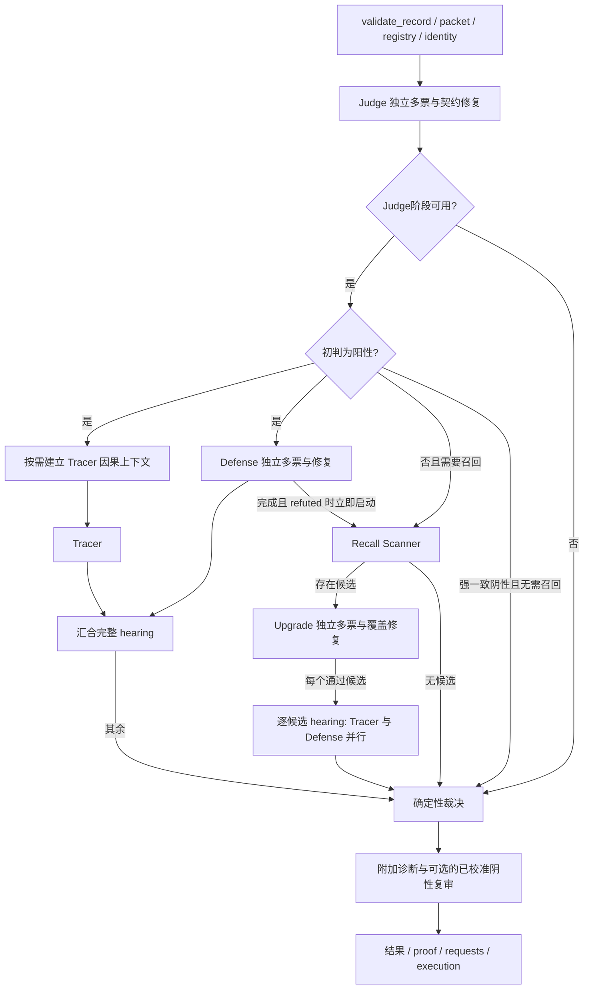

# 检测器 review 核查与执行模型

> 历史审计记录：按原日期解释实现、测试和计划；当前合同见[技术文档](../technical-solution.md)，当前结果见[实验日志](../experiment-log.md)。文档迁移时只修订路径与失效链接标记。

核查日期：2026-10-14。基线为修改前的 `HEAD@4c89ef75`。本次工作覆盖用户提供的 review、检测器调用与异常路径，以及保留全部必要阶段和投票的执行优化。不运行真实 provider，不改原始轨迹、标签、冻结协议、历史报告或 ledger。

## Review 的逐项结论

| 项目 | 核查结论与当前修复 |
|---|---|
| 1 跨族事实 | 确认。`InterventionPlan._entry_facts` 统一提供触发和动作抑制所读事实；有 scoped writer 时，只读本族值。没有本族 scoped 值时，不能用另一族的全局别名授权。Guard 与 Recall trigger 共用此规则。原双族复现现在与单族对照都不触发。 |
| 2 健康未决巡检 | 确认。复用 `_unmeasurable_cases`，权威且运行健康的 `semantic_unresolved` 计为已测量；基础设施故障仍阻断周期。 |
| 3 组合臂故障归因 | 确认。评分前检查两臂测量健康；故障组合标记 `not_evaluable`，报告保留未测案例。先前独立通过的首单元仍可接纳，尾单元保留不可测原因，不记为证伪。组合事件映射到成员经验记录，后续 proposer 不永久屏蔽该组合。 |
| 4 库容量拒绝 | 确认。`LIBRARY` 反馈标记不可评估，经验记为 `budget_unselected`，不因容量不足证伪机制或压缩提案空间。 |
| 5 晋升重试 | 确认。恢复已提交发布后、任何新测量前检查已有终态。完整 attempt 身份与报告摘要匹配的非晋级终态只读返回原结果；未知、篡改或未提交的 version 文件返回 `promotion_blocked_preflight`，原文件不变。未留下终态的中断才可续接已有 attempt。完整回归发现并修正了“拒绝重测同时误拒幂等读取”的边界；旧 v1 报告写入时统一补齐 admitted 字段。 |
| 6 定位 metamorphic 门 | 确认变异 packet 未被消费。两次读取现在分别使用原 packet 和移动后的 packet，坐标重标注也携带变异 packet。原测试只有错位数据，没有实现标题所称的错误读取器；新增真正按布局改变责任步的读取器，门禁会拒绝它。该门检验指标读取与坐标关系，不宣称重新调用模型后定位完全不变。 |
| 7 Research 基线 | 确认。当既有合同要求配置哈希时，缺失 `run.json` 直接拒绝复用，不再跳过校验。 |
| 8 FP 回退模板 | 确认 `not_applicable` 被选为违规值；已排除。原文“违规被显式抑制”需校正：`action_not_when_facts` 使用全部同时匹配，多个互斥值不能同时成立；确定的问题是触发值选错，而非每个违规值都会被抑制。 |
| 9 正则窗口 | 确认。删除仅匹配前 4096 字符的截断，`matches` / `not_matches` 都消费完整 view；保留原可终止子进程、程序期限和取消规则。 |
| 10 检索属性 | 确认幂等 stem 条件导致拒绝分支失效。要求 passage 的规范化 token 实际包含所问属性；缺属性不产出 verifies 三元组。 |
| 11 英文撇号 | 确认。引号匹配增加词边界，英文缩写中的撇号不能成为开引号；直引号和弯引号问句都有回归。 |
| 12 沙箱三项 | Job 创建失败和 Job 不可用均拒绝执行，准入也实际检查 Job 创建。stdout 与 stderr 在读取时受累计输出上限约束，超限立即终止子进程；父进程不会先缓冲全部输出。POSIX rlimit 在子解释器内、组件执行前设置，删除线程池中的 `preexec_fn`。Windows 实测通过；POSIX 实际资源执行仍需 Linux 平台验证。 |
| 12 定位状态 | 确认集合被按成员下标读取。生产者保存与 failure_cases 对齐的状态列表，谓词细分和机制细分同时投影对应成员状态。三例 `step_missing` 不再变成一例 missing、两例 mislocated。 |
| 12 L0 归档原因 | 确认。从 development sidecar 读取 `revision_reason`，保留结构化记录中的 note。 |
| 12 Runner 准入 | 确认。`admission_error` 执行参考 subject 的 `run_gate`；`admitted_runners` 使用同一实际通过规则。仍区分 runner 形状准入和具体候选四门评估。 |
| 12 Judge 可达路线 | 确认 Judge 路线未派发。FN 家族开放 `judge_directive`，与 `judge.system` 的实际 reach 和 proposer 指引一致。 |
| 12 CaseExecutionError | 不按 review 建议改成 run-stop。当前 `runtime.CaseExecutionError` 明确表示“案例失败不取消其他案例”；生产 Detector 已封装已知案例故障，fatal provider / RunStopped 才停止运行。意外程序错误继续抛出并保留批次 summary，不能吞成成功或弃权。 |
| 12 Defense 元数据 | 确认，并扩展检查五个阶段。Judge、Scanner、Upgrade、Tracer、Defense 的 repair 元数据均合并先前调用的 attempts 和 usage_total；失败修复也保留已知用量。多票汇总包含不可用票的已知用量。整例 execution 原始请求仍是计费真源，避免再次累计阶段镜像。 |
| 12 Regex 20 ms | “20 ms 是 worker 总预算”的判断不成立。它是 communicate 轮询间隔，总匹配预算为 500 ms；冷启动期间会继续轮询。高负载仍可能耗尽真实期限，不能把它当阴性匹配。本轮保留期限，没有通过提高预算修复此项。 |
| 工程卫生 | 清除已确认的生产无用导入、死赋值和恒真条件。两个 `capability_surface_report` 位于不同模块且各有消费者，保留既有公开接口，不将同名视为调用错误或删除依据。 |

## 检测器调用与执行模型

入口为 `Detector.detect`；`runner.detect_with_transport_retry` 管理整例重试，`runner.run_batch` 管理案例调度与全局 provider 并发槽。`detect` 内的 usage scope、案例 deadline、added budget 跨线程继承，最终由 request observation 汇总 execution。Registry、snapshot、frozen replay 和源码身份在调用 Judge 前验证。

该图保留 Judge、召回、因果升级、Tracer、Defense、完整候选覆盖、正常邻居、机械证据和阴性复审的权限边界。Recall 不能自行定罪；Defense 仍只凭证据推翻；Tracer 只定位当前 hearing 的偏差。不同候选的 hearing 继续按确定顺序执行，因为它们共享干预事实与经验记录；Defense成功refuted时Scanner/Upgrade立即启动，与待完成Tracer重叠；API仍先汇合原听证，再按确定顺序听证所有升级候选，进行最终裁决。

令 J/D/U 为对应阶段独立票数，H 为最终 hearing 数量，S 为是否启动 Scanner，A 为实际发生的附加审计调用。没有 repair、topup 和 transport retry 时，逻辑调用数为：

`N = J + S × (1 + U) + H × (1 + D) + A`

有 Scanner 但没有候选时 U 为零。Repair、topup及上下文超限回退是新增逻辑调用，transport retry是同一逻辑调用的新增请求尝试；整例retry仅重测未成功的模型阶段，预检与干预副作用仍重跑。三者必须分别统计，不能把多个 provider 请求统称为“三票”。源码配置当前由 judge_route 承载 Judge、Tracer 和 Upgrade；defense_route 承载 Defense；recall_route 承载 Scanner。

该公式描述一次基础检测通路；可选阴性复审复用Judge并再次经过实际Scanner/Upgrade/hearing通路，整例重试则按每个attempt分别相加。请求观测数量也不是必然已发送HTTP数量：容量等待耗尽会产生transport_error观测，却可能没有request_started；实时journal中的queued/started/finished才可核对派发。缺少usage不能记零费用，也不能把失败阶段镜像再次加到整例请求账本。

| API 分支条件 | 实际执行 | 不能省略的边界 |
|---|---|---|
| Judge成功阳性 | 听证；Defense refuted才重开Recall | Tracer无定罪权；翻案不能继承原Judge答案作为新候选referent |
| Judge成功阴性，弱置信/分票/弃权或degraded view | Scanner，有候选才Upgrade，再听证所有升级候选 | degraded投影不足以按三张high阴性跳过召回；不能只处理首候选 |
| Judge成功强一致阴性但有snapshot、有效registry触发或已授权因果复审 | 重新打开Scanner | snapshot不能在高置信阴性时被闲置；scoped事实只授权本族 |
| Judge成功强一致阴性且无需召回 | Scanner/Upgrade为not_needed，零请求；仍构造结果与按配置诊断 | 这是既有正常分支，本轮没有扩大跳过条件 |
| Judge失败不可用 | 保留失败结果，裁决给出相应非权威状态；runner按基础设施retry合同处理 | 当前API不自动用Scanner替换一个坏Judge，不能把失败伪装为阴性 |
| Scanner成功空候选 | Upgrade not_needed | 空候选与Scanner失败是不同测量状态 |
| 校准阴性复审eligible | 同例最多一次，复用Judge，新增请求用独立added scope | 默认未启用的反馈不因本轮效率优化自动开放，风险评分不获得定罪权 |

独立票使用 `parallel_ordered`，仍按 ballot index 汇总，quorum、多数、平票和全部候选覆盖规则不变。原 hearing 的 `Tracer → Defense` 是人为串行依赖，Defense 不消费 Tracer 输出。新测量的因果诊断准备也放入 Tracer 分支，因此 hearing 耗时从 `T_prepare + T_tracer + T_defense` 改为 `max(T_prepare + T_tracer, T_defense)` 加汇合开销。Tracer hook 在 Defense 写 pre-check facts 前冻结；已有 frozen Tracer 时，先核验上下文摘要再判断复用，避免改变原 trace。不同候选仍顺序执行。

Upgrade 原先逐票循环，现在也遵守 `vote_concurrency` 并复用同一全局 request slot。没有足够槽位时仍排队，不绕开调用控制。所有票、修复和候选均保留。单次 HTTP 仍在可终止子进程中执行；父进程轮询取消与已有期限，取消后 kill 并回收 worker，retry backoff 也能被 run-stop 唤醒。

## 历史证据与效率归因

使用 `scripts/analyze_detector_calls.py` 只读 canonical `cases/*/result.json`，每个输入记录 SHA-256。只读取原请求观测，不重放、不调用模型。最终分析输出位于仓库外的 `../../_audit/detector-call-analysis-final.json`；先前分析文件保留。三个历史批次的928项请求观测均无新区间字段，明确记为untimed；不能将空区间并集的0解释为实际没有排队或重叠。

| 原始运行 | 案例 | 请求 | Repair 请求 | 案例中位耗时 | 案例 P95 | 排队时间 / 累计请求时间 |
|---|---:|---:|---:|---:|---:|---:|
| live100_20261012_localization | 100 | 624 | 57 | 499.014 s | 1200.129 s | 37.33% |
| live28_20261013_recovery_r1 | 27 | 275 | 31 | 1849.181 s | 6487.290 s | 0.0099% |
| live28_20261013_recovery_r2_parallel3 | 3 | 29 | 4 | 3319.947 s | 3835.765 s | 0.0077% |

这些是不同配置、预算、源码和选例的历史记录，不能当同条件速度或准确率对比。r1 名义是恢复 28 例，canonical 结果实际 27 例；r2 实际 3 例。累计请求时间可重叠，不等于批次墙钟，也不足以精确重建请求时间线。

100 例的 Judge 请求累计排队 23745.545 s，Defense 累计排队 6256.516 s；共有 57 次契约修复，其中 Judge 40、Scanner 8、Tracer 9。恢复 r1 的本地排队接近零，但 Judge 请求 P95 900.089 s、Upgrade P95 770.949 s。这分别支持“全局槽等待”和“provider 响应长尾”两个原因；它们不能通过同一个预算调整解释。历史 completion_tokens 包含 provider 的生成口径，不能直接当最终 JSON 长度。

另外只读测量三个历史输入的本地准备，各组件重复5次，源码f1cd87、同时有全量pytest负载：

| 输入 | 事件数 | render_judge_view中位数 | risk_profile中位数 | code_lineage中位数 | source_identity中位数 |
|---|---:|---:|---:|---:|---:|
| Magentic_One/031 | 14 | 0.000028 s | 0.000818 s | 0.001059 s | 0.027068 s |
| Magentic_One/061 | 43 | 0.006298 s | 0.004354 s | 0.001827 s | 0.025393 s |
| Camel/012 | 35 | 0.023798 s | 0.023211 s | 0.008974 s | 0.044648 s |

这不是同条件A/B或完整Detector性能实验，也不能推广到所有轨迹；原值在 `_audit/review-fix-local-preparation-timings.json`。它说明这三个案例的上述本地准备是毫秒量级，不能解释历史数百秒请求；长尾也不等于事件数多。优化无损renderer复用有工程价值，但不能将其宣称为解决这些请求长尾的主要办法。源码验证仍保留，不用跨执行的永久缓存遮蔽漂移。

已经落地的改进是同 hearing 并行、诊断准备与 Defense 重叠、Upgrade 多票并行、独立 provider 容量、请求区间观测、取消及时回收、完整阶段用量聚合，以及 typed DSL 的按需 view 构造和同程序字段复用。DSL 不为 question-only 条件构造交付锚点、所有事件文本或全部工具字段；缓存只活在一次程序执行中，另一案例仍重新读取实际 packet。没有修改生产 route 配置、票数、输出额度或必要功能。

后续提高效率的方法应按实际依赖与证据选择：

1. 已实现 `run_batch(provider_concurrency=...)` 和 `batch --provider-concurrency`，默认仍等于 workers，显式 control 的容量不得冲突。案例 worker 与 provider 容量共同写入 manifest 的身份，改变调度策略必须使用新的 run_id。服务允许时可提高可用吞吐，需同时观察 429、P95 和实际排队，不能盲目增加线程。
2. 已实现每个请求的 started_seconds / finished_seconds，嵌套 usage scope 共用原点，不重复计费。分析器按 case_attempt 分组计算区间并集和重叠量；区间包含本地 queue，不能当 provider 占用时间或完整 DAG 关键路径。历史缺时间戳仍记 untimed。首 token、server queue、prefill、reasoning 和 decode 仍缺观测，不能据总耗时假造分解。
3. 对契约修复高发字段做精确 schema 约束与离线 parser 回归，验证 endpoint 支持后使用严格结构化输出。当前已有可选json_object模式，但它不能保证阶段字段、引用和语义成立；现有context_cache也已支持automatic或显式prompt_cache_key，不再另造一个重复缓存层。保留引文、责任步、证据引用和reasoning能力，避免生成重复包装后再花一轮修复；不缓存答案代替独立票。
4. 进一步按依赖调度：Defense 的 refuted 结果可以决定召回，不必等待无关的 Tracer 完成后才启动 Scanner；所有正在执行的定位结果仍应汇合入最终 proof。该流水化已实现，冻结复用、屏障、异常和完整proof回归通过，最终统一验收见下文。
5. 保留独立投票，优先复用合法的不可变输入和 provider prompt prefix；不能把同一模型回答复制成多票，也不能用缺少 registry/config/source 身份的旧结果充当新测量。进程启动开销远小于历史数十至数百秒的响应，长期 worker 池只能在取消、隔离和身份合同完整后评估。

Python 对线程池取消与 `preexec_fn` 的实际行为见[并发文档](https://docs.python.org/3/library/concurrent.futures.html)和[子进程文档](https://docs.python.org/3/library/subprocess.html)。本实现只使用 Python ≥3.10 已有的接口。

## 长尾样本的状态、依赖与成本

案例线程、独立投票线程和全局 provider 槽是三层不同资源。案例线程等待 hearing 不意味着占用 provider 槽；只有实际请求持有槽。请求等待槽的时间仍受既有请求/案例期限约束。本轮分开容量后可以配置 `workers=8, provider_concurrency=24`，但 24 只是接口示例，未经服务容量验证不应当作部署推荐。默认行为保持原容量。

| 层级 | 拥有者与身份 | 必须保留的执行合同 | 主要耗时来源 |
|---|---|---|---|
| 批次 | runner / run manifest / exclusive writer | 案例集合、源码、配置、输入、registry、调度身份；未启动也显式记录 | 排队案例、有限 worker、长尾案例占据 worker |
| 整例尝试 | detect_with_transport_retry / shared case deadline | 每次结果和成本独立保存；健康语义未决不重问择优，资源耗尽不在同一预算内空重试 | 基础设施错误导致整个流程重新执行 |
| 判断阶段 | Judge / Scanner / Upgrade / Defense / Tracer | 各自 parser、投票 quorum、引用、候选覆盖与权限；Repair 不能伪造证据或通过改成阴性逃逸 | 模型生成、独立票最慢者、契约修复 |
| 请求尝试 | provider_call / request_id / RunControl | queued→started→finished；取消、总期限、transport retry、实际用量 | 本地槽等待 + 传输及服务耗时 + backoff |
| 诊断 | causal_audit / risk_context / AddedBudget | 仅 Tracer 假设，无定罪/定位权威；缺上下文保留基础 Tracer并记录原因 | 索引与投影、上下文验证、可选 model_hypothesis 请求 |
| 落盘与恢复 | atomic_json / immutable attempt / verified replay | 读缓存不伪装新测量，身份变化拒绝复用，冻结终态不得重测 | 文件同步、摘要重建、独占写入 |

单票成本可以写成 `queue + service + repair + transport_backoff`，其中 repair 是新的逻辑调用，每次 transport attempt 又有自己的 queue/service。多票阶段成本为调度后最慢必需票的完成时间，加按原规则发生的 topup；不能用平均单票时间乘票数估算并行墙钟。单个阳性分支的必要路径为 `Judge → max(prepare+Tracer, Defense) → adjudication`。Defense推翻时当前实现已提前启动Scanner/Upgrade，与原Tracer重叠；全部听证仍在最终裁决前汇合。Recall 的必要路径为 `Scanner → Upgrade → sequential hearings → adjudication`；Scanner 空候选时不虚构 Upgrade 调用。

批次时间的下界受累计服务工作量/可用容量和最长必需案例路径共同约束。历史队列占比高时容量可能主导；队列已接近零时继续增加并发无法消除单个 900 秒响应。请求区间新观测能识别本地重叠，服务端内部阶段仍未知。`T_case` 包含 CPU、验证、汇合、落盘及请求工作，不能把差值全部称为网络或模型推理。

| 长尾状态 | 正确处理 | 本轮处理与可进一步优化 |
|---|---|---|
| healthy semantic_unresolved | 记为健康测量，保留未决及原因；不变为阴性或基础设施故障 | 已修复巡检分母与组合健康检查；不重新问到得到想要的答案 |
| transient transport failure | 保留每次请求/整例尝试；只按原 retry 合同继续 | 已保留 repair 失败用量与取消成本；未引入更小 retry/预算 |
| case/added budget exhausted | 保留资源原因及缺证据状态；不得使用无结果票凑 quorum | 原同预算不重试规则保留，原投影/预算策略不是本轮提速方案 |
| malformed/contract output | 单独记录校验错误，原 repair 与全部引用验证仍执行 | 结构异常转换为明确 provider 错误，五阶段成本统一合并；结构化输出须验证 endpoint 后才能启用 |
| run cancellation/fatal provider | 停止新提交、终止本地传输子进程并回收，已发送费用未知仍标未知 | 已实现轮询取消和可唤醒 backoff；本地 kill 不证明远端停止生成或免计费 |
| terminal/cached/frozen result | 精确身份匹配时只读恢复，不重测、不增加新测量计数 | 晋级终态幂等读取已修复；未知输出拒绝覆盖 |

Magentic_One/031 的 canonical 历史结果耗时 1200.095 秒，9 个 Judge 请求全部 transport_error/TimeoutError，无已完成 Judge、无 hearing。其累计请求耗时约 2250.884 秒，包含485.076秒本地排队，因多票重叠而大于案例墙钟；不能解释成案例实跑两千多秒，也不能归因为纯服务端延迟。这个样本没有完整票可供“阶段缓存”复用，优先问题是请求长尾/服务可用性和实际并发，不是删除 Tracer 或少投一票。Camel/012 的 6487.290 秒记录则有成功票、三次 Judge 传输失败、两次 Judge repair、一次 Tracer timeout 及 Defense 成功票，是不同路径。两者都不能用缺阶段结果判为 clean。

无损续接已完成阶段已在同例内存retry中实现：必须绑定同一 packet/config/source/registry/snapshot、同一实际 stage reach、同一 ballot identity 和截止语义，且保存原成本；不能借 frozen reach 避开正在验证的干预。分布变化或重新生成票组会改变独立投票的统计合同。当前成功模型阶段不重新询问；失败或降级阶段重测，所有预检副作用重算。缓存仅活在一次detect_with_transport_retry中，不跨案例、跨运行、跨源码复用。

## 历史错误与定位偏晚的逐类模型

对 recovered evaluation 的 22 个指定案例，逐个按 provenance 找到原 canonical result 并核验 SHA-256。只读明细位于 `E:\agent hallucination\_audit\review-case-evidence.json`，同时绑定 evaluation 摘要；原始结果及标签没有改写。这里的“标注→定位”仅是不同目标的观察，不把标注当运行时提示。

| 案例 | 实际原结果与证据 | 当前代码边界及仍需优化的位置 |
|---|---|---|
| BFCL/115 | clean，Judge 把 should be like 理解为近似模板；3 请求、166.511 s | 任务契约解析须区分 approximate/exact。不能将所有模板改成逐字匹配；用两种合同的正常邻居验证更严格约束 |
| BFCL/030 | clean；Judge 用 event_008 删除前 ls -a 满足删除后目录核验；8 请求、735.962 s，跨两次整例尝试 | required_action 需要状态版本和时间顺序，早先成功不能替代新义务。共享 materiality 已有顺序规则，但尚无通用可验证 obligation-state graph |
| BFCL/056 | clean；诚实汇报引擎失败被当作“已完成或诚实汇报”；4 请求、460.552 s | 分开虚假成功与交付遗漏；只有任务、权限和可见能力支持时才能追究遗漏，不能从错误消息臆造工具 |
| BFCL/144 | clean；description 原句加解释被接受；3 请求、135.495 s | 逐字字段与要求解释的组合合同有歧义，应结构化保留 exact field 与另行解释的边界；不能硬编码这个案例为 exact |
| SmolAgents/024 | clean；14 请求、2831.016 s；Recall 触发后 Defense 推翻 | 实体别名/检索指代需要独立身份链。自动把拼写变体判错或自动视为同一实体都会误伤 |
| Magentic_One/065 | error step 9；Judge 低置信阴性后召回听证；20 请求、4692.536 s | 观察只覆盖 viewport，不证明整页或 answer_question 分析不存在。应区分显式反证与可见性缺口，视图缺失不能自行定罪 |
| OpenDeepSearch/071 | error step 2；Judge basis=world_knowledge，用 October 否定一致观察 September；7 请求、184.491 s | 事实 referent 的来源需与证据分开。无独立快照时不能把模型记忆描述成检索事实；全局禁用世界知识也可能损害正确检出，需成对验证 |
| BFCL/055 | error step 4；Judge 从无单位的780推断应为 miles，否定 km→484.67；10 请求、1128.576 s | 单位/工具契约缺失应为 unknown；参数数值变化仅是线索。需保留 source_unit/target_unit 和换算证据，不能只比较数值 |
| Magentic_One/031 | unresolved、无定位；9 次 Judge 请求全部超时 | 无判断证据，不与语义 FN 混算。详见长尾状态模型 |
| Magentic_One/061 | 1→43；8 请求、694.210 s；听证指控最后编造修订数 | 标注任务解释与听证最终编造属于不同偏差候选；先评估 claim equivalence，再评估 earliest origin |
| BFCL/155 | 6→9；9 请求、716.236 s；听证指控 invoice 日期的星期注释 | 与标注保险参数是不同目标；不能将已核验星期偏差强制前移至保险动作 |
| SmolAgents/022 | 1→4；11 请求、687.418 s；当前内容错误成立，早先计划失去固定方法约束 | 从任务要求到计划/外部规则采纳建立约束传播，记录后来计算是否真正消费早期偏差 |
| SmolAgents/066 | 3→6；11 请求、770.157 s | 错实体查询、访问失败、最终答案的引用需绑定同一实体/同一偏差，不能把任何早先失败当责任源 |
| BFCL/071 | 4→5；11 请求、887.795 s | 失败调用与后续未恢复遗漏是不同责任口径；prefix action audit 只是追溯假设，不自动把失败步设为最早责任 |
| SmolAgents/047 | 2→6；7 请求、996.769 s；后期计数错误被检出 | 定义域条件在 log 变换时丢失，数值 def-use 不足。需要前提集合、变换规则与实际消费边，而非只追最终数值 |
| OpenDeepSearch/090 | 1→4；7 请求、2206.563 s | 形式体系假设先于结论；需追踪假设采纳和 task constraint，错误结论与假设必须同一指控 |
| OpenDeepSearch/007 | 2→4；8 请求、3102.062 s | 实体解释→查询→选项承诺的 source identity 待加强，不能仅按相同字符串连接 |
| OpenManus/031 | 8→9；13 请求、1920.948 s | 标注人类提示错误、当前听证空完成交付为不同偏差；角色来源、错误源与助手采纳分开记录 |
| Camel/024 | 1→6；9 请求、1931.340 s | 初始分解与密度事实推导同时存在；需要同指控的因果链接以及事实证据，不能凭首步靠前就选它 |
| Magentic_One/090 | 1→3；8 请求、1529.522 s | 启发猜测什么时候成为执行/推导前提，比猜测第一次出现更关键；需记录后续实际采纳 |
| BFCL/130 | 7→10；12 请求、1524.122 s | 币种错误与预算动作是否因果相连需验证；错误提示只是风险线索，单位/币种与后来参数绑定不可省略 |
| Camel/012 | 18→27；13 请求、6487.290 s；note 包装检索结果，Tracer 超时，最终责任来自 Defense | 中间包装、引用和长通道保真需加强；不能把 Defense 给出的步号称为一次成功 Tracer 追溯。长尾传输与来源链是两项独立问题 |

上述 13 个偏晚定位至少包含不同指控、语义前提传播、实体/单位/角色绑定和动作责任口径，统一“强制选更早步”会损害定位精度。当前 `step_tracer._parse_tracer` 已要求步号、引用和逐字 quote 支持同一步；这只能证明引用落点，不能机械证明语义同指控、材料性或最早性。`risk_context` 和 `code_lineage` 的权限为 none；保留这一边界，优先扩展可核验传播边和漏失信息，而不是提高风险分数的裁决权。

| 后续优化 | 建议实现合同 | 性能不退化的验收条件 | 本轮状态 |
|---|---|---|---|
| 任务义务/状态时序 | 为每项义务绑定请求、角色、状态版本、先后约束与实际观察；unknown 不补造能力 | 顺序遗漏与合规早先查询的成对案例；检测/弃权/正常邻居同时统计 | 已实现原任务来源/顺序和动作时序索引；只提供状态变化假 |
| 前提和来源传播 | 原值/单位/实体/条件/角色绑定，跟踪首源→实际采纳→交付，覆盖重命名、包装及修复 | 同指控定位、不同指控不强移、正常修复不误报；坐标 metamorphic 与长通道用例 | 已实现符号域/条件别名、限定字段、笔记复制及文档引 吗  事实
 |
| 冗余输入准备 | 同一次不可变 packet 的 lossless view/index 可共享；按字段按需构造 | 与完整 view 字节等价，输入身份变化失效；不缓存裁决、多票不复制答案 | 已实现单检测prepare_once/render_judge_view/semantic_trace/inventory共享准备；返回独立副本，输入漂移失效 |
| 冗余请求与修复 | 共享传输、计费、修复错误合同；stage parser 与权威判断仍独立 | 全票/失败票用量正确，坏输出仍 repair，全部候选覆盖不减少 | 五阶段 merge_provider_meta 已整合；未合并不同职责阶段 |
| 无损流水化/容量 | 仅独立依赖重叠，完整 proof 汇合；真实容量由服务测量确定 | 请求数、ballot index、输入、quorum、scope、取消、replay 一致 | hearing/准备/Upgrade/容量及Defense→Scanner提前派发均已实现，所有结果仍汇合 |

历史已有的48000字符投影和输出上限在本轮保持原样，没有用更小窗口、token、案例期限、票数或诊断功能获得加速。长输入仍可能造成信息缺口；已实现的完整索引/按需证据展开给所有候选相同的读取能力，部分展开仍披露剩余缺口，保留正常反证。离线验收验证代码合同和调用覆盖；真实模型准确率是否提高或不下降仍需另行实验。

## 六项后续优化的生产合同

本轮按OPT01–OPT06实际实现后统一验收，不把设计或接口演示当成完成。生产源码已冻结为 `c932a5713090a819952b25379f69497947e94861e3a2d7c438026885bb235319`；新增生产模块为 `semantic_trace.py`、`evidence_view.py` 和 `stage_retry.py`，统一执行、计费、期限与取消继续由runtime/provider拥有。

### 任务、状态和来源

`task_sources` 保存完整原任务/用户文本、turn顺序、角色、原位置和摘要。question中的turn不能猜测对应哪一个history事件；原用户/人类文本是指令或断言，不能冒充环境事实。原始来源索引进入Judge、Scanner/Upgrade与Defense实际输入。状态索引保留工具动作、参数/观察摘要、显式资源字段、查询先于可能改变状态的动作及版本假设。失败动作不证明状态已改变，名称不证明可用能力或授权；这些数据没有裁决权限。

`structured_payload` 只解码标准JSON容器，不重写packet或原通道。记录中的JSON参数/观察可以与原生对象共用字段/算术/代码读取合同；坏JSON、非有限数和重复键保持原文未知。字符串事实用源引用和摘要表示，原文按需读取；数值和实际声明的entity/unit/time限定保留。`bound_fields`的source_binding仅允许名称别名，单位或时间偷换不能获得已核验复制边。

`referent_provenance`绑定当前听证目标，分开记录模型asserted_referent与实际recorded_literals，指明basis、snapshot身份和未知单位。Tracer/Defense收到实际来源索引；缺独立证据不能把模型记忆改称观察来源。它不自动把世界知识判断禁用或替换为阴性，原证据/投票与权限规则保留。

### 前提、实体、代码及笔记传播

`semantic_trace`补充显式限定字段复制、条件消费/别名、数学符号域的重声明和命名消费、笔记内容实际读取及精确文档标识的可能采纳。覆写、删除和未知控制不能延续旧变量条件；字段值、单位、时间或声明来源不匹配保留unresolved。代码不执行；真实符号声明不证明实际运行，变量命名和同一URL不证明同一错误。所有语义采用关系仍为hypothesis，完整轨迹/独立证据/实质性由原听证核验。

记笔记后在同名read_note观察中实际出现原内容，仅证明记录的复制，不能证明笔记中的事实真实或交付因果成立。文档引用按精确URL标识匹配，较长的另一个URL不因前缀相同就合并。优先连接最近观察的同文档读取，原始完整索引仍保留所有更早来源。图的claim_equivalence为unestablished，decision_authority和localization_authority均为none；图进入诊断sidecar及Tracer假设，不能触发Judge/Defense自动定罪。

只读真实格式检查中，SmolAgents/047的当前事件6有通往事件2–5的假设链；Camel/012的事件27可沿笔记/文档线索回溯事件11、12、18、21、24、25。它们来自原记录结构，不来自gold，也不等于模型已经正确选中了最早责任步骤。与有意义的更早来源相比，另一指控仍不得强制前移。

### 同例重试和准备复用

`StageRetryCache`只存在于一次detect_with_transport_retry。API每次尝试绑定case_id、完整源码/配置/packet/record/registry/snapshot/authority/replay身份。各阶段另外绑定实际route/system/user、候选、听证目标、上下文和视图。只有ok=True且status=ok的完整模型阶段可以复用；失败、缺覆盖、降级阶段重新测量。改配置/源码/输入、另一个目标、过期、取消或存储摘要不一致都不能命中。

提示词hook、机械预检、guard副作用和后置裁决在每次尝试中重新运行；复用只包住模型判读部分，不跳过干预。没有复制一张票凑多个独立票，原完整quorum仍有效。provenance.stage_retry_reuse保存原case_attempt与request_ids；根execution只累计真正发生的请求，旧阶段provider镜像不重复计费。缓存不跨案例、跨运行或跨版本使用，也不把旧失败重新问到成功。

`prepare_once`仅在一次Detector调用及其子线程中共享不可变视图/索引/图；packet及参数摘要是键，返回独立副本。另一输入或参数重新构造，不能用永久缓存遮蔽漂移。祖先读取使用按边建索引的遍历，事件排序读取实际position，不从event_id文本猜位置；缺角色、tool名或source_step_id保持未知。

### 保真展开与服务端超限

`evidence_inventory`提供所有事件/工具通道的完整坐标和摘要，`read_evidence`只按合法精确引用返回独立的原始值。Tracer可以读取同一听证的引用和来源闭包，Defense展开被引用通道；完整被请求通道不意味着其余轨迹完整，degraded/gap状态保留。提示词的逐字来源表示与packet_quote_error一致，避免JSON/Python展示差异造成额外修复。

服务端明确报告context_length_exceeded/input_too_long或相应context-length信息时，视图最多回退一次。回退去掉新增辅助索引和扩展，保留原基础视图、听证指控、机械预检、独立snapshot、原投票和裁决。已存在的因果上下文仍按原预算规则尝试保留：baseline请求每个副本reserve_context；added_request_scope则由provider对整请求统一reserve，不能重复消费或绕过额度。真实不足时按既有合同保留基础Tracer、记录实际context_digest和回退原因。

输入超限是案例级失败，不能停止其余案例；认证、权限、配额和模型配置错误仍按原规则全局停止。回退共用case期限和容量槽，不延长整例预算，失败请求的已知usage和未知费用都保留。没有降低token/请求/诊断额度，也没有删除必要功能获得加速。

### 提前召回与完整汇合

`run_hearing.on_defense`仅在成功refuted后启动原Scanner/Upgrade。Tracer的干预输入先冻结，不读取后续Recall写入的计划事实；进行中的Tracer不因翻案取消。不同候选的听证仍按确定顺序执行，所有结果进入最终proof。Scanner失败也不能丢掉已完成Tracer或变成verified_clean；取消/异常继续走统一控制，费用和尝试落盘。

屏障回归证明Scanner确实在Tracer完成前启动，并检查扫描故障时原定位仍保留。阶段续接全入口用例证明Def故障后Judge/Tracer不再重复询问，defense.pre与judge.post仍各重算两次，费用只计真正请求。正常邻居与权限合同继续沿原测试执行。

### 本轮统一验收状态

前两次验收在修改生产源码之前停止，原因分别为实际JSON字符串适配缺口、回退辅助输入与上下文额度复核；中断日志保留，不计完整通过。最新冻结源码的相关联合回归233项通过，额外格式/传播回归169项通过，693条原轨迹的只读接口探针693/693通过：完整通道索引、合法引用读取、所有传播边严格向后、权限为none及源码不变。此探针不调用模型、不评分标签，不属于准确率实验。

正式统一验收 `python scripts/verify.py --scope all` 已于2026-10-14 17:50:32（Asia/Shanghai）完成：**2545 passed，0 failed/error/skipped，18项检查全部通过**。完整报告为 [统一验收README](../../artifacts/code_quality/0f8176916beff83aee968ed9121c7b622c87ec212a01e047d10de1de88ba5a29/7b46ae8592f8455eb81a8a9616309c95/README.md)，机器结果和逐文件摘要在同目录 `summary.json` / `source_manifest.json`。生产源码身份为上述c932a5；全量源码/测试/协议清单摘要为 `0f8176916beff83aee968ed9121c7b622c87ec212a01e047d10de1de88ba5a29`，验收期间未变化。

统一检查覆盖源代码依赖与定义、原数据完整性、全套pytest、三个CLI及命令注册、能力准入、metamorphic门、沙箱准入、Mock闭环与单次执行审计。补充检查中，88个生产文件无重复定义/依赖边界违规/导入环；85个库模块导入无失败，静态调用与运行时签名审计均无发现。反例验证了重试身份与原成本、长输入超限案例隔离、取消/期限、故障完整proof、正常邻居及权威边界。

所选离线scope的not_run为空；这不等于Windows实测了POSIX的资源约束，POSIX沙箱运行仍需Linux复核。本轮未运行真实provider、准确率/定位或服务耗时实验，不把代码可用性与接口通过冒充真实性能提升。

## 前轮离线验证证据

### 真实运行前发现的输出容量合同错误

2026-10-14统一100例真实运行的首轮在18例完成后停止，原结果和请求保存在 `artifacts/detector/live_checks/live100_20261014_optimized`。OpenManus/040和Camel/022的Judge被默认16384限制截断，导致未决。回查补测采用的原响应发现同两例的成功Judge分别有25407/23948、36932/44341 completion_tokens；补测未声明Judge max_tokens，原服务能力大于新增默认上限。初次运行前检查仅比对显式配置，遗漏了实际请求容量差异；该首轮不是完整收益实验，不能与后续新结果拼接或挑选。

唯一源头 `trajectory_budget.bound_request_route` 已修复：默认基础/长输入输出ceiling为None，不主动降低服务容量；显式max_tokens及声明的可选上限仍执行。新增审计仍在provider统一reserve并保持默认1500，案例/请求期限、三票、修复、候选及证据权限均保留。nullable上限贯通config、provider及request_budget元数据。177项相关回归通过，含实际payload不发送新增max_tokens、44341-token有效响应、显式上限与新增额度反例；新生产源码为 `35514f6e8a5df5ffb7eeb30302d007acc29c33a02ec0c34a0c92267df1b23886`，新的全量验收运行中。上文2545/18证据绑定原c932a5，不能替代当前源码验收。

容量修复的首个全量验收为2535通过/14失败，原报告保留。13项失败定位到resolve_route中重复的None拒绝：已解析配置再次进入Detector/CLI/演化入口时崩溃；另外1项测试仍要求已取消的隐式8192限制。现已删除重复拒绝，把空值/正整数规则交给唯一_validate_route；显式nullable输出ceiling可清除继承的限制，必需long_input_threshold仍拒绝None。配置再次校验、源码CLI、安装wheel、演化、缓存及输出额度共232项通过；当前生产源码 `460d36ec35487a7c1d5054b3e1a571900fdc6f174ddb19960dfa70042f71d116` 的全量验收正在运行，报告目录 `artifacts/code_quality/1acd8ebc73fbca762a47d092fc7cb5b47925033acb317a101d4c9d5cd30d3673/6fbf6cefa8974b4ca220bd6cfe588b27`。

460d36源码的完整验收于2026-10-14 21:56:39（Asia/Shanghai）完成：**2551 passed、0 failed/error/skipped，18项检查全部通过，源码未变**。实际服务预检一请求成功，Judge未发送新增max_tokens且返回合法JSON；记录在仓库外 `_audit/live100-restored-service-preflight.json`。同集100例新批次opt100_20261014_v2已在独立目录live100_20261014_full完成，100份提交与冻结来源通过，93权威、6降级、1未决。检测72/100、定位23/62，相对唯一补测基线净增4/1例；权威覆盖99%→93%，请求646→752、中位430.464→787.597秒，不能宣称整体提速。批次stop为空，CLI退出2表示存在测量失败，不能冒充全健康运行。此前中断批次的未完成请求用量未知，保留全部请求日志，不以中断18例冒充完整对比。

用户于2026-10-15授权补测7例非权威结果。逐例复核发现3例Defense受显式32768输出容量影响（2例表现为有效票不足、1例直接truncated_output），2例Recall引用契约失败，1例Defense有效票多数证据不确定，1例Judge长尾运输超时后无quorum。独立opt7_20261015_recovery已启动，源码不变，仅解除Defense32768上限，保留三票、补票、证据门及期限；按权威性合并，不按金标择优。详细证据及局限见[首轮失败分析](../../artifacts/detector/live_checks/live7_20261015_recovery/failure_analysis.md)，最终比较以补测后的100例报告为准，全部首轮及补测成本保留。

相同的 32 项反例与对照在修改前导出源码上得到 **27 failed / 5 passed**，在当前实现上得到 **32 passed**。基线源码与两个日志保留在仓库外 `_audit`，不修改原仓库或历史记录。跨族原复现脚本也已重新执行，双族与单族动作均为 `[]`。

组合断电、容量拒绝和健康未决巡检的完整周期 Mock 回归 **5 passed**。增加的阶段修复、取消、错误 response envelope、定位列表及分析器回归合计 **64 passed**。其他模块的阶段性回归为 **328 passed**；这是阶段性结果，完整源码验收以最终全量日志为准，不把这些数字相加。

固定延迟 Fake 阶段、每种调度重复 5 次：hearing 串行/并行中位数 **0.201383 / 0.121701 s**；Upgrade 三票串行/并行中位数 **0.121001 / 0.041548 s**。两组各自阶段调用次数完全相同；结果位于 `_audit/detector-scheduling-synthetic.json`。这只证明调度开销与重叠收益，不能当真实模型加速比。

当前 85 个生产文件的 AST 定义/依赖审计无重复定义、依赖边界违规或导入环。82 个库模块可导入，三个 CLI 入口的 `--help` 正常；运行时签名审计的 call/modattr/classattr/all/import 均为 0 个发现。旧裸名 AST 工具仍输出大量类绑定与同名函数误报，未将其结果当源码缺陷。

当前源码的补充检查11项通过：原数据完整摘要、三个CLI及batch容量参数注册、能力审计准入、metamorphic元门、sandbox准入、两个Mock闭环、源码未变化。输出在 `_audit/review-final-supplementary/summary.json`；Windows实际资源probe已单独保存，sandbox准入报告不冒充POSIX实测。最终源码身份为 `f1cd87c2bee5bc61c6a0bc7b46056bec47f9d7a8a00f2745a15b146ff3577bb8`。

首轮完整 pytest 为 2490 passed / 4 failed；四项失败都涉及晋级终态读取或未知输出拒绝，原日志保留。修正后，晋级、调度、runner、API、投票与分析器联合回归为 199 passed。最终源码全量 **2502 passed / 0 failed/error/skipped**，耗时1959.14秒（32分39秒），生产源码和源码/测试/协议文件清单未变。最终日志为 `E:\agent hallucination\_audit\review-fix-final-full-pytest.log`，机器摘要为 `E:\agent hallucination\_audit\review-fix-final-validation.json`。ruff、compileall及diff检查通过。本轮修复、可行提速、详细建模与离线验收完成；POSIX实际资源约束未在本机Windows上验证，真实模型准确率、定位收益与真实加速比未重测。
