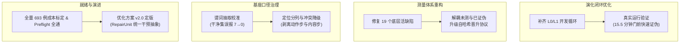

# 组会汇报｜2026-09-24

---

## 一、实验结果复盘：首轮真实 Cycle 产出与 0 准入

实验：**在不预先指定机制和候选的前提下，让系统从当前版本的真实失败出发，自主完成一轮受控的自进化闭环**（44 例宽开发池，8 例收益集，12 例哨兵集，每轮 20 例巡检预算）。

该实验在 `GLM-5.3-flash` 真实端点上完成了首个端到端运行（Cycle 1）。

### 1. 真实运行读数（终态：`completed`，0 准入）

| 阶段 / 检查项 | 真实读数 | 判定与执行含义 |
| :--- | :---: | :--- |
| **Patrol 巡检 (8例裸底座)** | `tp=3, tn=1, fn=1, fp=3, unresolved=0` | 成功暴露当前基座的稳定漏检与误报 |
| **失败机制聚类** | **2 个机制族** | 分别为 `M-5a89ab46e81f`（裁决阶段/withhold_conviction）与 `M-c393f57ff12f`（定位阶段/constrain_localization） |
| **能力规划与路由** | 均评估为 `actionable` | 任务义务相同（均为 `required_action`），但分别路由至 `withhold_guard` 与 `tracer_directive` |
| **候选生成** | 产出 1 个候选：`IV-1-001` | 类型为 `text_boundary` / `tracer.system`，极性 `boundary`，优化目标为 `localization` |
| **STRUCTURAL 结构门** | **通过** (`jaccard_base=0.1098`) | 契约合法，无上下文泄露，语法校验通过 |
| **HARMLESSNESS 保护门** | **拒绝** (`new_fn=2, new_unresolved=4`) | 哨兵保护集 4 例正确样本全军覆没（2 例翻为未决，2 例翻为假阴），边际效用 `-4` |
| **BEHAVIOR / M 收益门** | **未运行 (`null`)** | 前置保护门硬拦截，未浪费后续真实测量调用 |
| **缺陷注入审计** | **通过 (`passed=true`)** | 注入缺陷被不同门正确拦截（结构缺陷被 STRUCTURAL 拦截，极性缺陷被 BEHAVIOR 拦截） |
| **经验沉淀与版本变更** | `active_after_cycle: []` | **0 候选准入**；情景记忆（Episodic Memory）**真实写入 1 条结构化拒绝证据** |

### 2. 首轮实验证明了什么、没证明什么
- **证明了**：
  1. 真实数据上的自主演化闭环完整跑通；
  2. 机制层具备按“修复操作与失败阶段”而非“任务表面契约”聚类机制族的能力；
  3. 四门保护机制有效发挥了“安全防火墙”作用，严格践行“绝不允许收益抵消保护损伤”原则；
  4. 拒绝理由真实落盘并写入情景记忆（`memory/episodic.jsonl`），避免未来无意义重试。
- **没有证明**：
  1. **未能证明自进化有效性**：首轮 0 准入，代际能力继承（$G_0 < G_1 < G_2$）无从谈起；
  2. **未能证明检测/定位能力提升**：唯一候选直接被拒，未进入正式收益测量；

---

## 二、分析：为什么首轮实验出现 0 准入？

深入分析该实验全过程日志与落盘状态后，我们定位出导致 0 准入及运行异常的五个系统性深层根因：

### 1. 候选质量原始且激进，严重破坏已有保护能力
LLM 一次性起草的候选 `IV-1-001` 试图通过在 `tracer.system` 中加入强行截断的 `text_boundary` 提示词来约束定位范围。然而该约束过于生硬，使得原本能够正常定罪的案例无法满足过于严苛的边界条件，导致大量判定退化为 `unresolved` 或 `fn`，在保护门被直接一票否决。

### 2. 致命接线缺口：开发循环（Development Loop）此前从未生效
这是排查出的最严重设计缺口：
- **现状代码核对**：`_run_cycle` 内部没有任何对 `CandidateDeveloper` 的调用，**`development.enabled` 配置项在代码中从未被任何路径读取**；
- **后果**：本应先由 **L0（零成本确定性检查）** 和 **L1（低成本目标重放）** 进行初筛的机制完全形同虚设，LLM 一次性产出的毛坯候选**直接送入长达 62 分钟的双臂真实晋升实测**，既浪费大量算力，又必然遭遇门控拦截。

### 3. 测量完整性缺陷：把“未测量”错误记录为“已证伪”
审查发现框架底层存在三处严重逻辑漏洞：
1. **超时 fail-closed 被记为机制已死**：当运行机时耗尽导致候选臂批量超时时，保护门将未决视同 `new_fn > 0` 判定 `rejected`，并在情景记忆中记录 `falsified: true`，直接将其放入 `rejected_keys` **永久禁止再次生成该机制的提案**；
2. **Gain 机会假死**：Gain 臂因超时中断时，账本硬编码记录 `gain_measured: true`，使得跨轮评估误以为该机制在真实数据上确实没有改进空间；
3. **缺陷审计伪通过**：不可测行在切分前被剔除，导致门控根本未演练便直接放行。

### 4. 资源预算竞争与并发管理事故
- **审计与巡逻竞争墙钟预算**：在 120 分钟预算下，12 例注入审计由于包含多票听证耗尽了 89.4 分钟，导致巡逻阶段的 16 例中有 10 例触发 `batch_deadline_exceeded`，耗时 0.0 秒未决退出；
- **长尾案例主导耗时**：审计集中的 `Magentic_One/049.json` 单例运行耗时高达 36~94 分钟，严重拖垮了单轮时效；
- **并发目录冲突事故**：早期误用 `tasklist | grep python` 判断进程存活（因中文环境静默返回空而误判进程退出），导致 2 个 run 并发写入同一 `work_root` 互相覆盖数据，造成该尝试报废。

### 5. 定位口径与能力的本质缺失
对历史归档中 142 行定罪记录进行结构化重构分解，揭示了定位模块的真实短板：
- **动作步（Action Steps）**：命中率 **98/117 (83.8%)**；
- **语义内容步（Content Steps）**：命中率 **0/25 (0.0%)**！
- 过去宣称的 72.6% 定位准确率完全依赖显式的工具调用结构支撑；而在模型文本生成阶段首次引入虚构事实的内容步定位上，Tracer 缺乏语义因果追踪能力，导致相关定位候选极难产生实质正向增益。

---

## 三、9.21 晚至现在的实际研发进展

针对首轮实验暴露出的系统性缺陷，我们在过去几天放弃了简单的参数微调，围绕**“开发过滤、测量完整性、基座口径、全量就绪性与架构演进”**五大维度展开了深度重构与验证：



### 进展一：演化闭环接线补齐与门前低成本阻断实测（L0/L1 落地）
- **问题与交付**：
  - 彻底解决了 `development.enabled` 未被引擎调用的重大悬空漏洞；
  - 接入 `CandidateDeveloper`，打通了 **L0（确定性语法与边界静态检查）** 与 **L1（局部目标案例快速重放）** 管道；
  - 顺带修复了全局 `DEFAULTS` 浅拷贝跨配置污染、同轮次多机制候选 ID 碰撞、重入开发目录丢失认证版本等 4 个真实缺陷。
- **实效验证**：
  - 在扩容墙钟预算（14400s）后再次部署真实测试，系统针对定位机制族自动衍生了 2 个候选版本（初稿 `v001` 与修订版 `v002`）；
  - **核心突破**：两个候选在 L0 静态检查中 6/6 通过，但在 L1 定向重放中测定为 `fired_cases=4`（真实触发）但 `marginal_cases=0`（无效改动）；
  - **收益对比**：**系统在开发阶段仅用 15.5 分钟便就地将其证伪并阻断，未向四门输送任何无效候选，将双臂晋升的算力浪费彻底降为 0**（相较于首轮 62 分钟昂贵实测后被拒，过滤效率提升数倍）。

### 进展二：测量完整性与准入协议大修（消除仪器失真与虚假判定）
针对底层代码展开深度变异测试，排查并修复了 19 个直接污染科研结论的底层缺陷（单元测试由 843 项全面扩增至 **1043 项且全部 PASS**）：
1. **解耦“基础设施故障”与“算法证伪”**：引入 `arm_has_infrastructure_failure` 阻断机制，严禁将超时中断标记为已证伪，消除了机制被永久封禁的死锁；
2. **晋升协议硬性哈希冻结**：重构晋升协议，补齐了 `protocol_hash`、基线快照哈希与四门强制检查，彻底封堵了此前可通过在运行期原地改写角色划分或裁切 M 门来刷高准入率的协议漏洞；
3. **终审标准去伪存真**：重写 `run_final` 核心判据，严禁将 `unresolved → correct`（即“放弃弃权盲目多判”）计为有效修正，强制要求必须具备不可逆的决定性翻转（`decisive_fixed >= 1`）。

### 进展三：检测器基座口径标定与定位冲突治理
- **机械定罪校准护栏**：
  - 修复了谓词上下文抽取缺陷，在 250 例干净集上的**定罪误报由 7 例彻底清零（7 → 0）**；
  - 确立硬性校准原则：未通过干净集零误报校准的谓词，仅保留证据输出能力，一律吊销其独立定罪权限。
- **定位冲突精准降级与口径显式化**：
  - **时序合规解耦**：量化实测证明，Tracer 责任步先于 Defense 确认步的 25 例全部属于正常的“最早责任步履职”，不属于冲突；
  - **独立权威性降级**：仅对 envelope 镜像 tracer 与采纳步不符的 3 例（2.1%）进行降级，并将降级作用于新增的 `localization_authority` 维度，杜绝了此前对判定权威性（`decision_authority`）的误伤；
  - **显式分解指标**：将定位指标永久性分列为动作步与内容步，使后续实验能够精确感知语义层面的真实改进。

### 进展四：全量 693 例就绪性排查与开跑前检查（Preflight READY）
- **基线数据现状排查**：
  - 深入排查证实，仓库历史归档的全部定罪读数均来源于 10 个特定用例的 30 次重复回放；**693 例全量样本此前从未产生过任何端到端真实读数**。
- **耗时与成本精准标定**：
  - 基于真实采样建立精准成本模型：在 `workers=8` 下，单次全量 693 例运行的工作量下界为 21.3 小时，预计实际耗时 **22~28 小时**，消耗 Token 约 18.6M。
- **开跑前检查器（`preflight_real_run.py`）**：
  - 交付包含 15 项静态与动态验证的检查脚本，两阶段实测均已达到 **READY（0 blockers）**；
  - 成功排查并阻断了配置文件中“单例超时时间大于轮次总墙钟”的严重死锁隐患。

### 进展五：系统级优化方案 v2.0 定版（架构演进基线确立）
系统正式编制并发布《Agent-Hallucination 检测器与受控自进化框架：系统级完整优化方案 v2.0》，确立了后续 P0~P4 分阶段演进蓝图：
- **治理对象原子化**：废弃过去松散的干预字典拼装模式，确立以 **`RepairUnit`（修复单元）** 为核心的统一生命周期管理；
- **局部语义验证器**：针对内容步 0/25 的核心瓶颈，设计具备局部作用域的代码化语义执行器（Local Semantic Executor），为突破语义根因追踪奠定架构基础。

---

## 四、当前结论与后续工作规划

### 1. 当前系统成熟度定论
- **评估体系与演化框架已达到高可信状态**：完成了从“毛坯提示词直接冲门”到“L0/L1 门前低成本快速阻断”的闭环升级；修复了测量体系的 19 个失真漏洞，不会再产生虚假准入或错误永久证伪；
- **核心待攻克瓶颈已完全收敛**：系统的核心卡点不在于外围工程调度，而明确聚焦于**“打破内容步 0/25 的语义定位困局”**与**“提高高级修复候选的生成质量”**。

### 2. 下一步实施路线

```text
第一阶段：冻结并产出首个 693 例真实基线 (Baseline-693)
  - 启动 scripts/run_baseline_693.py (支持断点续跑，预估 22~28 小时)
  - 首次采集 693 例全量真实分布，沉淀 TP/FP/FN/TN 与动作/内容步的基线定位图谱

第二阶段：在修正后的框架上启动多轮自进化实跑 (≥3 Cycles)
  - 在 L0/L1 快速阻断与消除虚假证伪的前提下，验证系统能否自主产出有效候选
  - 重点观察候选准入后，下一代是否真正完成跨代能力继承与增量演化

第三阶段：落地优化方案 v2.0 (Optimization Plan v2.0)
  - 推进 RepairUnit 统一干预抽象与局部语义验证器落地
  - 针对内容步构建细粒度事件窗口投影，彻底攻克语义定位准确率
```
