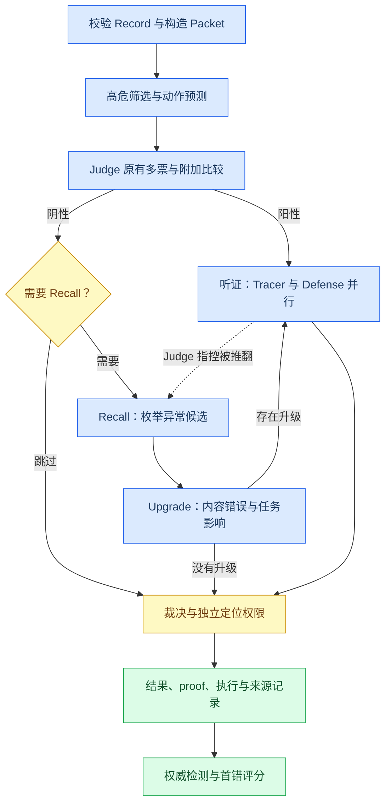
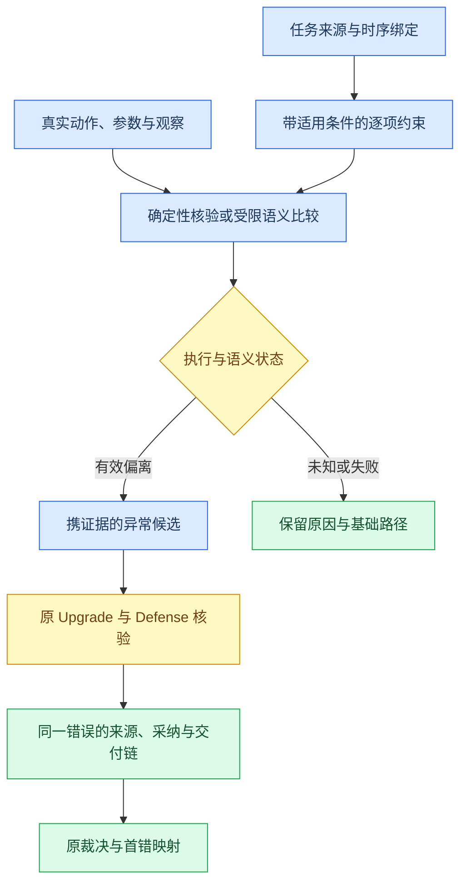

# 下一步预测机制的代码结构、执行失败与优化方案

分析日期：2026-10-16。分析对象为当前 Detector 中的高危前缀预测、真实下一事件比较及其完整检测与首错定位链。当前代码提交为 `f1f2c7d`；真实实验归属 `2fa0a56`，其后 Detector 仅有 provider 请求结束记账及对应测试变更，不能将历史实验写成新版本的重新实测。

**当前瓶颈是证据转换能力。** 预测能够产出局部建议，但没有稳定地将其转换为当前任务义务下的有效偏离，再转换为内容错误、任务影响和首次来源的证据。候选覆盖、比较合同、来源真值和后续升级都存在损失；预测还消耗原有诊断的共享预算。检测 4 修正/4 回退、定位 2 修正/2 回退，是这些变化叠加后的观测结果。现有比较无法给每个因素分配独立的因果效应。

## 🔎 1. 证据范围与复现方式

本报告使用最近恢复基线与下一步预测实验的最终采用结果，各 100 份；脚本逐份核验 200 个结果文件的归档 SHA-256，确认案例集合、检测标签和首错标签相同。原始数据只用于读取问题、历史和评估标签，标签没有传入任何预测或检测调用。没有执行真实 provider、新的效果测量或真实进化，也没有修改生产实现、既有结果或用户现有文档。

| 输入或产物 | 路径与用途 |
| --- | --- |
| 最近实测基线 | [localization100 最终评分](results/localization100-20261015/final-evaluation.json)，76/100、首错 27/62 |
| 本轮最终采用结果 | [next-action100 最终评分](results/next-action100-20261015/final-evaluation.json)，76/100、首错 27/62 |
| 冻结配置与费用 | [配置](results/next-action100-20261015/config.json)、[费用复核](results/next-action100-20261015/cost-comparison.json) |
| 可重复分析程序 | [analyze.py](../artifacts/detector/analysis/next_action_failure_model/analyze.py)；只读取历史证据并运行纯本地结构反例 |
| 机器可读结果 | [analysis.json](../artifacts/detector/analysis/next_action_failure_model/analysis.json)，包含逐例阶段、候选、升级、预算、比较、26 个模块的 AST 定义位置和输入摘要 |

复现命令：

```powershell
python artifacts/detector/analysis/next_action_failure_model/analyze.py
```

脚本中的 6 个结构反例全部复现了当前行为。“反例复现成功”表示所述结构问题可以观察到，不表示实现已被修复，也不表示新增机制的语义正确率已经测得。本文将已复核事实、从代码与案例得到的解释、以及待验证方案分别表述。

## 🧭 2. 当前执行结构

### 2.1 控制流



该图省略了干预注册表、机械裁决门和冻结回放的内部节点。完整逻辑还包含：适用的外部快照或已部署干预可以强制 Recall；机械定罪必须满足原有执行和权限门；模型或引用合同失败可能使结果降级或未决。新增预测没有替代这些分支。

### 2.2 模块职责与主要入口

| 层 | 代码与入口 | 核心职责及边界 |
| --- | --- | --- |
| 输入 | [packet.py](../detector/packet.py)：`build_packet`、`_question_text` | 只从 question/history 编译 Packet；保留原始事件位置，将多轮问题拼接；不建立用户轮次到事件的可靠映射 |
| 筛选 | [step_uncertainty.py](../detector/step_uncertainty.py)：`build_step_risk_profile`、`select_causal_candidates` | 识别局部算术、字段冲突、工具失败、工具动作和未核实声明，按优先级、已验证信号数、位置排序 |
| 确定性边界 | [next_action.py](../detector/next_action.py)：`predict_action_boundary`、`compare_next_action` | 工具明确失败后，检查相邻事件的重试、失败报告或无恢复成功声明；不是通用工具前置条件解释器 |
| 模型预测 | [action_forecast.py](../detector/action_forecast.py)：`build_action_forecast`、`prefix_view` | 从选定前缀生成至多两条允许/禁止动作约束；每次案例执行至多选一个模型候选；输出均为假设 |
| 比较 | [action_forecast.py](../detector/action_forecast.py)：`comparison_prompt`、`action_comparisons` | 将约束附加给原 Judge；验证下一事件引用与原文；失败比较转为 unknown |
| 基础判断 | [judge.py](../detector/judge.py)：`run_judge`、`_cast_vote` | 原多票决定是否有幻觉；代表票取首个支持获胜判决的票，不对局部比较建立独立 quorum |
| 异常枚举 | [recaller.py](../detector/recaller.py)：`run_recall_scan` | 根据轨迹和可用快照生成原文绑定的候选；新预测比较没有作为结构化候选传入 |
| 内容与影响门 | [recaller.py](../detector/recaller.py)：`run_causal_upgrade` | 每个候选要求内容错误、任务影响同时成立并获严格多数；没有升级的候选不进入听证 |
| 听证编排 | [hearing.py](../detector/hearing.py)：`judge_target`、`recall_target`、`run_hearing` | 构造固定目标，将 Tracer 与 Defense 并行运行；Judge 的局部比较不在目标字段中 |
| 定位 | [step_tracer.py](../detector/step_tracer.py)：`run_step_tracer` | 追踪当前指控的首次错误事件；依赖全轨迹、来源扩展和可用诊断，不直接接受预测为首错 |
| 复核 | [defense.py](../detector/defense.py)：`run_defense` | 对内容、材料性及指控位置投票，维持证据与 quorum 约束 |
| 诊断 | [causal_audit.py](../detector/causal_audit.py)、[risk_context.py](../detector/risk_context.py) | 共享预算内生成局部证书或风险上下文；健康检查失败时不会向 Tracer 提供正常上下文 |
| 裁决 | [adjudication.py](../detector/adjudication.py)：`adjudicate` | 决定检测权限与定位权限；风险、预测、单步偏离均不能单独定罪 |
| 生命周期 | [api.py](../detector/api.py)、[runtime.py](../detector/runtime.py)、[stage_retry.py](../detector/stage_retry.py) | 阶段编排、案例期限、新增预算、取消、并发及成功阶段的案例内重试复用 |
| 结果与测量 | [result.py](../detector/result.py)、[measurement.py](../detector/measurement.py)、[evaluation.py](../detector/evaluation.py) | 分离权威预测、终局读数、定位、调用观察和缺失用量；权威不等于对金标正确 |
| 回放 | [replay.py](../detector/replay.py)：`build_replay_inputs` | 将输入、源码、路由、证据及相关策略绑定到阶段身份；开启预测后不能复用关闭模式的旧 Judge |

`api.py` 是控制流所有者。预测在 `run_judge` 内执行，早于 Judge 投票；因果诊断通常在准备听证时才执行。这个顺序是预算竞争的直接来源。

### 2.3 对象模型与权限

| 对象 | 已保存的信息 | 当前不足 |
| --- | --- | --- |
| Packet | question、event_id、position、role、content、tool_interactions | 一条事件包含调用与返回，可能还有顺序未知的声明；没有 active_turn 绑定 |
| Forecast | packet/policy 摘要、候选事件、预测、健康状态、生产者 | 选中事件不等于已预测，预测成功不等于 Judge 已成功比较 |
| Constraint | requirement、allowed/forbidden_actions、evidence_ref、quote | 没有独立 constraint_id、明确适用条件和义务绑定；原文存在不证明约束蕴含 |
| Comparison | source/next_event_id、matched/divergent/unknown、reason、refs、quote | 多个约束合成一个状态；缺失与校验失败合并；自由解释可能带入未来信息 |
| Recall candidate | claim、locus、原文与轨迹引用、可选快照引用 | 没有接收新增预测的结构化异常，也不自动拥有独立真值 |
| Upgrade row | content_error、causal、corrected_step、reason、coverage | 两个布尔量难以区分已反证、没有证据和证据冲突；未升级不等于已经证明正确 |
| Hearing target | 指控、位置、引用、交付、正确参照、contracts、basis | 没有携带预测的约束绑定、实际动作差异和候选来源链 |
| Detection result | state、decision_authority、localization_authority、责任事件、proof | “权威”表示按合同形成了结果；模型一致通过仍可能与金标不符 |

检测、局部动作合规和首次错误是三个不同问题。局部 matched 只回答该动作与某个约束是否一致；divergent 还需要内容错误与材料性核验；定位还需要追到该材料性错误首次出现的事件。

### 2.4 实验、重试与学习边界

[实验脚本](../scripts/run_next_action_experiment.py)冻结同一 100 例、配置与源码，运行首轮，再按非权威状态统一恢复并采用恢复权威的结果；整个过程保留首轮和恢复费用。首轮 53 次、恢复 2 次模型预测请求，不等于最终接受的 43 例约束，也不等于发生 55 次有效比较。技术失败预试另有 12 次预测请求，不能混入正式效果 cohort。

`runner.py` 在整例尝试外创建共享 AddedBudget 和 StageRetryCache。后者只复用成功且阶段状态正常、quorum 未失败的结果，避免为运行故障重复花费。新增比较 unknown 不影响 Judge 的 ok，所以可能随整个成功 Judge 阶段一并缓存。基础成功阶段仍应保留复用；若增加比较修复，应有独立健康状态和身份，不能为了修比较重复整套基础判决。

[evolution/causal_failures.py](../evolution/causal_failures.py) 当前归档的动作三元组来自确定性 `build_next_action_audit`，终端 deviation_status 保持 unverified；它不是把本轮模型 Forecast 自动学成共享规则的闭环。本轮没有运行真实进化，因此没有“预测错误后系统自动学会新规则”的实测收益。未来若训练或进化消费新结构，仍需来源去标识化、正常邻居保护与独立准入，不能直接把金标答案写成运行时约束。

## 📊 3. 从总指标拆到失效位置

### 3.1 覆盖与比较

| 层次 | 实际观测 |
| --- | --- |
| 全部案例 | 100 |
| 使用预测上下文 | 47，含 43 例模型约束和 4 例仅确定性边界 |
| 没有使用预测上下文 | 53 |
| 模型预测落点 | 第 1 个事件后 17 例，第 2 个事件后 25 例，第 8 个事件后 1 例 |
| 模型代表票比较 | matched 5、divergent 3、unknown 35 |
| 35 条 unknown 的来源 | 缺失或校验失败 32，模型明确 unknown 3 |
| 全部相关 Judge 票 | matched 16、divergent 10、unknown 103；129 张票不是 129 个独立案例 |
| 任一票出现模型 divergent | 5 个案例，最近基线均已检出 |
| 最近基线明确漏检 | 19 例，其中 8 例本轮使用模型预测，这 8 例仍全部漏检 |

`62` 个阳性中有 `28` 例使用模型预测，仅 `5` 例预测比较的下一事件恰好是金标首错。后者是落点描述，不是通用定位召回率：位于更早或更晚的诊断也可能帮助回溯，前提是后续存在同一错误的证据连接。

| 按本轮采用状态分组 | 案例数 | 基线正确 → 本轮正确 | 基线首错命中 → 本轮首错命中 |
| --- | ---: | ---: | ---: |
| 使用模型预测 | 43 | 33 → 31 | 15 → 15 |
| 仅使用确定性边界 | 4 | 3 → 3 | 2 → 2 |
| 没有使用预测上下文 | 53 | 40 → 42 | 10 → 10 |

这些分组由本轮执行状态决定，并非随机分组。模型组净减 2 不能直接解释为模块因果伤害；无预测组净增 2 则进一步说明，总体结果变化包含基础执行和版本差异。

### 3.2 下游阶段变化

| 项目 | 最近基线 | 本轮 |
| --- | ---: | ---: |
| Judge 阳性案例 | 35 | 37 |
| Recall 实际运行案例 | 27 | 27 |
| Recall 候选总数 | 65 | 67 |
| 升级候选总数 | 23 | 17 |
| 听证总数 | 58 | 54 |
| 实际使用诊断上下文的 Tracer 听证 | 58 | 40 |
| 因果诊断健康 | 100 ok | 78 ok、22 budget_exhausted |
| 附加外部证据快照的案例 | 0 | 0 |

这些是不同执行版本的描述性统计，不能据此认定“预测使升级减少 6 个”。它们说明，新增预测没有消除原有升级门的证据难题，同时发生了可直接证明的诊断预算退化。

### 3.3 本轮 20 个漏检分布

| 阻断位置 | 数量 | 典型案例 |
| --- | ---: | --- |
| Judge 阴性且未触发 Recall | 10 | BFCL/115、OpenDeepSearch/011、BFCL/072 |
| Recall 运行，但没有候选 | 3 | BFCL/071、Magentic_One/078、Magentic_One/025 |
| 有候选，但没有通过 Upgrade | 6 | OpenDeepSearch/034、OpenManus/031、OpenDeepSearch/042 |
| 有 Judge 指控，后续复核未定罪 | 1 | SmolAgents/024 |

因此，增加 Recall 触发只是局部解法。另有 9 例漏检的阻断点在枚举或升级；一律强制更多扫描不能自动解决候选真值和任务影响问题。

首错失败也应继续拆分：62 个阳性中，20 个未检出，另有 15 个已检出但位置不准，27 个位置正确。本轮 42 个真正检出的阳性定位权限均为 authoritative；这 15 个是实际位置错误，没有用定位降级状态解释掉错误。检测召回和已检出案例的来源回溯需要分别优化。

## 🧩 4. 根因模型

### R1. 风险代理没有优化增量信息价值

排序首先看信号类别，再看已验证信号数量，最后看事件位置。普通工具动作和返回通常都会得到 priority=2，而纯声明的 unsupported_claim 为 priority=3；模型候选又限定 priority≤2。于是早期工具使用很容易占据预测位置，后期无工具的错误声明和长程污染难以被选择。显式工具失败走确定性分支后，不再针对该事件做模型前置条件分析。

当前筛选回答“哪些地方有风险信号”，没有回答“哪一个可核验义务最可能提供基础链尚未利用的信息”。不能利用本轮金标调选择器，否则会把回顾性命中伪装成方法收益。应先以未核验的任务约束、实体/时间切换、证据来源变化和动作前置条件作为可解释选择维度，再在独立数据检验。

### R2. 前缀边界只完整覆盖事件数组

`prefix_view` 保留最近 6 个前缀事件，并有界摘录通道，但 question 是全部轮次拼接后的文本。BFCL/071 的第 1 个事件前缀实际携带第 3 轮请求，且错轮约束仍通过引文校验。现有单轮未来事件不变性测试没有覆盖该问题。

同时，筛选在完整 Packet 上计算 Top K，因此整体调度是回顾性的。一次预测只发送截至 t 的事件，并不能证明其触发选择是严格在线的。比较由能看到全轨迹的 Judge 给出，结构化引用限制到下一事件，但自由 reason 没有相同的内容边界。本轮 129 条模型票比较中，7 条解释提及比目标更晚的 event_id，分布于 6 个案例；这是时序泄漏警示，不足以证明每条判决实际依赖了未来事件。

原始数据本身没有可靠的轮次—事件映射时，应明确标记无法绑定，不能按最新问题猜当前轮次，也不能从金标或答案字段补造映射。

### R3. 比较是可失败的旁路，且多个约束共用一个状态

`_parse_judge` 不把 next_action_comparisons 纳入核心合同验收。基础判决通过后，`action_comparisons` 才处理新增字段；缺失、重复、错误引用或不合法字段都变成相同的 unknown，不触发原合同修复。基础链因此能继续完成，但新增模块的实际失败被弱化为一个普通诊断状态。

此外，一次模型预测最多包含两条约束，比较却只有一个 state。BFCL/071 中“加油量保留两位小数”与错轮的“下一步查胎压”混在一起，部分满足也只能整体 unknown。应分离 applicability、逐约束比较状态和比较执行健康；正常的语义 unknown 不应该被修复成强行确定。

当前对比原始不合格输出没有充分保留细分失败原因。32 条 missing_or_invalid 不能继续被拆成“模型漏字段多少、引文错误多少”的精确数字。

### R4. 预测与动作一致性没有补充独立真值

预测复用 Judge 路由和轨迹资料。引用通过只证明文字出现在所发前缀中；没有代码证明该引用蕴含 requirement、所有 forbidden_actions 都必要，或所引用的观察确实正确。

两种相反风险同时存在。OpenManus/031 的人类回复没有得到独立核实，本轮因此拒绝升级；SmolAgents/062 又在没有外部快照时，把不同阶段互相不一致的“确定公共知识”当成内容错误依据。前者不能通过“缺证即有错”解决，后者也不能由增加同模型票数自动解决。需要区分真实工具返回、返回中的外部断言、任务固定事实、可重算事实和模型记忆。

### R5. 新诊断没有进入候选和证据升级的结构化接口

预测比较仅附加给 Judge 并保存在 proof；它可以间接改变 Judge 的判断、置信度或指控，但没有直接作为 Recall 候选、Upgrade 的受核验差异或听证目标的来源链传递。`judge_target` 不包含 next_action_comparisons。普通 Recall 不读取本轮预测；只有另外的 causal_review 分支能向 Recall 提供 causal_context，该阴性反馈在本轮关闭，且其已实现支持域主要是局部算术证书。

更精确的说法是“缺少结构化利用”，而非“预测完全不可能影响判决”。也不能把局部 divergent 直接变成定罪：正确桥梁应是异常候选及证据，再经过原有内容、材料性与 Defense 门。

### R6. 可选预测会耗尽原有诊断的预算

`Detector.detect` 创建同一个 AddedBudget；预测先使用它，后续 `build_causal_diagnostics` 再调用同一预算的 `begin/check`。22 例预测耗尽 time 后，其后因果诊断也全部 budget_exhausted，audit/profile/projection 为空。这 22 例中实际有 12 场听证，均未获得诊断上下文。另 2 场没有上下文的听证来自 Tracer 合同错误，不能一并算作预算造成。

因此，本轮 54 场听证只有 40 场使用上下文；该退化无需预测进入 Judge 即可由共享资源结构产生。`shadow` 也在 Judge 前计算预测并使用共享预算，不能未经验证便视为与 off 完全隔离的测量旁路。

runtime 已排除基础 provider 等待时间，不能把 22 例简单解释成“整个基础 Judge 等待都算进 180 秒”。真实问题是可选新增工作消耗了后续诊断仍依赖的资源。预算耦合已由控制时钟反例复现；它对整体准确率的独立影响尚未测得。

### R7. 局部处置与首次来源没有统一的错误绑定

预测源 t、实际动作 t+1、错误观察来源、首次采纳和最终交付可能属于不同事件。OpenDeepSearch/007 的首次错误在第 2 步工具观察，比较发现的是第 3 步采纳，原 Judge 指控和最终定位停在第 4 步。仅知道第 3 步违反“不要采信缺证检索”不足以证明第 2 步是同一个材料性错误的首次来源。

现有 Tracer 提示已经要求回溯，代码也有依赖图、代码变量和语义消费提示，但这些结构对自然语言事实的同一性和来源可靠性仍是提示，不是通用证明。应为同一指控建立 origin/adoption/delivery 三类锚点及各自证据，验证修复与旧值替换，再将最早有证据支持的原始事件映射回 dataset_first_error_event.v1。

## 🧪 5. 真实执行案例

### 5.1 BFCL/071：错轮约束与缺少前置动作

原任务按轮次要求加油、启动、检查胎压。第 1 步完成升到加仑换算；模型预测却要求立即检查胎压，并禁止再次加油或启动，因为 question 包含未来轮次。另一个约束正确要求 7.93 加仑，两条约束被合为 unknown。

第 4 步 startEngine 因车门未锁而失败，第 5 步诚实报告并询问是否锁门，确定性比较记录 matched。金标的错误是第 4 步缺少 lockDoors 和 pressBrakePedal 前置调用。当前边界没有工具契约来机械确认所有前置动作，不能从金标反向补给预测器。

| 阶段 | 最近基线 | 本轮 |
| --- | --- | --- |
| Judge | 阴性、medium、0/3 阳性票 | 阴性、medium、0/3 阳性票 |
| Recall | 2 个候选 | 0 个候选，实际运行且状态 ok |
| Upgrade | 1 个升级 | 无候选，无需升级 |
| 听证与结果 | 确认第 5 步遗漏恢复，检出但首错未命中 | 没有听证，漏检 |

该回退发生在候选枚举，不是 Recall 触发门。改进必须核验当前义务、工具能力和已授权恢复；诚实失败报告只免除虚构成功，不自动证明先前动作和未完成义务正确。

原件：[本轮](../artifacts/detector/live_checks/next_action100_20261015/runs/next_action100_quote_fixed/cases/BFCL__071.json/result.json)、[基线](../artifacts/detector/live_checks/live100_20261014_full/runs/opt100_20261014_v2/cases/BFCL__071.json/result.json)。

### 5.2 OpenDeepSearch/034：继续搜索被接受，时间参数没有核验

预测要求继续检索报告日期。真实第 3 步无依据地加入“in 2023”；一张 Judge 票仍判 matched，认为带日期词继续搜索符合动作模式。代表票为 unknown。金标将第 3 步引入年份认定为首错。

Recall 本轮实际生成 4 个候选，包括向查询加入 2022/2023、把 March 2022 放入查询、将无日期返回说成日期确认；Upgrade 全部不升级，认为查询措辞是策略、返回确实支持 2022，且没有外部证据证明错误。基线曾生成 5 个候选、升级 2 个并检出，但定位在第 4 步。

该例同时暴露“动作类别过宽”和“查询假设被返回重复后是否成为独立证据”的来源问题。仅禁止所有带年份的查询也会误伤有依据的定向检索；需要记录日期参数的来源、它是待检验假设还是已确认事实，以及返回是否提供独立支持。原始金标为 April 2020 是本地评估事实；本文没有重新联网核验该外部历史。

原件：[本轮](../artifacts/detector/live_checks/next_action100_20261015/runs/next_action100_quote_fixed/cases/OpenDeepSearch__034.json/result.json)。

### 5.3 OpenManus/031：正确提醒没有解决真值与升级

第 8 步 ask_human 返回 Perfect Day；本地金标答案为 Instant Calm。预测提醒必须归属人类来源或进一步验证，比较却为 unknown。两轮 Recall 都找到了“人类断言未经核验即交付”的候选：基线 2 个候选、升级 1 个并定位第 8 步；本轮仍有 2 个候选，但全部不升级。

本轮 Upgrade 的理由是缺少佐证不能证明事实错误、工具确实返回了该人类回复、没有外部快照。因此，瓶颈已到内容证据层。恢复基线的“未核实即错误”推断可能在该标签上命中，却不能作为通用修复。必须将“尚未证实”“已有反证”“任务明确要求核验却未履行”分开，保持当前证据不足时不凭空定罪的边界。

原件：[本轮](../artifacts/detector/live_checks/next_action100_20261015/runs/next_action100_quote_fixed/cases/OpenManus__031.json/result.json)。

### 5.4 SmolAgents/062：同模型多阶段确认也会形成误报

本地金标为正常，答案 1.3。两轮 Judge 都是阴性，且均有 1/3 阳性票，因此 Recall 实际运行。基线没有候选；本轮生成并升级 2 个候选，两场听证都确认有错，最终误报。

本轮 Recall/Upgrade 的一个理由称相关功能属于 1.21.2 / snapshot 24w33a；Defense 又称正确版本应为 Beta 1.8。本文不判定外部版本史，关键事实是这些不同的正确参照没有外部快照支持，也没有通过一致的证据绑定。在不一致的参照下仍得到两条 substantiated，说明格式、引用和投票成功不能替代真值核验。

这也是优化的正常保护案例：不能通过更激进的异常升级提高召回，再把新增误报隐藏在净分数中。

原件：[本轮](../artifacts/detector/live_checks/next_action100_20261015/runs/next_action100_quote_fixed/cases/SmolAgents__062.json/result.json)。

### 5.5 BFCL/056：可选预测失败，原有定位支持也丢失

预测耗尽新增时间，没有向 Judge 提供预测上下文；后续因果诊断复用该预算，返回 budget_exhausted，Tracer 没有获得原有风险上下文。基线 Judge/Tracer 都定位第 4 步，本轮都定位第 5 步，金标为第 4 步。

这里能证明“预测超时使诊断无法生成”和“实际定位退化”共同发生，不能证明后一件事完全由前一件事造成。本轮 Judge 在进入 Tracer 前已经改了指控；基础源码和输出容量也不同。优化应先消除可选模块吞掉既有证据的结构耦合，再做同配置消融测量定位影响。

原件：[本轮](../artifacts/detector/live_checks/next_action100_20261015/runs/next_action100_quote_fixed/cases/BFCL__056.json/result.json)。

### 5.6 有效偏离为什么仍无新增命中

| 案例 | 实际比较 | 最近基线 → 本轮 | 解释 |
| --- | --- | --- | --- |
| OpenDeepSearch/007 | 第 3 步 divergent | 已检出、第 4 步 → 相同 | 金标第 2 步；发现采纳偏离没有补上来源定位 |
| SmolAgents/048 | 第 3 步 divergent | 已检出、第 2 步 → 相同 | 错误连续性假设已在第 2 步发生，第 3 步的代码/分析缺失更晚 |
| SmolAgents/066 | 第 3 步 divergent | 已检出、第 3 步 → 相同 | 实体混淆已由基线发现，新增诊断重复了原有信息 |
| OpenManus/040 | 仅部分票 divergent | 已检出、第 1 步 → 相同 | 对未验证化学假设的后续采用没有新增命中 |
| OpenManus/102 | 仅部分票 divergent | 已检出、第 1 步 → 相同 | 对错误因式分解的后续采用没有新增命中 |

前 3 个是代表票 divergent，后 2 个只在其他票出现。它们不是 5 个经过局部比较 quorum 确认的新错误。

四个检测修正也没有形成清晰的模块证据链：OpenDeepSearch/027 的预测时间耗尽，Camel/012 没有预测，SmolAgents/043 从已有正确降级结果恢复权威，OpenManus/095 的比较为 unknown。修正是真实观测，但不能直接算成下一步比较的独立收益。

## 🛠️ 6. 优化后的证据模型

优化目标是让新增信息进入既有验证链，并保留所有原始证据、投票、引用、材料性和权限边界。先实现小范围可验证义务，避免另建一套与 Detector 语义相冲突的通用裁决器。



### 6.1 保留原始事件，增加可证明的内部时序

内部视图区分 call、observation、claim，记录其原 event_id 与 interaction_id。只建立日志能证明的偏序，例如同一工具调用先于其返回；同事件自然语言与工具动作的顺序不明时继续标记 unknown。评分仍映射到原始事件位置，不改数据集粒度或金标。

任务来源保存 turn_ref 和适用对象。原日志没有轮次对齐时不把最后一轮当当前轮；该案例可以进行标明边界的回顾性全任务审计，不能宣称严格在线预测。如果需要严格在线能力，必须使用提供真实用户消息时序的数据。

### 6.2 逐约束比较，分离失败与语义未知

在现有结构上最少增加以下信息，并升级 schema 与回放身份：

```json
{
  "constraint_id": "stable_constraint_id",
  "task_source_ref": "question:turn_1",
  "scope": "tool_argument",
  "binding": {"entity": "vehicle", "field": "fuelAmount", "unit": "gallon"},
  "applicability": "established",
  "comparison": {
    "state": "matched",
    "validation_state": "valid",
    "reason_code": "literal_rounding_matches",
    "actual_refs": ["event_002_tool_01"]
  },
  "decision_authority": "none",
  "localization_authority": "none"
}
```

该对象是拟议接口示意，具体数值必须来自已绑定记录。`scope` 和 `binding` 不能由示例工具名自动推断；无法确认的实体、单位或适用条件保持 unknown。比较至少区分 missing、invalid_shape、invalid_ref、invalid_quote、ambiguous_order、inapplicable、explicit_unknown；记录有界原输出与校验原因。

使用现有基础 Judge 请求时，可要求每个约束单独返回状态，并沿用其真实引用。缺字段或引用格式错误属于局部合同修复；语义证据不足不属于可重试至确定的错误。是否允许额外修复调用必须计入同一测量配置，不能隐藏调用成本。

### 6.3 让语义建议落到可复核的谓词

| 类型 | 优先实现的核验 | 必须保留的未知 |
| --- | --- | --- |
| 固定字段、格式、单位与数值 | 任务原文绑定、显式单位、白名单表达式和舍入计算；复用现有 predicates/DSL | 无单位、近似要求、复杂自然语言转换 |
| 实体或时间参数 | 检查参数来自哪个任务/观察；区分待检验假设、已确认事实和查询回声 | 相似名称是否同一实体、外部事实真假 |
| 工具失败与恢复 | 同一义务下核验失败、能力、授权、恢复尝试与后置状态 | 不从未知工具规范推断必需前置调用 |
| 人类或检索断言 | 保留来源角色，检查独立证据是否支持交付中的具体断言 | 缺少佐证不直接等同错误 |
| 自然语言推理 | 绑定原文与限定语，生成待核验候选，再走现有升级门 | 模型的合理解释不升级为确定性证书 |

对必须由模型判断的比较，现有全轨迹 Judge 可以先提供可审计的逐项结果，但仍不能宣称严格无未来信息。若同时保留模型前缀预测，并要求严格局部的模型比较，应单列一个只接收前缀和真实下一步的比较请求，测量其额外调用与延迟。不能将第二次独立模型工作称为零成本复用。

### 6.4 用异常候选接入原链，不让风险获得判定权

将有效偏离转换为现有 candidate 的受约束输入，包含 constraint_id、义务来源、实际动作差异、轨迹引用及验证状态。原始预测和模型建议只能作为候选来源；内容是否错误、错误是否影响交付仍由 Upgrade/Defense 判断。Recall 仍可独立枚举其他错误，不能被预测候选替代。

对于原 Judge 一致阴性但存在可验证矛盾的案例，允许该证据请求复核；原始 divergent、一次输出错误或纯策略差异都不能单独强制定罪。比较失败不应把全部正常案例推成未决，但也不能伪装成 matched。阴性复核策略需要正常保护样本和明确适用域。

为 Tracer 增加同一指控的 origin、adoption、delivery 三类来源锚点，逐条记录被哪个实际值或声明消费。候选首次来源和最终首错之间继续由现有定位合同核验，不取最早风险事件，也不机械取 t 或 t+1。既有依赖图、代码与语义来源提示可以复用，不重新制造一套未核验的“因果图”。

### 6.5 保护原有诊断的资源

保持整例期限、取消、并发、投票和原有重试。先准备可复用的确定性风险/依赖数据，在统一父预算内为既有诊断和上下文准入保留资源；可选预测仅使用未占用部分。预算保护必须覆盖后续上下文准入，不能只提前计算 profile，却在 Tracer 前再次因预测耗尽时间而丢弃。

资源预留量先从离线实际工作量确定，本文不编造一个毫秒常数。父预算继续汇总所有请求、输入和输出，子模块不得绕过总额。分别记录 forecast、comparison、diagnostics 的消费和失败原因，使 shadow 对基础输入、诊断可用性及调用计划的影响能被测试。不要通过削减必要票数、删除 Recall 或放宽引用核验获得表面效率。

## 🧱 7. 实施顺序与验收条件

以下为拟议工作包，尚未实施或获得效果验证；本次已执行的只有证据分析与结构反例。

| 顺序 | 源规则与主要消费者 | 工作内容 | 完成的证据条件 |
| --- | --- | --- | --- |
| P0-1 | runtime → forecast/causal_audit/Tracer | 同一父预算下保护既有诊断；区分可选预测与原诊断准入 | 控制时钟使预测耗尽后，已保留的诊断仍可按合同使用；父预算、整例 deadline 和取消仍严格有效 |
| P0-2 | packet/evidence_view → prefix/比较/回放 | 显式轮次与微事件偏序；不能绑定时返回 unknown | 改动未来用户轮次不改变已经绑定的前缀；缺映射不猜轮次；原事件评分映射不变 |
| P0-3 | action_forecast → Judge/proof/统计 | 逐约束 ID、独立执行健康、拒绝原因和有界原输出 | 缺失比较与 explicit_unknown 可分；基础 Judge 仍可运行；所有票可追溯且不将样例当 quorum |
| P1-1 | 既有 predicates/DSL → 预测/Upgrade/Defense | 小范围共享义务核验与来源可信度类型 | 同一规则在多个阶段解释一致；正常变体、许可阻塞和真实修复不误报 |
| P1-2 | API/Recall/Upgrade/hearing/Tracer/replay | 经核验异常进入候选和来源回溯，保持听证独立 | 已验证矛盾可触发复核；无原文和未建立材料性的预测不能定罪；旧阶段身份不能掩盖新上下文 |

每个工作包先复现一个根因，再修改源规则及全部消费者，执行相应离线回归。高风险正常样本包括：同一任务的合理替代动作、诚实且确实无法恢复的失败、实际完成的后续修复、查询中有来源的年份、同义实体表示和有适用来源的正常事实。不能只增加能命中本轮阳性案例的测试。

现有 `test_action_forecast.py` 已覆盖单轮未来事件、不合法引文、零预算、缓存复用、开关、确定性边界及比较降级；这些保护需要保留。新验收缺口是多轮问题截断、部分满足的多约束、共享预算造成原诊断退化、真实语义对比及异常到来源链的贯通。既有 2596 项测试和 18 项检查的历史报告不能自动为未来更改背书。

## 🧮 8. 效果验证设计

### 8.1 建立新的可比基线

`1137a50` 是优化前的代码提交身份；最近 76/100 的结果属于之前一次实测，不是本轮功能源码在 off 下的同预算控制组。因此需要在相同源码、模型路由、基础输出容量、期限、并发、证据、数据顺序及恢复规则下建立新的 off/on 比较，所有权威与失败结果都保留。

| 配置 | 目的 | 可解释的变化 |
| --- | --- | --- |
| A：同源码 off | 建立当前可比控制组 | 基础链表现 |
| B：当前 shadow | 测量预测本身的资源耦合 | 没有 Judge 注入时的诊断可用性与成本 |
| C：当前 judge_context | 重现现有机制 | 预测内容加入 Judge 后的变化 |
| D：仅加入预算保护 | 分离资源退化 | 诊断恢复及效率变化 |
| E：逐项加入义务绑定、比较合同与异常传递 | 检验各项语义改进 | 每项增量分别记录，不把所有改变打包后归因 |

如果严格局部比较增加额外模型请求，应作为单独配置报告，不与一条额外请求配置混记。整体消融使用真实新请求；阶段回放只能复用实际输入和身份均未变化的阶段，不能冻结受新机制影响的 Judge、比较或候选来制造一致性。

### 8.2 同时验证中间机制与最终效果

| 层 | 需要的指标 |
| --- | --- |
| 候选 | 选择/预测覆盖、任务义务覆盖、按轨迹长度与来源的落点；首错重合仅为描述 |
| 预测 | 约束是否被原文支持、适用条件是否成立、对象/单位/轮次是否绑定 |
| 比较 | 每个约束的有效交付率、语义正确性、unknown 原因；三票逐例一致性及少数票分歧 |
| 证据转换 | 新偏离生成多少可核验候选，通过哪些内容与材料性检查，是否错误提升人类/模型断言 |
| 定位 | 来源、采纳、交付区分是否正确；全部阳性首错命中及检测条件下的定位分别报告 |
| 最终质量 | TP/FP/FN/TN、4类配对变化、检测与定位权威覆盖、未决和降级 |
| 效率 | 所有 started、结束缺失、usage 下界、额外工作分解、中位与尾部时延；保持失败尝试成本 |

本轮 100 例已经反复查看，只能作为回归与机制审计集。新的规则与阈值应冻结后，在按来源/任务隔离的未见数据上验证，防止把案例记忆当泛化。所有结果按固定规则采用；恢复仍只按非权威或运行失败选择，不按金标或判对与否挑选。报告配对变化及不确定性，不承诺特定百分点增益。

## ✅ 9. 可支持的结论与尚待验证项

已确认：本轮检测与首错净变化为零；新增模型预测的有效非 unknown 比较很少；任一票发现的模型偏离均未带来基线之外的新检出；关键回退分布于候选枚举和升级；共享预算确实使 22 例因果诊断耗尽，其中 12 场听证丢失诊断上下文；多轮前缀与自由解释存在时序边界缺口。

尚待验证：预算保护能恢复多少首错命中；逐项义务绑定能减少多少 unknown；结构化异常传递能补回多少漏检且不伤正常；独立事实证据的收益与成本；同源码开关消融及未见数据上的稳定净收益。它们是可执行的验证问题，不是已经实现的能力或已经测得的增益。

当前配置采用路径请求 740→797，中位案例耗时 787.597→966.587 秒。优化应首先使已有额外工作交付可核验、可传递的证据，再判断是否值得扩大覆盖和预算。
