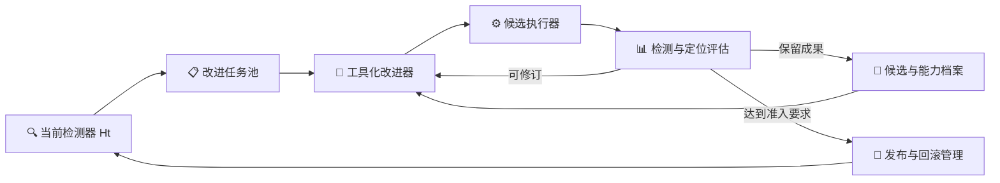

# Agent Hallucination 自我改进框架优化方案

更新日期：2026-09-21。项目核心目标以[根 README](../README.md)为准；当前实现见[技术方案](technical-solution.md)。本文规划后续改造，所列新模块和新行为尚未实现。验证用于确认改造有效，不作为独立研究主线。

## 🎯 1. 目标与总体路线

项目有两个核心目标：第一，检测器正确执行 Agent 幻觉检测任务，并给出可靠的责任步骤定位；当前底座基本有效，应作为持续改进的基础。第二，自进化或自我改进框架正确生效，能够自动产生、验证、部署和积累有效改动，提高底座的检测与定位能力；RSI 架构是实现这一目标的可选途径。

当前主要投入放在第二个目标。优化路线为：**把已有提案与筛查流程升级为能够操作系统、完成修复、继承有效版本的改进循环；将检测收益与定位收益共同纳入选择和准入。**

保留当前 Judge→Recall→Upgrade→Tracer→Defense→Adjudication 底座。框架根据实际错误选择提示、DSL、上下文、证据工具、局部代码或流程策略改动，不预先限定必须采用某一种核验方法。只有具体改进确实需要时才调整底座接口。

## 🧱 2. 要补齐的框架能力

| 当前基础 | 要补齐的能力 | 直接服务的目标 |
| --- | --- | --- |
| proposer 能产生合法干预，研究通道支持有限修订 | 改进器按需读轨迹和源码、执行局部尝试、利用新反馈修复 | 提高有效候选产出率 |
| 4 类干预、固定 hook、受限 DSL | 按需装载上下文工具、解析器和局部组件改动 | 让框架能解决提示无法表达的失败 |
| S/G 四门、研究筛查分开实现 | 建立统一候选交接和自动晋升入口 | 让研究成果真正进入运行底座 |
| M 主要奖励二分类净收益 | 将定位修复作为独立目标并保护既有检测能力 | 检测与定位共同提升 |
| H_t、registry、三类经验已有持久化 | 完整可运行父代、可继续修订的候选档案与能力依赖 | 后代从有效成果继续改进 |
| 失败族和能力缺口可记录 | 自动选择修复目标、选择修改方式、推进下一轮 | 减少逐轮人工选择机制和开接口 |

历史问题转化为设计要求即可：没有收益机会时不能否定机制，也不能阻断所有开发；补丁没执行时要修接线，缺事实时要补能力；候选失败后要有修订路径；成功后要能部署并成为下一代起点。无需在开发主线之外长期开展全面病因分析。

## 🔄 3. 目标 RSI 架构

建议把系统组织为四个协作部件：任务控制器、改进器、候选执行器和评估/发布器。它们可以是程序模块与工具调用循环，不要求实现四个独立 LLM Agent。

### 3.1 任务控制器

输入为当前部署版本、巡检结果、错误与定位偏差、能力缺口、历史尝试和剩余预算。输出是一个可执行改进任务：目标问题、代表案例、受保护能力、允许修改面和预算。

任务至少分为漏报、误报、定位错误、运行/证据能力缺口四类。每轮优先选择有明确输入证据、现有权限下能推进且预计收益较高的任务；不可处理的缺口进入待办。已有人工机制清单可用于启动，但后续巡检应能自动生成任务。

诊断只做到足以决定下一项改动：读取相关失败阶段或运行一个局部检查；随后立即实现并测量候选。遇到信息不足时记录具体缺口，不继续生成同类无效提示。

### 3.2 工具化改进器

将当前一次性 JSON proposer 扩展为有界工具循环。保留原 proposer 作为低成本修改方式，并增加以下能力：

| 工具能力 | 作用 |
| --- | --- |
| 读取指定案例及阶段 proof | 查看真实错误和定位链路，不依赖固定摘要 |
| 读取允许修改的源码/配置与活跃干预 | 明确补丁消费位置和已有能力 |
| 创建候选分支、编辑干预或允许的组件 | 形成实际可运行改动 |
| 执行合同检查和局部检测 | 尽早发现无效修改、接口错误和不可达补丁 |
| 比较父代与候选的阶段/最终结果 | 找到新变化并进行修订 |
| 读取经验和选择历史父代 | 复用有效实现，避免原样重试已否定方案 |

每个任务限定调用、版本、token、墙钟和允许路径。改进器可返回有效候选、可继续发展的候选、需要能力扩展或无法推进；不要求每轮必须准入。gold 可用于开发评价与任务监督，仍不得进入检测器运行输入。

### 3.3 候选执行器

候选以完整可复现版本执行：原代码基线、父代 ID、registry、配置、组件补丁、依赖和内容 hash 一起固定。不同候选使用隔离目录，不能修改当前部署实例，也不能复用身份不匹配的缓存。

优先复用现有后端、provider、checkpoint 和日志。纯干预继续走 registry；新增上下文/工具/代码组件由装载适配器接入同一个 Detector 接口。组件候选改变输入依赖时，受影响阶段及后继必须重新执行。

### 3.4 评估与发布器

开发反馈用于修订；候选冻结后进入晋升评估；晋升通过才更新 active 版本。发布后立刻进行能力保持检查，并把该版本作为下一轮巡检和修改起点。判定器、gold 和最终确认集不属于候选可修改面。

四门继续承担部署保护。框架层改动或新的优化目标所需的新合同，应单独版本化实现后再运行，而不是让改进器现场修改门限。发布动作保存可回滚快照，并确保下一代加载的是完整有效版本。

## 🛠️ 4. 优化一：打通开发、修订和发布

这是第一个实现工作包，优先复用 `research.py`、`engine.py` 与已有候选。

### 4.1 统一候选对象

新增通用候选描述，字段至少包括：`candidate_id/parent_id/target_kind/change_kind/base_revision/artifact_refs/dependencies/content_hash/development_results/status`。局部 v001/v002 仅作运行内名称，跨轮按内容及完整执行身份识别。

将干预 JSON、联合干预、配置/上下文补丁等包装为同一候选生命周期：draft → developing → frozen → promotion_pending → active/retired。保存真实失败与停止原因；修订形成新 hash，不覆盖父代。状态名为拟议设计，具体实现统一在生命周期模块中。

### 4.2 建立晋升桥接

新增统一入口，将冻结研究候选转换成部署评估输入，复用 STRUCTURAL/HARMLESSNESS/BEHAVIOR/M；禁止研究 PASS 直接写 active。晋升前检查父代、组件装载、S/G 可测性、数据用途及预算。通过后由 registry/版本发布器提交，失败或不可测则留在候选档案。

这样，框架可以自动走完“开发出改进→确认有效→成为下一代”的链路，而不再依赖人工把研究目录中的候选移入其他运行。

### 4.3 把失败反馈接回修订

修订输入增加本候选实际产生的新阶段结果，至少包含错误样本、责任步变化、相关听证、实际触发、失败类别和可修改位置。保留原始轨迹的按需读取，避免将全部大记录永久塞入提示。

先支持预算内少量版本的连续修订，并允许从最佳有效父代继续；不要只允许“最新失败稿再写一遍”。选中的候选依据固定开发标准，不能只选最后一个通过版本。每次完整测量后可结束任务，不为了耗尽预算继续搜索。

**工作包完成条件：** 一次指令能完成真实候选开发、冻结、晋升检查和版本记录；可测且有效时自动发布，不可测或退化时明确结束；恢复后不重抽已经完成的结果。

## 🎯 5. 优化二：把定位能力纳入自我改进目标

当前底座已输出责任步骤，但部署进化主要以二分类增益选择候选。定位任务需要进入失败池、提案目标、行为检查与收益门，不能仅在最终报告追加一个指标。

### 5.1 定位任务的构造

从权威检出的阳性案例中收集责任步骤错误、步骤缺失和跨重复不一致。结合目标指控、候选步骤、tracer/defense 结果组织任务。gold 步骤由评价侧使用；标注有歧义时记录允许的责任事件集合或待复核状态，不向检测器泄漏答案。

可选择的修改包括 tracer.system、相关视图构造、候选证据传递、交付锚点解析、升级定位与 Defense 的同一指控约束。检测已正确而位置错误的案例，是定位优化的主要机会集。

### 5.2 双目标收益合同

建议版本化增加 `target_kind=detection/localization/joint`，沿用现有检测指标并增加：

- **检测收益 ΔD**：同一固定批次的有效正确判定增量。
- **联合成功 ΔJ**：固定 gold-positive 且有可评定位标注的批次上，“权威检出且定位正确”的数量增量；漏报不能从分母消失。
- **定位保持**：父代已定位正确的案例在候选下不得无记录退化。

检测目标要求 ΔD>0，并保护定位和运行健康；定位目标要求 ΔJ>0，并保护原检测正确性；联合目标至少一个目标改善且另一个不退化。具体容差沿用或在运行前明确定义，不用临时加权分数抵消新增误报/漏报。

定位的 BEHAVIOR 检查应验证相关阶段实际执行，并确认责任事件依据发生了目标变化；定位版本的收益门需要新实现。不能把重复 case ID 塞进现有二分类 M 门冒充定位支持。

**工作包完成条件：** 框架能够独立发现和修复定位错误；一个只提升定位、不改变二分类的有效候选能够按新合同被正确评价和晋升。

## 🧰 6. 优化三：扩展实际可修改能力

按改进任务开放修改面，而不是一次性重写底座。

| 层级 | 改进器可产生的成果 | 适用问题 | 接入方式 |
| --- | --- | --- | --- |
| L1 现有干预 | 提示、联合提示、DSL、触发器、guard | 检查遗漏、规则表达和局部判定边界 | 复用 registry |
| L2 上下文与工具组件 | 视图构造、事件解析、交付锚点、证据检索/整理、定位证据准备 | 信息未被正确呈现、工具能力不足 | 新组件接口和版本装载器 |
| L3 局部流程策略 | 何时召回、调用哪种证据工具、哪种错误需要额外定位复核 | 固定调度不能有效利用已有能力 | 受限策略配置与执行合同 |
| L4 改进器策略 | 任务选择、父代选择、修改方式选择、开发预算分配 | 已有闭环稳定后提升改进效率 | 独立策略版本与同起点比较 |

L1 先用于闭环集成，L2 为主要能力扩展。L3 在实际任务表明确需改变调度时加入，L4 等有效改进可积累后再实施。模型权重训练、任意工作流搜索不是必要前置条件。

### 6.1 最小组件接口

建议能力组件声明 `component_id/version/input_schema/output_schema/entrypoint/dependencies/budget`，输出携带来源、状态与必要中间结果。具体逻辑可为代码、工具包装或配置。H_t 从描述清单扩展为引用可装载组件的版本清单。

对代码改动使用隔离候选 checkout/执行目录、明确可编辑文件和受控运行环境；普通子进程只提供超时/崩溃隔离，不当作任意代码的安全沙箱。校验通过后才能被评估器装载，运行时不能修改 evaluator、数据标签或活跃发布目录。

### 6.2 何时扩展，何时结束

改进器先判断现有 hook 是否足够。若输入已有必要信息，提示或 DSL 能解决，就直接完成修复；若需要新解析/检索/上下文能力，生成对应组件；若需要新调度，提交流程策略。连续失败应输出具体阻塞，转用适配的修改方式，而不是无限改写同一提示。

仅在遇到实际阻塞时增加接口。义务图、局部核验程序等检测方法可作为具体任务的候选实现，由实际收益决定是否采用。

**工作包完成条件：** 至少一种超出现有文本干预的有效修改能够由改进器产生、装载、评价，并在新的检测运行中实际执行。

## 🌱 7. 优化四：累积改进与版本继承

将研究候选档案与 active registry 分开。active 只保存通过晋升的版本；档案保留有效局部成果、尚需组合的能力和已失败版本。档案是后续改进的父代来源，容量有上限，依据收益、覆盖和重复程度维护。

### 7.1 父代选择与能力组合

下一轮默认以当前 active 版本为起点，同时允许从档案中选取与当前目标有关的能力进行组合。组合后重新执行必要评估，不能相加两个独立实验的收益。父代选择依赖检测、定位、健康和成本记录，而非版本先后。

组件之间记录显式依赖；例如定位证据组件依赖某个事件解析器，发布时必须一起装载。回滚和淘汰按照依赖闭包处理，不能删掉仍被活跃能力引用的组件。

### 7.2 经验真正参与决策

已有三类 memory 继续使用，但记录应指向可执行成果及结果：哪类任务适用、改了什么、哪里有效、哪些近邻退化、成本和可复用版本。控制器用这些信息安排任务与修改方式，改进器用它选择父代和避免无效重复。

未测量不当作失败机制；未通过部署但具有可用中间能力的版本可继续在开发区被利用。记忆不可改写评估结论，也不能绕过晋升检查。

### 7.3 持续运行

每轮发布后巡检当前 H_t，区分尚未解决的旧错误和新引入错误。新的检测任务从当前能力状态出发，保持独立 H0 参照以衡量累计收益。遇到持续负收益、基础设施不可用或预算耗尽时暂停该分支，并恢复最后有效版本。

**工作包完成条件：** 至少两代真实改进形成继承链，后代实际执行祖先成果，并进一步改善检测或定位；不是每轮重新从裸底座修同一批问题。

## 📏 8. 优化五：让开发评估支持有效改进

开发评价要给改进器足够反馈，发布评价要防止退化，两者分工明确。

| 数据角色 | 框架用途 | 使用方式 |
| --- | --- | --- |
| 开发任务集 | 生成、执行、修订候选 | 可反复使用，反馈完整 |
| 开发选择集 | 选择父代与候选 | 使用次数和暴露记录明确 |
| 晋升收益集 | 判断冻结候选是否改善目标能力 | 检测和定位各有真实可修机会 |
| 保护集 | 保持既有检测与定位能力 | 同期对照，新退化显式记录 |
| 后续复测/独立终审 | 检查发布后收益与泛化 | 不用于当轮候选修订 |

gain 不可测不阻断开发任务；开发出的候选也不因此直接晋升。晋升机会按预先定义的任务类型和采样规则准备，不根据候选结果不断替换。没有足够定位标注时先建立小规模审阅集合，只对可信标注计定位收益。

候选比较采用相同基座、模型、允许输入和运行包络。确定性/不受影响阶段可回放；改变模型输入或控制流后的完整确认使用 fresh 对照。记录案例重复，避免把同例调用数当独立样本数；小样本不足以排除退化时保留不确定结论。

汇总使用内容 hash 和完整运行身份；未决、失败和中断保留。报告同时展示全案例检测正确率、权威覆盖、联合检测定位成功、误报/漏报、新退化和成本。补齐这些读数后即可服务实现迭代，不另行建设庞大统计研究项目。

## 🗓️ 9. 实施顺序与交付

| 阶段 | 核心工作 | 代码落点 | 可交付结果 |
| --- | --- | --- | --- |
| P1 闭环接通 | 通用候选、连续修订、研究到晋升桥接、完整反馈 | `research.py`、`engine.py`、`proposer.py`、`registry.py` | 一次运行可开发、冻结、检查晋升并记录结果 |
| P2 双目标 | 定位任务生成、联合成功指标、定位行为与收益合同 | `worksheet.py`、`metrics.py`、`gates.py`、`evaluation.py` | 检测和定位候选都可被正确优化与准入 |
| P3 工具化 | 读源码/证据、局部执行、受限编辑、可装载组件 | proposer 新工具循环、backend、harness、组件适配器 | 能实际修复一个超出现有干预面的瓶颈 |
| P4 累积 | 候选父代档案、组合依赖、经验使用、下一代运行 | `memory.py`、`gaps.py`、`registry.py`、控制器 | 多代有效成果继承与持续收益 |
| P5 RSI 提效 | 自动任务/父代/算子选择和预算分配 | 控制器与改进策略模块 | 同预算下更稳定地产生有效改进 |

P1 立即开始，P2 紧随其后；P3 与前两阶段共享候选和评估接口，避免建一套独立于主系统的新框架。每阶段完成一个可运行增量就进入真实任务验证，验证失败直接形成下一项修复，不以追加分析文档代替实现。

首轮开发选择两个明确任务：一个检测失败任务、一个已检出但定位错误任务。先让它们贯穿任务生成→修改→评估→晋升检查；随后扩展到不同来源与机制。具体案例从当前可用记录中核实，旧试点案例可作集成回归，不能充当候选未用收益集。

## ✅ 10. 配套验证与完成判据

验证围绕功能和收益展开，随实现推进。

| 要确认的能力 | 最小验证 | 通过后说明什么 |
| --- | --- | --- |
| 检测器仍正确执行 | 原有回归＋改动关键路径测试 | 接口和已知行为保持 |
| 改进器可操作系统 | 真实任务中自主读取、修改、执行、修订并输出可运行版本 | 工具循环实际生效 |
| 检测提升 | 父代与冻结候选在未参与修订的收益/保护批次配对运行 | 检测改动有实际价值 |
| 定位提升 | 固定可定位正例批次比较联合成功，并保护检测能力 | 改善不只来自判定翻转 |
| 发布生效 | 新实例加载完整版本，并观察到改进执行痕迹 | 成果确实进入底座 |
| 继承生效 | 下一代从新版本继续，调用祖先组件并取得新增收益 | 改进可以积累 |
| 框架有附加价值 | 冻结基座、当前提案流程、增强改进循环在相同预算下比较 | 收益与自动改进过程有关 |

统一报告四组结果：相对 H0 的累计检测收益、累计定位收益、相对上一代的边际变化、搜索和推理成本。只展示通过候选会高估框架效果，因此预算内全部尝试计入改进效率。

工程闭环通过与模型效果通过分开：链路跑完但无收益，视为功能完成、目标尚未完成；定位收益不能被二分类收益掩盖；单代成功后继续验证继承，不立即宣称递归改进已建立。晋升失败应保留并回到开发或结束该分支，不能通过降低门限制造成功。

本路线的阶段性完成标准是：**基本有效的检测器保持可用，自我改进框架能在受控预算内自动产出可运行改动，经配套验证提高检测或定位能力，发布后继续作为下一代基础。** 后续工作的优先级均依据这一标准确定。
