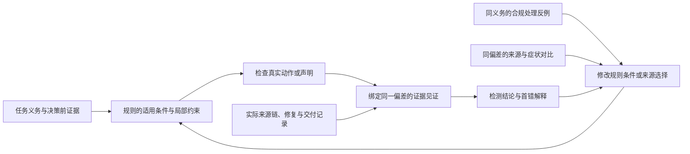

# 从轨迹审计到诊断规则学习：项目理论主线与创新路线

更新：2026-10-15。本文是整个仓库的研究定位与后续论文写作主文档，覆盖检测、首错定位、解释和检测器自进化。当前行为以[技术合同](technical-solution.md)为准，工作状态见[实施台账](../IMPLEMENTATION_PLAN.md)。文中“拟议方法”是本次形成的研究设计，尚未实现；已有实验统一在 §6，概念评审在 §10，二者分开判断。

本次按 `ccf-idea-optimizer` 与 `ccf-idea-reviewer` 的思路，围绕问题、洞察、机制及可反驳主张组织，由同一分析者独立完成。公开文献有针对性检索至 2026-10-15，并非穷尽检索。实验依据包括历史653例、10月13日恢复基线、当前100例首轮及10月15日补测最终合并；本次只读核对全部已完成结果和请求日志，未启动新实验。

## 1. 总体判断：把研究对象从模块转为诊断规则

**建议把整体项目收束为：在有限日志中，学习能同时解释“为什么构成实质错误”和“为什么应定位在这里”的诊断规则，并用反例修订这些规则。** 当前系统可作为研究底座；下一阶段最值得争取的方法贡献，是让检测与定位共享可检验的条件，并使自进化直接修改这些条件。

目前的工程叙事回答了“系统如何运行”，科学叙事还需回答“为什么同类风险有时导致幻觉、有时不导致；为什么某个错误来源应当承担当前交付偏差，而另一个显眼事件不应当”。增加评审角色、提示长度或验证步骤，不能单独回答这些问题。

拟议的中心假设是：**对于同一类任务义务，区分异常处置是否错误，与区分首次来源和后续症状，可以部分共享一组关于对象、证据、时序和修复的关系条件。用两类反例共同约束这些条件，有机会比独立改写检测提示和定位提示得到更可迁移的诊断。** “部分共享”允许不同错误族使用不同规则，也允许检测已明确而位置仍不确定。这里提出的是可验证假设，不是已有结果。

这条主线保留整个仓库的价值。任务语义提供判定对象，来源图提供可查询关系，听证检查规则实例是否成立，单步约束识别风险如何被处置，自进化根据反例改规则，测量框架检查改变是否有效。论文应重点讲这些部分之间的约束关系，工程角色与发布流程放在实现章节。

真实 novelty 的判断分三层：已有的检测、首错、前缀约束、对比反思与门控均有先例；本仓库已有可复用的实现基础与内部观察；**“以义务实例为单位，同时受合规反例和定位反例约束的规则学习”是值得发展的具体候选增量**。本次没有确认领域首创，也不将这一候选写成已完成的算法。

## 2. 科学问题：风险信号为什么不能直接变成诊断

### 2.1 三个需要联合解决的歧义

第一，**异常与实质错误之间有处置差异**。一个工具失败之后，助手可能合法恢复、如实报告阻塞，也可能虚报完成；同一个失败标记不能区分它们。一个工具没有报错，也可能发生对象、单位或时间条件的错误转移。异常检测因而不能直接代替任务交付判断。

第二，**实质错误与最早责任位置之间有传播差异**。错误可能先出现在工具观察，随后被助手采纳，又在最终回答中复制。也可能早期只是合法假设，后期才被无依据地当成事实。判断交付有错，并不自动确定首错；把位置统一前移也无法解决这一问题。

第三，**解释一个失败与修复检测器之间有概括差异**。某个规则可以纠正一个错例，却误伤同风险的正常处理，或在其他任务根本不触发。需要知道应该修改的究竟是适用条件、证据关系、终端材料性，还是来源选择。笼统要求“更加谨慎”无法提供这个区分。

这些歧义分别出现在现有 `semantics.py`、来源/定位链和 `evolution` 开发链中。统一研究对象后，它们对应同一个问题的三个环节：规则如何成立、位置如何由规则约束、规则如何被反例修正。

### 2.2 一个贯穿方法的例子

以下是说明机制的构造例子，不是新增实验。用户要求“将对象 A 的字段置为 v，并在修改后查询确认”。各轨迹都有某次失败观察：

| 观察与实际处置 | 对这项义务的判断 | 对规则学习的作用 |
| --- | --- | --- |
| 首次写入失败；随后对 A 重试成功，并在之后查询确认 | 失败插曲已处理；这一局部义务可以得到支持 | 反驳“出现失败就判幻觉” |
| 写入 A 失败；查询另一个对象 B 成功；声称 A 已完成 | B 的成功不能证明 A 恢复；还需核验声称与实际状态的冲突 | 迫使规则绑定对象和操作，而非只查 success 字段 |
| 先查询 A，再成功修改；直接声称已经完成“修改后确认” | 旧观察不履行明确要求的后置查询；偏差可以没有工具报错 | 迫使规则保留时间顺序，扩大到成功日志中的错误 |
| A 的操作确实被阻塞；如实说明，未宣称完成 | 不构成该项虚假完成；其他交付义务仍须逐项检查 | 反驳“诚实失败等于全部任务正确”或“未完成必是幻觉” |

在第二种情形中，“A 的失败观察”“把 B 的成功套用于 A 的决策”“最终完成声明”仍是不同位置。工具如实返回失败，本身不是被证明为错误的工具事实；首错候选应落在已确认的不当决策或声明。只有独立证据确认上游观察本身有误，且它与当前偏差同源，才可能把来源追到该观察。

这里最值得学习的是关系条件：**同一对象、同一义务、当时可见的证据、满足规定时序的恢复**。具体工具名、案例编号与措辞不应成为部署规则的判别依据。

### 2.3 保持任务定义与证据判断分开

仓库的 MATERIALITY 规则覆盖最终答案、工件、任务固定的动作/参数/顺序，以及完成声明。它比只检查回答中的事实更宽。论文应明确采用的任务口径，并保留与数据集的口径差异；不能把一切任务失败改称幻觉，也不能在分析后改变原标签。

“日志未显示支持”“证据与声明冲突”“真实世界中声明为假”是不同命题。开放事实缺少依据时通常只能保持未知；明确要求的字段被改错、后置查询确实遗漏等可观察违约，则可由任务和日志直接支持。复制链证明信息被消费，不证明源信息真实。后续方法必须保留这个区别，否则可解释性会退化为更详细的错误解释。

## 3. 统一方法：一条规则贯穿判断、定位和解释

### 3.1 规则的内容与读取边界

设任务为 q，完整轨迹为 τ，决策前可见前缀为 H_t。任务中的义务实例 o 包含原文依据、对象、所需结果或动作，以及适用时间；它不能由助手自己的计划擅自补充。拟议规则写作：

\[
r=(\omega, g, c, m, \pi).
\]

ω 是可跨任务绑定的义务类型，g 是适用条件，c 是局部动作或声明约束，m 是该偏差与交付的关联条件，π 是同一偏差的来源选择规则。g、c 的实例化只使用 H_t 及当时适用的契约；m、π 可以检查真实后续记录。未来信息能用于事后追踪，不能回填到先前决策的已知前提。

例如，规则不写“工具 X 报错就去找更早步骤”，而写“对义务 o 的对象已观察到操作失败；若接下来声称该操作成功，需有适用于同一对象及操作的恢复依据；若该声明构成当前交付偏差，再沿实际引用关系寻找首次引入”。将失败模板换成固定字段、单位或状态时序，规则结构仍可复用。

规则检查保留 `not_applicable / satisfied / violated / unknown`。guard 不成立只表示这条规则不适用；没有规则触发也不表示轨迹正常。模型可以提出候选条件，原文引用、对象绑定和可机械核验的关系由检查器验证；语义解释仍可能出错，不能因输出是结构化格式就提升证据等级。

### 3.2 从规则生成可检查的解释

一次解释应给出一个与规则绑定的证据见证：

\[
w=(r,o,E_{\mathrm{pre}},t_a,E_{\mathrm{src}},
K,E_{\mathrm{delivery}},E_{\mathrm{repair}}).
\]

E_pre 支持规则前提，t_a 是局部违规的动作或声明，E_src 支持来源和消费关系，K 是尚可能成立的首错位置集合，E_delivery 与 E_repair 分别支持交付影响和修复状态。来源不明时可以确认不当采纳；证据不能消除多个位置时，K 不应被任意压成一个最早数字。现有接口仍输出单步，研究阶段可先将 K 作为诊断侧记录，正式输出继续遵守原定位合同。

推理顺序是：从任务绑定规则，检查真实动作，沿同一偏差寻找来源与交付影响，检验修复和替代解释，再交由现有听证裁决。已确认的违约与交付关系支持阳性诊断；单独的异常、无支持标记或推测依赖不支持定罪。定位输出必须对应该听证实际确认的偏差，不能借另一项更早错误获得较小步号。

`dataset_first_error_event.v1` 仍是当前评测目标。外部来源和助手首次不当采纳可以作为两个解释坐标，但不能将原金标改成更容易命中的“首次采纳”。这是方法解释与数据集投影的区别。

图描述拟议统一机制。当前代码具有若干入口，但尚未实现通用规则表示及双类反例学习。

### 3.3 两个解释方法边界的推论

**单步判断不能代替结果性判断。** 取两条轨迹，它们直到同一个局部错误动作都完全相同，一条后来修正，另一条将错误交付。任何只读取这个前缀和下一动作的函数，对二者必然给出相同输出，因而不可能同时正确判定结果性幻觉。这个简单不可区分性说明，单步约束应承担局部判别，实际后缀承担材料性和修复验证。它是设计依据，不是拟主张的新定理。

**有限日志不能保证唯一因果根源。** 若两个不同隐藏状态产生同一可见日志，而真实错误来源不同，任何只读日志的算法都不能始终区分它们。记录中的依赖、任务违约和来源范围可以被核验；真实环境的因果必要性还需要额外假设、环境重放或独立证据。局部算术证书的结论也只在声明的符号域内成立。

这两个边界给出积极的方法要求：前缀局部约束、后缀交付核验与来源证据各有不可替代的作用；缺少其中一类信息时，应明确是哪一项结论尚不成立。

### 3.4 可解释性要体现在判别和修订中

当前仓库最成熟的是**可审计性**：引用可回查、步骤可对齐、决策与定位权限分开。后续应增强两种能力。其一是**可区分性**：解释必须指出为何相似的正常处理不应被同规则判错，为何下游副本不是首次来源。其二是**可修订性**：反例应指出规则哪项条件失效，导出有界修改，而非只要求模型重新思考。

还需检验解释是否忠实于实际推理。规则必须在使用前绑定证据并记录其实际消费；不能先得到结论，再生成一个看似匹配的规则。若最终听证覆盖了规则建议，应记录为听证另行判断，不能仍把规则称为该结论的充分解释。对前提的受控遮蔽或替换可以检验检测器是否依赖该证据，但这种检验不证明原 Agent 环境中的因果责任。

## 4. 候选方法贡献：用两类反例学习同一规则

### 4.1 最关键的变化是学习单位

拟将规则学习单位从“整条轨迹成功或失败”细化为“某项义务的处置及其来源解释”。一条总体错误的轨迹，也可能正确处理了另一个工具失败；这个局部片段可以反驳相应的过宽规则。反过来，整条轨迹的正标签不能证明每个风险事件都违规。

当前 `matching_action_normal_neighbors` 选择健康、gold=false、prediction=false 且同风险下动作合规的整例邻居。它是保护机制，还没有实现上述局部监督。拟议扩展需要为局部义务提供独立核验依据；不能把检测器自己说“正常”当作新真值。金标只用于开发侧选择和评分，运行时规则仍只读任务、日志和适用证据。

### 4.2 两类反例约束不同的错误

**跨轨迹的合规反例**保留相近的义务类型与风险前提，但具有合法的处置或已确认的恢复。它们约束“何时可以认为存在当前违约”，防止规则只记住失败词、工具名或高风险表象。匹配依据是对象角色、操作和证据条件，不只是文本相似度。

**轨迹内的定位反例**比较同一偏差的已核验首次来源与下游副本，或比较责任候选与已修复、无关的早期异常。它们约束“为什么位置应当选这里”。下游副本仍可能是错误，负约束针对其首错资格，不能把它重新标成正确内容。不同错误之间、来源关系未知时，不构造这种顺序监督。

这两类约束作用于同一条 r：一条只抓到交付末端虚假声明的规则可能检测正确却定位偏后；一条把所有失败观察都选为来源的规则可能位置偏早并误伤正常轨迹。规则必须同时解决适用边界和来源选择，才算完成当前研究目标。这是比“把检测损失与定位损失相加”更具体的机制要求。

### 4.3 可实现的规则搜索与修订

第一版采用有限、带类型的谓词与修改操作。谓词来自显式任务字段、对象/单位/时间绑定、真实动作与观察的顺序、已核验消费边及修复依据。模型负责提议组合或指出缺失条件；程序检查类型、引用、读取阶段和适用域，不执行模型生成的任意代码。

一次开发迭代如下：

1. 从已经核验的同类义务实例构造目标违约、局部合规反例和来源对比；证据不足的样本保留待核验，不强制赋标签。
2. 从共享条件产生有限候选规则，在同一解释器上执行；保存每个目标和反例的触发、检查状态与来源选择。
3. 将失败转成具体编辑：正常处理被误伤则补对象、时序或恢复条件；末端副本被当来源则修改消费关系或来源选择；目标未覆盖则检查缺失绑定，不能用案例 ID 扩大触发。
4. 对保留下来的条件尝试删除。若删除后不改变已要求的判别、定位和覆盖，则去掉该条件；若改变，保留对应反例作为该条件的必要性证据。
5. 在独立开发验证样本回放整个检测器，再执行既有发布门。规则拟合、整机收益和部署准入分别记录。

允许的编辑先限定为绑定或替换关系中的类型变量、增加有依据的适用条件、补充恢复/交付检查，以及改用同偏差消费关系选择来源。位置不能按固定步数前移，任务金标中的正确步号和答案不能进入部署谓词。例如，一条候选若把“最早失败观察”选作首错，定位反例应迫使它检查该观察是否真的引入当前错误；如实返回失败的工具事件不能仅凭时间更早就获得首错资格。

第 4 步得到的是**相对于当前样本与候选语法的局部不可删减性**。它不是唯一规则、全局最小程序或真实因果充分条件。其解释价值在于每项保留条件都能回答“删掉它会把哪一种情况混淆”。

一个可用的研究目标是：

\[
\min_{\mathcal R}\quad
\mathcal L_{\rm det}(\mathcal R)
+\lambda\mathcal L_{\rm loc}(\mathcal R)
+\alpha\operatorname{size}(\mathcal R),
\]

这里评价的是装载规则集 R 后的完整检测器 D_R：L_det 在完整开发请求上计算错误，L_loc 检查有依据的来源对比是否选择了正确来源、排除了不具首错资格的候选。一个集合同时保留正确来源和未消除的错误候选，只能计为尚未区分。轻量规则回放用于筛选候选，整机回放才测量这些条件是否实际改变最终输出，二者损失不混用。

同时约束已核验保护样本无新增误报、目标覆盖达到预先设定要求、成本不超过预算。未知或并列须计入定位覆盖，不能当作已正确。复杂度惩罚抑制案例特化；覆盖约束排除“规则从不适用、因此没有误报”的空解。权重与阈值是待确定的开发参数，当前仓库没有实现或优化此目标。

这属于反例驱动规范学习思想的应用与具体化，并非重新发明反例搜索。可能的新贡献在于**义务层面的监督组织、两类反例对同一关系规则的联合限制，以及从该规则直接生成判定证据与来源候选的推理接口**。

### 4.4 为什么这个整合有机会产生额外作用

同一谓词不能只在自然语言摘要里复用。它必须同时控制运行时规则适用、开发时邻居匹配及修订后的重新验证。例如新增“恢复观察必须指向同一对象”之后，B 的成功不再为 A 提供恢复依据，对象真正一致的正常轨迹仍应通过；该条件也决定哪些上游事件能进入来源链。

因此可区分的因果链是：**改变共享关系条件 → 同时改变误报边界和可接受来源 → 减少同风险误判与来源/症状混淆 → 有机会改善端到端检测定位及规则迁移。** 这是待验证的机制预测。若把两类反例拆给独立提示，在同预算下效果相同，或共享条件只增加了文本长度，整体 novelty 就应收缩为普通的组合改进。

本项目的可保留优势有三项：已有数据坐标与任务语义便于核对局部义务；检测与定位分别记账便于识别不同修订目标；父候选反馈及正常邻居回放便于实施反例修订。它们降低研究落地成本，但自身不是方法首创性的证明。

## 5. 最近工作扣除之后，还剩下什么

检索覆盖 Agent 幻觉归因、轨迹诊断、动态约束、自进化及反例规范学习；相邻的程序诊断、因果表示学习和规则学习文献只作部分核验。下表基于一手论文的所列方法章节，不比较不同数据、标签和预算下的分数。“剩余差异”是本次分析提出的研究空间，不是对方论文已经证实的结论。

| 已核验来源与位置 | 已有机制及直接重叠 | 对本项目的约束与候选增量 |
| --- | --- | --- |
| [AgentHallu](https://arxiv.org/html/2601.06818v1)，任务定义与标注 | 幻觉检测、责任步和原因；本仓库使用其多框架轨迹 | 不能认领任务或数据。需要在诊断规则及其学习机制上产生方法增量 |
| [Who&When](https://arxiv.org/abs/2505.00212)，问题与方法概述 | 责任 Agent/步骤归因，整体、逐步与搜索式分析 | “找到首错”不是新问题；需说明规则如何区分来源与症状 |
| [AgentRx](https://arxiv.org/html/2602.02475v1)，§3.1–3.4 | 从 schema、政策和前缀合成动态约束，检查后生成带证据的违例日志，再定位 | 单步前缀约束已有直接先例。候选增量是跨案例学习其适用关系，并共同限制误报与来源选择 |
| [FALAT](https://arxiv.org/html/2606.00765v1)，§2 | 分层表示、类型依赖、来源/传播区分及局部候选验证 | 图、双向追踪和来源区分不能独立认领；规则学习须产生不同于单案验证的可复用判别条件 |
| [TrajDebug](https://arxiv.org/html/2608.06346v1)，§3、§6 | 基于证据发现错误，跟踪修复和终端影响；诊断用于修复与历史经验迁移 | 义务参照、修复和终端影响的叙事高度重叠。拟议重点转为诊断器的共享规则及反例修订 |
| [AgentDebug](https://arxiv.org/html/2509.25370v1)，§3 | 细粒度分类、关键步反事实分析、反馈后重执行 | 日志审计与环境重执行是设置差异；本项目不能据此宣称更强的因果证明 |
| [AgentScope](https://arxiv.org/html/2609.02371v1)，§3.1–3.3 | Reasoning-Action Graph、语义表示与 neural invariants 检查 | 类型化轨迹和语义约束也已有覆盖。新增语法或把提示叫“不变量”不够，须明确规则如何学习和被推翻 |
| [GEPA](https://arxiv.org/abs/2507.19457v2)，方法概述 | 轨迹反思、提示候选更新、测试与互补选择 | 通用反思优化已有先例；应比较同预算下结构化规则搜索与自然语言改写 |
| [SEVA](https://arxiv.org/html/2606.29713v1)，§2.2、§2.5 | 结构化事实验证及自身迭代，包含规则阶段与后续参数更新 | “验证器也能进化”不是新点；候选差异在轨迹义务、检测/首错共同约束及程序规则修改 |
| [TRACE](https://arxiv.org/html/2608.22793v1)，§2.2 | 按技能聚合成功/失败轨迹，对比修订行为知识，区分部署可见信息并去除任务特化内容 | 对比成功失败、部署视角和去记忆化已有覆盖。拟议增量必须落实到局部义务监督与轨迹内定位反例，不能只换更新对象 |
| [Sentry](https://arxiv.org/html/2610.02994v1)，摘要、§1 | 按当前失败条件检索经验，引导恢复，并在核验局部恢复后写入经验 | “失败知识有适用条件”也不能独有化；本项目进一步研究如何从反例学出条件及其来源判别作用 |
| [Verifier-as-Gatekeeper](https://arxiv.org/html/2608.05810v1)，预提交门与边际选择 | 结构、无害、语义及组合边际筛选 | 与四门有明显重叠；准入负责保护更新，不列为本论文的核心创新 |
| [AgentSpec](https://arxiv.org/html/2503.18666v3)，运行约束方法 | trigger、predicate 与运行约束，可由模型生成规则 | 可执行约束形式是借鉴基础，离线诊断的用途差异不足以证明算法新颖 |
| [Adversarial Specification Mining](https://arxiv.org/abs/2103.15350)，方法概述 | DICE 通过反例否定伪规范，再推断更可靠的执行规范 | 反例驱动规范学习已有长期先例。本文的研究空间是部分日志条件下的义务级监督、联合首错约束及检测器更新接口 |

本次比较使贡献进一步集中：**“动态约束 + 来源追踪 + 对比进化”仍是已知原语的组合；值得检验的是两类反例能否通过同一组关系条件改变诊断和定位。** 如果最终实现只生成更长的反思文本，或分别调整两个互不约束的提示，就应按组合系统定位，不能沿用 §4 的方法主张。

## 6. 已有实验能支持什么

### 6.1 最终结果更新

| 固定证据 | 权威覆盖 | 权威检测正确 | 全请求正确 | 全部阳性首错命中 |
| --- | ---: | ---: | ---: | ---: |
| 9月G0，653例 | 651/653 | 490/651 = 75.27% | 490/653 = 75.04% | 114/419 = 27.21% |
| 历史恢复基线，100例 | 99/100 | 68/99 = 68.69% | 68/100 = 68.00% | 22/62 = 35.48% |
| 当前完整首轮，原100例 | 93/100 | 72/93 = 77.42% | 72/100 = 72.00% | 23/62 = 37.10% |
| **10月15日补测最终合并，原100例** | **99/100** | **76/99 = 76.77%** | **76/100 = 76.00%** | **27/62 = 43.55%** |

7例补测中6例恢复权威并采用，SmolAgents/043仍降级，保留首轮；全部100例都有终局记录。非权威终局不计入主口径正确数，若另行接受降级终局则为77/100。最终TP42、FP4、FN19、TN34，权威召回42/61=68.85%，全部阳性的权威检出42/62=67.74%。

原件及逐例来源集中在[结果索引](results/README.md)，详细失败、采用规则和费用在[实验日志](experiment-log.md)。100份采用原件的provenance SHA-256逐项核对通过。原冻结manifest的单轮描述不覆盖全部实际外层attempt，比较时应同时读取最终来源与请求日志。

### 6.2 从效果变化提炼科学问题

最终100例相对唯一历史基线为检测12修正/4回退，净增8例；定位8修正/3回退，净增5例。描述性单侧精确值分别为0.0384与0.1133。**当前出现积极的内部配对变化**，更新了此前只依据首轮作出的判断；混合源码、输出容量、额外补测及缺少稳定独立复测，使它仍不能证明单步模块、共享规则学习或自进化的因果收益。

最终权威覆盖恢复到99%，较当前首轮多4个权威正确及4个定位命中。这说明可测性影响效果，但最终相比历史基线的提升也不能仅凭覆盖数量相同就全部归于算法；两次非权威案例及状态不同。

历史95交集曾呈现检测71/95→65/95、定位18/57→20/57；双方检出的30例定位15/30→19/30。该观察仍有助于发现检出与来源选择的联合瓶颈，但30例子集的0回退不代表总体。最新结果支持继续发展整体检测定位方法，并未替代这些机制层面的区分问题。

端到端定位可分解为全部阳性的权威检出比例与检出后的权威定位率之积。恢复基线22/62=(35/62)×(22/35)，最终为27/62=(42/62)×(27/42)。这个恒等式说明同时改进检出与已检出后的来源选择才有完整价值，不构成新理论。当前Tracer-only接线仍不能直接为共享规则带来召回收益。

### 6.3 成本与经验主张的边界

采用结果有740个请求；原调用汇总将首轮752与补测73相加为825。但逐条journal去重发现补测实际有114个started请求，包含未采用的外层尝试，完整对应范围为**866个started、859个finished、7个结束状态未知**。finished中有31个transport_error，因此不能写成全部调用HTTP200。[请求日志审计](results/localization100-20261015/request-journal-audit.json)保留路径与摘要，原JSON保持不变。

采用结果的案例中位耗时约788秒，历史基线约430秒；未知usage及中断尝试保留为未知费用，没有整体提速证据。更早中断18例未计入866这个范围。效率研究应减少重复推理和无效证据处理，同时保留必要覆盖，不能用选择性的费用范围论证节省。

历史三轮自进化仍为7个开发版本、4个正式候选、0准入，active为空。这与本次检测器补测是不同实验，尚无持续自改进证据。局部候选损伤正常邻居提出“如何学习适用条件”的研究问题；正式不可测属于测量问题，不能靠放松保护门替代方法改进。

完整693例已有开发暴露，当前结果是内部回顾性评估。§3–4的通用规则学习尚未实现，现有接口接通及本次检测收益不能被当作它的成绩。新方法能否改善同风险混淆、来源误选及规则迁移，仍由§9的区分证据检验。

## 7. 单步受限动作预测：统一规则中的局部判别器

### 7.1 当前实现与拟议能力

`next_action.py` 已有确定性原型：对明确工具失败构造 `ActionBoundary`，绑定截至该事件的前缀，比较紧邻真实事件中的重试、诚实报错及无恢复成功声明。不同工具的潜在 fallback、缺失下一事件等保留 unknown；无需模型请求，所有输出为 hypothesis，判定与定位权限均为 none。

上述 `next_action.py` 的 `allowed_actions` 是静态类别表，同名工具重试不证明参数合法或任务完成；按完整事件比较还可能混合动作、观察和声明。`action_failure_triplet.v1` 保留终端摘录，但其 `deviation_status` 是 unverified。共享条件目前只是多成员之间两种模式标签的交集，候选落到 `tracer.system` 提示边界。**这些是可复用原型，不是 §3–4 的通用规则生成、局部监督或学习算法。**

**本次实现扩展**：`action_forecast.py` 已将截至t前缀的有界模型约束预测与真实下一原始事件比较接入Judge，复用现有Top K、预算、投票、证据和听证边界；明确工具失败仍走零请求规则。默认关闭，`shadow`仅记录，`judge_context`参与原Judge独立核对。预测有前缀原文绑定，matched/divergent比较有下一事件动作/声明短引；未知、截断和预算退化均可见。它实现了受限的前缀预测和检测输入增强；§7.3所述严格微事件时序、四类共享谓词及两类反例学习仍未实现。[同组100例真实结果](results/next-action100-20261015/report.md)为76/100、首错27/62，相对最近基线无净增益；43例使用模型预测，代表票8条为非unknown，但这些结构有效比较不等于语义准确率。采用路径请求与中位耗时分别上升7.70%和22.73%，功能保持默认关闭；不能从接线与离线测试推断增强有效。

### 7.2 应预测“下一步必须满足什么”，而非唯一动作

同一前缀可能允许重试、合法替代、请求信息或如实报告。预测唯一动作会把策略多样性误认为错误。拟议输出是以义务为索引的部分约束：可确认合规的动作模式、可确认违规的动作模式，以及无法判断的部分。

设 S(H_t) 为与已知证据一致的状态集合，局部约束为 c。对候选动作模式 a，保守的判别是：

\[
\mathcal A_t^{\rm ok}=\{a:\forall s\in S(H_t),\ c(s,a)=\mathrm{true}\},
\qquad
\mathcal A_t^{\rm bad}=\{a:\forall s\in S(H_t),\ c(s,a)=\mathrm{false}\}.
\]

两集合以外为 unknown，且不要求覆盖全部策略。S(H_t) 须非空，义务解释和状态抽象须有效；相互冲突的证据应先报告冲突，不能利用空集上的全称命题把所有动作同时判为合规和违规。实现不枚举真实世界状态，先用有限类型和可靠检查器建立局部充分条件，其他情况保留未知。

这里的“合规”只针对 c。合法重试可以再次失败，符合一项约束也不代表满足全部任务。缺少成功记录不必然证明成功没有发生；只有轨迹对相关动作/状态的覆盖足以支撑判断，或任务明确要求的验证步骤在完整记录中缺失，才能形成相应违约证据。

### 7.3 三个读取时点决定它是否可信

**生成约束时**，输入只有决策前缀、已生效义务、当时可用的工具契约和证据。固定规则版本、前缀及随机配置后，替换未来后缀不应改变约束。这是无前视泄漏的可检验性质。

**比较动作时**，读取真实下一决策，不生成工具返回。动作参数只能由动作发生前的信息支持；其随后返回不能倒流成为选择该动作时的依据。若之后才出现完成声明，它可以引用在该声明前已经发生的成功观察。

**判定交付与定位时**，再读取实际后缀，核对同一义务的修复、持续影响和首次来源。后续新任务不能反向成为先前动作的义务。这样既利用完整日志，又保留当时决策的合理性边界。

任务要求最终执行某动作，并不等于下一步必须立即执行。只有明确顺序、截止条件或不可逆承诺使当前动作已构成违约时，才能作局部违规判断；仍可在后续合法完成的义务保持待履行。延迟执行的义务在实际后缀核验，避免把合理的插入步骤当作首错。

需要从 Packet 派生只读微事件视图，区分请求、返回与声明，并保留原事件位置。无法确定顺序时输出 unknown；不能把一条混合事件人为排序成有利的故事。原“下一原始事件”模式保留为显式对照。

### 7.4 首批扩展应覆盖不同机制，而非增加失败关键词

| 约束族 | 需要绑定的关系 | 可能改善的问题 | 应保持未知的情形 |
| --- | --- | --- | --- |
| 失败后的完成声明 | 同对象、同操作、有效恢复和记录覆盖 | 失败即定罪的误报；虚假完成漏检 | 恢复过程未记录、其他工具的作用未知 |
| 明确固定字段 | 用户原句、实际字段、允许的等价表示 | 表面合理但违背交付契约 | 近似模板被误当精确字面量 |
| 实体、单位或时间转换 | 源属性、目标属性、转换依据及适用时点 | 正常工具返回后的错误采纳 | 单位缺失、对象同一性或转换条件不明 |
| 状态变更与后置验证 | 查询对象、变更时点、验证义务 | 用旧观察证明新状态 | 日志无法确定操作先后或后置义务并未成立 |

四类分别提供操作、值、语义绑定和时序上的关系条件。其共同表示可以支撑 §4 的规则学习；若最终仍是四段互不关联的硬编码提示，应按有限场景增强报告。

### 7.5 增益路径与成本路径

最直接的预期作用是减少同风险不同处置的混淆，给首次不当采纳提供证据，并找到更有针对性的合规反例。来源是否进一步前移取决于上游错误和消费链是否已被证实，不能把前一个失败事件一律当首错。

第一阶段保持 Tracer-only，可检验定位与解释；进入候选发现阶段后，才有直接改变召回的路径，仍须走现有听证和校准。结构化条件与反例修订能否改善后续版本，是第三个层面的主张，应单独验证。

确定性检查可复用全步扫描，模型仅对少量未解析约束提出候选。成本节省是有条件的：局部证据组织若减少重复推理，可能节省调用；新增约束生成和微事件解析也可能更贵。应比较同总预算的准确率、覆盖和耗时，不能把“只预测一步”直接写成效率提升。

## 8. 路线取舍：一个主线、一个收缩方向、一个后续延伸

### 8.1 三条有实质区别的候选路线

| 路线 | 科学问题与方法 | 与整体项目的关系 | 判断 |
| --- | --- | --- | --- |
| A：联合判别的诊断规则学习 | 同一关系规则接受义务层合规反例和来源对比，以有界编辑同时修改误报边界与首错选择 | 统一检测、定位、单步约束和检测器进化 | **推荐主线**；需形成真正共享的条件解释器与修订操作 |
| B：证据不足时的来源范围推断 | 不学习规则库，研究给定任务/日志何时能区分来源与采纳，输出候选范围及决定歧义的缺失证据 | 保留检测与可解释定位，可独立于持续进化成立 | **收缩方向**；价值在可识别性和有效覆盖，不能只把单步输出改成列表 |
| C：按待消除的诊断歧义选择补证 | 在竞争规则或候选来源之间，选择最可能改变判断的证据读取/核验操作 | 由同一规则表示导出预算优化，承接现有 evidence inventory 与预算框架 | **后续延伸**；须定义可估计效用并与同预算策略比较 |

A 比“来源与采纳联合归因”更进一步，因为后者只是输出对象的改进；A 指定了这些对象如何约束学习。B 有不同的价值目标：即使跨任务规则迁移困难，可靠识别“能定位到哪一范围、还缺什么证据”仍可能成立。C 应在规则和证据状态稳定后发展，当前不把未经校准的风险分数解释为信息增益。

### 8.2 如何发展成项目独有的积累

最值得积累的资产是经过核验的**关系型反例集合**：相似义务中哪些处置有别、同一偏差中哪些来源关系成立、哪个新增条件消除了混淆。案例数量和解释长度不是这种资产的质量指标。它需要原文依据、局部标签来源、不同意见及适用域；已有全轨迹标签不足以自动生成全部局部标注。

优先顺序是：先实现统一规则实例与单步检查，再实现两类反例的有界修订，最后研究跨任务迁移和按证据缺口调度。受限算术、单位换算或时序验证器可以增强规则检查的可信部分；它们按真实覆盖扩展，不另立一条笼统“通用因果证明”主线。

当前可作为项目特征的是任务交付语义、同偏差听证、来源核验和检测器开发反馈的完整接线。未来若 A 成立，最有辨识度的贡献将是**诊断所用的条件，也是反例选择、规则修订与重新定位所用的条件**。领域独有性要落在这套可执行机制及其证据上，不能靠命名或角色组合获得。

## 9. 最小区分证据：检验机制，而非堆叠消融

以下是后续研究设计。本次只更新已完成结果及方法解释，不启动新实验。

| 核心主张 | 最有区分力的比较 | 首先看什么 | 什么结果会否定或收缩主张 |
| --- | --- | --- | --- |
| 同一关系条件有联合价值 | 同预算比较独立优化检测/定位与共享规则；固定模型、候选数及输入信息 | 同风险误报、来源/症状错配、端到端首错和覆盖 | 独立提示等效，或收益完全来自多给信息/计算 |
| 两类反例约束互补 | 无反例、仅合规反例、仅定位反例、两类都有；另设等量随机邻居 | 每种反例减少哪类错误，以及组合是否保留该作用 | 随机邻居同效，或组合只是以召回损失换精度 |
| 单步约束没有前视泄漏 | 固定前缀与规则版本，替换后缀；另改写合法但不同的下一动作 | 约束身份、合法动作误伤、未知率 | 后缀改变先前约束，或只允许唯一策略 |
| 解释与真实推理相符 | 记录规则实际消费；删除已声明必要的条件或遮蔽其证据，比较无关片段扰动 | 判别/位置是否按规则变化，覆盖是否降低 | 解释声称必要，实际判断却与规则无关 |
| 规则可以迁移 | 按义务族/任务模板隔离开发与评估，保留工具名、文本表述变化 | 新任务的有效触发、误报、位置正确和规则复杂度 | 只在原案例触发，或依靠案例特有常量 |
| 未知是可靠选择而非回避 | 固定权威覆盖或比较风险—覆盖曲线；未知原因分层 | 相同覆盖下的错误、来源范围大小和证据充分性 | 全部收益来自少判断，或候选集合接近全轨迹 |

两类反例的组合不预设必然超加性；需要解释实际交互，而非只挑一个有利合计分数。定位对比只对已核验同偏差关系建立，完整 benchmark 的原始首错指标另行保留。必要的细粒度派生标注应记录标注依据与分歧，不能由待评估检测器自证。

评价以完整请求集合为主，同时报告权威子集、全部金标阳性定位、双方检出后的条件定位、证据覆盖和成本。服务故障、语义证据不足、模型判错与位置歧义分别记账。既有 693 例已经开发暴露，重新随机划分不能消除；独立泛化需要新任务或外部数据，并先对齐其“首错”“关键失败”“首次不可恢复故障”等标签定义。

当前成败判据可以具体化为：A 若只改善定位而没有可靠的规则修订价值，就按定位方法收束；规则学习若有效而跨框架失效，应限定义务/工具契约域；B 若只增加候选数量却不能用少量证据缩小歧义，就没有形成有效的新定位方法。

## 10. 概念复审：保留问题，收紧方法贡献

### 10.1 判断、范围与优势

**判断：revise，建议按路线 A 继续发展；发展潜力较高，创新性置信度中等。** 对“已有模块集成就是独立算法创新”的表述，应转向更具体的方法；对 §3–4 的新设计，逻辑已经可以讨论，但与相邻规则学习工作的最终差异仍需继续核验。

本节评审概念质量与通用 CCF-A 研究受众契合度，不评价投稿成熟度，也不因尚无新实验而扣分。§6 的已有负面/混合结果保留在经验判断中。此次新增 TRACE、AgentScope、Sentry 与规范挖掘证据，收紧的是已知原语的认领范围，不表示原仓库实现价值下降。

最应保留的概念优势是：问题明确到处置、来源和规则修订的三种歧义；单一关系条件有机会同时影响判别与定位；局部义务允许从总体失败轨迹中提取经过核验的合规反例；即使最终增益有限，仍能解释哪些条件有迁移价值、哪些错误超出日志可识别范围。

### 10.2 延续原 concern ID 的复审

| ID / 状态 | 受影响主张、依据与重要性 | 最小修正及改判条件 |
| --- | --- | --- |
| N1 / 部分缓解，高 | “把约束、溯源和进化串起来就是新方法”；§5 显示三类原语均有直接先例 | 将增量限定为 §4 的局部监督与共同规则修订；若最近工作已有同样监督/搜索/推理关系，转向 B 或承认组合贡献 |
| N2 / 概念边界已明确，高 | “日志依赖就是唯一因果根源”；§3.3 的不可区分例否定这一保证 | 使用可识别的来源范围及受限证书；未知不能被选择器伪装成唯一来源 |
| N3 / 设计已明确、实现待后续，高 | “下一原始事件等于下一决策”；当前 `compare_next_action` 可能混合动作和返回 | 采用 §7.3 的读取边界与有依据的微事件顺序；无法对齐时保留未知 |
| N4 / 概念已修正，高 | “局部合规意味着整体正确”；§2.2 的诚实阻塞和独立义务构成反例 | 规则只对绑定义务给结论，交付和修复单独核验；不得让某项豁免覆盖整条轨迹 |
| N5 / 部分缓解，中高 | “检测器解释可直接变成学习真值”；当前三元组终端状态仍是 unverified | 独立核验局部监督、保留异议和原始证据；同底座多票不视为独立证实 |
| N6 / 新增的概念风险，中高 | “共享格式等于共享机制”；若各字段仍由独立提示任意解释，§4 的联合约束不成立 | 运行、邻居匹配与修订使用相同谓词语义，输出可复查的条件变化及相应反例 |
| N7 / 新增的概念风险，中高 | “全轨迹标签足以监督每项义务和每个位置”；多义务、多错误使这种推断错误 | 局部标注须有独立依据；后续副本只失去首错资格；规则覆盖与不可删减检查防止空规则或案例记忆 |

N2、N4 的“已明确/已修正”指本文概念，不宣称新算法已经通过运行验证。N6、N7 是将学习机制具体化后暴露的必要条件，不是由缺少实验推断出的缺陷。

### 10.3 同一分析者的四个视角

从问题视角，价值在于把“看见异常”推进到“解释何时构成当前交付错误”。从文献视角，前缀约束、错误生命周期和对比经验已很拥挤，方法增量必须落在监督单位和规则操作。机制视角最关心两个地方：局部标签是否有依据，以及同一条件是否真的约束了检测和位置。贡献视角建议把论文中心限定为一种规则学习方法，来源范围与预算调度作为后续延伸。

这些是单一分析者的不同审视角度，不是多个独立专家的共识。

### 10.4 六维概念评分

此前文档使用定性六维判断；本次为明确路线差异，对“模块集成表述”和“§3–4 拟议方法”按同一 1–5 分、同一文献范围重新评分。数值是研究判断，不是效果、录用概率或实现验收分。

| 维度 | 权重 | 模块集成表述 | 拟议方法 | 依据与改判条件 |
| --- | ---: | ---: | ---: | --- |
| 问题重要性与具体性 | 20 | 4.0 | 4.5 | §2 把对象具体到三类歧义；保持与幻觉任务口径一致 |
| 相对最近工作的新颖性 | 25 | 2.5 | 3.5 | N1；已知成分被扣除，候选增量是联合反例规则学习；更近同机制工作会改变判断 |
| 概念洞察 | 20 | 3.0 | 4.0 | §4.1–4.4；从整轨迹标签转到局部义务及同偏差关系，需维持这项非等价变化 |
| 机制与逻辑 | 20 | 3.5 | 4.0 | N2–N5、N7；前缀/后缀和局部/整体分开，局部监督来源仍须严格定义 |
| 简洁性与组件必要性 | 10 | 2.5 | 3.5 | N6；一套关系条件替代独立规则叙事；若仍靠多套自由提示则回到原问题 |
| 受众与贡献契合 | 5 | 4.0 | 4.5 | Agent 可靠性、可解释诊断与自动程序改进；贡献应是可学习的诊断关系 |
| 加权总分 | 100 | **3.18** | **3.95** | 全部维度已评，覆盖 100%；置信度独立于分数 |

原表述的主要扣分来自直接文献重叠和模块必要性不清，不能靠补实验消除。新方法的分数增加来自问题与操作更具体，不来自假定它会有效。对代码事实与原始数值的置信度较高；对候选机制的内部连贯性中高；对领域独有性中等。按概念标尺仍属 revise，最重要的后续工作是落实 N6、N7 的可执行定义及继续核对相邻学习方法，而非扩大创新点数量。

## 11. 论文应如何讲这个项目

### 11.1 可以直接使用的研究动机

> Agent 轨迹中的异常并不等价于结果性幻觉。相同的失败观察可能被正确恢复，也可能被错误采纳；同一个错误事实还可能在多个步骤重复出现。检测器因此需要同时区分异常处置是否违反任务义务，以及当前交付偏差最早由哪里引入。分别优化错误检测与首错定位，容易得到能识别末端症状却无法解释来源、或过度追溯而误伤正常处理的诊断。
>
> 我们研究以任务义务为单位的诊断规则学习。规则将局部约束、证据关系和来源选择连接起来：合规处置反例约束何时应当判错，同偏差的来源对比约束应当定位在哪里。单步动作约束提供决策当时的局部判别，真实后缀提供修复与交付影响的检验。规则修订随后成为检测器更新的明确对象，使解释能够被反驳、被修改并在其他任务上重新检验。

第二段是拟议方法的动机与问题表述。正式方法章节应在机制实现后描述实际算法；摘要中的效果必须来自后续匹配实验，当前不能用 §6 数字填充这套新方法的成绩。

### 11.2 贡献收束为两项方法主张

**第一项：可联合约束检测与首错的诊断表示及推理。** 关键在相同任务绑定和证据关系如何限制两个结论，允许检测成立而来源未定。单步预测是其中的局部判别器；工具失败、字段、单位与时序是适用实例，不能拆成多个独立创新。

**第二项：接受两类反例检验的有界规则修订。** 关键在局部监督如何产生、反例修改哪个条件、修改后如何同时检查误报与位置，以及规则能否在新任务复用。已有的四门负责验证与发布，不能代替学习算法的贡献。

如果只有第一项获得支持，就按可解释检测定位方法写作；第二项保留为后续工作。若二者都成立，可以用“诊断规则同时承担解释与学习接口”贯穿全文。可审计测量是支撑证据，不单独凑成第三项算法创新。

### 11.3 当前项目的事实表述

> 当前仓库实现了任务交付导向的 Agent 幻觉检测与首错定位框架，具备同偏差听证、来源核验、有界风险上下文及候选更新保护。单步动作边界已经覆盖明确工具失败后的窄场景。已完成内部评估展示了定位、检出、权威覆盖和成本之间的权衡；通用规则学习与稳定自进化收益尚未建立。

可用的工作题目是“基于任务义务与对比规则学习的 Agent 幻觉检测和首错定位”。它描述研究方向，不预先宣称因果证明、无监督自进化或已取得稳定增益。

## 12. 仓库接入与当前能力边界

| 理论角色 | 当前实现依据 | 后续最小改动对象 |
| --- | --- | --- |
| 任务义务与证据范围 | `detector/semantics.py`、`packet.py`、`semantic_trace.py`、`evidence.py`；原文索引、实体/单位/时间及证据快照 | 可执行义务实例；索引本身不变成已证明义务 |
| 局部动作约束 | `detector/next_action.py`；静态失败模板、下一原始事件比较 | 有依据的微事件视图、前缀约束实例化与四态检查 |
| 同偏差来源 | `causal_graph.py`、`code_lineage.py`、`causal_task.py`、`step_tracer.py`；显式复制、静态代码假说及窄算术证书 | 规则绑定的来源候选与位置反例；保留原数据集坐标 |
| 解释核验 | `hearing.py`、`defense.py`、`adjudication.py`、`risk_context.py`；独立抗辩和权限分离 | 记录规则实际使用、支持/反驳条件和最终裁决关系 |
| 学习样本与修订 | `evolution/causal_failures.py`、`worksheet.py`、`proposer.py`、`development.py`；模式交集、父候选、正常整例邻居 | 义务层局部监督、两类反例、共享谓词解释器及有限编辑 |
| 整机验证与发布 | `evolution/metrics.py`、`gates.py`、registry 和 `experiments` | 复用保护与配对机制，分别评价规则覆盖、检测和定位，不绕过现有准入 |

当前多票、Recall、Defense 和确定性裁决继续承担原职责；同底座多票不保证错误独立。风险为有序的 semantic proxy，`unsupported_claim` 等标记不是已证实幻觉概率；真实 teacher-forced PPL 仍 unsupported。默认 `tracer_context` 及关闭的阴性反馈不被本文更改。

实现时应先让规则实例保留 `obligation_ref`、`source_refs`、`prefix_identity`、`guard`、`assertion`、`action_scope`、有效时间、检查状态和未知原因，复用现有身份与证据接口。当前终端三元组和提示模板升级为通用共享语义需要实际代码变更，不能只增加字段后宣布实现。规则默认无裁决权限，后续召回接入单独校准。

原始证据入口集中在 §6、[结果索引](results/README.md)、[自进化失效分析](archive/self-evolution-audit-20260928.md)和[技术合同](technical-solution.md)。本次交付是理论与研究设计的修订，不修改生产代码、数据、金标、冻结协议、原始运行报告或补测进程。
