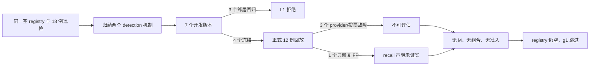
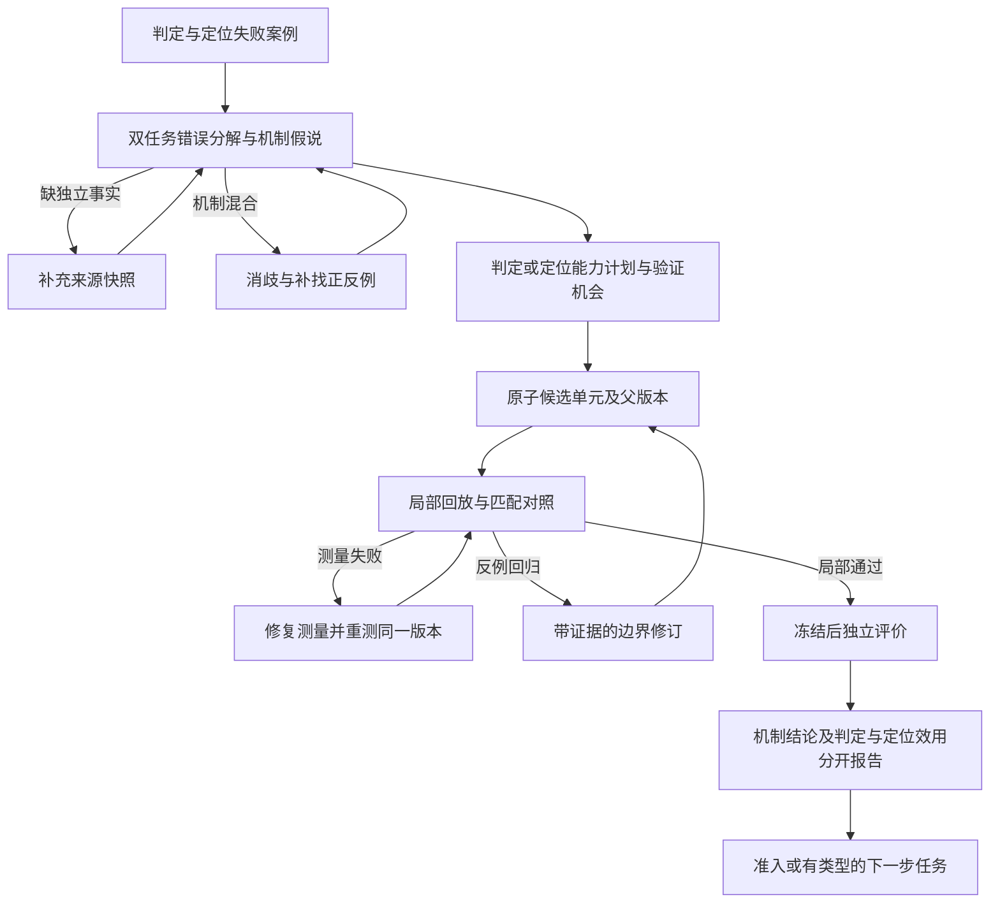

# 全量运行三轮自进化：失效链路、代码机制与改进路线

分析更新：2026-09-28；对象：`artifacts/full693-20260924T143024Z`。本文只分析工作区已有产物与当前源码，并将近期一手研究作为设计参照；没有修改实验代码、配置、checkpoint 或原始评估结果，也没有重新调用模型。文中“历史事实”“当前实现”“推测/待验证”分别指运行产物、当前 checkout 与尚需对照实验的因果解释，三者不得互相替代。

## 摘要：先回答三个核心怀疑

本次结果应表述为：**三轮都完成了，但 7 个开发版本中只有 4 个通过局部 L1 并冻结；正式门控对这 4 个版本给出 3 个 `not_evaluated`、1 个 `rejected`，准入数为 0。** C3 只生成一个 L1 失败版本，没有正式候选。空 registry 使 g1 不启动；`--mini` 的效果条件失败使进程退出码为 2。这里既有已观察到的局部改进，也有不可测结果，不能概括成“模型没有提出任何有用东西”。见 [实验总报告](<E:/agent hallucination/agent hallucination/artifacts/full693-20260924T143024Z/work/evolution/reports/experiment.json>)、[7 个归档版本](<E:/agent hallucination/agent hallucination/artifacts/full693-20260924T143024Z/work/evolution/candidates/archive_summary.json>)、[退出码](<E:/agent hallucination/agent hallucination/artifacts/full693-20260924T143024Z/evolution.exitcode.txt>)。

| 用户的怀疑 | 本次证据支持的判断 | 首先该做什么 |
|---|---|---|
| RSI 底层机制有问题 | **成立，但不是“RSI 原理失效”**：某些目标需要的独立事实不在输入中；机制标签、实际可达的修复动作与正式可测机会没有对齐。 | 先判定可观察性、失败责任与动作可达性，再允许起草；为同机制安排未见验证机会。 |
| 经验归纳/反思引擎有问题 | **成立，能定位到字段与接口**：机制“confirmed”可能来自合同优先级和映射；修订提示丢掉父程序与反例；记忆增长却没有把失败类型变成下一步调度。 | 拆开义务/违规/漏检，保留父版本、逐例差分与正常反例；让记录驱动补证、修订或重测。 |
| 准入门槛或检验过于冗余 | **部分成立**：判定语义确有重叠，但本次 STRUCTURAL/HARMLESSNESS 全过，M 全未运行；真正阻断是 3 次正式不可测和 1 次 recall 声明未获 TP 改善。 | 先恢复可测与配对归因，把机制证实、部署效用和保护约束分开报告，再考虑合并静态检查。 |

后续研究目标是让固定基座模型上的检测器通过受控自进化，**同时提高幻觉判定与首个责任步定位**。逐例定位和证据分析用于指导候选修改；最终证据是冻结新版本在新样本上的双指标净收益，而不是诊断材料本身变得更详细。



主文按“**事实与案例 → 框架机制 → 文献借鉴 → 根因排序 → 修复验证**”组织。想先看本次运行，可读第 2–3 节；要审查三项架构怀疑，可读第 4 节；要决定实施顺序，可读第 6–7 节。第 9 节保留完整证据索引、37 条 ledger 时间线和离线探针。研究文献支持的是可迁移的设计原则，**不能作为本仓库修复效果已经成立的证据**。

## 1. 实验范围、产物与证据边界

### 1.1 找对运行根目录

工作区外层是 `E:/agent hallucination`，实际 Git 项目在其下的 `agent hallucination/`。外层 `artifacts/full693-20260924T143024Z/` 只有 `monitor_measurement.ps1`；完整实验位于项目内的同名目录。本文用以下缩写，附录提供可点击的绝对路径：

- **R**：项目内 `artifacts/full693-20260924T143024Z/`。
- **W**：`R/work/evolution/`。
- **D**：项目内 `datasets/raw/agenthallu/AgentHallu/`。
- C1/C2/C3：`W/cycles/cycle001.json`、`cycle002.json`、`cycle003.json`。

还清点了 `artifacts/real-selfevo-*`、`selfevo-real-multigen*`、`baseline`、`integration`、`promotion-real` 等旁系产物。两个 20260923 multigen 实验报告均为请求 3、完成 0；不能将这些早期失败并入本次完成 3 轮的运行。`promotion-real` 也不是本次正式门控的结果目录；本次实际入口是 `evolution experiment --cycles 3 --mini`，证据在 cycle/checkpoint 中。

### 1.2 “全量”并不等于每轮用 693 例自进化

`R/run_plan.json` 与 `R/inputs/*.json` 规定：693 例分成开发池 30、validation 10、measurement 653。开发池内部 S（sentinel）6、G（gain）6、patrol 18，S/G/patrol 互斥。development 使用 patrol 目标和邻居，正式行为门使用 S∪G 12 例，边际 M 门拟使用 G 6 例。**653 例只做后续 g0 测量，并未向三轮自进化提供 653 例新的失败证据。**

| 配置或状态 | 本次值 | 含义 |
|---|---:|---|
| cycles / backend / proposer | 3 / detector / llm | 实际模型调用，不是 mock/offline |
| workers / cycle timeout | 8 / 43,200 秒 | 每轮最多 12 小时；三轮均未达到截止 |
| 机制数上限 | 2/轮 | 两个定位族每轮都排在上限之外 |
| proposer 全局预算 | `budget.llm_calls=3` | 与 development 的预算是不同层级 |
| development 上限 | 4 版本/机制、6 provider calls、40 L1 case-evaluations | 10 例两臂一次计 20，最多容纳两次完整 L1 |
| 邻居保护 | 要求至少 2 个，本次选入 8 个 | 不是实际只测了 2 个邻居 |
| 正式保护集 | S 中保护 4 例，2 TP + 2 TN | S 的另 2 例基线已错，未作为“正确保护”行 |
| 正式 gain 机会 | recall=1、precision=1 | 是极性机会计数，不等于与候选机制匹配 |
| 门控 | 要求触发；M 至少 1 边际、0 新错误 | 本次 4 个正式候选均在 M 之前停止 |
| 最终 validation | 10 例，0.8 → 0.8、0 翻转 | 比较的是同一空 registry，不是成功进化后的收益 |

正式 G 的 6 例为 `OpenDeepSearch/088`、`Magentic_One/049`、`OpenManus/064`、`Octotools/030`、`OpenDeepSearch/002`、`OpenDeepSearch/063`。基线唯一 recall 收益点是 `OpenDeepSearch/063`（FN），唯一 precision 收益点是 `Magentic_One/049`（FP）。不能将“至少修正一个机会”解释成“必须同时覆盖六个案例的所有类型”。

### 1.3 产物清单、终态与可信度

| 产物 | 实际数量/内容 | 用途 |
|---|---|---|
| `cycles` | 3 | 三份逐轮报告 |
| `checkpoints` | 3 | 三个 completed checkpoint |
| `checkpoints/*/arms` | 220 | 220 个逐臂快照；含跨轮重复基线，不能当作 220 个唯一新调用 |
| `development` | 7 | 7 对 candidate.json/development.json，另有修订诊断和日志 |
| `cache` | 167 | 167 个 JSON 缓存；不是每个都代表独立请求 |
| `ledger.jsonl` | 37 | 37 条事件；本次按 canonical JSON 重算 SHA-256，链完整 |
| `memory/episodic.jsonl` | 7 | 3 条开发拒绝 + 4 条正式门控记录，其中 3 条 unevaluable |
| `candidates/candidates.jsonl` | 7 | 3 failed_l1、4 ready_for_freeze；归档状态不代表准入 |
| `components/components.jsonl` | 2 | 两个可复用 parser，不能等同 active intervention |
| `registry/active.json` | 0 | interventions=[]，内容 hash 三轮相同 |

`R/evolution.stdout.log` 可完整解析为 JSON，与 `W/reports/experiment.json` 对象相等；它不是逐行带时间的过程日志，时间线应以 ledger 和逐案 `execution` 为准。实验报告为 `cycles_completed=3, stopped_early=false`，但 **`R/evolution.exitcode.txt` 实际是 `2`**。入口带 `--mini`，当前 `evolution/cli.py:124` 对 `mini_effect.passed=false` 返回 2，与落盘状态一致；不能写成“退出码 0、实验成功”。准确表述为“周期完成，效果条件不通过”。

`R/live_status.json` 混有旧 `status=running` / “Cycle 1 is still active” 与新 `cycle=3, checkpoint_status=completed`。`R/monitor.jsonl` 最后一条已是 `runner_stopped`。这是状态汇总的陈旧字段问题，不能用旧文本断言实验仍运行或中途崩溃。

预检 `preflight-evolution.json` 为 `passed=false`，唯一 blocker 是 validation 与历史 development exposure 重叠；`run_plan.json` 明确记录用户授权按内部回顾性评估继续。三轮真实执行及 `blocked_families=[]` 是“该 blocker 没有阻断此次流程”的反证。污染影响泛化解释，不是本次零准入的直接原因。

**源码身份限制**：三个 checkpoint、preflight 和 harness 记录的运行摘要均为 `8bdc5a76abc7e47e`；本次读取当前源码计算为 `ff942512981ac0c0`，并不相同。当前 HEAD 为 `3cd8722`，Git 中有运行后归档与修改，未找到能在本次审计中直接重算出原运行摘要的完整精确快照。因此本文的数值与实际走过的分支以运行产物为主；当前源码行号只用于解释与产物一致的机制、提出修复方向，不把当前 checkout 冒充字节相同的运行版本。仅凭摘要差异也不能证明运行途中漂移。

## 2. 三轮执行链路与时间线

### 2.1 总时间线

以下为 ledger 的 UTC 时间；北京时间为 UTC+8。秒级间隔由事件时间相减计算，不能等同于全部模型计算时间。

| 轮次 | UTC 开始 → 完成 | 北京时间开始 → 完成 | 墙钟 | checkpoint `used_seconds` |
|---|---|---|---:|---:|
| C1 | 09-24 14:32:59 → 09-24 20:57:38 | 09-24 22:32:59 → 09-25 04:57:38 | 23079.590s | 23079.646 |
| C2 | 09-24 20:57:38 → 09-25 00:25:32 | 09-25 04:57:38 → 09-25 08:25:32 | 12473.877s | 12473.948 |
| C3 | 09-25 00:25:32 → 09-25 01:15:07 | 09-25 08:25:32 → 09-25 09:15:07 | 2974.734s | 2974.807 |

- 09-24 14:30:24 UTC：创建 run plan；14:31:18/14:31:48 分别完成 evolution/baseline 预检。
- C1：16:39:30 审计完成，17:14:30 巡检/评估预检完成，19:43:13 开发与冻结完成，20:57:38 记录两条拒绝并收尾。
- C2：20:57:39 审计命中缓存，20:57:40 巡检/预检完成；23:38:20 冻结，09-25 00:25:32 两条门控终态落盘。
- C3：00:25:33 审计命中缓存，00:25:34 巡检/预检完成；01:15:07 开发结束且正式 proposal 为空，随后收尾。
- 09-25 01:31:33 UTC：监控末条 `runner_stopped`。这不是 cycle 完成时间，也不能据此精确还原 final validation 的起止时刻。
- g0 的 measurement 监控首条为 09-25 01:37:50 UTC，末条为 09-27 01:38:04 UTC；最终 baseline report 生成于 09-27 04:32:16 UTC。g0 是后续独立测量阶段，不能把它的两天时长或重试错误反算成三轮自进化的失败原因。

### 2.2 共用链路与逐版本结果

实际链路为：基线/缺陷审计 → 18 例巡检 → 机制与路由选择 → **起草、L0、局部 L1 回放、必要修订** → 冻结 → STRUCTURAL → HARMLESSNESS → BEHAVIOR →（通过才进入 M、组合和准入）→ 归档、记忆、harness、checkpoint。回放不是单一的最后步骤：L1 和正式门控都读取真实逐臂检测结果。

三轮 patrol 都是 18/18 authoritative、TP=7、TN=5、FN=5、FP=1、unresolved=0，准确率 12/18。所有周期 `preflight.sentinel.evaluable=true`、`blocked_families=[]`。缺陷注入 IV-DEFECT-001/002 是审计用的预期拒绝样本，不应计入 7 个开发版本或 4 个正式候选。

两个实际开发机制：

- **M-A = `M-17084a0707a4`**：judge 判 clean、没有 recall candidates；目标 `BFCL/062`、`OpenDeepSearch/086`。
- **M-B = `M-dcd34940c9d8`**：judge 判 clean、upgrade 没有成功；目标 `BFCL/017`、`OpenManus/073`。

共同 8 个邻居：`Camel/018,048,054`、`Magentic_One/036,050,093`、`Octotools/023,040`。下表数值直接取各版本 `development.json#/l1/delta`；所有 7 个版本 L0 均通过。

| 轮次/机制/版本 | 实际 type @ hook | L1 正确数 | 修复目标 | 新错误 | L1 / 去向 |
|---|---|---|---|---:|---|
| cycle001/M-A/v001 | `recall_trigger @ recall.trigger` | 8/10 → 7/10 | BFCL/062.json | 2 | 拒绝 |
| cycle001/M-A/v002 | `recall_trigger @ recall.trigger` | 8/10 → 9/10 | BFCL/062.json | 0 | 通过并冻结 |
| cycle001/M-B/v001 | `text_boundary @ upgrade.system` | 8/10 → 9/10 | OpenManus/073.json | 0 | 通过并冻结 |
| cycle002/M-A/v001 | `text_boundary @ scanner.system` | 8/10 → 7/10 | 无 | 1 | 拒绝 |
| cycle002/M-A/v002 | `recall_trigger @ recall.trigger` | 8/10 → 9/10 | BFCL/062.json | 0 | 通过并冻结 |
| cycle002/M-B/v001 | `text_boundary @ upgrade.system` | 8/10 → 9/10 | OpenManus/073.json | 0 | 通过并冻结 |
| cycle003/M-B/v001 | `text_boundary @ scanner.system` | 8/10 → 8/10 | OpenManus/073.json | 1 | 拒绝 |

注意：M-B 的 `route=evolved_predicate` 并不代表实际生成了机械谓词；实际候选是 `text_boundary`。C2 M-A 的 v001 也是 `scanner.system` 文本，v002 才变成 recall trigger；C3 M-B 从前两轮的 `upgrade.system` 改到了 `scanner.system`。分析必须读 `candidate.type/hook`，不能只看 route 标签，也不能声称三轮候选逐字相同。

### 2.3 C1：局部通过，正式门控分成“未测成”和“方向不符”

M-A v001 修好 BFCL/062，却新增 Camel/048、Magentic_One/050 两个误报，8/10 → 7/10。v002 缩窄条件后达到 9/10，冻结为 `IV-1-D001`。M-B v001 修好 OpenManus/073、无邻居退化，同样 9/10，冻结为 `IV-1-D002`。

正式结构门 jaccard 分别 0.0846、0.1085，均远低于 0.72；保护集两候选均 4/4 无损。因此 STRUCTURAL 与 HARMLESSNESS 不是本轮瓶颈。

- D001：`fired_rate=0`；Magentic_One/049 非权威，行为结论 `not_evaluated`。M 为 null。
- D002：触发 2/12、`marginal_cases=1, new_errors=0`，但 TP 不变，只有 FP 减 1。行为结论 `rejected`。M 为 null。

两者都没有形成 qualified unit，`combination.reason="no qualified unit"`，`selected=[]`、`active_after_cycle=[]`。归档、记忆及 checkpoint 正常写出；这里不是“通过后落盘失败”，而是“准入前已经停止”。

### 2.4 C2：再修出局部有效候选，正式评估被同一案例卡住

M-A v001 在目标上没有修复，Camel/048 新增误报；修订 v002 又修好 BFCL/062。M-B v001 修好 OpenManus/073。两者都在 L1 达到 9/10，冻结为 D001/D002。

正式结构 jaccard=0.0861/0.1458，保护集仍无损；D001 再次未触发且 scanner 截断，D002 在 causal upgrade 回放中 `no_quorum`。本轮两个正式终态均 `not_evaluated`，不是两个质量拒绝。两者 M=null，组合与准入仍没有输入。

### 2.5 C3：候选供应端先停止，正式门控没有执行

M-A 的 `stopped_note` 明确为 `provider_called=true, provider_ok=true, model=glm-5.3-flash, total_tokens=32857`，但 `versions=[], stopped=no_candidates`。能确认“调用成功、最终没有开发候选”，不能进一步确认是模型主动空输出、合同过滤、重复抑制还是其他具体原因：该停止摘要没有保存足以区分这些情形的完整原始响应/过滤轨迹。

M-B 产出了 v001，L0 通过，L1 修好 OpenManus/073、损伤 Camel/048，净变化 0。下一次起草返回：

```text
provider_called: false
reason: llm_calls budget exhausted for this cycle
stopped_reason: budget_exhausted
```

这证明的是**修订机会被预算截断**，不是“第二个机制从未尝试”。`development.max_provider_calls=6` 并没有覆盖 proposer 全局 `budget.llm_calls=3`。此外 `budget.used.provider_calls=2` 是开发器的起草计数，当前 `development.py` 在 proposer 返回后无条件 `spend_provider()`，包含这次未实际调用 provider 的拒绝；不能机械地把“1+2”还原为三次成功网络调用。proposer 还允许内部 repair，完整调用分配不能只凭汇总计数确定。

C3 的 `proposals=[], gates=[], frozen_versions=[]`。空 proposal 的包装 note `provider_called=false` 指“使用开发结果、未再调用单次 proposer”，不能覆盖内部已发生的 LLM 调用。`development` 有目标但无出线版本时，正式门控不继续运行；不应绕过 L1 把已失败版本送去晋升。

### 2.6 落盘与最终评估

所有轮次都有 completed checkpoint；4 个冻结版本在各自 `development.json` 中为 `frozen`，归档统计仍为 `ready_for_freeze`。这是不同时间/用途的状态字段，不是候选丢失。归档 7 条、parser 2 条、episodic 7 条说明存在诊断性产出；只有 active registry 为空。

harness digest 为 `17f69102d5a3` → `bef3d26500a5` → `6003bc56907e`。C1 为首份 manifest，所有组件列为建立；C2/C3 的 diff 明确只变 `M`（memory），registry hash 始终 `1a4fe1d7958f4019af15871d26f5451c22a88e6a74db54fa43b11e0aeedfbd37`。因此“manifest 变了”不等于“检测器已进化”。

最终 mini validation：n=10、TP=4、TN=4、FP=1、FN=1，baseline/active 都是 0.8；翻转为 F→F 5、T→T 5，`passed=false`。g1 按 run plan 的 `if_active_registry_changes` 条件跳过。三轮没有任何 M 通过或组合准入，所以也没有进入有效的新版本治理、退役或回滚验证。

## 3. 四个关键案例：失败发生在不同节点

### 3.1 BFCL/062：局部修复确实存在，但正式评估没有覆盖该机制的成功实例

原始任务包含加油、按顺序启动车辆等动作。M-A v002 的谓词围绕末尾承认执行失败的文本：`could not` + tool observation 含 `error`，或 `no direct output` + observation 含 `None`，并要求 judge 为 high-confidence clean。C1/C2 L1 均将 BFCL/062 从 false → true，另一个目标 OpenDeepSearch/086 保持 false。

**支持机制覆盖不足**：成功案例属于 patrol；正式 S/G 不含两个目标；冻结候选在正式 12 例触发率都是 0。正式 gain 的 recall 机会 OpenDeepSearch/063 与已修好的 BFCL/062 不是同一案例，极性“同为 FN”并不能证明是同一缺陷机制。

**反证与边界**：候选不是完全无效，因为两份局部记录均有正确修复；评估互斥本身也是正常的防泄漏设计，不能直接把互斥称为代码错误。仍未证明该规则能在新的同机制案例上泛化；两輪结果共享基线和近似规则，也不构成两个独立重复实验。

**可验证修复**：预先建立与机制匹配、候选未见的 gain 集，并把“该机制有可测覆盖”与“有任意 FN”分开预检。保留当前案例作开发证据，不把 BFCL/062 直接移入正式 gain 来制造通过。

### 3.2 Magentic_One/049：同一数据行产生了四种不同评估结果

这是 G 中 gold=false 的 precision 机会，不是 S 的成员。以下均为正式 12 例评估中的该行；路径相对 W。

| 对照/候选 | 逐臂证据 | 预测/authority | 直接事实 |
|---|---|---|---|
| 空基线 | `checkpoints/cycle001/arms/508acdf65658/078a43f81b05.json` | true / authoritative | 基线误报，虽有旧 TimeoutError 警告但形成有效终局 |
| C1-D001 | `checkpoints/cycle001/arms/78dc3c5de734/078a43f81b05.json` | null / degraded_judge_only | scanner `provider_error`，32768 token 截断 |
| C1-D002 | `checkpoints/cycle001/arms/cfcbd6a587c6/078a43f81b05.json` | false / authoritative | 正式评估唯一一处正确性改善 |
| C2-D001 | `checkpoints/cycle002/arms/de64995761c7/078a43f81b05.json` | null / degraded_judge_only | scanner 再次截断 |
| C2-D002 | `checkpoints/cycle002/arms/229ebec61264/078a43f81b05.json` | null / degraded_judge_only | causal_upgrade `no_quorum` |

原始错误片段：

```text
C1-D001: 2026-09-24T19:43:13.980642+00:00 → 19:53:12.022580+00:00
C2-D001: 2026-09-24T23:38:20.906951+00:00 → 23:49:33.343020+00:00
error_type: truncated_output
error: output truncated at max_tokens (32768 tokens)
```

C2-D002 execution 是 `2026-09-24T23:49:33.439919+00:00` → `2026-09-25T00:25:32.014664+00:00`，共 2158.575 秒；3 个 causal_upgrade 请求均 HTTP 200，completion_tokens 分别 76313、128000、128000，汇总 356793 total tokens。最终阶段状态却为 `no_quorum`。这证明“HTTP 成功 ≠ 可用语义投票”。**推测**：后两次输出上限与可用票不足有关，依据是两次 completion 正好达到 128000；但逐请求未保存 finish_reason/解析失败细节，不能把这两次都写成已证实的 `truncated_output`。no_quorum 本身是确证，也不能武断解释成纯语义平票。

为什么 D001 未触发也能出现 scanner 失败？两份失败臂的 `provenance.frozen_stages=['judge_result']`；C1-D002 则冻结 judge+recall，重跑 upgrade。当前 `backends.py::_frozen_stages` 对 `recall.trigger` 排除 scanner 冻结的逻辑与这些实测字段一致：**回放边界由候选 hook 决定，候选在具体案例不触发，并不保证该案例不重跑下游 provider。** 这使“测量噪声/截断”可以进入本来没有候选行为变化的行。

**支持执行/测量瓶颈**：3/4 正式候选被标不可评估，都是这一行；实际错误位于不同 provider 阶段。**反证**：C1-D002 和基线都测成了，所以该案例不是永远不可测；没有证据表明凭据、目录写权限或进程全局崩溃；提高单例超时也不会自动解决 max_tokens 截断或 quorum 问题。

另一个审计问题是 C1/C2 `instrument.noise_floor.status='deterministic_replay'`、`applicable=false`，理由写“every arm ... frozen replay”。但上述 request 证明候选臂仍有真实 provider 调用。**这一确定性描述过强**：冻结 judge 不能推出整臂噪声为零。报告没有 fresh control 来量化重跑部分的波动；因此 C1-D002 的 +1 与 Camel/048 的损伤是实测差异，仍需匹配重跑边界的无干预对照来分离候选因果贡献。

**可验证修复**：对不可评估候选先挂起并针对失败 stage 有界重测；保存每票输出终止原因与可用性；记录实际 replay/rerun stage；对部分重跑臂加入相同边界的无干预 control。重测必须保持候选和协议冻结，不能反复取最好一次。验收要求是 authority 完整和可复现的配对效应，而非单纯 HTTP 200 或退出码成功。

### 3.3 C1-D002：评分没有算错，但承诺目标与实际收益不一致

候选 `type=text_boundary, hook=upgrade.system, claim.target_polarity=recall`。其开发集修好 OpenManus/073，正式集却只修好 clean 的 Magentic_One/049。

正式 delta：TP=5 不变、FN=2 不变，FP=2→1、TN=3→4，正确数 8→9。行为门错误原文：

```text
target polarity mismatch: recall claim but no TP gain or precision was harmed
```

这是复合错误描述，本例命中的是 **no TP gain**，不是 precision harmed；实际 precision 得到改善。当前 `gates.py:819` 的 recall 分支要求新 TP>0、无 TP 损失、无新 FP，与记录一致。

**支持目标协议过窄这一候选解释**：如果研究目标是总体正确率，那么这次可测提升没有进入 M；收益分类与候选承诺不一致，导致可利用的方向未被转化成新研究分支。**反证**：按预先声明的 recall 目标拒绝是自洽的，不是“评分计算 bug”；事后把 polarity 改成 precision 再用同一组结果晋升会引入选择偏差。**可验证修复**：把这次观察登记为新的 precision 假设，重新冻结候选和未见测量集，再测试，而不是直接翻转本次 rejected。

### 3.4 Camel/048：真实邻居回归，有具体的证据冲突，而非已证明的坏标签

三次开发拒绝涉及该例：C1 M-A v001、C2 M-A v001、C3 M-B v001。原始 `D/Camel/048.json` 写 `is_hallucination=false, true_answer='James Thornhill '`；轨迹中工具/用户信息却还出现 Louis Laguerre 的说法。

C3 逐臂 `checkpoints/cycle003/arms/a476e26ed85b/7f232f63ee61.json` 将该例判为 authoritative `verified_error`，tracer/defense 指向 step 13。其 recall 文本把 ask_human 的 “the book ... Louis Laguerre” 当成决定性观察，并称回答 “Sir James Thornhill” 是遗漏题目所要的书中归属；causal upgrade/defense 随后认可这条指控。这与工作区 gold 直接相反，形成新增 FP。

**支持候选过度扩张/来源判别不足**：C3 scanner 指令强调把 tool name、arguments、observations 组成完整因果证据，实际这条完整链仍依赖冲突的人类提供信息；形式完整没有自动保证来源正确。C3 修复 1 个目标并损伤 1 个邻居，净 0，拒绝有实数依据。

**反证与推测边界**：C1/C2 两个冻结 M-A v002 以及 M-B v001 的 L1 都没有损伤该例，因此不是任何候选都会被它“一票否决”，也不能据三次失败判定标签错误。**推测**：它对冲突来源的优先级较敏感，可能放大不同 scanner/upgrade 提示的差异；依据是 raw history 的冲突内容与 C3 proof。没有独立重测或外部史料核验，本文不裁决哪条书目说法在真实世界正确，也不建议删除该例或改 gold 来取得通过。

**可验证修复**：保留 gold，补充来源冲突诊断与重复配对控制；检查 scanner 是否把“有人这样说”误升级成“已验证事实”。验收为保护邻居不退化且目标仍改善。

## 4. 代码机制：闭环为何没有把失败转成下一轮收益

这里的“底层机制”具体指四条接口关系：**可观察证据是否足以证明错误、归纳标签是否真对应共同偏差、修订器是否拿到父版本与反例、评估是否可靠地区分候选效果和 provider 波动**。它们位于不同层；单独增加轮数或降低 M 数字门槛不会自动修复接口。当前源码的 SHA 摘要与运行时记录不同，以下函数级分析说明当前代码如何工作；历史分支是否走到该函数以相应 checkpoint、cycle 和 ledger 记录为准。

### 4.1 RSI 的可进化对象、观测与动作空间

本次 harness 的 G 是固定检测工作流 `validate → packet → judge → recall → upgrade → tracer → defense → adjudicate`，明确记录 `execution_graph_rewrite=false`；T 是 intervention registry；M 是经验库；C 和 R 记录上下文配置与运行策略。三轮 T 均为空，G/C/R 没有显示出成功进化，后续 harness 摘要变化主要来自 M 的新增记录。参见 C1–C3 的 `#/harness/manifest/components`，及 [harness.py:117](<E:/agent hallucination/agent hallucination/evolution/harness.py:117>)。

因此，这次运行实际验证的是：**在固定检测框架中，用有限类型的 intervention 搜索可部署改进，并借助记忆指导下次搜索**。它尚未验证“搜索器会根据失败自动改善自己的诊断、测量、预算与学习方法”。harness 版本更新只说明状态变化，不能充当检测能力提高的证据。

这种边界本身可以是合理工程选择。问题在于，当主要失败来自“缺外部事实”“回放后缀无法稳定产出”“诊断摘要缺信息”时，下一轮仍主要输出一个新的 predicate 或 prompt directive，动作空间没有处理当前瓶颈。**有循环不等于有闭环学习；需要检查每类反馈能否改变下一步行动。** 后续建议保留受控动作空间，增加明确的诊断、测量和调度决策，而不是开放任意修改评价器。

#### 4.1.1 需要外部事实的目标却只给了轨迹

**案例 A：`OpenDeepSearch/086`。** 数据集标注的 `true_answer` 为 `116`，轨迹内的搜索工具响应却明确说 `76 tons`，最终回答也为 `76 tons`。完整 history 中没有字面值 `116`。基线 judge 的 `delivered_result` 与 `correct_result` 都为 `76 tons`，`basis=observation`、`confidence=high`。记录与源码共同说明：该 judge 按可见工具观察判一致，并非读到了正确事实后拒绝使用。

- 原始记录：[OpenDeepSearch/086.json](<E:/agent hallucination/agent hallucination/datasets/raw/agenthallu/AgentHallu/OpenDeepSearch/086.json>) 的 `history`、`true_answer`、`hallucination_reason`。
- 基线：[C1 基线 ODS086](<E:/agent hallucination/agent hallucination/artifacts/full693-20260924T143024Z/work/evolution/checkpoints/cycle001/arms/508acdf65658/b12a82572954.json>) 的 `#/row/result/proof/judge`。
- 标注把它解释为搜索摘要遗漏语境更相关的吨位；本文只确认这是**数据集的解释**，没有访问外部网页复核船舶史实。

**案例 B：`OpenManus/073`。** 标注答案为 `Grigor Sargsyan`，history 中提取出的获奖名单写的是 `2009: Tigran Hakobyan`，随后 terminate。完整 history 中没有 `Grigor Sargsyan`。基线 judge 明确以提取内容认定后一个名字是已交付结果。原始标签将错误定位为 step 3 的 `Retrieval Hallucination / Summarize Misalign`。

- 原始记录：[OpenManus/073.json](<E:/agent hallucination/agent hallucination/datasets/raw/agenthallu/AgentHallu/OpenManus/073.json>)。
- 基线：[C1 基线 OpenManus073](<E:/agent hallucination/agent hallucination/artifacts/full693-20260924T143024Z/work/evolution/checkpoints/cycle001/arms/508acdf65658/614f3077f894.json>)。

三个 cycle 均有 `#/evidence = {"active": false}`，上述基线 proof 的 `external_evidence=null`。输入投影 [dataset.py:16](<E:/agent hallucination/agent hallucination/detector/dataset.py:16>) 仅保留 question/history；[judge.py:225](<E:/agent hallucination/agent hallucination/detector/judge.py:225>) 要求 `Do not use any information that is not in the question or the trajectory`。这形成明确的**任务—观测错配**：评测要求识别现实事实错误，而当前观测只支持判断轨迹内是否自洽。

**反证与边界**：不能由正确答案字面缺失证明所有方法都无法判别；模型可能利用其他异常线索，外部知识也可能恰好覆盖该事实。`OpenManus/073` 的局部预测确实被几个候选改成 true。但这些现象不能证明它获得了独立事实依据，更不能证明规则可泛化。对于只有“工具说 X、最后答 X”的证据，广泛怀疑工具即可增加某些 TP，也可能增加正常轨迹 FP；现有回放没有识别两者的稳定边界。

**解决方向**：为每个失败增加可观察性分类：轨迹内可核验、需要独立来源、标注/任务解释待复核。第二类应生成“补充证据”的研究任务，先取得来源快照再评价修复，不能把 gold 答案送入线上 predicate。当前仓库已存在 [evidence.py](<E:/agent hallucination/agent hallucination/detector/evidence.py>)、[retrieval.py](<E:/agent hallucination/agent hallucination/detector/retrieval.py>)，且 [api.py:339](<E:/agent hallucination/agent hallucination/detector/api.py:339>) 支持独立 evidence snapshot 向 recall/upgrade/defense 传递。因此建议核查并接通已有能力，而非断言仓库没有外部证据机制。验证时两臂必须共享同一来源、时间与 digest，避免把多拿到的信息误计为候选逻辑收益。

#### 4.1.2 机制归纳把“有义务”提升成“已观察到违规”

归纳链路是 `stable_failure_families → diagnose_failure_families → refine/mechanism_subgroups → infer_mechanism`。其中阶段路径用于发现共同失败位置，typed predicate 与 judge contract 用于给任务义务分类。这些是有用线索，但当前实现存在从**线索**直接跃迁到**已观察偏差**的问题：

1. [mechanisms.py:386](<E:/agent hallucination/agent hallucination/evolution/mechanisms.py:386>) 的 `obligation_for` 优先读机械违规；没有违规时，从 `judge.contracts` 按固定优先级取第一个义务。`required_action` 排在 `exact_value` 之前。
2. [mechanisms.py:429](<E:/agent hallucination/agent hallucination/evolution/mechanisms.py:429>) 的 `_deviation_for` 对已知义务直接查映射，例如 required_action → omission；这一步不要求 `required_action_present=violated`。
3. [mechanisms.py:739](<E:/agent hallucination/agent hallucination/evolution/mechanisms.py:739>) 对两个以上相同 reading 标 `confirmed / multi_case`。一致的是映射结果，未必是已证实的同一因果故障。

实际 M-B 就满足这种情况：两个 member 的 `required_action_present` 都是 `not_applicable`，mechanism 的 obligation binding 是 `judge.contracts`，却输出 `observed_deviation.actual=required_action_absent`、`status=confirmed`。证据在 C1 `#/patrol/detection_families/1/diagnostics/member_summaries` 与 `/mechanism`；C2/C3 保留相同机制。

两个成员的真实任务也显示该抽象太粗：`BFCL/017` 的标注认为应 diff 比较文件，实际执行 echo 覆盖；`OpenManus/073` 的标注认为获奖者事实错误。后者确实执行了检索与提取，不能只因 judge 合同含“determine the winner using available means”就把错误归为工具动作遗漏。对 BFCL，用户“ensure identical”的解释与数据集期望的具体工具序列也需要单独审查，不能把 gold 工具名硬编码成检测规则。参见 [BFCL/017.json](<E:/agent hallucination/agent hallucination/datasets/raw/agenthallu/AgentHallu/BFCL/017.json>)。

**根因判断**：当前归纳混用了“任务具有某义务”“轨迹违反该义务”“检测器因某原因漏检”三个不同命题。修复规划随后依据该合成标签指定 required_inputs 和 repair_operation，错误抽象会继续传播。此判断由代码和实际 M-B 字段共同支持；“因此所有候选必败”仍无证据。

**解决方向**：拆分 obligation、observed_violation、detector_error 三份证据；每一份保留事件引用、支持与冲突证据、观测充分性。`confirmed` 至少要求成员各自存在支持该偏差的事实，并通过正常对照排除同一规则。只有合同类别时，应为 hypothesis，不能自动写入 `required_action_absent`。这项修复旨在降低错误确定性，而不是新增一个让所有模糊案例直接出局的门：模糊案例应转入研究与补证。

#### 4.1.3 混合族的身份依赖第一位成员

M-A 明确为 `ambiguous / mixed`，observed readings 包含 required_action/omission 与 exact_value/mismatch。当前 [infer_mechanism:723](<E:/agent hallucination/agent hallucination/evolution/mechanisms.py:723>) 使用 `signatures[0]` 和 `readings[0]` 构造机制与 ID；[engine.py:1406](<E:/agent hallucination/agent hallucination/evolution/engine.py:1406>) 的开发入口只要求 ID 和至少两个成员，没有将 ambiguous 转到消歧任务。

以 C1 原始 member summaries 做纯函数探针，仅反转成员顺序，得到：

```text
原顺序：M-17084a0707a4 ambiguous
  required_action, omission, recall_scanner, not_reached, route_recall
反顺序：M-7e35e8379108 ambiguous
  exact_value, mismatch, recall_scanner, not_reached, route_recall
```

这是**当前代码的身份稳定性缺陷**：同一成员集合可改变机制 ID 与修复所需字段，影响记忆和组件检索。历史三轮没有证据显示顺序发生改变，因此它是已证实的结构风险，不是本次历史 ID 漂移的解释。

[worksheet.py:1057](<E:/agent hallucination/agent hallucination/evolution/worksheet.py:1057>) 的 subgroup 逻辑在不能组成至少两例的子组时允许保留混合族。此处存在约束冲突：一边要求至少两例 provenance，一边又希望机制同质，样本不足时以混合族维持可起草性。解决方案应允许单例作为研究假说，补找第二例或反例；用规范化的 reading 集合表示“待消歧问题”，避免让第一例冒充全族机制。单例研究仍不能直接当成正式泛化证据。

#### 4.1.4 计划写着 sufficient，候选却走了其他 hook

本次 capability plan 已经知道部分动作不能处理相应故障：M-A 的 `repair_operation=route_recall`，唯一 sufficient route 是 recall_trigger；M-B 的 sufficient route 是 evolved_predicate。然而：

- C2 M-A v001 实际为 `text_boundary@scanner.system`。两个目标原本 recall `not_needed`；该版本没有修好任何目标，只使 `Camel/048` 误报，局部正确数 8 → 7。
- M-B 的开发记录 `action_class=evolved_predicate`，C1/C2 实际候选却是 `text_boundary@upgrade.system`；C3 是 scanner.system。

原因可以定位到接口：[CandidateDeveloper._route:660](<E:/agent hallucination/agent hallucination/evolution/development.py:660>) 取 sufficient_routes[0] 作为 route；[engine._development_drafter:1903](<E:/agent hallucination/agent hallucination/evolution/engine.py:1903>) 收到 `_plan` 但不使用它，proposer 仍看到 family 的全部 treatment_routes；[check_l0:248](<E:/agent hallucination/agent hallucination/evolution/development.py:248>) 只检查 hook 能否到达失败 stage，而未证明该动作能改变目标控制流。

“修改 scanner 的提示”与“让原本不启动的 scanner 启动”是两种能力。名义 hook 对得上，不等于目标轨迹会经过它。同样，规划表标 sufficient 是静态能力分类，不是执行验证通过。

**反证**：换 action class 可以是合理探索，且配置允许；不能要求任何偏离初始计划的候选都永久拒绝。真正缺少的是显式重规划、route 字段与实际 artifact 一致、目标上的可达性检查。建议在花费完整 L1 前，验证目标触发条件与执行路径；变更 route 时重新给出能力需求及证据，不能沿用旧 route 标签。

#### 4.1.5 联合修复在当前开发单位中被截断

这是当前实现中另一个具体的表达能力缺口：

- [proposer.py:158](<E:/agent hallucination/agent hallucination/evolution/proposer.py:158>) 明确规定 evidence_check 本身不改变终局，通常需要同族、消费其 fact 的 decision_guard；FP 路径也明确要求成对起草。
- development drafter 两处调用都固定 `max_proposals=1`；[proposer.py:658](<E:/agent hallucination/agent hallucination/evolution/proposer.py:658>) 在验证及配对前截断 `raw[:max_proposals]`。
- [development.py:781](<E:/agent hallucination/agent hallucination/evolution/development.py:781>) 只取 `batch[0]`；drafter 的 renamed 还会把返回的每条 entry 设为同一个 ID。
- [proposer.py:959](<E:/agent hallucination/agent hallucination/evolution/proposer.py:959>) 删除孤立 evidence_check。

内存中用最小 evidence E + guard G 检查配对函数，完整两条被识别为 `[['E','G']]`，保留数 2；只传 E 保留数 0，原因 `missing_terminal_partner`。这只验证配对与删除逻辑，不声称这两个最小字典已经通过所有 intervention schema 校验。

**结论**：正常 development 路径不能完整承载这类“先产生证据、再改变判决”的联合程序。单独调大 `max_proposals` 不够，还需修改版本图、ID、hash、L0/L1 和冻结单位。应把 candidate 定义为一个含多条 intervention 的原子修复单元，内部引用唯一 ID，统一部署与评价。

**历史因果限制**：本次保存的 7 个版本都是 recall_trigger/text_boundary，没有记录模型实际返回过被截断的有效联合候选；也不能用此解释 C3 空返回的具体原因。因此它是已复现的当前架构限制，不能冒充本次丢掉了某个成功 pair 的证据。

### 4.2 反思与记忆：有反馈文件，修订时仍缺关键证据

#### 4.2.1 最明确的数据流缺陷：父候选和反例在提示边界丢失

开发器内部并非没有反思资料：[development.py:927](<E:/agent hallucination/agent hallucination/evolution/development.py:927>) 生成包含完整 L0、L1 与 reasons 的 diagnosis；C1/C2 M-A v002 均保存 `parent.json` 和 `diagnosis.json`。问题发生在传递过程中：

1. drafter 的 feedback 只保留 parent 在 `candidate` 字段，并把详细诊断压成 reasons 字符串，`delta` 直接设为 null。
2. [proposer.py:532](<E:/agent hallucination/agent hallucination/evolution/proposer.py:532>) 序列化反馈时**不读取 candidate 字段**，只读取顶层 predicate/action/facts；drafter 没有填这些字段，最终均为 null。
3. reasons 中案例 ID 被替换成 `[case]`，但没有增加可对应的反例别名与轨迹。因此保留了“两个邻居坏了”，没有保留“哪种正常行为被哪条规则误伤”。

对实际 C1 M-A v001 parent 和 v002 diagnosis，用当前 drafter/proposer 构造提示，并把 `provider_call` 替换为只捕获参数、返回空列表的本地函数，得到：

```json
{
  "type": "recall_trigger",
  "hook": "recall.trigger",
  "predicate": null,
  "action": null,
  "facts": null,
  "gate": "DEVELOPMENT",
  "reason": "normal neighbour(s) regressed: [case], [case]; the paired replay added 2 new error(s) and lost 0 true positive(s)",
  "delta": null,
  "gain_opportunities": null,
  "behavior_delta": null,
  "behavior_note": null,
  "not_evaluable": false,
  "combination": []
}
```

完整生成提示中不包含 parent 的 predicate 名 `evo_high_conf_clean_tool_case`，也不包含 `Camel/048` 的 Great Hall 反例内容；`research_packet` 为空。这证明当前接口在丢失修订所需输入，而不是证明某个模型不具备反思能力。

更不对称的是：[set_rejection_feedback:372](<E:/agent hallucination/agent hallucination/evolution/proposer.py:372>) 能读取完整 candidate 来计算禁止重提的指纹；**筛选器知道被禁的父版本是什么，起草模型却只看到缺失内容的摘要**。反思在这里接近“收到失败通知后重新生成”，而非针对可观察反例修补父程序。

**反证**：C1/C2 的 v002 仍把局部正确数提升到 9/10，说明压缩反馈并非绝对无法学习；family 正例摘要、既有组件等也仍提供信息。但无法由局部成功证明 parent/反例缺失无害。其影响大小需要在相同模型、预算和开发划分下对照验证。

#### 4.2.2 初始归纳也只得到短摘要，缺乏正反例对照

普通 experiment 的 proposer 接收 `member_summaries/typed_samples`，不是完整训练轨迹。[predicate_dsl.py:640](<E:/agent hallucination/agent hallucination/detector/predicate_dsl.py:640>) 设置 scalar 240 字符、list 最多 6 条、每条 160 字符；C1 的 OpenManus073 提取页面工具观察因此只显示名单前导，奖项具体条目已被截断。其他字段仍能提供部分结果信息，但完整证据关系不可由这些短片段自动恢复。

普通 proposer 的 `research_packet` 初始化为空，experiment 调用链没有给它设置完整研究包。**当前仓库另有更完整的路径**：[research.py:380](<E:/agent hallucination/agent hallucination/evolution/research.py:380>) 组装完整 label-free training/neighbor record、baseline 和 target_error，并在 `:430` 调用 `set_research_packet`。因此需要解决的是入口能力未统一，不能笼统说“代码从未实现深度研究”。

正常邻居的选择也不是按语义相似性：`attach_normal_neighbors` 收集正确、健康 patrol 行，按 case ID 排序取前 8；每个机制得到几乎相同的列表。它提供的是共享回归保护集，不能自动承担“只差一个关键条件”的机制反例。参见 [worksheet.py:1228](<E:/agent hallucination/agent hallucination/evolution/worksheet.py:1228>)。

建议保留共享回归集，同时增加机制匹配的对照：例如“明确未完成必需动作”与“如实报告环境阻塞”，或“源内容与总结冲突”与“来源本身缺乏独立核验”。给模型完整的相关事件窗口、稳定别名和前后预测，长轨迹按证据引用取片段，而非固定只取每个字段开头。既要避免 case ID 记忆，也要保留跨版本可追踪的反例身份。

#### 4.2.3 记忆记录失败，不等于归纳出了能改变搜索策略的经验

本次存在 7 条 episodic、2 个 parser component，procedural 与 improvement 的记录数为 0。不要把 `proposal_memory` 的 `procedures` 数字理解为成功 procedure 数：当前 [engine.py:785](<E:/agent hallucination/agent hallucination/evolution/engine.py:785>) 把 `recall_experience(...).entries` 统一放到 procedures，而 retrieval 同时包含 episodic、procedural 等类型。记录 schema 能区分来源，但字段命名与 prompt 文案会弱化这个区别。

[memory.record_episode:99](<E:/agent hallucination/agent hallucination/evolution/memory.py:99>) 主要保存 family、polarity、gate、reason、intervention_id、type/hook 等元数据，没有把候选内容 hash、证据引用、反例机制和局部前后差异作为经验的核心载荷。检索按 family +4、polarity +2、route 重合 +3，随后限量；它衡量的是类别相似，而不是哪条经验最能解释当前冲突。文件仍可经 intervention_id 等进一步追查，问题在于起草链路没有自动完成这一步。

路线失败库更窄：[route_failures.insufficiency_evidence:184](<E:/agent hallucination/agent hallucination/evolution/route_failures.py:184>) 要求候选已触发、有行为事件、机会存在、测量成功、无收益也无损害；其他情况不记为 route insufficiency。这个谨慎规则有理由——一次误报或 provider 故障不应永久封杀整条路线。但当前系统缺少**与这些非 insufficiency 结果对应的其他规划动作**：

| 本次反馈 | 现有反应 | 所缺的下一步决策 |
|---|---|---|
| 三个正式结果不可测 | episodic 标 unevaluable，不当作永久证伪 | 保持候选冻结，修复测量、匹配后缀对照后重测 |
| C1-D002 修好 FP，但 recall 不增 | 拒绝，不能形成 route unchanged 证据 | 保存附带 precision 假说，进入预先定义的新验证流程 |
| L1 邻居回归 | 保存开发失败，局部修订或预算停止 | 提取触发条件与反例差异，生成明确边界修补任务 |
| ambiguous 机制 | 仍进入同一候选开发预算 | 消歧、补证、拆分，或暂时降低优先级 |

`record_route_failures` 的输入是正式 gate_reports，开发失败并不直接进入该库；本次三轮 `#/route_failures/observed=0`、`records=0` 与此一致。其结果是经验库有增长，规划层却没有得到可改变搜索安排的结构化信号。

**解决方向**：把经验拆为带证据的研究记录（机制假说）、执行记录（真实调用/事件/健康）、效果记录（同一候选同一配置的 delta）、调度记录（下一步动作及理由）。失败类型应映射到 retry_measurement、revise_boundary、collect_evidence、split_mechanism、validate_secondary_gain 等动作；动作名称是本文建议，并非现有落盘状态。保留“不可测不等于无效”的正确原则，同时让不可测能引发测量修复。

#### 4.2.4 冷启动与预算没有配合上述学习过程

本次先选择两个 detection 族，然后截断，其余定位族三轮累计跳过 6 次；重复的是问题池与顺序，不是完全相同的候选。C3 的真实预算停止又说明：development 的每机制 6 calls 与 proposer 的每轮全局 3 calls 不在同一个账本中，内部 repair 也可能占全局调用。20 个逻辑 L1 case-evaluations/版本使 40 的上限最多容纳两次完整 L1，达不到名义 4 版本。

推测：在弱反馈、狭窄路线和嵌套预算共同作用下，多轮更接近同一问题上的多次抽样，而非逐步收敛。这个解释与产物一致，但需以完整 prompt、版本差异和调度日志验证，不能把 3 轮全部归为随机搜索。

建议统一逻辑起草、实际 provider 请求、格式修复、L1 新测/缓存命中四类计数；为反思修订预留预算，并按“未测完、机制不确定、已有反例、未探索”的状态调度。增加轮数应在证据和预算链路修复后进行，不能把它当首要解决方案。

### 4.3 门控与回放：重叠的判定不是本次主要成本

#### 4.3.1 有多少门，实际重复了多少模型工作

| 检查 | 主要责任 | 本次结果 | 是否另起完整候选回放 |
|---|---|---|---|
| 开发 L0 | schema、泄漏、可执行身份、hook 等 | 7/7 通过 | 否，主要本地检查 |
| 开发 L1 | 2 个目标 + 8 个邻居的局部效果 | 4 版本冻结，3 失败 | 有局部两臂，基线可能复用 |
| STRUCTURAL | 冻结候选契约、provenance、目标一致性 | 4/4 通过 | 否 |
| HARMLESSNESS | S 正确保护行不回归 | 4/4 通过 | 与下两者共用正式 candidate_rows |
| BEHAVIOR | 触发/事件、健康、终局极性收益 | 1 rejected，3 not_evaluated | 同上 |
| M | G 边际收益、新错误及健康 | 4/4 null，未到达 | 如执行，也是同一批行的 G 子集 |
| combination | 多个合格 unit 的组合效果 | 无合格 unit，未运行 | 多 unit 时才可能新增臂 |

[engine.py:2678](<E:/agent hallucination/agent hallucination/evolution/engine.py:2678>) 对 S∪G 生成一批 candidate_rows，后面切片并调用 gates；[engine.py:4232](<E:/agent hallucination/agent hallucination/evolution/engine.py:4232>) 的 combination 对单一合格 unit 不新增组合臂。因而不能将多个 gate 名称乘以同一回放成本。

确有可整理的重复：L0 与 STRUCTURAL 都检查部分契约；BEHAVIOR、HARMLESSNESS 与 M 都涉及不同范围的回归/健康判定。但开发与正式集不同，L1 与正式检验的重复属于泛化验证，不应全部删除。可以复用以 artifact/config/source hash 为键的静态校验证书，并统一生成一次测量报告，让多个判定读取同一事实。

另一个反方向问题是“便宜检查未接入”：L0 的 `normal_neighbors_clean` 只在 predicate_runner 与 normal_neighbors 同时传入时执行；当前 experiment 构造 CandidateDeveloper 只传 neighbor_cases ID 和 l1_runner，没有传这两个对象。本次各版本 L0 的通过不能解读为已证明 predicate 在邻居上不触发。L1 仍实际保护了邻居，所以不是完全漏检，只是可能到昂贵阶段才发现可提前发现的边界问题。

#### 4.3.2 最实质的门控矛盾：研究声明和部署效用被绑成一个条件

C1-D002 是本次唯一测量完整的正式候选：12 例中正确数 8 → 9，TP 不变、FP 减 1、new_errors=0、health_regressed=0，唯一修复是 gain 集的 Magentic_One049。BEHAVIOR 拒绝理由为：

```text
target polarity mismatch: recall claim but no TP gain or precision was harmed
```

其中实际是“没有 TP 增益”，不是已观察到 precision 受损。[gates.py:819](<E:/agent hallucination/agent hallucination/evolution/gates.py:819>) 将 recall 的成功定义为新增 TP 且无 TP 损失、无 FP 新增；[structural_gate:343](<E:/agent hallucination/agent hallucination/evolution/gates.py:343>) 又要求 FN family 必须声明 recall。所以简单把该候选改标 precision/boundary 并不能合法穿过现有协议。

本次补充审计从冻结 checkpoint 读取原基线 arm `508acdf65658` 与 C1-D002 arm `cfcbd6a587c6`，只取原 G 的六例，调用当前 paired_delta 与配置等价的 meets_m，结果为：

```text
paired_n=6, marginal_cases=1, new_errors=0,
tp_lost=0, fp_added=0, unresolved_added=0, health_regressed=0
meets_m(config: min_marginal=1, new_errors_allowed=0) -> (True, [])
```

这是**已保存测量的离线反事实检查**，不是原运行曾执行 M，更不是新实验通过正式准入。它精确说明：该候选被更早的声明检验挡住，M 数值门槛本身并非其阻碍。

如果科学目标是“证明修复了某 FN 机制”，现有拒绝合理，因为 precision 改善没有证实该机制；如果工程目标是“提高总体检测效用”，这份改进值得继续验证。需要在运行前选择目标，或同时报告 `mechanism_supported` 与 `deployment_utility`，不能用一个 passed 表示两件事。

**建议**：BEHAVIOR 只承担“动作按设计执行、所声称中间量是否改变”的诊断；统一效果判定负责收益与保护。主机制未证实但出现旁路收益时，保留为新假说，使用未暴露数据或预注册的次级收益规则再次验证。不要事后改变极性再把同一 049 当成独立验证，也不要仅凭这一次收益立即准入。

#### 4.3.3 机会判定只按极性，容易把“集合中有 FN”当成“可验证这个机制”

本次正式 G 有一个 FN，预检据此允许 recall family。它没有给出该 FN（OpenDeepSearch063）与 M-A/M-B 的义务、偏差、可修复操作一致的证据。两个 recall_trigger 在开发目标 BFCL062 上有效，却在正式 12 例 fired=0，正好暴露“局部可触发”和“评估集可验证”之间的距离；这些正式行又含测量失败，因此不能据 fired=0 单独给整个候选定无效。

当前 [engine._mechanism_opportunity:1111](<E:/agent hallucination/agent hallucination/evolution/engine.py:1111>) 在没有 mechanism+membership 绑定时返回 None，继续历史 polarity 语义。另一套 [promotion_alignment.py:95](<E:/agent hallucination/agent hallucination/evolution/promotion_alignment.py:95>) 已要求 confirmed mechanism，并验证 benefit cases 的机制 membership 与 repairable。已有代码说明仓库意识到了这一问题，但本次 experiment 的落盘 opportunity 仍是 recall/precision 计数；不能拿另一入口的能力反推本次已做到机制对齐。

建议在消耗完整开发预算前检查“评估设计是否能检验这个机制”。缺同机制样本应记为评价覆盖不足，继续补样或只做局部研究；不能迫使候选扩大触发到无关案例来满足 fired 门。独立评估器可建立 membership，proposer 不应反复看到封存 gain 的具体失败细节。反复用同一 G 决策也应记录 exposure，避免后续把它称作未见测试集。

#### 4.3.4 对回放确定性的假设过强，影响成功与失败的归因

C1/C2 的 `instrument.noise_floor` 都称：

```text
status=deterministic_replay; applicable=false; rolls=1
every arm ... is a frozen replay ... jitter is zero by construction
```

但冻结的是上游 stage，scanner/upgrade 等后缀仍调用 provider；049 的真实输出截断与 no_quorum 已证实后缀不是静态纯函数。`fresh_control=null`。当前 [requires_fresh_evaluation:51](<E:/agent hallucination/agent hallucination/evolution/gates.py:51>) 主要在 judge.system 或 require_full_view_defense 等情况下返回 true，其他 hook 可以复用 judge 后重跑后缀。**无需全流程重跑，不意味着后缀没有采样或运行波动。**

它造成两个评估缺口：无关049的 provider 故障让候选不可评估；049的单次 FP 修复也不能排除自然后缀波动。对 C1-D002 必须同时保留“观察到收益”与“未建立稳定因果归因”，不能只挑对某个论点有利的一面。

修复方向是按实际执行清单声明 frozen_stages、live_stages、request IDs 与有效票数；对含 live 后缀的比较使用**同一冻结前缀、相同后缀策略的空干预对照**。先诊断控制组能否稳定完成，再评分候选。若原接口支持 seed，可固定并做匹配，但不把 seed 当作供应商确定性承诺。测量失败单列，不当负例；也不能排除所有失败行后直接给剩余行过门。

#### 4.3.5 对“门槛太高”的最终判断

本次没有出现“统计显著性检验过强而挡住收益”的记录；当前 M 是最少一个边际案例、零新增错误等规则，不是 p 值检验。小集合上的零损害要求可能限制覆盖面，但 3 个 L1 失败版本分别存在真实邻居误报，其中 C3 是修复一个、损害一个、净收益为 0；不能仅通过放宽零损害把它们称为已有效。

因此优先级应为：**修正评价对象与声明语义 → 恢复可测、可归因 → 整理重复判定 → 最后研究收益/风险阈值**。若产品允许收益与损害交换，需要先定义代价权重与保护案例，再使用更充分样本估计，不能围绕这 7 个版本反向调阈值。

## 5. 近期一手研究：哪些方法能补上当前断点

检索截至 **2026-09-28**，核对了 2025–2026 年 arXiv 原稿与 ACL Anthology 正式论文的摘要及相关方法段落；这是针对本项目问题的代表性选取，不是穷尽性综述。下列 arXiv 工作均按**预印本**对待。文献给出的是可迁移设计，不是本仓库修复已有效的证据。

### 5.1 先判断失败属于哪一层，再决定改什么

[VeriSkill（2026-07，预印本）](https://arxiv.org/html/2607.27733v1)在修改 skill 前先做责任归因：区分任务本身无法满足、验证器能力限制、执行者没遵循既有 skill、skill 知识缺口；只有可归因于 skill 的失败进入修订。它再以失败位置、可复用责任和 skill 缺陷机制组成诊断签名，而非直接从单例生成补丁。对应本项目，`OpenDeepSearch/086` 与 `OpenManus/073` 应先被标为“独立事实缺失/观测不足待核”，`Magentic_One/049` 的 `truncated_output` 与 `no_quorum` 应先被标为测量故障；只有证据证明某候选可改变相应阶段，才消费干预搜索预算。原论文面对程序证明，四类名称不能机械搬入幻觉检测。

[FactBench/VERIFY（ACL 2025）](https://aclanthology.org/2025.acl-long.1587/)在外部证据下区分 Supported、Unsupported 和 Undecidable；[DeepFact（ACL 2026）](https://aclanthology.org/2026.acl-long.1586/)让验证器提交证据挑战当前标签，经审计裁决并版本化理由。这里可借鉴**来源快照与可争议标签**：ODS086/OpenManus073 在事实来源未补齐时保留“待判定”，Camel/048 的冲突来源另开审计，不因为候选误报就直接改 gold。两臂必须共享同一冻结来源、时间和 digest，否则补证收益会混入候选收益；这项实验设计是本文推论，尚未在本项目验证。

### 5.2 把反思从“失败通知”改成有父版本、有反例的编辑

[EvoSkill（2026-03，预印本）](https://arxiv.org/html/2603.02766v1)让 proposer 看执行轨迹、训练标签、父程序及历次提议与分数变化，再由 builder 实体化新技能，并在 held-out validation 上选择。训练标签用于研发诊断，不被写入生成的 skill。对照当前 `engine._development_drafter → proposer` 丢失 parent predicate、delta 与邻居证据的现象，最直接的修改是把完整父版本、逐例变化和相关事件窗口作为一个结构化反馈包传递；保留训练 gold 的诊断用途，但禁止 candidate 引用 gold 常量。EvoSkill 的技能文件动作空间更宽，不能据此开放本项目任意改 detector 代码。

[ReMe（ACL Findings 2026）](https://aclanthology.org/2026.findings-acl.829/)分别提取成功、失败与对比经验，按场景复用，再依据后续效用保留或修正。[Hindsight（ACL 2026 系统演示）](https://aclanthology.org/2026.acl-demo.27/)将事实、经历、观察、意见分为不同记忆网络；[经验跟随实证研究（ACL 2026）](https://aclanthology.org/2026.acl-long.27/)则显示，相似记忆可能复制旧错误。对当前 7 条 episodic，建议每条至少记录“哪条规则、哪个正常反例、哪段观察、候选前后结果、状态是未测/伤害/收益、适用边界”。`judge.contracts` 应作为义务线索，不能与已观察违规合并成一条 confirmed 事实。检索到的相似 episode 也应有来源、有效期与复验结果，而不只按 family/polarity 排序。

[SkillAdam（2026-09，预印本）](https://arxiv.org/html/2609.08944v1)进一步把优化记忆做成 issue tracker，保存问题状态和历次修订结果，并用逐例效果波动控制下一次编辑范围。C3 的“一例修好、一例误报”正适合触发**缩小编辑**，而不是再给一条宽泛 scanner 指令；C1/C2 的局部成功也应保留确切成功边界，不被下轮空反馈覆盖。该论文允许受保护的辅助指标支持接受，但其接受协议没有额外 validation set；本项目不能照搬这个部分，因为原数据已有曝光，次级 precision 收益必须另立未见验证。

### 5.3 候选效果要用配对轨迹与稀疏搜索口径评估

[SkillAudit（2026-06，预印本）](https://arxiv.org/html/2606.14239v1)对同一任务比较有/无 skill 的轨迹，并把过程差异锚定到 skill 片段；固定的结构验证器防止反复编辑时约束漂移。这启发对 `049` 使用**相同冻结前缀、相同 live 后缀的空干预对照**，再与固定候选配对，记录 scanner/upgrade 的输出健康、有效票和行为差异。该工作在无 gold 场景中做过程审计；本项目仍需要 gold 准确率、authority 和保护集，不能以过程相似性替代终局评分。

[Rethinking Self-Evolving Agent Skills（2026-07，预印本）](https://arxiv.org/html/2608.02636v1)在固定预算下比较“成功+失败、仅失败、仅成功”三种反馈；388 个候选只有 55 个成为字节不同的验证最优，说明多轮收益稀疏，且验证选择与后续测试可能不同。对本项目，下一次应记录 candidate hash、best-so-far 与每轮真正新增的验证最优，并做**同模型、同父版本、同预算**的反馈内容消融。55/388 只是该论文任务的观察值，绝不是本项目应有的准入率或“三轮本该成功”的依据。

这些论文提示：将失败归因转成可执行的候选修改，再通过稳定测量和独立验证决定是否保留。下述研究问题以**自进化后的检测器能力**为结果，判定和责任步定位都是优化目标。

### 5.4 核心研究问题：检测器能否通过自进化同时改善判定与定位

[AgentHallu（2026，预印本）](https://arxiv.org/html/2601.06818)同时评测幻觉判定和首个责任步定位。本次 g0 判定 macro-F1 为 74.8%，在 419 个金标幻觉样本中精确命中 114 个责任步（27.2%）；127 个漏检样本未产生责任步。判定错误与定位错误相互耦合：只给进化器一个总分，无法指出应修订判定、证据获取还是定位阶段；只优化 tracer，也无法修复由漏检造成的无定位输出。

通用自进化已有重要先例：[GEPA（ICLR 2026）](https://proceedings.iclr.cc/paper_files/paper/2026/hash/0e9e708b6f48e14fd0ac29e167413f76-Abstract-Conference.html)利用轨迹反思优化提示，[EvoSkill](https://arxiv.org/html/2603.02766)从失败提出技能修改并用留出验证筛选。[SEVA](https://arxiv.org/html/2606.29713)将结构化诊断用于主张与来源匹配的事实验证器迭代，但也观察到跨基准退化。定位方面，[VeriTrail（ICLR 2026）](https://proceedings.iclr.cc/paper_files/paper/2026/hash/42ec51d1031d25eca238ccc67559fe84-Abstract-Conference.html)追踪多步生成的证据来源，[DRIFT](https://arxiv.org/html/2606.02060)定位深度研究轨迹的错误片段，[TrajDebug](https://arxiv.org/html/2608.06346)追踪局部错误到最终失败的影响，[ErrorProbe](https://arxiv.org/html/2604.17658)结合错误步骤归因与验证过的经验记忆。这些工作分别覆盖反思进化、事实核验和失败归因；本项目要检验的是**联合判定与定位反馈，能否驱动同一个 AgentHallu 检测器跨轮改进两项能力**。这是一项待验证的研究问题，不是已确立的首创性结论。

### 5.5 递归自我改进（RSI）的受控闭环与可行性

本次运行的可进化对象主要是 intervention registry，检测执行图固定，最终 0 准入、无 g1 测量。现阶段可检验的是**固定基座模型下检测器配置的受控自进化**：逐轮从错误生成修改、验证、保留或回退；只有 active 版本发生变化且在未见样本上提高能力，才能报告有效进化。更广义的“系统改写自身搜索器或评估器”不属于本次已验证范围。

建议的核心机制是**双任务失败归因驱动候选更新**。每例反馈先区分误报、漏检、判对但责任步错误、正常邻居受损和测量故障；再记录证据是否足以判断、错误最早在哪个阶段产生、父版本到候选版本的逐例变化。进化器据此选择可达的判定、独立取证或定位干预，并保留父程序与反例。`OpenDeepSearch/086` 触发取证需求，`BFCL/062` 提醒补足同机制验证机会，`Camel/048` 提供正常反例，`Magentic_One/049` 进入重测而不是被当作算法失败。这些是拟议的反馈与调度规则，尚未形成已验证方法。

候选选择在未参与开发的验证集上同时看判定 macro-F1、全部金标幻觉样本的责任步精确命中、正常例保护与成本；预先规定双指标的准入或 Pareto 规则，避免事后只挑有利的一项。最终测试集只在 active 版本冻结后使用。定位分数还应拆成漏检造成的无输出与检出后错步，以检验反馈是否把修改送到了正确阶段。需要外部事实时，两臂共享冻结来源快照；开发标注可用于诊断，推理时不输入标准答案。[Who&When Pro](https://arxiv.org/html/2607.09996)显示标准答案有时会让归因器关注后续症状而忽略更早错误，这也支持将研发监督与推理证据分开。

| 研究环节 | 当前可行性 | 最小可检验结果 |
|---|---|---|
| 修复测量和反馈接口 | 可先用已有案例离线检查，随后做小规模配对回放 | 相同候选身份下可稳定得到逐例判定、责任步、证据和正常反例；不可测有明确重测动作。 |
| 双任务反馈驱动受控进化 | 依赖测量修复、可达的判定/定位动作及同机制验证机会 | 同模型、同父版本、同候选数上限和调用预算下，相比普通摘要或单任务反馈产生更多可测且有效的冻结版本。 |
| 多轮净收益与泛化 | 当前没有结果，需新封存数据 | 最终 active 版本在新样本上同时保持判定与定位收益，正常例损伤和成本处于预先规定的范围。 |

[Rethinking Self-Evolving Agent Skills](https://arxiv.org/html/2608.02636)显示多轮有效候选出现稀疏，不能用轮数代替收益证据。旧 653 例及完整 693 例在项目历史中已有曝光，可用于诊断和原型开发，不能充当最终未见测试集；原 10 例验证集也不足以稳定支撑双指标选版。新数据应在搜索前按预设的金标幻觉类型分层，划分为有足够正负例的**选版验证集**及**最终封存测试集**，并覆盖正常邻居及外部事实需求；不能按 g0 的错误结果挑选测试样本，测试集不进入候选反馈或门控。逐轮记录判定 macro-F1、正类召回与误报、全部金标幻觉样本上的责任步准确率、检出后定位准确率、判定与定位同时正确率，以及候选可测率、准入率和实际成本；最终效果以冻结版本在测试集上的一次测量为准。公开论文数字只作参照；自进化方法的差异须在同一数据、基座模型、动作空间和预算下检验。

## 6. 按证据强度排序的根因

排序首先考虑是否直接对应本次运行，再考虑实现复现程度；不表示可以量化各项贡献率。多个因素同时存在，无法从一次运行识别各自独立造成了多少失败。

| 顺序 | 根因与证据强度 | 本次影响与主要证据 | 可验证修复方向 |
|---:|---|---|---|
| 1 | **测量链不稳定，且局部冻结被误表述为确定性回放。历史强证据** | 4 个正式候选中的 3 个不可测；049 两次 scanner 截断、一次 upgrade no_quorum；C1/C2 instrument 与执行请求相矛盾 | 匹配后缀空干预对照；区分 live/frozen；要求故障可归类、稳定有效票；用同一冻结候选重测而非重新起草 |
| 2 | **评价目标错位：FN 来源锁定 recall，机会只按极性。历史强证据 + 当前计算复核** | C1-D002 FP 修复被极性拒绝，离线 G 的 M 数值检查通过；M-A 开发有效但 S∪G fired=0 | 分开机制证实与部署效用；预先确定同机制 gain coverage；次级收益在独立验证中研究 |
| 3 | **现有观测不足却仍按可修复 FN 投入搜索。历史强证据，收益后果待验证** | ODS086/OpenManus073 的正确事实不在 history；evidence.active=false；错误观察与最终结果一致 | 标记外部证据需求；使用已有 snapshot 路径；两臂相同来源；验证信息补充是否消除对应 FN |
| 4 | **归纳把合同类别直接提升成已证实偏差。历史字段 + 当前实现相互支持** | M-B 两成员 predicate not_applicable，却 confirmed required_action omission；M-A ambiguous 仍开发 | 拆分义务/偏差/检测失败证据；消歧与补例；用具体正反例验证 reading，不以多例标签一致替代因果证据 |
| 5 | **反思输入在接口中损失父版本、delta 和反例。当前探针强证据** | 用实际 C1 parent/diagnosis 构造提示，predicate/action/facts/delta 为 null，父 predicate 不在提示；历史 v002 输入未完整存档 | 传完整父程序及针对反例的诊断包；保存 prompt digest/证据引用；同预算对照修订效果 |
| 6 | **规划未约束执行；日志 route 可与实际 artifact 不一致。历史 + 当前强证据** | M-A sufficient=recall_trigger 却出现 scanner.system；M-B route=evolved_predicate 却执行文本边界 | 可达性检查、显式重规划、route 从执行单元推导；便宜检查前移 |
| 7 | **复合动作被单条版本单位截断。当前实现已复现，历史贡献未证实** | max_proposals=1、batch[0]、同 ID 重命名与 evidence+guard 配对要求冲突；纯函数 pair/single 检查 | 原子多 entry candidate；引用/版本/hash/L0/L1/冻结同步改造；先做已知机械案例闭环 |
| 8 | **经验没有驱动瓶颈调度，嵌套预算限制有效修订。历史 + 当前证据** | route_failures 连续 0，同样两个机制优先，定位累计跳过 6 次；C3 全局 calls 阻断 | 类型化失败→下一步动作；统一预算；预算不足前公平分配研究、重测与修订 |
| 9 | **若干 gate 重复判定，组件命名与真实职责不清。当前实现证据，非本次主因** | BEHAVIOR 同时测执行和效果；H/M 重复健康/保护；但结构与无害性全部通过，M 从未到达 | 一个测量事实对象、多个清晰结论；复用静态证书；不要删掉必要的数据独立性与保护 |

不支持的归因包括：“模型根本不会反思”“所有候选没有收益”“因为 653 个样本太难所以三轮失败”“只有把门全去掉才能进化”“多跑几轮必然成功”。本次证据不足以支撑这些结论。

## 7. 解决方案与验证顺序

现有 `research`、`evidence snapshot`、`CandidateVersionGraph`、`promotion_alignment`、回放 cache 与 ledger 已提供部分基础能力；应优先打通 `experiment` 入口中的接口与状态，而非另起一套自进化产品线。方案以**双任务失败驱动下一次检测器修改**为核心：`漏检/误报 → 判定或取证动作`，`判对但错步 → 定位动作`，`候选伤邻居 → 边界修订`，`正式不可测 → 固定候选重测`，`仅次级收益 → 新假说和新验证集`。下面所有设计及验收标准均是建议，尚未执行。

### 7.1 建议的最小重构边界

优先在现有代码上统一 experiment、research 和 promotion 的能力，避免再并行增加第四套流程。建议的状态链如下，属于待实现设计：



落到接口，应统一三类对象：

1. **MechanismEvidence**：误报、漏检或错步类型，可观察偏差、失败阶段、成员/反例证据引用、替代解释、外部事实需求与身份规范化。状态允许 hypothesis/ambiguous，配套研究动作。
2. **CandidateUnit**：一项判定或定位修复假说、一个父版本、一个 content hash、多条相互依赖 intervention、真实 capability/route、预期中间效果、适用与不适用边界。局部和正式检验以 unit 为原子。
3. **EvaluationRecord**：冻结前缀与 live 后缀、匹配控制、原始健康结果、逐案例判定与责任步 delta、触发/机制证据、双指标效用、数据 exposure 和 next_action。禁止用一个 passed 混合数据缺失、因果声明和产品收益。

以上名称用于说明职责，不要求按名称新建模块。现有 research packet、CandidateVersionGraph、组件库、回放缓存、promotion membership 和 ledger 均可复用。

### 7.2 实施顺序与验收标准

| 优先级 | 建议工作 | 修改职责位置 | 验收条件，而非预设收益 |
|---|---|---|---|
| P0 | 固定证据与测量身份 | backends、runtime、ledger、instrument | 每次比较能列出原始 source/config/candidate/data hash；live suffix 不再标零噪声；任何不可测都保留原候选与请求原因 |
| P0 | 修复反思传参 | engine._development_drafter、proposer feedback、research packet | 使用 C1 实际 parent/diagnosis，模型可见父程序、逐例前后差异、Camel048/050 的相关证据及匿名稳定引用；封存 G 不进入修订提示 |
| P0 | 核对观测充分性与机制身份 | worksheet、mechanisms、evidence | M-A 不随顺序改变身份；M-B 不在无偏差证据时 confirmed omission；外部事实案例路由到补证而非重复 prompt |
| P1 | 候选单位与能力计划一致 | CandidateDeveloper、proposer、intervention batch | evidence+guard 可整体开发、冻结、回放；每个 entry ID 唯一；实际 route 与计划一致或有显式重规划 |
| P1 | 双指标准入语义统一 | gates、engine._run_unit、promotion_alignment | 从同一测量报告分别读机制结论、判定收益、责任步收益、保护和健康；C1-D002 记为“recall 未证实、附带 precision 收益待独立验证” |
| P1 | 失败类型驱动调度 | memory、route_failures、capability planning、budget | 不可测触发重测，边界损害触发修订，缺事实触发补证；预算账本对齐，连续轮不会仅靠列表顺序饿死未探索方向 |
| P2 | 成本与阈值优化 | cache、静态检查、配置 | 统计真实 provider 成本与缓存复用；静态校验复用且结果一致；收益/损害权重在新验证前确定 |

不要把 P0/P1 的缺口全部改成新 veto：这会进一步增加“不能做任何事”的状态。每个无法准入的状态应有有限、可审计的研究或测量动作；只有动作空间与证据都耗尽时，才报告 unresolved research question。

### 7.3 能区分根因的对照实验

以下是后续实验方案，**本次没有执行模型对照，也没有结果数字**。优先离线契约检查，再以固定成本跑小规模配对试验，最后才重做全量。

| 检验 | 控制条件与比较项 | 观察量 | 什么结果会削弱本文判断 |
|---|---|---|---|
| 反思传参对照 | 同父版本、同开发样本/模型/预算；摘要反馈 vs 完整父程序与逐例判定、错步、正常反例 | 目标修复、邻居回归、判定和定位变化、有效修订数/实际调用 | 多次匹配试验中完整反馈没有改善修订，则信息丢失不是主要效果瓶颈 |
| 可观察性对照 | 固定 ODS086/OpenManus073 的记录与规则；两臂分别在同一“无补证/有冻结来源”条件下比较 | 是否给出可引用的正确依据、错误修复、正常相似案例 FP | 无补证已能稳定给出轨迹内有效证伪依据，则“主要缺独立事实”的解释需缩小 |
| 归纳一致性 | 相同成员集合改变顺序；以独立事件证据审查各成员 | ID 不变、observed_deviation 有证据、混合族被正确保留为待研究 | 修正归纳后仍得到同一必要修复操作，且对照证实其有效，则原粗分组的实际损害较小 |
| 联合动作可达性 | 先用已知、可核验的机械问题构造合法 evidence+guard，不调用模型 | pair 从起草到冻结无丢失、单体/联合的终局差异 | 若闭环仍由其他约束阻断，说明不止 max_proposals 与版本单位需要修改 |
| 回放噪声与健康 | 同冻结前缀、相同 suffix 配置；空干预重复对照，再与冻结候选配对 | 049 有效票/截断、空干预翻转率、候选额外收益 | 空干预始终稳定、故障只随候选内容发生，应转查候选导致的 token/路由变化，不能继续归为纯环境噪声 |
| 双任务错误归因与动作可达性 | 人工复核 FP、FN、判对但错步、需独立事实和测量故障；检查每类诊断是否能到达对应判定、取证或定位动作 | 诊断正确率、动作可达率、错误阶段与实际候选一致性 | 新诊断仍把缺事实送去改 tracer，或把错步送去改判定而无法触发目标，联合反馈机制尚未成立 |
| 双任务反馈自进化 | 固定父版本、模型、开发集、可编辑对象、证据快照、正常反例、双指标验证规则、每轮候选数与总预算；只比较普通摘要、仅判定、仅定位与联合反馈 | 逐轮候选可测率与准入率；新封存集上的判定 macro-F1、全部幻觉样本责任步命中、邻居损伤和成本 | 联合反馈不能比普通或单任务反馈带来配对净收益，或只在历史已见案例改善，则当前 RSI 主张不成立 |
| 双指标准入消融 | 固定联合反馈与候选生成预算；分别按预先规定的单指标规则及双指标规则选择版本 | 被保留候选的身份、两项指标的代际变化、正常邻居回归 | 双指标规则只降低准入数，且不改善封存测试集上的联合效果，则其选择价值未得到支持 |
| 推理成本控制 | 同一封存集上，对 g0 增加同等推理预算的逐步检查；与冻结进化版本比较，保持证据来源一致 | 判定与定位两指标、每例 tokens、延迟 | 进化版本的收益可由等成本的测试时检查完全解释，则不能归因于跨轮版本改进 |
| 门控整合 | 首先只对保存行执行旧/新判定，不改测量；再用未见数据验证次级收益 | 哪些分歧来自极性、健康、保护、机会缺失 | 除 C1-D002 外无合格对象，说明删减 gate 数量无法改善本轮产出；新数据不能复现该收益则不能部署 |
| 调度与预算 | 总 provider 成本相同；固定前两个机制 vs 类型化瓶颈调度 | 可评估候选数、覆盖机制数、测量修复数、真实准入效果 | 覆盖增加但收益不增，则瓶颈更可能在观察/动作表达，不能仅靠扩大探索解决 |

推理成本对照有必要：[AgentHallu Table 5](https://arxiv.org/html/2601.06818)中 GPT-5 的逐步提示把定位准确率从 32.7% 提至 42.7%，同时判定 F1 从 70.2% 降至 68.5%，token 成本从 7,426 增至 25,454。以上“普通摘要反馈”是本框架内的同预算对照，不等同于完整复现 GEPA 或 EvoSkill。若一组启用外部取证，其他组应使用同一冻结来源快照，或另做取证因素实验。不建议用 653 例 g0 结果为候选找命中案例，再把同一集合当最终未见评估；已有数据用于诊断、筛选或调参后，应登记 exposure，并重新定义评价用途。

### 7.4 对本次三个候选状态应采取不同处置

- **C1/C2 D001**：保留“开发目标修复”和“正式未触发且不可测”两份事实；先核查同机制正式机会，再处理 049 后缀测量，不应继续凭同一空 G 反馈要求扩大 predicate。
- **C1-D002**：保留冻结版本及 precision 次级假说；补匹配对照与独立验证。现有记录支持继续研究，不支持立即部署。
- **C2-D002**：优先重测原冻结版本以获得可评分结果；不能把 no_quorum 作为需要改写机制的直接理由。
- **C3 M-B v001 及 C1/C2 的 L1 失败版本**：输入具体回归反例做边界修订。C3 的零净增益不能靠删除保护集变为成功；若事实来源冲突，应先澄清来源优先级和任务解释。

上述均是建议动作，本次只形成分析文档，未改动任何候选、门限或实验程序。

### 7.5 最小状态模型：减少重复 gate，同时保留必要的保护

建议对每个冻结 `CandidateUnit` 只生产一次带 identity/hash 的逐例 `EvaluationRecord`，再从该记录派生四个互不混淆的结论：`measurable`（权威结果是否齐全）、`mechanism_supported`（声明机制是否被触发并改善）、`utility_delta`（TP/FP/定位及成本变化）、`protected`（正常邻居与关键指标是否不退化）。若 `measurable=false`，状态为 `measurement_pending`，不进入收益计算；若无同机制验证机会，状态为 `coverage_missing`；若只改进 FP 而声明 recall，状态为 `secondary_hypothesis`，不追认原声明。这样可复用同一 12 行正式结果并保留 M 对 G 的独立判定语义，同时避免一个 `passed` 混合测量故障、机制真假和部署收益。当前代码 [behavior_gate](<E:/agent hallucination/agent hallucination/evolution/gates.py:708>)、[meets_m](<E:/agent hallucination/agent hallucination/evolution/gates.py:1208>) 与 [engine._run_unit](<E:/agent hallucination/agent hallucination/evolution/engine.py:2678>) 是改造责任点，不是已经采用新模型的证据。

在实施前应先运行不调用 provider 的契约检查：给同一 M-A 成员换序，机制身份应稳定；把 M-B 的 `required_action_present=not_applicable` 输入归纳器，不得得到已证实的“遗漏”；C1-A 的 parent+diagnosis 进入修订提示后，必须能定位原谓词、两个邻居差分及证据引用；完整 evidence+guard unit 不得被截成单条。再做同边界的 049 空干预重复对照和固定候选回放；这些都通过后，才重跑小规模搜索与全量测量。每项通过与否应直接写入新的审计报告，不能用“修了代码”代替效果验证。

## 8. 结论：下一次运行应该先证明什么

最强的历史证据说明：三轮 **没有发生准入后的落盘失败**；故障集中在局部反例、正式可评估性和目标极性。更深的代码审计说明，当前搜索器在观测不足、机制归纳过强、父候选信息丢失和动作/计划错位时，无法可靠地把失败转成下一轮更准确的行动；这比“门太多”更接近设计根因。当前源码与运行时源码摘要不同，因此这些实现问题的历史影响大小仍需要新一轮固定版本对照来估计。

近期研究主线是**通过受控自进化共同提升幻觉判定与责任步定位**。证据可得性和错误传播分析为进化器提供反馈：漏检、误报与错步分别指向可达的检测器修改；正常反例和双指标验证决定候选是否保留。工程上先恢复正式配对测量、完整反思输入及候选身份；C1-D002 的 +1 精度观察作为新假说，3 个不可测候选固定内容重测，C3 的一修一伤用正常反例修订边界。随后以同预算多轮对照检验联合反馈能否产生有效版本。候选经独立验证准入、active registry 改变后运行 g1；旧 653 例上的 g0/g1 同口径测量仅作内部回顾性比较，最终泛化结论以另一份预先封存的测试集上可复现的判定与定位收益为准。

## 8.1 2026-10-08 增补：用因果疑惑度诊断补足双任务反馈（拟议）

本节为新增建议，**不改变上文对 2026-09-27 历史三轮实验的归因，也不宣称后续模型实验已完成**。一条失败轨迹可以同时出现“初判阴性但存在有证据的偏差（漏检）”与“初判阳性却将后续使用/交付步骤当作首次错误（错步）”。两类故障需要不同的执行动作，但可以共用只读风险画像和后续因果依赖审计。

建议先在 `detector/api.py` 中为现有 `negative_needs_recall` 设置带预算的、证据支持的 Recall 触发扩展，同时在阳性 `run_hearing` 进入 `run_step_tracer` 前加入候选因果上下文；两条实验效应必须分别消融，且都不能绕过 `run_causal_upgrade`、Defense 与 Adjudication 的既有定罪权限。高 PPL/语义疑惑度本身不是错误证据；`detector/provider.py` 现无真正逐步 PPL 的打分后端，建议先实验语义风险代理。

对进化引擎，应在 `worksheet.py`/机制诊断中区分 `late_attribution`、`missed_detection`、`evidence_missing`、`ambiguous_multi_error`、`runtime_unmeasurable`；把可核实的首次错误、后续传播、正常反例、父候选及逐例差分传给已有 Proposer/L1。测量故障应重测同一冻结候选，不能被记为算法失败；定位标注有歧义时不得为了迎合 gold 强迫改步。

**下一步验证约束**：冻结底座、Top-K、因果窗口、证据快照、总 token 预算与开发/正式数据角色；先 shadow 运行，后做定位、检测反哺、跨轮自进化三组独立配对消融，并跟踪权威性、FN/FP、精确步命中与成本。详见 [技术优化设计](uncertainty-guided-causal-audit-design-20261008.md) 和 [组会一页版](group-meeting-uncertainty-causal-feedback-20261008.md)。

## 9. 附录：本地证据、复核方法与文件清单

### 9.1 核心文件索引

以下链接全部指向审计时已存在的本地文件。JSON 用键路径定位，JSONL 用行号定位，避免引用复制过期的文件修改时间。

| 编号 | 文件 | 关键定位/证明内容 |
|---|---|---|
| E01 | [artifacts\full693-20260924T143024Z\run_plan.json](<E:/agent hallucination/agent hallucination/artifacts/full693-20260924T143024Z/run_plan.json>) | dataset、execution、stages、authorization_note |
| E02 | [artifacts\full693-20260924T143024Z\evolution_config.json](<E:/agent hallucination/agent hallucination/artifacts/full693-20260924T143024Z/evolution_config.json>) | budget/development/gates/mini_effect/proposer |
| E03 | [artifacts\full693-20260924T143024Z\inputs\development.json](<E:/agent hallucination/agent hallucination/artifacts/full693-20260924T143024Z/inputs/development.json>) | 30+10 例成员 |
| E04 | [artifacts\full693-20260924T143024Z\inputs\measurement_v1.json](<E:/agent hallucination/agent hallucination/artifacts/full693-20260924T143024Z/inputs/measurement_v1.json>) | 653 例、excluded_mini_split、cases_digest |
| E05 | [artifacts\full693-20260924T143024Z\inputs\development_exposure.json](<E:/agent hallucination/agent hallucination/artifacts/full693-20260924T143024Z/inputs/development_exposure.json>) | 历史曝光范围及用途声明 |
| E06 | [artifacts\full693-20260924T143024Z\preflight-evolution.json](<E:/agent hallucination/agent hallucination/artifacts/full693-20260924T143024Z/preflight-evolution.json>) | checks[split] blocker 与技术就绪项 |
| E07 | [artifacts\full693-20260924T143024Z\preflight-baseline.json](<E:/agent hallucination/agent hallucination/artifacts/full693-20260924T143024Z/preflight-baseline.json>) | baseline 预检通过 |
| E08 | [artifacts\full693-20260924T143024Z\launch_evolution.ps1](<E:/agent hallucination/agent hallucination/artifacts/full693-20260924T143024Z/launch_evolution.ps1>) | 真实启动命令 --mini |
| E09 | [artifacts\full693-20260924T143024Z\evolution.exitcode.txt](<E:/agent hallucination/agent hallucination/artifacts/full693-20260924T143024Z/evolution.exitcode.txt>) | 退出码 2 |
| E10 | [artifacts\full693-20260924T143024Z\evolution.stdout.log](<E:/agent hallucination/agent hallucination/artifacts/full693-20260924T143024Z/evolution.stdout.log>) | 与最终 experiment.json 等价的 JSON |
| E11 | [artifacts\full693-20260924T143024Z\work\evolution\ledger.jsonl](<E:/agent hallucination/agent hallucination/artifacts/full693-20260924T143024Z/work/evolution/ledger.jsonl>) | 37 条带 UTC 时间的事件与哈希链 |
| E12 | [artifacts\full693-20260924T143024Z\work\evolution\reports\experiment.json](<E:/agent hallucination/agent hallucination/artifacts/full693-20260924T143024Z/work/evolution/reports/experiment.json>) | cycles_completed、active、mini_effect、registry_state |
| E13 | [artifacts\full693-20260924T143024Z\work\evolution\reports\defect_audit_verdict.json](<E:/agent hallucination/agent hallucination/artifacts/full693-20260924T143024Z/work/evolution/reports/defect_audit_verdict.json>) | 缺陷审计 passed；不计入真实候选 |
| E14 | [artifacts\full693-20260924T143024Z\work\evolution\registry\active.json](<E:/agent hallucination/agent hallucination/artifacts/full693-20260924T143024Z/work/evolution/registry/active.json>) | 空 interventions 与不变 hash |
| E15 | [artifacts\full693-20260924T143024Z\work\evolution\candidates\archive_summary.json](<E:/agent hallucination/agent hallucination/artifacts/full693-20260924T143024Z/work/evolution/candidates/archive_summary.json>) | 7 版本、4 ready、3 failed、2 parser |
| E16 | [artifacts\full693-20260924T143024Z\work\evolution\candidates\candidates.jsonl](<E:/agent hallucination/agent hallucination/artifacts/full693-20260924T143024Z/work/evolution/candidates/candidates.jsonl>) | 逐版本归档 |
| E17 | [artifacts\full693-20260924T143024Z\work\evolution\components\components.jsonl](<E:/agent hallucination/agent hallucination/artifacts/full693-20260924T143024Z/work/evolution/components/components.jsonl>) | 两个诊断性可复用 parser |
| E18 | [artifacts\full693-20260924T143024Z\work\evolution\memory\episodic.jsonl](<E:/agent hallucination/agent hallucination/artifacts/full693-20260924T143024Z/work/evolution/memory/episodic.jsonl>) | 7 条：正式不可评估为第 2、5、6 行 |
| E19 | [artifacts\full693-20260924T143024Z\work\evolution\harness\harness_history.jsonl](<E:/agent hallucination/agent hallucination/artifacts/full693-20260924T143024Z/work/evolution/harness/harness_history.jsonl>) | 三轮 manifest 与 M 更新 |
| E20 | [artifacts\full693-20260924T143024Z\monitor.jsonl](<E:/agent hallucination/agent hallucination/artifacts/full693-20260924T143024Z/monitor.jsonl>) | 665 行；末行 runner_stopped |
| E21 | [artifacts\full693-20260924T143024Z\live_status.json](<E:/agent hallucination/agent hallucination/artifacts/full693-20260924T143024Z/live_status.json>) | 旧 running 文本与新 completed 混存 |
| E22 | [artifacts\full693-20260924T143024Z\measurement\g0\baseline_report.json](<E:/agent hallucination/agent hallucination/artifacts/full693-20260924T143024Z/measurement/g0/baseline_report.json>) | coverage、metrics、terminal_metrics、step_localization |
| E23 | [artifacts\full693-20260924T143024Z\measurement\g0\runs\full693-g0\run.json](<E:/agent hallucination/agent hallucination/artifacts/full693-20260924T143024Z/measurement/g0/runs/full693-g0/run.json>) | measurement run manifest；started_at 为当前 attempt，不当原始启动时刻 |
| E24 | [artifacts\full693-20260924T143024Z\measurement\g0\runs\full693-g0\summary.json](<E:/agent hallucination/agent hallucination/artifacts/full693-20260924T143024Z/measurement/g0/runs/full693-g0/summary.json>) | measurement 批次汇总 |
| E25 | [artifacts\full693-20260924T143024Z\measurement\g0\monitor.jsonl](<E:/agent hallucination/agent hallucination/artifacts/full693-20260924T143024Z/measurement/g0/monitor.jsonl>) | 3584 行的独立 g0 进度 |
| E26 | [artifacts\full693-20260924T143024Z\experiment_journal.md](<E:/agent hallucination/agent hallucination/artifacts/full693-20260924T143024Z/experiment_journal.md>) | 后补实验叙述，仅辅助，不覆盖原始结果 |

### 9.2 每轮与每版本文件

- C1：[cycle001.json](<E:/agent hallucination/agent hallucination/artifacts/full693-20260924T143024Z/work/evolution/cycles/cycle001.json>)；[checkpoint.json](<E:/agent hallucination/agent hallucination/artifacts/full693-20260924T143024Z/work/evolution/checkpoints/cycle001/checkpoint.json>)。关键键为 `development.runs`、`gates`、`instrument`、`combination`、`harness.diff`。
- C2：[cycle002.json](<E:/agent hallucination/agent hallucination/artifacts/full693-20260924T143024Z/work/evolution/cycles/cycle002.json>)；[checkpoint.json](<E:/agent hallucination/agent hallucination/artifacts/full693-20260924T143024Z/work/evolution/checkpoints/cycle002/checkpoint.json>)。关键键为 `development.runs`、`gates`、`instrument`、`combination`、`harness.diff`。
- C3：[cycle003.json](<E:/agent hallucination/agent hallucination/artifacts/full693-20260924T143024Z/work/evolution/cycles/cycle003.json>)；[checkpoint.json](<E:/agent hallucination/agent hallucination/artifacts/full693-20260924T143024Z/work/evolution/checkpoints/cycle003/checkpoint.json>)。关键键为 `development.runs`、`gates`、`instrument`、`combination`、`harness.diff`。
- [development\cycle001\M-17084a0707a4\v001\development.json](<E:/agent hallucination/agent hallucination/artifacts/full693-20260924T143024Z/work/evolution/development/cycle001/M-17084a0707a4/v001/development.json>)；[candidate.json](<E:/agent hallucination/agent hallucination/artifacts/full693-20260924T143024Z/work/evolution/development/cycle001/M-17084a0707a4/v001/candidate.json>)。候选定义看 `candidate.type/hook/body/claim`；验证看 `l0`、`l1.delta.rows`、`l1.target_improved/neighbor_regressed`。
- [development\cycle001\M-17084a0707a4\v002\development.json](<E:/agent hallucination/agent hallucination/artifacts/full693-20260924T143024Z/work/evolution/development/cycle001/M-17084a0707a4/v002/development.json>)；[candidate.json](<E:/agent hallucination/agent hallucination/artifacts/full693-20260924T143024Z/work/evolution/development/cycle001/M-17084a0707a4/v002/candidate.json>)。候选定义看 `candidate.type/hook/body/claim`；验证看 `l0`、`l1.delta.rows`、`l1.target_improved/neighbor_regressed`。
- [development\cycle001\M-dcd34940c9d8\v001\development.json](<E:/agent hallucination/agent hallucination/artifacts/full693-20260924T143024Z/work/evolution/development/cycle001/M-dcd34940c9d8/v001/development.json>)；[candidate.json](<E:/agent hallucination/agent hallucination/artifacts/full693-20260924T143024Z/work/evolution/development/cycle001/M-dcd34940c9d8/v001/candidate.json>)。候选定义看 `candidate.type/hook/body/claim`；验证看 `l0`、`l1.delta.rows`、`l1.target_improved/neighbor_regressed`。
- [development\cycle002\M-17084a0707a4\v001\development.json](<E:/agent hallucination/agent hallucination/artifacts/full693-20260924T143024Z/work/evolution/development/cycle002/M-17084a0707a4/v001/development.json>)；[candidate.json](<E:/agent hallucination/agent hallucination/artifacts/full693-20260924T143024Z/work/evolution/development/cycle002/M-17084a0707a4/v001/candidate.json>)。候选定义看 `candidate.type/hook/body/claim`；验证看 `l0`、`l1.delta.rows`、`l1.target_improved/neighbor_regressed`。
- [development\cycle002\M-17084a0707a4\v002\development.json](<E:/agent hallucination/agent hallucination/artifacts/full693-20260924T143024Z/work/evolution/development/cycle002/M-17084a0707a4/v002/development.json>)；[candidate.json](<E:/agent hallucination/agent hallucination/artifacts/full693-20260924T143024Z/work/evolution/development/cycle002/M-17084a0707a4/v002/candidate.json>)。候选定义看 `candidate.type/hook/body/claim`；验证看 `l0`、`l1.delta.rows`、`l1.target_improved/neighbor_regressed`。
- [development\cycle002\M-dcd34940c9d8\v001\development.json](<E:/agent hallucination/agent hallucination/artifacts/full693-20260924T143024Z/work/evolution/development/cycle002/M-dcd34940c9d8/v001/development.json>)；[candidate.json](<E:/agent hallucination/agent hallucination/artifacts/full693-20260924T143024Z/work/evolution/development/cycle002/M-dcd34940c9d8/v001/candidate.json>)。候选定义看 `candidate.type/hook/body/claim`；验证看 `l0`、`l1.delta.rows`、`l1.target_improved/neighbor_regressed`。
- [development\cycle003\M-dcd34940c9d8\v001\development.json](<E:/agent hallucination/agent hallucination/artifacts/full693-20260924T143024Z/work/evolution/development/cycle003/M-dcd34940c9d8/v001/development.json>)；[candidate.json](<E:/agent hallucination/agent hallucination/artifacts/full693-20260924T143024Z/work/evolution/development/cycle003/M-dcd34940c9d8/v001/candidate.json>)。候选定义看 `candidate.type/hook/body/claim`；验证看 `l0`、`l1.delta.rows`、`l1.target_improved/neighbor_regressed`。

### 9.3 关键逐臂与原始案例

- [checkpoints/cycle001/arms/508acdf65658/078a43f81b05.json](<E:/agent hallucination/agent hallucination/artifacts/full693-20260924T143024Z/work/evolution/checkpoints/cycle001/arms/508acdf65658/078a43f81b05.json>)：`row.case/gold/prediction/authority`、`row.result.stage_status/provenance/execution/proof`。
- [checkpoints/cycle001/arms/78dc3c5de734/078a43f81b05.json](<E:/agent hallucination/agent hallucination/artifacts/full693-20260924T143024Z/work/evolution/checkpoints/cycle001/arms/78dc3c5de734/078a43f81b05.json>)：`row.case/gold/prediction/authority`、`row.result.stage_status/provenance/execution/proof`。
- [checkpoints/cycle001/arms/cfcbd6a587c6/078a43f81b05.json](<E:/agent hallucination/agent hallucination/artifacts/full693-20260924T143024Z/work/evolution/checkpoints/cycle001/arms/cfcbd6a587c6/078a43f81b05.json>)：`row.case/gold/prediction/authority`、`row.result.stage_status/provenance/execution/proof`。
- [checkpoints/cycle002/arms/de64995761c7/078a43f81b05.json](<E:/agent hallucination/agent hallucination/artifacts/full693-20260924T143024Z/work/evolution/checkpoints/cycle002/arms/de64995761c7/078a43f81b05.json>)：`row.case/gold/prediction/authority`、`row.result.stage_status/provenance/execution/proof`。
- [checkpoints/cycle002/arms/229ebec61264/078a43f81b05.json](<E:/agent hallucination/agent hallucination/artifacts/full693-20260924T143024Z/work/evolution/checkpoints/cycle002/arms/229ebec61264/078a43f81b05.json>)：`row.case/gold/prediction/authority`、`row.result.stage_status/provenance/execution/proof`。
- [checkpoints/cycle003/arms/a476e26ed85b/7f232f63ee61.json](<E:/agent hallucination/agent hallucination/artifacts/full693-20260924T143024Z/work/evolution/checkpoints/cycle003/arms/a476e26ed85b/7f232f63ee61.json>)：`row.case/gold/prediction/authority`、`row.result.stage_status/provenance/execution/proof`。
- [D/BFCL/062.json](<E:/agent hallucination/agent hallucination/datasets/raw/agenthallu/AgentHallu/BFCL/062.json>)：题目、gold、轨迹与最终回答；只按工作区标签评分。
- [D/OpenDeepSearch/086.json](<E:/agent hallucination/agent hallucination/datasets/raw/agenthallu/AgentHallu/OpenDeepSearch/086.json>)：题目、gold、轨迹与最终回答；只按工作区标签评分。
- [D/OpenManus/073.json](<E:/agent hallucination/agent hallucination/datasets/raw/agenthallu/AgentHallu/OpenManus/073.json>)：题目、gold、轨迹与最终回答；只按工作区标签评分。
- [D/Magentic_One/049.json](<E:/agent hallucination/agent hallucination/datasets/raw/agenthallu/AgentHallu/Magentic_One/049.json>)：题目、gold、轨迹与最终回答；只按工作区标签评分。
- [D/Camel/048.json](<E:/agent hallucination/agent hallucination/datasets/raw/agenthallu/AgentHallu/Camel/048.json>)：题目、gold、轨迹与最终回答；只按工作区标签评分。

### 9.4 完整 ledger 事件时间表

同一事件的时间是账本写入时刻，不保证等于模型请求开始时刻。

| 行 | UTC 时间 | 周期 | 事件 |
|---:|---|---:|---|
| 1 | 2026-09-24T14:32:59.118245+00:00 | 1 | `cycle_started` |
| 2 | 2026-09-24T16:39:30.251510+00:00 | 1 | `audit` |
| 3 | 2026-09-24T17:14:30.402043+00:00 | 1 | `patrol` |
| 4 | 2026-09-24T17:14:30.462482+00:00 | 1 | `evaluation_preflight` |
| 5 | 2026-09-24T17:14:30.543700+00:00 | 1 | `proposal_memory` |
| 6 | 2026-09-24T19:43:13.667776+00:00 | 1 | `development` |
| 7 | 2026-09-24T19:43:13.712779+00:00 | 1 | `proposal_memory_used` |
| 8 | 2026-09-24T19:43:13.771745+00:00 | 1 | `proposed` |
| 9 | 2026-09-24T20:57:38.031110+00:00 | 1 | `rejected` |
| 10 | 2026-09-24T20:57:38.104147+00:00 | 1 | `rejected` |
| 11 | 2026-09-24T20:57:38.188290+00:00 | 1 | `capability_gaps` |
| 12 | 2026-09-24T20:57:38.625227+00:00 | 1 | `harness` |
| 13 | 2026-09-24T20:57:38.708571+00:00 | 1 | `cycle_completed` |
| 14 | 2026-09-24T20:57:38.947407+00:00 | 2 | `cycle_started` |
| 15 | 2026-09-24T20:57:39.359024+00:00 | 2 | `audit` |
| 16 | 2026-09-24T20:57:40.115418+00:00 | 2 | `patrol` |
| 17 | 2026-09-24T20:57:40.454750+00:00 | 2 | `evaluation_preflight` |
| 18 | 2026-09-24T20:57:40.586902+00:00 | 2 | `proposal_memory` |
| 19 | 2026-09-24T23:38:20.727835+00:00 | 2 | `development` |
| 20 | 2026-09-24T23:38:20.753011+00:00 | 2 | `proposal_memory_used` |
| 21 | 2026-09-24T23:38:20.845641+00:00 | 2 | `proposed` |
| 22 | 2026-09-25T00:25:32.068937+00:00 | 2 | `rejected` |
| 23 | 2026-09-25T00:25:32.087275+00:00 | 2 | `rejected` |
| 24 | 2026-09-25T00:25:32.188026+00:00 | 2 | `capability_gaps` |
| 25 | 2026-09-25T00:25:32.747280+00:00 | 2 | `harness` |
| 26 | 2026-09-25T00:25:32.824349+00:00 | 2 | `cycle_completed` |
| 27 | 2026-09-25T00:25:32.998825+00:00 | 3 | `cycle_started` |
| 28 | 2026-09-25T00:25:33.284508+00:00 | 3 | `audit` |
| 29 | 2026-09-25T00:25:34.205990+00:00 | 3 | `patrol` |
| 30 | 2026-09-25T00:25:34.506072+00:00 | 3 | `evaluation_preflight` |
| 31 | 2026-09-25T00:25:34.642617+00:00 | 3 | `proposal_memory` |
| 32 | 2026-09-25T01:15:07.274963+00:00 | 3 | `development` |
| 33 | 2026-09-25T01:15:07.357747+00:00 | 3 | `proposal_memory_used` |
| 34 | 2026-09-25T01:15:07.441379+00:00 | 3 | `proposed` |
| 35 | 2026-09-25T01:15:07.540809+00:00 | 3 | `capability_gaps` |
| 36 | 2026-09-25T01:15:07.657733+00:00 | 3 | `harness` |
| 37 | 2026-09-25T01:15:07.732993+00:00 | 3 | `cycle_completed` |

### 9.5 哈希、计数与代码复核边界

本次只读复核项目包括：三个输入 manifest 的 SHA-256 与 run_plan 一致；37 条 ledger 的 `prev_hash` 与 `entry_hash` 重算通过；stdout 与 experiment JSON 相等；逐版本数量、局部 delta 与正式 gates 对齐；三个 checkpoint 均 completed；正式 M 均 null；active registry 为空。下列输入 hash 直接由文件字节重算：

- `development.json`：`5d52a99ef961622ccb032d9951fc776d39ea690fe2c7b6571460f3207fd43d14`。
- `measurement_v1.json`：`892912b64e315cdee222245535f41769b46d0108e872b4edd172b3c78ffc3d2a`。
- `development_exposure.json`：`ac2d651967d8cdc7b73d347d590b93e6972958d0b0b1d25061f04ad4bb336c56`。

当前源码解释位置（源码摘要不等于原运行；不能单独用于证明历史执行）：

- [evolution/cli.py:96](<E:/agent hallucination/agent hallucination/evolution/cli.py:96>)：mini 效果失败返回 2。
- [evolution/gates.py:707](<E:/agent hallucination/agent hallucination/evolution/gates.py:707>)：行为触发、健康性、recall/precision 极性检查。
- [evolution/engine.py:2700](<E:/agent hallucination/agent hallucination/evolution/engine.py:2700>)：行为通过才计算 M；不可测 verdict 标记。
- [evolution/engine.py:1588](<E:/agent hallucination/agent hallucination/evolution/engine.py:1588>)：开发目标截断与失败版本不送正式门控。
- [evolution/engine.py:2991](<E:/agent hallucination/agent hallucination/evolution/engine.py:2991>)：detection 后接 localization 的族顺序。
- [evolution/backends.py:519](<E:/agent hallucination/agent hallucination/evolution/backends.py:519>)：冻结 stage 与 hook 对应的下游重跑。
- [evolution/backends.py:1267](<E:/agent hallucination/agent hallucination/evolution/backends.py:1267>)：hook 依赖和 replay boundary。
- [evolution/development.py:736](<E:/agent hallucination/agent hallucination/evolution/development.py:736>)：起草计数、空候选停止。
- [evolution/proposer.py:470](<E:/agent hallucination/agent hallucination/evolution/proposer.py:470>)：全局 llm_calls 拒绝。
- [evolution/proposer.py:846](<E:/agent hallucination/agent hallucination/evolution/proposer.py:846>)：内部 repair 也受调用预算约束。
- [evolution/proposer.py:372](<E:/agent hallucination/agent hallucination/evolution/proposer.py:372>)：不可评估不作为永久证伪。
- [evolution/proposer.py:987](<E:/agent hallucination/agent hallucination/evolution/proposer.py:987>)：文本候选指纹。
- [detector/recaller.py:487](<E:/agent hallucination/agent hallucination/detector/recaller.py:487>)：可用票少于 quorum 时不能升级。
- [evolution/ledger.py:139](<E:/agent hallucination/agent hallucination/evolution/ledger.py:139>)：账本 SHA-256 校验。

成本限制：checkpoint、cache、cycles、report/stdout 复制了同一结果；不能逐文件相加 total_tokens 作为实验总成本。本文仅引用具体单次 execution 的 request/usage 与 C3 停止记录，不给出未去重的自进化总 token 数。

### 9.6 当前代码证据与离线探针

#### 9.6.1 新增核心证据文件

以下文件与第 9.1–9.5 节清单共同构成完整证据目录。JSON 定位使用字段路径，避免因格式化导致行号漂移。

| 文件 | 关键定位及用途 |
|---|---|
| [cycle001.json](<E:/agent hallucination/agent hallucination/artifacts/full693-20260924T143024Z/work/evolution/cycles/cycle001.json>) | `patrol.detection_families` 的机制、短摘要与 predicate；`capability_plan`；`gates[1]`；`evidence.active`；`instrument.noise_floor` |
| [cycle002.json](<E:/agent hallucination/agent hallucination/artifacts/full693-20260924T143024Z/work/evolution/cycles/cycle002.json>) | 路线与开发状态、正式不可测、route_failures=0 |
| [cycle003.json](<E:/agent hallucination/agent hallucination/artifacts/full693-20260924T143024Z/work/evolution/cycles/cycle003.json>) | 零正式候选、预算停止、定位跳过、route_failures=0 |
| [C1-A parent 候选](<E:/agent hallucination/agent hallucination/artifacts/full693-20260924T143024Z/work/evolution/development/cycle001/M-17084a0707a4/v001/candidate.json>) | `candidate.body.predicate=evo_high_conf_clean_tool_case`；提示探针输入 |
| [C1-A 修订诊断](<E:/agent hallucination/agent hallucination/artifacts/full693-20260924T143024Z/work/evolution/development/cycle001/M-17084a0707a4/v002/diagnosis.json>) | 完整 L1/reasons；对照提示最终丢失字段 |
| [C1-B development](<E:/agent hallucination/agent hallucination/artifacts/full693-20260924T143024Z/work/evolution/development/cycle001/M-dcd34940c9d8/v001/development.json>) | action_class=evolved_predicate 与真实候选类型对照 |
| [C1-B candidate](<E:/agent hallucination/agent hallucination/artifacts/full693-20260924T143024Z/work/evolution/development/cycle001/M-dcd34940c9d8/v001/candidate.json>) | candidate.type=text_boundary、hook=upgrade.system |
| [episodic.jsonl](<E:/agent hallucination/agent hallucination/artifacts/full693-20260924T143024Z/work/evolution/memory/episodic.jsonl>) | 7 条记录的类型、内容粒度与 unevaluable |
| [mechanisms.py](<E:/agent hallucination/agent hallucination/evolution/mechanisms.py>) | 义务优先级、偏差映射、first-reading 身份、confirmed 条件 |
| [development.py](<E:/agent hallucination/agent hallucination/evolution/development.py>) | L0 可达性、邻居 runner 条件、单条 candidate、完整 diagnosis |
| [proposer.py](<E:/agent hallucination/agent hallucination/evolution/proposer.py>) | 联合动作要求、feedback 序列化、raw 截断、orphan 删除 |
| [research.py](<E:/agent hallucination/agent hallucination/evolution/research.py>) | 已有完整研究包与多 entry 研究入口，供统一方案复用 |
| [promotion_alignment.py](<E:/agent hallucination/agent hallucination/evolution/promotion_alignment.py>) | 已有机制 membership、repairable 与 confirmed 校验 |
| [route_failures.py](<E:/agent hallucination/agent hallucination/evolution/route_failures.py>) | insufficiency 记录为何不覆盖本次主要失败类型 |
| [predicate_dsl.py](<E:/agent hallucination/agent hallucination/detector/predicate_dsl.py>) | typed profile 的 240/6/160 摘要限制 |
| [dataset.py](<E:/agent hallucination/agent hallucination/detector/dataset.py>)、[judge.py](<E:/agent hallucination/agent hallucination/detector/judge.py>) | 输入投影与可用证据限制 |

#### 9.6.2 本次已经运行的补充检查

| 检查 | 输入/执行方式 | 实测输出 | 边界 |
|---|---|---|---|
| 机制顺序 | C1 detection_families[0] 的 members 正序/逆序调用 infer_mechanism | ID 从 M-17084a0707a4 变 M-7e35e8379108 | 当前代码纯函数，不是历史顺序变更 |
| 修订提示 | 实际 parent+diagnosis，经 drafter/proposer；mock provider_call 返回空 | 父 predicate 不出现；predicate/action/facts/delta=null；research_packet 空 | 捕获当前实际构造路径，未发送网络请求，不能还原缺失的历史原 prompt |
| pair 配对 | 最小 evidence/guard 字典调用 infer_joint_groups、_drop_orphan_evidence | pair 保留2，单独 evidence 保留0 | 只测配对函数，未宣称通过完整 schema/门控 |
| M 反事实 | 原 C1 baseline 与 C1-D002 六个 G checkpoint rows | marginal_cases=1，new_errors=0；meets_m=True | 原运行 M=null；这不是追认准入 |
| 标注可见性 | 读取完整 ODS086/OpenManus073 history 与原基线 proof | 正确答案字面均不在 history；external_evidence=null | 没有外部事实核验；字面缺失不是不可判别性的数学证明 |

#### 9.6.3 M 反事实的最小复核代码

在项目根目录使用当前 Python 环境运行以下代码，只读原文件，不调用模型。其他探针的函数、参数与输入文件已在正文列明。

```python
import json
from pathlib import Path
from evolution.metrics import paired_delta
from evolution.gates import meets_m

w = Path("artifacts/full693-20260924T143024Z/work/evolution")
cycle = json.loads((w / "cycles/cycle001.json").read_text(encoding="utf-8"))
gain = set(cycle["split"]["gain"])

def rows(arm):
    result = []
    for path in (w / "checkpoints/cycle001/arms" / arm).glob("*.json"):
        row = json.loads(path.read_text(encoding="utf-8"))["row"]
        if row["case"] in gain:
            result.append(row)
    assert len(result) == len(gain) == 6
    assert {row["case"] for row in result} == gain
    return result

delta = paired_delta(rows("508acdf65658"), rows("cfcbd6a587c6"))
print({key: delta[key] for key in (
    "paired_n", "marginal_cases", "new_errors", "health_regressed",
    "unresolved_added", "tp_lost", "fp_added",
)})
print(meets_m(delta, config={"gates": {
    "m_min_marginal_cases": 1, "m_new_errors_allowed": 0,
}}))
```

**尚未验证**：完整反馈是否提高模型修订成功率；补充事实是否稳定修复目标；联合候选能否在真实数据上泛化；简化 gate 后的独立集效用；本次 provider 故障中模型、输出长度、提示内容各自的因果贡献。这些问题需要第 7.3 节的对照，不能用代码阅读代替实验结果。
