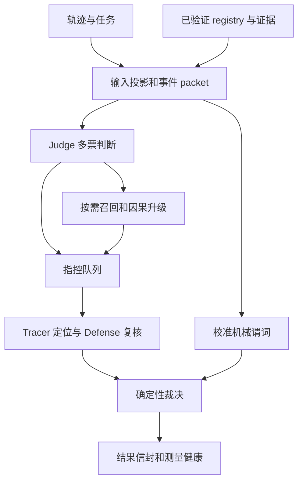
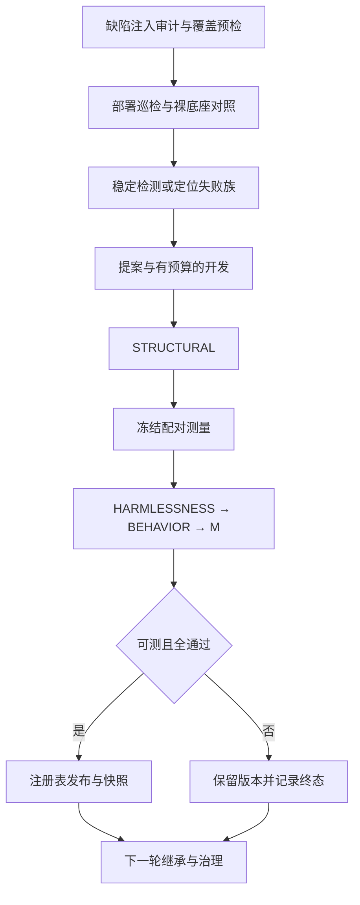

# 核心技术文档

更新：2026-10-08（补充拟议方向，原有实现叙述保持不变）。本文描述当前实现及约束；历史实验、旧方案和数值统一见 [实验日志](experiment-log.md)。

> **研究方向补充（未实现）**：详见 [疑惑度引导的双向因果轨迹审计技术设计](uncertainty-guided-causal-audit-design-20261008.md)，简明版见 [2026-10-08 组会汇报](group-meeting-uncertainty-causal-feedback-20261008.md)。

代码重构、缺陷修复及新功能的当前实施状态统一见根目录 [实施台账](../IMPLEMENTATION_PLAN.md)。本期采用离线代码验收，不开展真实模型实验；本文件仍只描述已实现合同。

## 🧭 仓库边界

依赖方向为 `experiments → detector`、`evolution → detector`。检测器不导入进化框架；进化只能通过经过验证的 registry 干预检测。实验编排负责冻结执行计划、收集结果和评估，不能替代准入门。

| 目录 | 内容 | 约束 |
| --- | --- | --- |
| detector/ | 检测、模型调用、证据、干预、结果、批处理 | 独立运行，不依赖 evolution |
| evolution/ | 失败诊断、候选开发、四门、发布、记忆、治理 | 候选经过评估才能进入部署版本 |
| experiments/ | 计划、运行、报告 | 使用统一检测结果信封 |
| scripts/ | 验证、预检、成本、研究轮和实验工具 | 新运行产物写 artifacts |
| datasets/protocols/ | 开发划分、测量协议、暴露记录 | 执行输入，不能作为旧日志删除 |
| datasets/raw/ | 本地原始数据 | 不修改，由 integrity.json 校验 |
| 各包 tests/、根 tests/ | 单元、跨包回归、必要夹具 | 不依赖旧 reports/output |
| docs/ | 本文、研究设计和唯一实验日志 | README 是入口；代码实施进度只写根目录 IMPLEMENTATION_PLAN.md |
| artifacts/ | 可生成的运行产物 | 不入 Git，旧缓存不能直接用于新代码 |

## 🔎 检测器模型

令轨迹为 X、证据快照为 E、部署干预为 R、配置为 C。检测输出 D(X,E,R,C) 包含终态、判定权威性、责任步骤及定位权威性、测量健康、成本和执行来源。判定、定位与服务可用性是不同维度。



### 输入与判错口径

`dataset.py` 分离任务输入和标签；`packet.py` 建立事件 ID、位置、工具观察、交付物及答案锚点。gold 只用于评估，不能参与判断或责任步骤映射。`semantics.py` 是各模型阶段共享的判错与定位规则。

可定罪对象包括结果错误、任务固定的交付动作/参数/次序/渠道违约、虚假完成、伪造归因与伪造验证。合法探索和未改变交付物的风格偏差不构成幻觉。观测冲突时，不得用模型世界知识挑边定罪，需要适用的独立证据快照裁决。诚实报告过程失败不自动等于结果性幻觉，例如 BFCL/041 与数据集标签有已知口径分歧。不得为通过预检改标签、种子或门限。

责任步骤是最早引入实质错误的 assistant 内容或动作。提交工具调用首次引入错误时可以是根因，仅重复已有错误时应追溯早先步骤；工具观察不是 assistant 本身的幻觉。内容步和动作步都可命中，但指标必须分列，不能将动作步命中解释为语义根因追踪成功。

### 执行与终态

`api.Detector` 编排阶段；`judge.py`、`recaller.py`、`step_tracer.py`、`defense.py` 各自校验模型输出。Judge 阳性和召回升级候选进入 hearing 队列；`adjudication.py` 校验证据引用、指控和确认步骤，计算终态。机械谓词的定罪能力受 `conviction_calibration.py` 和校准记录约束；证据型组件不能自行获得定罪权。

`interventions.py` 负责统一 schema、内容哈希、hook 和执行计划；`predicate_dsl.py`、`predicate_context.py` 定义可执行谓词及可用上下文。冻结阶段回放必须匹配证据身份，并拒绝覆盖待测干预的目标阶段。配置文件与 `Detector(config=...)` 共用 `config.validate_config`，解析有效 route 并保留默认 off 的审计配置，未知字段、非法数值与缺失声明工件直接报错；`require_credentials=False` 不读取仓库 .env。审计配置已可解析，执行分支仍待后续工作包接通。

Packet 的 `packet_reference_index` 统一事件和实际工具交互的引用归属，canonical position 与原始 source_step_id 分开；局部窗口 v2 覆盖 anchor/target 双端，携带 packet/内容摘要、遗漏 ID、截断原因与独立数据，后续活动不标为恢复。

Recall/Upgrade 的 live 与 frozen 解析使用同一适用证据快照；`recaller.assemble_upgraded_candidates` 从已校验候选及升级行生成按步骤排序的完整听证列表，单数项由该列表派生，回放不信任传入的派生字段。

`detector.identity` 提供规范有限 JSON 摘要、源码/声明工件摘要和 `execution_identity.v1`。Detector 的 provenance 与批次 `run_manifest.v3` 使用同一规则；清单绑定实际有效配置和逐例 record/packet/registry/工件，恢复时验证源码与逐例输入。演化 backend 复用同一输入构造规则，绑定 detector/evolution 源码、有效配置、record/packet、适用 evidence 与实际 registry/replay。内存基线核验 backend_execution_identity，并以独立副本返回。缓存 entry.v2 核验完整身份和结果摘要，目录由 registry 内容生成；缺身份的旧缓存重测，历史证据不回写。缓存中的 Mock gold 只属于测试 oracle 身份，不进入 Detector 输入。源码摘要排除测试与文档。

`backend_runtime_identity` 绑定已构造 backend 的有效配置、声明工件、Mock 参数及选定案例的实际证据快照；harness.v2、cycle_checkpoint.v2 和缺陷审计消费此身份并使用规范完整摘要。完成报告和中断检查点的恢复均经 CycleJournal.load_state 验证，输入漂移在写入前拒绝，旧 checkpoint/harness 不作为新运行复用。晋升冻结协议的历史摘要读者及 preflight 脚本迁移仍未完成。

批次 `run_summary.v3` 分别记录 requested/returned/not_started/missing，completed 只统计实际返回的非 not_started 行。工作线程登记完成结果，调度器中断后仍保留已提交案例；没有返回行的已开始案例记为 missing，不写成阴性或未开始。重复及额外案例行拒绝进入汇总。

| 维度 | 合同 | 解释 |
| --- | --- | --- |
| 终态 | verified_error / verified_clean / unresolved | 未决不等于 clean |
| 判定权威性 | authoritative / degraded_judge_only / invalid | 只有可信终态进入正式预测 |
| 定位权威性 | authoritative / degraded_localization_conflict | 独立于检测结论计量 |
| 未开始 | 批处理占位 not_started | 不是检测终态或阴性 |
| 版本 | detector.detection_result.v1 | 不匹配的缓存拒绝复用 |

`result.prediction_state` 同时检查 schema、authority、runtime_valid、state 与 occurrence_state，正式预测只返回 True、False 或 None。定位优先使用被定罪 hearing 的 tracer，其次是可用的 defense 确认，再次是指控步骤。tracer 比确认步骤更早本身不构成冲突；首 hearing 的镜像 tracer 与最终采纳步矛盾则降低定位权威性。旧定位文档曾混淆这些不同种类的不一致，这里按当前代码明确区分。

### 测量、故障与成本

`measurement.py` 统一健康分类与重测策略。error_type 和 code 都可能携带致命错误，必须同时检查。凭据、权限、请求、配额等致命故障不在同轮重试，修复环境后可在后续运行重测。暂时性服务错误允许同轮重试；耗尽案例或批次时限后不能重新申请完整预算。

`runner.py` 统一结果落盘、尝试记录、断点复用和调度；`runtime.py` 提供运行控制、deadline、原子写入和单写者保护。整例重试共享案例 deadline。`measurement.request_execution` 汇总单次 Detector 的真实请求，`case_execution` 生成 execution.v2，保留每次整例尝试的结果、错误和请求成本；嵌套 usage scope 向父层归并一次。批次每次尝试结束即原子保存 attempt.json，程序错误和中断仍传播，汇总保留已发生的成本而不补造结果行。未知请求统计用 usage_unknown_cases 表示，旧 providers/hearings 统计仅为下界。缓存命中的当次与历史成本分离、完整存储事务仍待 M08 实施。

## 🧬 自进化模型

部署版本与改进系统分离：部署状态 R_t 由 registry 表示；harness 清单记录门、能力、工具、记忆与运行编排的身份。候选在冻结的对照条件下评估，全部门通过才更新部署版本；拒绝或不可测时保留原版本。



L1 开发回放要求两臂恰好覆盖预定 target∪neighbor，每例各一行；配对指标模块统一验证覆盖和布尔 gold/prediction。覆盖缺失、非法读值和不健康运行归为未测，delta 留空，版本不能冻结。已知 gold step 时，定位回退只计基线原本精确命中而候选失去命中的案例；wrong→wrong 保持未改善。

普通单位提前检查、替换集合的 coverage 和路线反馈共用 target_opportunity：定位使用可纠正定位数，联合使用检测机会与定位机会之和。替换按 localization 方向的显式策略执行，并以实际替换集合报告机会。联合收益门保留“至少一个目标改善、两个目标均不回退”的既有语义。

指标模块 target_outcome 统一读取 detection/localization/joint/resolution 的收益与损伤，并携带目标类型和 delta_basis。周期入口按实际 benefit set 为每个候选成员产生 outcome；即使行为门未通过，读值仍保留。缺少相应指标归为未测；joint_broken、检测损伤及健康退化归为损伤，路线反馈只记录可测且未改善、未损伤的结果。定位机会来自基线可纠正的 annotated positive，不能用检测 FN/FP 机会替代。

路线状态按 JSONL 追加顺序归约：resolution 清除对应 mechanism/route 的当前观察期，后续 observation 从零累计，历史字节保留。相同 cycle/route 事件重放不重复累计，冲突内容拒绝；解决记录写入幂等。当前仍需接入候选、measurement 和上下文身份，不能把跨 cycle 次数当成已证明独立的测量证据。

### 模块职责

| 模块组 | 文件 | 职责 |
| --- | --- | --- |
| 循环 | engine.py、config.py、splits.py | 阶段顺序、预算、划分、审计、巡检、准入、治理 |
| 失败建模 | worksheet.py、mechanisms.py、route_failures.py | 稳定失败族、机制机会、定位错/缺、路径缺口 |
| 开发 | proposer.py、development.py、capability_planning.py | L0/L1 检查、修订、预算和反馈 |
| 研究入口 | research.py、scripts/run_research_round.py | 冻结机制研究、重复验证，不替代生产准入 |
| 晋升 | promotion.py、promotion_alignment.py、candidate_versions.py | 统一候选、协议冻结、自哈希、对照身份、晋升终态 |
| 门和指标 | gates.py、metrics.py、calibration.py | 结构、保护、行为、收益、定位、稳定性 |
| 后端 | backends.py、sandbox.py、capability_surface.py | 真实/模拟评估、缓存身份、受限执行 |
| 版本恢复 | registry.py、checkpoint.py、ledger.py | 部署、快照、断点 journal、追加哈希链 |
| 经验能力 | harness.py、memory.py、archive.py、gaps.py | 系统身份、经验、组件、开放缺口，不越过门判定 |
| 验证 | meta_eval.py、metamorphic.py、smoke.py | 归因、变形检查、离线闭环 |

### 核心不变量

1. STRUCTURAL 验证候选合同、执行边界、失败族和目标类型；结构失败不消耗真实候选测量。
2. HARMLESSNESS 检查保护集及覆盖，BEHAVIOR 要求实际触发且符合声明，M 衡量冻结收益集的决定性修复。收益不能抵消保护损伤。
3. detection、localization、joint 分别计量。定位分母包含漏检的 gold 阳性；只改标签不能伪装为定位修复。
4. unresolved、基础设施故障、覆盖不足、无可修机会分开记录。不可测不应写成机制被证伪，不进入永久负反馈。
5. 对照和候选使用冻结案例与角色，身份包含源码、配置、候选、证据和协议；不能通过换目录、裁门或改角色重新抽签。
6. 后续轮次读取新部署版本。缓存和断点核对身份，历史摘要不能作为新代码的结果复用。
7. 注册表输入与读取不能共享可变嵌套对象；发布拥有独立快照。同周期回滚选最后可用记录，同秒发布不能覆盖证据。
8. Ledger 采用哈希链和跨进程写锁，引擎单运行者锁是并发边界。ActiveRegistry 多文件不是数据库事务；active/state 不一致时拒绝加载，不静默接受。

### 审查结论与剩余边界

审查沿输入投影、API 编排、裁决/结果、测量、开发/门控、晋升、注册表/恢复展开，以完整离线测试及新增回归验证执行约束。本次未进行真实模型测量，不宣称形式化证明。

| 发现 | 风险 | 修复和证据 |
| --- | --- | --- |
| 致命错误只读优先字段 | code 中致命错误被遮蔽 | 两字段均识别，参数化信封测试 |
| 同轮重试包含 fatal_provider | 无效凭据重复消耗预算 | 禁止同轮重试，保留跨运行重测 |
| 注册表浅复制 | 外部修改 body/snapshots 绕过发布 | 输入、结果、状态深复制；内存/磁盘哈希测试 |
| 快照精确到秒且同周期回滚取最早 | 覆盖快照或恢复错误版本 | 唯一快照名；最后可用记录；固定时钟回归 |
| 验证指纹遗漏 experiments | 实验编排变更未进入验证源码身份 | 纳入源码清单；修改实验模块须改变哈希的回归 |
| 工具/测试依赖历史产物目录 | 清理文档破坏执行 | 驱动迁 scripts，划分迁 protocols，回放迁 fixtures |
| 旧文档与代码不同步 | 定位冲突口径、现状与计划混淆 | 当前合同集中本文，旧内容标为历史 |

静态结构检查覆盖 66 个顶层 Python 模块（detector 28、evolution 33、experiments 5），没有 detector 反向依赖 evolution 的导入。engine（5353 行）、promotion（2325 行）和 interventions（2247 行）仍是主要维护热点。

一次冗余梳理移除了没有生产调用方的代码：RepairUnit 声明与编译器、统计评估器、注册表单笔事务、注册表自愈、单元漂移记录、`event_source_mapping` 与 `resolution_opportunity`。它们此前只被各自的测试引用，`promotion.py` 中通向其中的分支在任何候选上都无法到达。保留的 `retire()` 反向依赖检查是实时的：它仍会拒绝单独退役被现役 Guard 消费的证据项。

engine、backends、promotion、interventions 仍承担较多职责，后续物理拆包需逐接口迁移。本次保持公开 API 和冻结身份合同，先统一职责边界及输出入口。真实模型重复波动、定位标注歧义、机械谓词误报风险仍需实测与语义审计，不能用测试数量替代。

## 🧪 待研究：疑惑度定位如何反哺幻觉检测（2026-10-08）

**现有代码事实**：`api.py::_judge_negative_needs_recall` 根据多票一致性和置信度决定部分阴性是否需要 Recall；`Detector._detect` 的 `negative_needs_recall` 还接受现有部署干预与适用证据快照触发；一旦进入 Recall，仍需 `run_causal_upgrade`、独立听证的 Tracer/Defense 和 `adjudicate`。阳性 Tracer 已支持输入单项指控，但尚无逐步困惑度或后续反事实推演的标准输入。

**拟议改造，不是已上线功能**：基于 `packet.py` 的规范事件和局部投影构造只读风险画像、Top-K 候选及有来源的因果传播链。初判阳性时将证据引入 `run_step_tracer` 以检查首次错误步骤；初判阴性时仅当出现可核实的具体偏差且满足预算/校准条件，才把它作为 `negative_needs_recall` 的额外触发因素，继续经过原有 Recall/Upgrade/Defense/Adjudication。**异常分数不能定罪；反事实模型推演不能冒充真实工具回放或事实来源**。强一致阴性的默认快路径应保持可用。

**双任务反馈**：`evolution/worksheet.py`、`mechanisms.py` 和 `proposer.py` 可在开发侧消费不含部署标签泄漏的因果诊断，将漏检、误报、首次步骤晚判、证据缺失、已纠正及多错误歧义区分处理；保留原始 L0/L1、四门准入、双指标配对与不可测状态。现有 `detector/provider.py` 没有对原 Agent 步骤计算 teacher-forced PPL 的接口，首期“疑惑度”应明确写作语义风险代理。

**实施顺序与验收**：先旁路影子审计（不改变判决）；然后配对验证 Tracer 定位收益；再独立验证阴性复核对 FN/FP 的影响；最后研究结构化反馈的跨轮自进化净收益。所有新增 prompt、scorer、依赖投影及后端工件须纳入缓存身份和冻结回放一致性校验。完整风险、分阶段文件改动、消融与预算见[技术优化设计](uncertainty-guided-causal-audit-design-20261008.md)。

## 🛠️ 运行和维护

Python ≥3.10，运行时标准库，测试依赖 pytest。默认配置为 detector/configs/autodl.json，凭据从本地 .env 或进程环境读取，不写入日志。默认开发划分不是独立终审，历史暴露记录必须保留。

```bash
python -m pytest -q
python scripts/verify.py --scope code_only
python -m detector --help
python -m evolution --help
python -m experiments --help
python scripts/run_research_round.py --help
python scripts/cost_model_693.py --json artifacts/cost_model_693.json
```

verify.py 默认执行 code_only（合成输入与临时夹具），可显式选择 platform（回环 HTTP、worker、锁、沙箱）、local_data（本地数据和证据完整性）或 all。所有测试禁公网，Python 子进程继承同一回环边界；code_only 拒绝访问原始数据及历史 artifacts。验证报告按源码摘要及独立运行 ID 写入 artifacts/code_quality，不覆盖历史报告；源码 AST 检查覆盖重复定义、包依赖边界和循环依赖。成本工具从实验日志的命名 JSON 块读取冻结样本并保留 original_source；旧样本有选择偏差，不代表完整语料的最新成本。

新增实验先冻结输入、源码/配置身份、角色、预算和判据；结束后将日期、分母、结果、失败、中断、更正和成本追加到唯一实验日志。运行缓存不作为永久文档提交。算法文件按职责命名，日期放运行 ID；夹具只服务具体测试断言，不存放任意实验备份。
