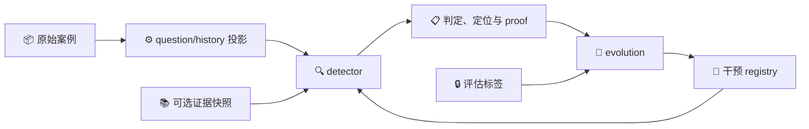
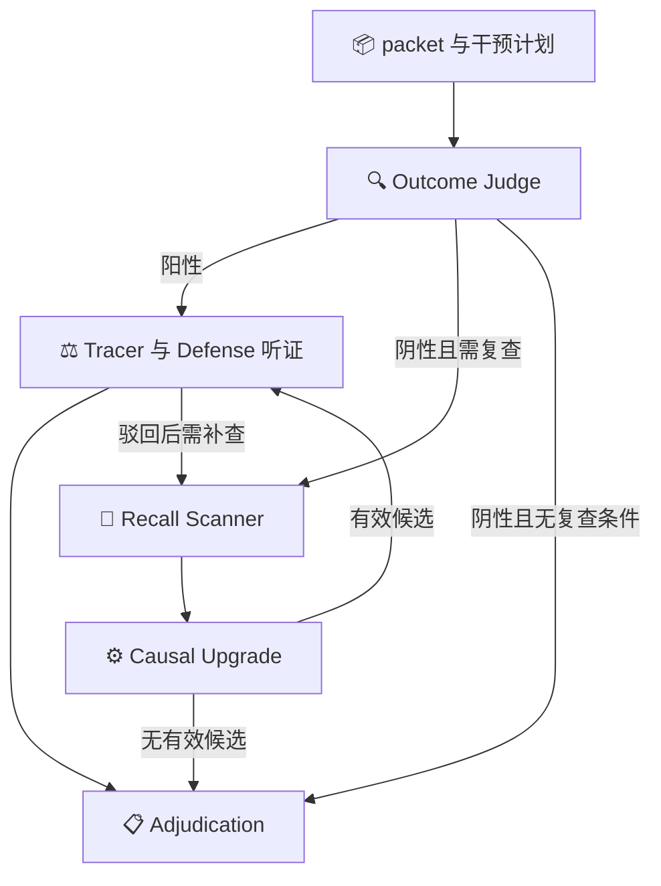

# Agent Hallucination 当前框架技术方案

更新日期：2026-09-21。对应源码：`33e6905`。本文只描述当前仓库已实现的模块、接口、执行流程、数据合同和运行方式。项目目标见[根 README](../README.md)，后续改造见[框架优化方案](optimization-plan.md)。

## 🗂️ 1. 系统组成与模块边界

框架由独立检测器 `detector` 和自我改进框架 `evolution` 组成。依赖方向是 `evolution → detector`：检测器通过标准输入、干预 registry 和可选外部证据执行检测；进化框架调用检测接口，管理提案、评估、准入和版本状态。

| 模块 | 主要文件 | 职责 |
| --- | --- | --- |
| 检测 API | `detector/api.py` | 单例编排、干预加载、阶段回放、最终输出 |
| 输入处理 | `detector/dataset.py`、`packet.py` | 数据投影、事件组织、工具和交付锚点、阶段视图 |
| 共享语义 | `detector/semantics.py` | 结果性幻觉判断规则与责任步骤定位规则 |
| 结果判断 | `detector/judge.py` | 完整轨迹的结果性错误判断 |
| 召回与升级 | `detector/recaller.py` | 候选扫描、内容错误及结果因果性判断 |
| 定位与辩护 | `detector/step_tracer.py`、`defense.py` | 责任步骤追踪、指控复核与证据验证 |
| 裁决和结果 | `detector/adjudication.py`、`result.py` | 确定性终态计算、权威性及统一结果合同 |
| 外部证据 | `detector/evidence.py`、`retrieval.py` | 来源快照、适用性检查、冲突裁定和本地语料检索 |
| 干预执行 | `detector/interventions.py`、`predicates.py`、`predicate_dsl.py`、`predicate_context.py` | 干预合同、hook、类型化谓词、执行痕迹 |
| 模型服务 | `detector/provider.py`、`provider_worker.py`、`config.py`、`env.py` | 路由、多票、超时、重试、调用记录与配置 |
| 批量运行 | `detector/runner.py`、`evaluation.py`、`cli.py` | 批任务、指标计算及命令入口 |
| 进化编排 | `evolution/engine.py`、`config.py` | cycle、预检、巡检、准入、组合选择与治理 |
| 诊断与提案 | `evolution/worksheet.py`、`proposer.py` | 失败分族、谓词画像、提案和反馈消费 |
| 研究通道 | `evolution/research.py` | 冻结机制下的草拟、有限修订、筛查及 seed 复用 |
| 晋升桥接 | `evolution/promotion.py` | 统一候选对象、冻结晋升协议、四门复用、版本发布与账本记录 |
| 门控 | `evolution/gates.py`、`metrics.py` | 结构、无害、行为、边际收益与定位目标判定 |
| 执行与划分 | `evolution/backends.py`、`splits.py` | live/mock/回放、数据角色和正式协议 |
| 版本与恢复 | `evolution/registry.py`、`ledger.py`、`checkpoint.py` | 活跃库、快照、哈希账本、检查点和恢复 |
| 系统状态与经验 | `evolution/harness.py`、`gaps.py`、`memory.py` | H_t 清单、能力缺口、三类经验和有界检索 |
| 能力与元评估 | `evolution/capability_surface.py`、`meta_eval.py` | 可执行修改范围、门控和治理的检查 |



## 📦 2. 输入、事件表示与输出

### 2.1 数据输入

`dataset.project_record` 将原始记录投影为 `question/history`，gold 留在评估侧。`packet.validate_record` 检查输入合同；`build_packet` 构造可供各阶段引用的事件表示。案例 ID 用于运行管理，不作为任务答案输入。

packet 提供任务文本、事件 ID、步骤索引、工具调用和观察、交付锚点及 packet features。不同阶段使用完整视图、索引加尾部视图或听证相关视图。截断和视图退化通过元数据保存，调用方可据此判断运行健康。

`delivered_result` 组织自然语言交付和答案工具调用等锚点；定位仍引用原始事件编号，不能通过压缩视图重新编号。相关实现位于 [packet.py](../detector/packet.py)。

### 2.2 公开检测接口

```python
Detector.detect(
    record,                       # question/history
    case_id="case",
    interventions=None,           # detector.intervention_registry.v1
    frozen_judge=None,            # 固定 Judge 结果与状态
    frozen_stages=None,           # 按合同回放已有阶段
    evidence=None,                # detector.evidence.v1
)
```

`interventions` 未显式提供时使用配置指定的 registry 或空计划。非法 registry 在模型调用前被拒绝。`evidence` 独立于原轨迹输入传递；`frozen_judge/frozen_stages` 用于配对回放，不能冻结正在被干预修改的阶段。

### 2.3 输出合同

结果 schema 为 `detector.detection_result.v1`。

| 字段 | 内容 |
| --- | --- |
| `case_id` | 运行案例标识 |
| `state`、`occurrence_state` | `verified_error`、`verified_clean`、`unresolved` |
| `decision_authority`、`runtime_valid` | 判定依据完整性和运行有效性 |
| `responsible_event_id`、`responsible_step` | 责任事件及原轨迹步骤 |
| `incident_occurred` | 裁决给出的发生状态 |
| `proof` | Judge、召回、升级、听证、机械证据及部署记录 |
| `stage_status` | 各阶段状态 |
| `authority_failure_reasons` | 权威性不足的原因 |
| `providers`、`provenance` | 服务信息、输入/证据及运行来源 |
| `evidence_health` | 各阶段视图健康信息 |

`result.prediction_state` 默认只把 schema、状态、runtime-valid 和 authoritative 均满足要求的结果映射为布尔值，否则返回 `None`。它也支持 `require_authoritative=False`；常规检测评估与进化门控使用的权威性过滤不同，见第 9 节。

## 🔍 3. 检测执行流程

### 3.1 阶段编排

1. 校验 record，构造 packet，加载干预计划，验证外部证据适用性。
2. Outcome Judge 对交付结果和任务约束进行判断。
3. Judge 阳性进入听证；Judge 阴性按置信度、票数、分歧、召回干预和证据条件决定是否召回。
4. Recall Scanner 提出疑点；Causal Upgrade 检查疑点是否同时存在内容错误和结果因果性。
5. 合格候选进入 Step Tracer 和 Defense，形成独立听证记录。Judge 阳性被有效驳回时，也可继续经过召回路径。
6. 确定性 adjudication 综合有效阶段、听证和机械 guard，输出终态及权威性。



多票一致且高置信的阴性通常不再扫描；单票模式下阴性会进入召回判断。Scanner 只生成候选，不直接定罪。Upgrade 的正向候选按责任步骤组织；每场听证保留候选身份及相关阶段结果。

### 3.2 判定语义

`semantics.py` 的 MATERIALITY 规则约束各阶段：交付结果错误、任务固定动作/参数/渠道的实质违约、虚假完成、伪造归因或验证等属于判定对象。合法探索和不影响交付的过程风格不单独定罪。轨迹内部观测冲突时，适用独立证据可参与裁决，不能只凭一般知识任选一方。

各阶段共享语义，但承担不同职责：Judge 判断交付；Scanner 寻找疑点；Upgrade 判断内容错误及因果性；Defense 检查指控是否成立；adjudication 按合同合并这些输出。详细规则见 [error-scope.md](error-scope.md)。

### 3.3 幻觉定位

定位遵循 `LOCALIZATION_LAW`，目标是最早引入实质错误的 assistant 内容或动作。最终提交若首次引入错误，可作为责任步；若只是重复更早且未被修正的错误，则追溯更早步骤。工具观察本身不作为 assistant 幻觉，需要定位 assistant 如何错误采用、转述或行动。

Judge、Recall、Upgrade、Tracer、Defense 使用共享规则。Step Tracer 接收当前指控及轨迹证据，Defense 对该指控复核。责任事件、责任步和各场听证写入 proof；依据不足时可保留定位不确定性。gold 步骤由评估侧读取，不输入定位阶段。详见 [localization.md](localization.md)。

定位同时也是一种可被优化的目标，而不只是一个报告字段。检测行携带评估侧的 `gold_step`（由 `load_gold_step` 读取，与 gold 走同一条评估通道，不进入 `question/history`），由此可计算：

- **`paired_localization_delta`**：在冻结批次上比较两臂的"权威检出且责任步正确"（联合成功）。分母是冻结批次本身，不是两臂都能判定的子集——漏报不能从分母消失，否则候选可以靠少检出显得定位更好。
- **`localization_opportunity`**：控制臂已权威检出但责任步错误的案例数（`improvable`），以及已正确的案例数（`preserved`）。这是仪器属性，不是候选属性：`improvable=0` 时该定位声明在本批次上不可测量。
- **`joint_broken`**：控制臂已定位正确而候选不再正确的案例数。它直接计为代价，不被新增收益抵消。

定位声明的 BEHAVIOR 检查为 `localization_behavior_gate`：干预必须实际触发，且必须**确有一个责任步被改对**（只翻转标签不算），同时不得破坏控制臂已有的正确定位。定位收益门为 `meets_localization`；`joint` 目标要求至少一个目标改善且另一个不退化。检测目标仍由 `meets_m` 判定，其规则未变。

### 3.4 运行故障与裁决

模型失败、输出合同错误、视图退化和未决听证通过 stage status 与 authority 字段表达。故障不自动成为有效反证，也不自动恢复为权威正常。Judge 无有效结果时进入 unresolved；其他阶段的故障由 adjudication 依据实际可用证据确定降级或未决结果。

## 📚 4. 外部证据与检索

`evidence.py` 定义独立快照合同。来源包含 URL、标题、发布方、获取时间、原文片段及哈希，并关联实体、属性、值和语境。schema 或片段哈希不合法时拒绝输入。

`touches_packet` 检查快照是否与当前问题或轨迹相关。不适用的快照不会进入阶段提示，也不会单独触发复查；适用原因保存在 provenance。快照传到 Recall Scanner、Causal Upgrade 和 Defense，引用使用证据 ID。来源冲突的裁定通过 `resolutions` 表达，未解决冲突不能被隐式当作确定依据。

`retrieval.py` 从本地 corpus 构建快照，执行词项查询、片段抽取、来源选择和语境匹配。后端通过 evidence provider 将检索结果接入单例检测。快照摘要与来源内容参与相关缓存身份。默认 `autodl.json` 未配置 corpus；外部证据需通过相应配置或 API 显式提供。

## 🔧 5. 干预与 DSL 执行合同

### 5.1 四类干预

| 类型 | 合法 hook | 运行作用 |
| --- | --- | --- |
| `text_boundary` | `judge.system`、`scanner.system`、`upgrade.system`、`tracer.system`、`defense.system` | 在匹配阶段注入 directive 与 not_when |
| `evidence_check` | `judge.post`、`upgrade.pre`、`defense.pre` | 执行内置或内联 DSL 谓词，生成机械证据 |
| `recall_trigger` | `recall.trigger` | 在条件匹配时开启召回 |
| `decision_guard` | `adjudicate.guard` | 根据已注册事实执行受限裁决动作 |

每个干预包含 schema、ID、type、hook、trigger、body、claim 和 provenance。`validate_intervention/validate_registry` 校验类型与 hook、字段、谓词和动作组合。`claim` 还带可选 `target_kind`（`detection`/`localization`/`joint`，缺省即 `detection`），声明该候选要改善的目标；它不改变执行，只决定晋升时由哪一套收益门评分。registry 与干预均带 schema 与内容哈希；手改已生成的 registry 后不得继续复用原哈希。编译后的 `InterventionPlan` 执行匹配、提示注入、证据检查和 guard，并记录 `proof.deployment`。

当前 hook 共 10 个，分为两层（`detector/interventions.py` 的 `HOOKS`）：

| Hook | 层 | 能力 |
| --- | --- | --- |
| `judge.system`、`scanner.system`、`upgrade.system`、`tracer.system` | L1 | 阶段提示边界 |
| `judge.post`、`upgrade.pre` | L1 | 阶段后/前机械证据 |
| `recall.trigger` | L1 | Judge 阴性案例召回触发 |
| `defense.system`、`defense.pre` | L2 | 辩护提示边界与辩护前机械证据 |
| `adjudicate.guard` | L2 | 有证据约束的裁决动作 |

Guard 动作为 `withhold_conviction`、`restore_judge_conviction`、`require_full_view_defense`、`convict_mechanical_violation`。必须提供适用事实与非空排除事实；多 guard 动作冲突时回退底座并记录冲突；机械定罪要求实际的可授权机械证据。内置谓词为 `required_action_present`、`verbatim_fidelity`、`evidence_refs_resolve`、`contract_coverage`、`delivered_anchor_consistency`、`final_delivery_present`。

text boundary 按 packet features 等合同条件触发；当前 `prompt_block` 将 directive 和 not_when 作为阶段指令注入。执行痕迹区分文本注入、召回触发、证据生成、guard 生效及未匹配等事件。

### 5.2 类型化谓词

`predicate_dsl.py` 提供固定解释器和受限操作集合。候选可内联定义新谓词程序，由 registry 校验后注册；不是任意 Python 执行。程序只能读取 hook 对应的类型化字段，条件组合和 verdict 服从合同。

`evidence_check` 与 `recall_trigger` 通过 `body.predicate_definition` 携带程序，runner 为 `typed_dsl`，schema 为 `detector.predicate_program.v1`，运行时注册 `evo_...` 谓词、verdict 与 fact；同名不同定义会被拒绝。程序只能访问 typed 字段与操作符白名单，不执行 eval、import、循环或任意属性访问；最多 16 条规则、6 个 verdict，每条规则最多 4 个 AND 条件。规则按顺序首命中，多条规则可表达 OR；单条件 `field/operator/value` 与 `conditions` 形式不能混写。完整程序须声明 verdict 集合、默认 verdict 和 conviction verdict 子集。精确字段与操作符可通过 `python -m evolution capability-audit` 查询。

`predicate_context.py` 构造阶段上下文。`judge.post/recall.trigger` 可使用 Judge 上下文；`defense.pre` 面向听证、合同和证据；`upgrade.pre` 有其自身字段限制。合同非法与回放输入不足分别处理，不静默当成条件未命中。

`capability_surface_report` 可输出当前干预、hook、谓词及动作范围。当前实现支持有界提示、谓词和控制流干预，不提供任意新 hook、任意执行图改写或模型权重更新。

## 🔄 6. 部署进化通道

### 6.1 数据角色与前置检查

部署通道由 `EvolutionEngine` 驱动。sentinel（S）保护已有正确能力，gain（G）计量边际收益，patrol 用于发现已部署版本的残余失败。`splits.py` 根据配置和协议形成划分，正式评估使用显式 manifest。

引擎检查 S 的权威且基线正确覆盖，并进行缺陷注入审计。巡检默认运行 active registry 对应版本，保留裸底座参照；空 registry 时无需重复执行相同臂。对照将失败分为 `new_failures/persisting_failures/resolved_by_active`。

worksheet 按执行路径分族，构造机制签名、成员摘要、谓词画像、共同字面量和可行修改路由。`stable_failure_families` 的分组计数表示跨案例共现，重复运行稳定性由相关运行逻辑另行处理。

gain opportunity 标识底座是否存在 recall/precision 修复机会。保护覆盖不足或目标方向全部不可测时，cycle 可返回 `blocked_evaluation_preflight`。覆盖策略默认 strict；显式安装的 replacement gain 和对应策略可改变测量集，动作写入 instrument。

`coverage_response` 决定「某方向在 gain 集上无机会可修」时怎么做，可按方向覆盖：`strict`（默认，记为未测量并阻断准入，行为与改动前一致）、`replacement`（在已安装的替代评估集上重新测量整个判定单元，门限不放宽，只更换所运行的仪器）、`replacement_or_skip`（无匹配评估集时记为 `skipped_unmeasured` 并跳过）。测量集在任何门运行之前决定，因为机会为 0 的召回类 claim 会先在 BEHAVIOR 的方向检查上失败、到不了 M。替代评估集通过 `set_replacement_gain_cases` 只驻留内存，未安装时策略如实报告 `none_installed`；持久化它需要与主 gain 集同等的 gold、协议与暴露保证。

### 6.2 提案生成

`LLMProposer` 根据失败族、允许修改面、活跃干预、历史反馈及记忆生成候选。`HybridProposer` 转发状态与反馈，在 LLM 无有效候选时使用受限模板后备。配置控制提案数量、输出 token、调用次数等。

提案经过合同与接地检查，组合候选可通过联合组表示依赖。返回候选与合法执行合同分离；无法执行的失败族进入能力缺口记录。

### 6.3 四门准入

| 门 | 输入与判定 | 默认要求 |
| --- | --- | --- |
| STRUCTURAL | schema、去重、案例 ID 泄漏、谓词接地、依赖和可达性 | 合同有效，行为可执行 |
| HARMLESSNESS | S 上基线正确权威案例的配对结果 | 至少 2 TP+2 TN；新增 FN/FP/unresolved 均为 0 |
| BEHAVIOR | 执行痕迹、干预声明及方向差分 | 实际触发并出现声明方向的有效纠正 |
| M | G 上净正确案例增量、新错误和健康状态 | marginal≥1，新错误为 0，无新增未决或健康退化 |

组合选择包含联合评估、子集选择及贡献检查。合格组合经 registry 预提交、容量约束后成为 active；判定和身份进入账本。后续治理根据边际贡献记录进行淘汰或回滚。

cycle 通过 `instrument` 记录可测方向、覆盖响应和候选终态。`admitted/rejected/not_evaluated/unresolved` 区分准入、实质拒绝、未测量和运行未决。M 当前以二分类净收益为核心，不是独立的定位收益门。

## 🧪 7. 独立研究通道

`evolution/research.py` 读取冻结 research manifest，在部署通道之外执行单机制研究。manifest 声明案例角色、目标步、可用干预类型/hook、联合条目数、路线和预算。

```text
冻结 manifest → baseline → draft 或 seed
→ 训练/正常近邻筛查 → 预算内 revision
→ 保存全部版本 → selection
→ 外部驱动执行冻结复核和后续面板
```

route C 的 research packet 包含投影后的完整训练/近邻轨迹、基线阶段结果和审阅后的目标错误描述。revision 反馈包含父代 hash、逐例 repaired/clean/step 与失败原因。当前执行逻辑以草案及有限修订为主，不是通用工具调用式改进 Agent。

`seed_candidate` 钉住历史候选内容 hash，检查合同和新运行身份后重新筛查，不调用 proposer 重新草拟。联合候选的多个条目作为同一版本部署评估。所有版本、parent、identity、结果和 selection 持久化。

`run_frozen_repeats` 完成同候选的重复配对测量。`output/rsi-planning/run_round.py` 按 manifest 调用研究入口及阶段门；其 panel gate 支持逐次条件、计数容差或 `no_significant_degradation` 的 Fisher 规则。研究通过不会自动写入部署 active registry。

## 🚀 7.1 晋升桥接

`evolution/promotion.py` 把研究通道的成果接到部署底座上。研究通道的 PASS 只是开发证据：准入仍由 `structural_gate`/`harmlessness_gate`/`behavior_gate`/`meets_m`（或定位目标的 `meets_localization`）在同一批冻结案例上判定。

**统一候选对象**（`build_candidate`，schema `evolution.candidate.v1`）字段为 `candidate_id/parent_id/target_kind/change_kind/base_revision/artifacts/artifact_refs/dependencies/development_results/status/content_hash`。生命周期为 `draft → developing → frozen → promotion_pending → active/retired`。内容 hash 排除 `status` 与 `development_results`，因此同一份可部署改动的身份不随生命周期或开发记录变化，跨轮按内容识别而非按运行内版本名识别。研究版本（`candidate_from_research`）与手写补丁（`candidate_from_registry_patch`）包装成同一对象，交付同一个晋升入口。

**冻结晋升协议**（`freeze_protocol`/`load_protocol`，schema `evolution.promotion_protocol.v1`）声明收益集（`benefit`）与保护集（`protection`）的案例、角色、gold 步、检测配置、并发数与代码基线。协议在运行前冻结且不可改写；加载时重新校验批次 hash、检测配置 hash、源码摘要和角色覆盖，数据集标注与冻结值不一致即拒绝。批次与候选的开发案例重叠时 STRUCTURAL 直接拒绝——晋升批次必须是候选未用的。`localization_min_joint_cases` 与 `localization_joint_broken_allowed` 控制定位目标的收益与保持要求。

**`PromotionRun` 执行**：先跑免费的 STRUCTURAL，再并发运行对照臂与候选臂（各臂内部按协议声明的 `workers` 并发），随后依次判 HARMLESSNESS（保护集）、BEHAVIOR（每个 artifact 各自给出语义判定）、M 或定位收益门。终态为 `promoted`/`promotion_rejected`/`promotion_unmeasurable`/`promotion_blocked_preflight`/`promotion_unresolved`。**只有 `promoted` 会写 active registry**；其余终态部署保持不变，`unmeasurable` 明确表示该机制在本批次上没有可计分机会，不是已被证伪。每次尝试都写入账本（`promotion_attempt`），准入写入 `candidate_promoted`，版本记录同时落盘 `version.json`。

**定位目标**（`target_kind`，见第 5 节）在候选层面声明。缺省为 `detection`，与既有 registry 语义逐字相同；`localization` 与 `joint` 走定位判定，不用二分类门冒充定位支持。

命令入口：`python -m evolution freeze-protocol` 冻结协议，`python -m evolution promote --from-research/--from-patch` 一次完成"装载→门评估→发布检查→版本记录"。

## 💾 8. 状态、经验、缓存与恢复

### 8.1 系统版本描述

`harness.py` 从实际代码和配置推导 `H_t=(G,C,T,M,R)`：工作流、上下文、工具/干预、记忆、路由/预算策略。每个组件及整体具有摘要，清单和历史差异可核验。这里 G/M 与 gain 集/M 门不是同一概念。

H_t 清单描述已经运行的系统，不参与门控评分。`gaps.py` 保存当前动作空间无法处理的失败族，按稳定身份去重并记录解决状态。

### 8.2 三类经验

`memory.py` 保存 episodic、procedural、improvement 三类 JSONL。程序性经验只来自通过门控的路线；检索按机制和数量上限组织。未测量与已证伪干预分开处理，人工更正通过带原记录 hash 的追加记录应用。

引擎将可检索经验及开放缺口送入 proposer；供给事件写入账本。研究通道也可从 manifest 接收 memory context。

### 8.3 回放与缓存

`LiveDetectorBackend` 根据候选影响范围选择 fresh 或阶段回放。回放检查 packet、阶段结果/状态、听证身份及被修改 hook；候选改变某阶段输入时不能继续复用该阶段旧输出。新增听证按实际输入运行。

缓存身份包含代码、配置、输入、registry 以及适用的证据身份。模型/控制流被改变时使用 fresh 两臂测量；无影响上游可用于条件回放。回放结果与 fresh 结果保留各自执行身份。

### 8.4 检查点和账本

`CycleJournal` 按 `(arm, case)` 保存观察。恢复校验运行契约，复用已完成结果，包括未决。检查点保留轮次起始 registry，支持处理本轮准入已提交但收尾未完成的中断；发生版本不一致时拒绝继续。

提案未持久化前中断不能假装精确恢复；已有结果不能为获取成功而被无记录重抽。同一工作目录不同时运行多个进化进程。`ledger.py` 维护追加式哈希链，`registry.py` 管理活跃版本和快照。

## 📊 9. 评估接口与数据目录

`detector/evaluation.py` 计算二分类指标、可判定覆盖、全案例正确率及定位相关读数，读取原始 gold 和 `hallucination_step`。常规运行评估使用 `require_authoritative=False` 读取可用终态，并单列 authoritative/degraded；`evolution/backends.py` 的门控读取采用 authoritative 口径。

`evolution/metrics.py` 计算配对 TP/FP/FN/TN、净正确案例、新错误、未决和健康变化。研究筛查可按 manifest 中 target_step 检查训练修复；它与正式部署 M 门是不同执行路径。

| 目录 | 内容 |
| --- | --- |
| `datasets/raw/` | 原始输入数据 |
| `datasets/integrity.json` | 原始文件 SHA-256 清单 |
| `datasets/protocols/` | 开发划分、暴露记录等协议 |
| `artifacts/evolution/` | 默认 cycles、cache、registry、ledger、checkpoint、harness、memory |
| `reports/` | 验证和研究运行的持久结果 |
| `output/rsi-planning/` | 冻结研究 manifest 和阶段驱动脚本 |
| `output/repository-review/` | R4–R6 已落盘结果的只读复核脚本与快照 |
| `output/literature-search/` | RSI 与检测器改进的资料表（历史方案的支持材料） |

### 9.1 原始数据与标签边界

原始目录 `datasets/raw/` 保持不变，共 695 个文件，其中 `agenthallu/AgentHallu/` 有 693 个 JSON 案例：

| 来源 | 案例数 |
| --- | ---: |
| BFCL | 164 |
| Camel | 93 |
| Magentic_One | 94 |
| Octotools | 47 |
| OpenDeepSearch | 100 |
| OpenManus | 104 |
| SmolAgents | 91 |

`python scripts/verify.py` 比较文件集合及全部摘要，任何新增、缺失或内容变化都使完整性检查失败；该检查证明与整理前本地原始目录一致，不替代上游发布方校验。

检测器只接收 `question/history`；gold 由评估和进化门控侧读取，LLM 不承担晋升评分。`datasets/protocols/development.json` 仅保存案例 ID，默认开发池 30 例、复测集 10 例，sentinel/gain/patrol 按配置和种子拆分；它们已经参与历史开发，复测不是独立泛化验证。`development_exposure.json` 保守地把原始 693 例列为不能直接认证为新独立终审的范围——这不表示每个案例都调用过模型，而是保留既有开发、协议选择和历史污染的不确定性；删除缓存或运行目录不能消除此边界。

### 9.2 正式评估入口

默认 `split_manifest=null`，`final` 与 `full-self-evolution` 不会自动取旧划分；调用方必须提供独立审计的正式 manifest、适配的数据根目录与新的运行目录。正式 manifest 包含 `evolution_pool.cases` 和 `final_verification.records`（case_id/gold），程序检查唯一性、开发/终审无交集、历史开发记录重叠及 read-once 标记。显式正式配置还需 `final_evaluation.enabled=true`，全流程入口需 `experiment.mode=full_self_evolution`，并可指定 `expected_evolution_cases`、`expected_evaluation_cases`、`expected_dataset_cases` 校验数量。

现有实现从 manifest 读取终审记录，正式配置属于评估受信任输入，不能据此宣称实现了外部标签服务隔离。原始语料不能因换 case ID 而被视为独立数据；配置引用的历史记录缺失会报错，而不会静默绕过。

### 9.3 巡检版本与边际集构成

两个评估侧配置决定「一轮能读到什么」。`patrol_registry`（顶层，`active` 默认 / `bare_base`）决定巡检测量哪个版本：`active` 面向已部署版本，同时保留裸底座参照臂，失败据此分为 `new_failures`／`persisting_failures`／`resolved_by_active`（registry 为空时两臂是同一次评估，冷启动成本不变）；`bare_base` 恢复旧的单臂行为。

`split.mini_gain_min_positives` / `mini_gain_min_negatives`（正式协议为 `gain_set_min_positives` / `gain_set_min_negatives`）是边际集每极性最少案例数，开发默认各 1，正式默认 `max(1, gain_size // 4)`；下限不可满足时构建直接报错，不静默弱化。`split_manifest_report` 的 `gain_polarity` / `sentinel_polarity` 记录实际构成。该下限是必要不充分条件：G 含有某极性案例不等于它是该方向的修复机会，机会覆盖由 cycle 报告的 `instrument` 块按轮报告。

### 9.4 证据等级

| 结果 | 能说明什么 |
| --- | --- |
| pytest | 输入合同、检测路径、投票、门控、缓存、账本、DSL 等离线回归 |
| 本地 HTTP 命令链测试 | 真实子进程执行 detect/batch/evaluate、HTTP 传输、落盘与标签隔离；响应由本地固定服务提供 |
| smoke | mock 条件下提案准入、缺陷拒绝与状态闭环 |
| capability-smoke | 合成数据上新谓词经 registry 执行并产生可观测增益 |
| 真实服务合成案例联调 | 当前 endpoint、凭据、模型输出与检测流程可接通；不能估计复杂轨迹准确率 |
| 开发集真实模型结果 | 当前已使用案例上的诊断读数 |
| 独立正式评估 | 满足数据隔离与真实后端测量后才可讨论泛化 |

最新代码结果统一写入 `reports/latest/`；历史结果摘要只在 `reports/maintenance/` 中作为背景保留，不与当前回归混合，也不沿用旧文档的通过数量或准确率。开发复测和独立评估必须分别报告，否则不得宣称泛化。

## 🧰 10. 配置与运行入口

Python ≥3.10；运行时使用标准库，测试依赖 pytest。项目入口为 `python -m detector`、`python -m evolution`，安装后也可使用 pyproject 声明的命令。

| 配置 | 当前默认值 |
| --- | --- |
| 检测配置 | `detector/configs/autodl.json` |
| 模型与温度 | `GLM-5.3-flash`，temperature 0 |
| 凭据引用 | `AUTODL_API_KEY` |
| Judge/Defense | votes 3、vote_topup 2 |
| Recall/Defense 输出上限 | 32768 tokens |
| 案例时限 | 3600 秒 |
| Provider 包络 | timeout 300 秒、total timeout 900 秒、transport retries 2 |
| 进化配置 | `evolution/configs/development.json` |
| 开发划分 | pool 30、S 6、G 4、patrol 20；开发复测另列 |
| 进化预算 | 2 cycles，最多 4 proposals/2 admits；8 case workers |
| Proposer | hybrid、max_output_tokens 32768、max_repair_calls 1 |
| 活跃库 | width≤6，同 hook 文本边界≤1，decision guards≤4 |

配置解析顺序为进程环境、route、provider、内建默认值；凭据通过环境名读取。相对路径按对应模块配置解析规则处理，进化配置的项目路径以仓库根目录为基础。

```powershell
# 从仓库根目录执行。
python -m pip install -e ".[test]"
python -m detector --help
python -m evolution --help
python -m pytest -q
python scripts/verify.py

# 以下命令可能调用真实模型服务。
python -m detector detect --record datasets/raw/agenthallu/AgentHallu/BFCL/001.json --case-id BFCL/001.json --output-dir artifacts/detector/single
python -m evolution experiment --mini
python -m evolution cycle --cycle 1 --mini --resume

# 状态检查使用与实际运行相同的配置。
python -m evolution registry
python -m evolution verify-ledger
python -m evolution capability-audit
```

`scripts/verify.py` 组织离线测试、数据完整性、CLI、能力面和 mock 闭环检查；`live_smoke.py` 与 `real_path_check.py` 为真实服务检查入口。测试数据、registry、账本和临时配置使用隔离目录，不覆盖日常真实运行状态。mock 后端仅用于机械回归，真实模型能力应来自真实后端的独立测量。命令级结果也是执行合同：`verify-ledger` 的退出码反映哈希链有效性，`smoke` 的退出码反映实际准入、审计、cycle 完成和账本有效性，而不只是进程结束。本文记录实现和运行合同，实验结果由对应 `reports/` 保存。
