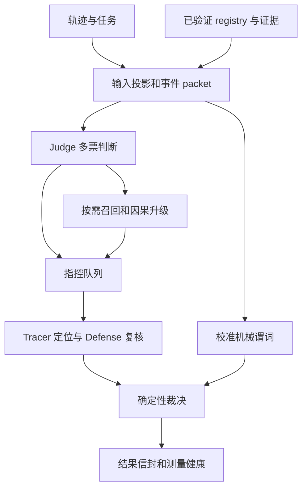
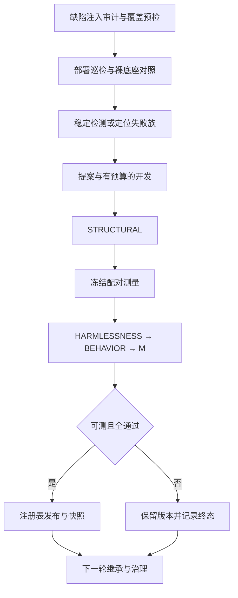

# 核心技术文档

更新：2026-10-19。本文描述当前实现及约束；历史实验、旧方案和数值统一见 [实验日志](experiment-log.md)。

本文是当前行为的维护入口。[研究主文档](research-positioning-and-roadmap.md)集中描述理论、候选新方法和论文主张；[实验日志](experiment-log.md)记录效果与费用，[结果索引](results/README.md)连接原件，[实施台账](../IMPLEMENTATION_PLAN.md)维护当前任务和验证状态。

最新已完成真实验证为新100例第二轮：100/100权威，检测82/100，定位36/62，FP7；同案G0为82/100、18/62、FP6，按当时冻结标准未通过。实现验收与模型效果分开记录，完整历史见实验日志。

## 🧭 仓库边界

依赖方向为 `experiments → detector`、`evolution → detector`。检测器不导入进化框架；进化只能通过经过验证的 registry 干预检测。实验编排负责冻结执行计划、收集结果和评估，不能替代准入门。

| 目录 | 内容 | 约束 |
| --- | --- | --- |
| detector/ | 检测、模型调用、证据、干预、结果、批处理 | 独立运行，不依赖 evolution |
| evolution/ | 失败诊断、候选开发、四门、发布、记忆、治理 | 候选经过评估才能进入部署版本 |
| experiments/ | 计划、运行、报告 | 使用统一检测结果信封 |
| scripts/ | 验证、预检、成本、研究轮和实验工具 | 新运行产物写 artifacts |
| datasets/protocols/ | 开发划分、测量协议、暴露记录 | 执行输入，不能作为旧日志删除 |
| datasets/raw/ | 本地原始数据 | 不修改，由 integrity.json 校验 |
| 各包 tests/、根 tests/ | 单元、跨包回归、必要夹具 | 不依赖旧 reports/output |
| docs/ | 本文、研究设计和唯一实验日志 | README 是入口；代码实施进度只写根目录 IMPLEMENTATION_PLAN.md |
| artifacts/ | 可生成的运行产物 | 不入 Git，旧缓存不能直接用于新代码 |

## 🔎 检测器模型

令轨迹为 X、证据快照为 E、部署干预为 R、配置为 C。检测输出 D(X,E,R,C) 包含终态、判定权威性、责任步骤及定位权威性、测量健康、成本和执行来源。判定、定位与服务可用性是不同维度。



### 输入与判错口径

`dataset.py` 分离任务输入和标签；`packet.py` 建立事件 ID、位置、工具观察、交付物及答案锚点。gold 只用于评估，不能参与判断或责任步骤映射。`semantics.py` 是各模型阶段共享的判错与定位规则。

Judge 多票阴性结果的 confidence 取所有支持阴性票的最低值，原始 ballots 保持不变；多数裁决、quorum、分票和弃权逻辑不变。任一有效阴性票以derivation或world_knowledge为依据时，即使全部high也进入一次既有Scanner→Upgrade复查；同一模型的共识不能独立验证推导或正确事实参照。检查所有有效阴性ballots，旧信封缺raw时读取parsed，不依赖代表票顺序。无上述依据、无分歧/弃权/弱置信或其他强制信号时保留一致high阴性的快捷路径。Scanner本身没有定罪权，仍须通过原Upgrade与Defense，失败/无结论不提高权威。proof.recall_trigger_metadata分别记录不确定性、事实参照复查、snapshot、policy和行动候选触发；这不是将causal_audit.negative_feedback_enabled开启。

各模型阶段的内置控制提示词统一使用英文，包括系统提示、user控制说明、修复提示和预测截断标记；预测校验诊断同样使用英文。九个生产系统提示词常量（含演化提案器）同时接受英文与JSON模式回归约束。question、轨迹、逐字引文、工具数据与来源语言识别规则保留原语言，不翻译冻结指令或历史证据。semantics.INPUT_LAW、DELIVERY_LAW和CAUSALITY_LAW统一数据/指令边界、允许的交付通道以及逐交付物的实际因果影响：工具观察可能承载答案，结束状态不抹除早前交付，但通道存在不证明正确或满足显式格式；修正来源时沿同一错误的依赖副本追踪，不要求单次编辑修复所有独立错误。Judge不再同时接收“仅限轨迹信息”与允许确定公共知识的冲突指令；不确定记忆及未解决观察冲突仍不能定罪。Recall区分有具体证据但材料性待审的候选与纯信息缺口。候选、Defense指控及Tracer结果参照以带有不可信声明的JSON数据传递，模型生成的contracts/correct_result不能升级为独立事实。

Defense.confirmed_step必须等于本听证alleged_step；Tracer.step才追溯同一错误的更早来源。二者职责不通过提示词混同，最终定位冲突与降权合同保留。预测提示明确每个动作数组1–3项、字符串1–240字符、最多两个约束，以及user_request只引用question、authorized_policy只引用授权事件正文；不能为填满结构编造禁令。rejected_prediction新增validation_error，首个失败后即使后续预算耗尽仍保留合同原因。英文统一及离线合同通过不证明中英文准确率优劣，真实效果需同源码/模型/样本配对测量。

`next_action.py` 从截至 t 的前缀生成明确工具失败后的只读动作边界，并比较真实 t+1；不调用 provider，不生成工具 Observation，不在缺失下一步时补造动作。明确重试或诚实失败报告匹配局部合规模式，不证明参数正确或任务全部履约；不同工具的潜在 fallback 仍为 unknown，没有明确恢复观察却宣称成功构成诊断偏离。当前粒度是下一原始事件，事件内动作、返回与声明未拆成严格决策时序。所有结果保持 hypothesis、decision_authority=none、localization_authority=none。失败信号进入静态风险排序，Top K 候选的 action audit 仅随绑定 risk context 传入 Tracer；该risk_context通路不直接交给Judge/Defense/裁决；新增Judge诊断通路见下节action_forecast。

`next_action.py`维护明确工具失败后的确定性动作边界；`action_forecast.py`、`action_context.py`与`action_evidence.py`负责有界前缀预测、逐约束比较和无权威候选接线。它们复用风险筛选、任务绑定、预算和现有听证，不独立定罪或授予定位权限。当前输入、接线和权限合同统一见下节；历史逐行代码梳理保存在整理前文档快照，不作为稳定接口。

### 高危前缀预测与真实下一步对比

`action_forecast.py` 在 Judge 前复用 Top K高危筛选；明确工具失败保留零请求边界，其余候选在可选请求额度内依序选择风险目标进行模型前缀预测，输出至多两个局部约束。`action_context.py` 统一任务前缀与动作通道：多轮任务仅接受历史中的非递减 `task_turn` 或匹配请求原文的user事件来绑定轮次；不能绑定时返回 `task_alignment_unknown`，不发送完整多轮question来猜当前任务。最近12个事件及有界通道保留原始引用、摘要和省略信息；同一调用先于自己的返回，混合内容与工具的顺序及多个调用间的顺序未建立时保持unknown。原始事件和首错评分映射不变。引文必须属于实际发送前缀及解码通道；合法JSON转义不会改变原文验证，预测不生成真实工具返回。

`causal_audit.next_action_mode` 为 `off`、`shadow` 或 `judge_context`；默认部署文件autodl.json与deepseek.json已显式选择judge_context。自行构造的配置仍以off作为未声明值，不自动继承部署文件。Forecast使用 `detector.action_forecast.v2`，每条约束有独立constraint_id；原Judge逐项返回matched/divergent/unknown，比较执行健康与语义状态分开保存。缺失、重复、无效引用/原文及理由显式引用未来事件分别记录；真实动作引用只接受content、工具名或参数，不能由其返回代证。可修复的合同失败在剩余新增请求/输出额度内仅补局部比较，不修改原Judge判决；明确的语义unknown不重试至确定。局部修复只读取各自前缀及真实下一动作；其余比较仍由全轨迹Judge生成，不宣称严格在线或完全无未来语义影响。

预测、比较修复与附加上下文通过OptionalBudget使用同一父预算的剩余额度，先保护既有诊断的默认30秒/6000 UTF-8字节（上限为本例总额度）；既有模型审计或阴性反馈启用时也保留其默认请求/输出额度。整例期限、取消、并发与原票数不变；额度仅够原有诊断时明确拒绝可选预测。请求发送前按输出上限保守预留，合同失败也不退款，不按实际usage减少已预留额度；输出不足继续抛出`AddedBudgetExceeded("output", origin="diagnostic_reservation")`。两次8192上限请求需要16384总输出额度，第三次仍受请求上限拒绝。`max_forecast_output_tokens_per_request`、`max_comparison_repair_output_tokens_per_request` 的代码缺省均4096，部署可显式提高；比较修复共享两次请求额度，不另领预算。缓存命中不重复预留各阶段上下文。凭据、配额及整例截止仍传播，新增预算终止保留已有请求日志和未知usage；历史journal不回填，预留额度不等于实际费用。

`action_evidence.py` 将达到比较票quorum及严格多数的局部偏离转为Recall候选，或复用literal_arithmetic.v1重算证书核验显式source_ref字段复制。两者均为无判定/定位权限的假设；模型约束、缺少佐证与模型记忆不升级为独立真值。候选仍须经过原Upgrade的内容/材料性检查、Defense和Tracer；阴性Judge可因此请求复核，升级拒绝或Defense推翻仍可清白。来源、采纳和交付分别提示，局部证书不证明通用材料性或首次来源。所有接收者核验packet、引用、摘要和权限；新增上下文参与重试及阶段回放身份，不能复用关闭模式的对应结果。

proof保留action_forecast、action_forecast_used、逐约束/逐票比较及健康状态、action_candidates和各阶段附加证据准入。前述[同100例历史测量](results/next-action100-20261015/report.md)的76/100、27/62归属修复前实测源码，不能作为本轮修复效果。默认部署配置autodl.json启用judge_context，可选请求上限2次、输入1048576 UTF-8字节、总输出65536 token，预测与比较修复单次上限均32768。新增时间额度10800秒与整例上限对齐，实际仍取整例剩余期限并保护诊断预留，不延长案例期限；放宽预算不增加预测次数。deepseek.json保留自身部署预算。当前P0验收见[修复报告](../artifacts/code-review/random100-p0-fix/report.md)；此前证据链修复见[修复记录](archive/20261019/next-action-integrity-fixes.md)，准确率和独立增益需新的同源码实测确认。

`evolution.causal_failures.build_action_failure_triplets` 将前序风险、真实下一步动作及实际终端交付归档为密封 `evolution.action_failure_triplet.v1`。终端摘录最多1024字符，并保留完整delivery digest与截断状态；启发式偏离不宣称终端错误已成立。`build_causal_failure_record` 在记录与policy可用时自动附加三元组，包括无阳性hearing的漏检；prompt视图只保留抽象risk_pattern/action_state/divergence_pattern和允许动作，不携带案例、步号或交付答案。正常邻居强制保护及复合起草器已接入：多个成员共享风险AND下一步偏离时，只起草Tracer定位模板；L0要求至少两个匹配且将回放的健康合规正常邻居，L1禁止收益抵消邻居退化。当前离线与真实验收状态见实施台账及detector-deep-optimization-20261013.md。

可定罪对象包括结果错误、任务固定的交付动作/参数/次序/渠道违约、虚假完成、伪造归因与伪造验证。合法探索和未改变交付物的风格偏差不构成幻觉。观测冲突时，不得用模型世界知识挑边定罪，需要适用的独立证据快照裁决。诚实报告过程失败不自动等于结果性幻觉，例如 BFCL/041 与数据集标签有已知口径分歧。不得为通过预检改标签、种子或门限。

责任步骤按 `dataset_first_error_event.v1` 取同一材料性偏差在完整轨迹中的首次引入事件，可以来自 content、tool arguments、tool observation 或工具承载的人类回复。错误来源、助手首次采纳与最终交付应分别解释；定位到工具观察不表示工具产生了助手幻觉。内容步和动作步指标分列，完整坐标与权威性合同见下文“数据集首错定位与风险上下文合同”。

### API 执行依赖与效率

`semantic_trace`保留原任务/用户文本及顺序、状态查询与可能修改的动作、角色/实体/单位/时间、字段复制、符号域/条件别名、笔记读取和精确文档引用。实际任务来源索引进入Judge/召回/Defense；语义传播只作为Tracer假设及诊断sidecar，decision/localization authority为none。`structured_payload`支持记录中的JSON字符串容器，原packet通道不变，重复键/坏JSON/非有限数未知。字段别名必须保留单位和时间；原单位缺失不能被工具名称填成已知。referent_provenance及Tracer/Defense来源索引分开模型referent与实际记录，不把记忆当独立观察。

同例transport retry使用`StageRetryCache`复用已校验成功的完整模型阶段，绑定case_id、全输入/源码/配置/registry/snapshot/authority/replay和实际模型输入，失败/降级/目标变化/过期/取消/篡改不命中。hook、机械预检、guard和后置裁决每次重算，原独立投票不复制为新票。stage_retry_reuse标出原attempt/request_ids，根execution不重复计费；缓存仅活在同一内存案例retry，不跨运行。prepare_once仅在一次检测内共享不可变准备结果，返回独立副本，参数/packet变化重新读取。

evidence_inventory提供完整通道坐标/摘要，read_evidence按精确引用返回原值，Tracer与Defense对degraded视图补充被引用的完整通道；部分展开不会把全轨迹标为complete。服务端实际上下文超限最多回退一次到原基础输入，保留机械预检/snapshot/票数/期限，辅助索引不反复发送；每个因果上下文副本由实际budget owner预留，耗尽时记录基础Tracer回退和实际digest。上下文超限为案例故障，不全局停止批次，其他fatal provider规则保留。

同一 hearing 的 Tracer 与 Defense 并行执行；新测量的按需诊断准备放入Tracer分支，与Defense重叠，所有阶段和结果保留。已有frozen Tracer时先准备上下文核对摘要再判断复用。Tracer hook 在 Defense 写入 pre-check facts 前冻结，以维持事实读取边界。Judge 和 Defense 的既有多票调度保留，Upgrade 多票使用相同的 `parallel_ordered` 和 `vote_concurrency`，所有线程共享原案例期限、调用控制和请求观测。Provider worker 在取消后及时终止并回收，retry backoff 可被 run-stop 唤醒。生产票数、route 输出额度与必要功能未缩减。

`run_batch(provider_concurrency=...)` 与 CLI `batch --provider-concurrency` 将案例worker与provider in-flight容量分开，默认仍等于workers。正整数校验在写入前执行；传入control时显式容量必须一致。实际case_workers/provider_concurrency共同进入manifest身份，改变调度策略不能覆盖旧run。每个请求新增started_seconds/finished_seconds，嵌套usage scope共用时间原点；分析器按case_attempt分别计算区间并集与重叠量。区间含本地queue，不是服务端占用或完整关键路径；历史缺时间戳仍记未知，不补造。

五个模型阶段的契约修复累计 attempts 与 usage_total，多票同时保留失败票的已知用量；整例 execution 的原始请求仍是计费真源，不与阶段镜像重复计费。Provider 返回错误 choices/message/usage 结构时产生可归因结果，不因类型假设抛出 AttributeError。Typed DSL 读取完整正则 view，按需构造所需字段，并在一次程序内复用字段值；未知正则结果仍 fail-closed。

家族干预的触发与抑制统一读取本族 scoped evidence，另一族的全局别名不能授权。巡检和组合臂使用同一测量健康规则：健康的权威语义未决已被测量，基础设施故障组合不可评估，库容量未接纳不证伪候选。晋升已有终态时在测量前核验完整attempt身份与报告摘要：匹配非晋级终态只读返回，未知或未提交输出拒绝测量并保留原工件；已提交发布仍先经过原publication恢复校验。

完整调用图、调用数量与关键路径模型、历史排队/修复统计、逐项review核查和验证边界见 [检测器执行模型](archive/detector-review-and-execution-model.md)。

Defense成功refuted即在原hearing内启动Scanner/Upgrade，与未完成Tracer重叠；Tracer输入提前冻结，所有结果仍汇合。Recall升级候选听证仍顺序执行，不在某个候选失败后丢掉其余覆盖；冻结回放、取消、测量健康和不可变落盘合同保持。

### 执行与终态

Judge 的阳性 root_cause.quote 和 Tracer 的 quote 必须是非空字符串；Scanner 的 quote 可省略，但提供时也须通过核验。`packet.packet_quote_error` 将引用文本逐通道匹配至对应步骤：事件引用覆盖该事件内容及工具交互，交互引用仅覆盖指定工具的名称、参数和观察，不能借用同事件中未引用的工具，也不能跨字段拼接。quote 采用去除首尾空白后的原文子串匹配，展示标签不是证据。live 与 frozen parser 消费同一规则；错误输出沿既有 repair/弃权流程处理，冻结合同错误拒绝回放。此核验只证明文本出处，不证明偏差或因果关系成立。

动作预测中声明`source_type=authorized_policy`的约束另要求事件属于instruction角色，且同一引用必须出现在原始前缀的事件正文及模型可见正文。工具名称、参数、观察不能借事件角色成为政策来源；正文截断后的省略内容和展示标记也不能通过跨通道匹配进入。预测解析与行动证据重新验证共用该规则，仍经独立比较、Recall/Upgrade和听证判定材料性。

`replay.validate_frozen_stages` 独立拥有输入信封的嵌套快照，集中调用各阶段解析器并从有效升级行重建派生候选；API只负责阶段编排。LiveDetectorBackend生成冻结信封时也复制完整嵌套结果，信封、规范化结果与原基线之间的修改不能相互传播。旧私有API验证入口已删除，调用方直接消费replay合同。

`hearing.run_hearing` 执行单次 Tracer/Defense 听证；API提供按需诊断factory并保留Judge翻案及Recall重开顺序。`replay.match_frozen_hearing` 只在来源、候选身份和完整目标同时匹配时选择已验证听证，Tracer 另核对上下文摘要；复用的结果和状态独立复制。听证队列是阶段结果的唯一来源。无论首听证来自Judge还是Recall，顶层proof、阶段状态与provider镜像均取首听证；实际责任步及决定性事实取被采纳的定罪听证，后续Recall不继承被推翻Judge的答案字段。决定性事实记录其candidate_id，Judge听证为None。首镜像与采纳步的分歧继续进入localization_sources/conflict，不改变检测裁决权威。无听证不调用Tracer/Defense，也不生成镜像。

多个有效定罪听证按可采信的最早错误来源选择，同一来源保持听证顺序；选择与最终责任步共用`_hearing_localization_step`。每项听证按有效Tracer步、普通substantiated的Defense确认步、原指控步回退；Recall指控回退按candidate_id绑定对应升级项。失败或明确缺quorum的Defense不能提供有效定罪；Tracer失败、步号无效或引用不支持该步时回退，不以其较早数字赢得选择。来源、candidate_id、决定性事实与责任步取自同一被采纳听证。首听证镜像保留，因此新的正确采纳步与首镜像不同时仍按原合同降低定位权限，不能据此声明权威定位率提升。

Defense 的 substantiated_upgraded 保持 confirmed_step=None，裁决在核对指控步骤和引用后认可该形状，检测权限仍为 degraded_judge_only。Tracer 定位取被采纳听证，分歧方向分别记录 earlier/later；不能把没有确认步号当成错误步号。

冻结阶段的ok必须为布尔值，并与state=ok一致。失败阶段的parsed必须为空或缺失，不能将成功裁决混入失败信封；合法失败状态及错误信息可以复用，避免通过重抽模型请求掩盖失败。此校验与所有成功阶段的原解析器一起执行。

`replay.build_replay_inputs` 生成 `detector.replay_inputs.v1`，绑定每个模型阶段的源码、packet、有效路由、基础 prompt及共享hook政策指定的阶段干预条目；Scanner、Upgrade、Defense另绑定适用快照，Tracer绑定审计策略和声明的scorer工件，启用阴性复审时Judge也绑定复审策略。

Detector在请求前取得此身份并写入provenance，backend将其复制进冻结信封。新运行拒绝缺身份、字段不闭合、摘要损坏或Judge输入漂移的信封；下游输入漂移清除对应冻结结果，Scanner或Upgrade漂移同时清除依赖它的Recall听证。Judge只读轨迹，单独冻结Judge可以配合新快照。

当前活动干预的mask在移除输入失效结果前核验，防止失效选择清掉待拒绝的阶段；不影响模型输入的judge.post仍执行后处理。听证完整目标和实际因果上下文继续独立核验。纯规范化函数未传 `expected_inputs` 时只检查阶段合同，可用于只读诊断，不能授权新Detector运行复用。完整回放包与独立复审尚未验收，状态见实施台账。

Judge、Defense及Causal Upgrade保留无效票的结构化失败。Judge与Defense在全部票失败且类型相同时保留该类型；不足quorum或混合失败报告no_quorum，Defense返回ok=false、parsed=None，不将票数不足伪装成有效inconclusive。失败票经authority_failure_reasons传入测量与重试分类；合同错误、截断、缺票及缺失升级行属于阶段失败，有效票对证据不足的判断仍为语义不确定。一次合同repair、有限vote_topup和最多三次整例尝试沿用原合同；整例重试共用原deadline，仅复用身份相同且成功、未缺票的阶段，不增加正常路径请求。截断可在后续运行重测，同一配置内不盲目重复；fatal、期限耗尽及取消不在本轮重试。归档原件保持原字节。

基础请求的输出合同由trajectory_budget.bound_request_route统一执行：默认配置的Judge、Defense、Recall均不设置max_tokens，max_output_tokens_per_request/long_output_tokens_per_request也为None；请求省略max_tokens，沿用服务默认容量。输入变长本身不降低输出容量。用户显式声明的自定义上限仍按最小值合并；服务自身的容量限制仍可能截断，错误保留已观测usage。added_request_scope继续执行独立的可选新增审计额度（默认1500），不限制基础检测/听证请求；元数据如实保存output_token_limit=None。有限重试、案例与调用期限、取消控制共同终止异常运行，不依赖缩小输出额度防止无限运行。

Judge声明的basis随hearing_target传入Defense来源索引，并由同一目标生成报告中的referent_provenance；两处不再分别补默认值。world_knowledge仅记录模型声明的依据类型，truth_status仍为requires_independent_verification，不获得外部来源、独立证据或定罪权限。Recall候选不继承Judge答案及依据锚点。引用错误仍执行原文/locus/通道核验及一次repair；失败后的解析输出随失败记录保留，不通过删除候选或放松引用合同消除降级。

`api.Detector` 编排阶段；`judge.py`、`recaller.py`、`step_tracer.py`、`defense.py` 各自校验模型输出。Judge 阳性和召回升级候选进入 hearing 队列；`adjudication.py` 校验证据引用、指控和确认步骤，计算终态。内置机械谓词的定罪能力受 `conviction_calibration.py` 和校准记录约束；证据型组件不能自行获得定罪权。 已验证typed DSL按程序/guard的声明合同确定权限，模型typed semantic仍无定罪权。

终态交付谓词仅把精确success状态、JSON对象success=true、字面success或完整固定完成banner识别为成功；失败/unknown、false、unsuccessful及普通查询字符串不触发成功交付义务，过深或非法JSON保持不适用。内置动作谓词只从packet.question提取机械义务；模型合同不能额外产生启动或移动要求，公开谓词、干预证据、风险画像/因果审计和Detector共享此规则。明确启动要求但轨迹终止于许可询问仍属于既有permission pending分支。工具、移动及启动的机械分支共用_action_is_required：动作须匹配有限英文肯定指令前缀和字面对象；禁止/否定缩写、许可询问、解释、引用及已测试的陈述性提及不产生义务。已测试的分句明确指令与I want/need/would like等请求仍可识别；条件和不支持的句型不生成机械义务。这不判断通用自然语言、工具实际状态变化或真实检测收益。动作与contract_coverage的精确源码指纹随共享规则变化，旧校准不能授权新源码；本轮不改原始语料；当前校准记录由用户在 2026-10-12 修复阶段更新，当前权限以 source fingerprint、记录摘要和启动预检为准，不沿用旧源码的通过结论。

`interventions.py` 负责统一 schema、内容哈希、hook 和执行计划；`predicate_dsl.py`、`predicate_context.py` 定义可执行谓词及可用上下文。冻结阶段回放必须匹配证据身份，并拒绝覆盖待测干预的目标阶段。配置文件与 `Detector(config=...)` 共用 `config.validate_config`，解析有效 route 并默认启用 tracer_context 的语义风险诊断，未知字段、非法数值与缺失声明工件直接报错；`require_credentials=False` 不读取仓库 .env。审计默认 tracer_context；off 是显式对照，shadow 是旁路诊断，完整模块验收状态见实施台账。

Packet 的 `packet_reference_index` 统一事件和实际工具交互的引用归属，canonical position 与原始 source_step_id 分开；局部窗口 v2 覆盖 anchor/target 双端，携带 packet/内容摘要、遗漏 ID、截断原因与独立数据，后续活动不标为恢复。

Recall/Upgrade 的 live 与 frozen 解析使用同一适用证据快照；`recaller.assemble_upgraded_candidates` 从已校验候选及升级行生成按步骤排序的完整听证列表，单数项由该列表派生，回放不信任传入的派生字段。

`detector.identity` 提供规范有限 JSON 摘要、源码/声明工件摘要和 `execution_identity.v2`。Detector 的 provenance 与批次 `run_manifest.v3` 使用同一规则；清单绑定实际有效配置和逐例 record/packet/registry/工件，恢复时验证源码与逐例输入。演化 backend 复用同一输入构造规则，绑定 detector/evolution 源码、有效配置、record/packet、适用 evidence 与实际 registry/replay。内存基线核验 backend_execution_identity，并以独立副本返回。磁盘缓存只保存/复用authoritative结果；配对基线在同周期记录观察，进入可执行周期时清除非authoritative内存基线，固定同输入journal仍保留未决观察，健康/覆盖门不将基础设施失败记为收益。缓存 entry.v2 核验完整身份和结果摘要，目录由 registry 内容生成；缺身份的旧缓存重测，历史证据不回写。缓存中的 Mock gold 只属于测试 oracle 身份，不进入 Detector 输入。源码摘要排除测试与文档。

使用内置机械定罪的 registry 还绑定实际校准视图：读取的校准记录、corpus 核验、可选重测和所用谓词权限状态。视图返回独立副本，已解析的权限与身份共同固定；不消费机械定罪的 registry 不加载此身份。逐例缓存随视图变化失效，CycleJournal 在同一固定 arm 的校准变化后拒绝复用或重新观测。周期创建时固定配置、源码、后端有效配置、scorer、池内案例及外部证据的独立身份；CycleJournal在每个arm入口和结束核验全池，在逐例观测或缓存读取前后核验全局输入及该例内容，准入及完成发布前再次核验全池。上述核验不一致时拒绝对应观测落盘、准入或完成发布；先前提交观测保持原字节，中断状态仍可保存。校准权限按实际首次消费绑定固定视图，后续候选扩展所用谓词而不替换视图；未消费的隐式校准不预加载。

`backend_runtime_identity` 绑定已构造 backend 的有效配置、声明工件、Mock 参数及选定案例的实际证据快照；harness.v2、cycle_checkpoint.v3 和缺陷审计消费此身份并使用规范完整摘要。完成报告和中断检查点的恢复均经 CycleJournal.load_state 验证。cycle_checkpoint.v3保存显式authority字段，以首次消费绑定校准视图并在同一视图上扩展谓词；新候选臂、所有后续测量与恢复均核验已消费身份，未消费时为None并不加载校准。输入漂移在写入前拒绝，旧 checkpoint/harness 不作为新运行复用。Live/Caching fresh 评估沿用原 backend 的逐例证据快照，同时重跑全部阶段、不使用冻结 baseline。阶段回放策略唯一来源为detector.replay：hook reach、直接冻结失效和fresh要求分别描述；judge.post仍执行确定性后处理。full-view guard与未知hook要求全阶段重跑，边界摘要绑定实际阶段、fresh、未知hook与策略schema，使用完整SHA-256。Live/Caching构造消费完整干预条目的fresh规则；所有非None冻结信封必须含judge_result，仅含hearings或空信封在模型请求前拒绝；Detector拒绝冻结信封时把完整plan.entries传入共享mask，包括full-view action，fresh规则拒绝信封内所有已冻结模型阶段，拒绝前不发模型请求。judge.system同样不能复用下游冻结听证；直接失效仍是独立的窄规则。engine、promotion和development直接引用共享规则，旧graph/mask/fresh定义已删除。preflight的JSON source_identity检查项保存共享source_identity(detector,evolution)的完整摘要及有效配置声明的detector_config文件路径/完整工件摘要；缺声明配置为BLOCKER，截断值只用于终端显示。晋升普通协议v3与机制协议v4使用共享source_identity、规范完整batch/config/roll摘要以及artifact_digest；工件manifest.v2即使为空也必须有合法schema/闭合字段/映射及自身digest，验证后才访问所声明工件。冻结写者和加载读者共用非空字符串路径标签约束；写者在任何所声明artifact IO之前验证全部标签，空路径不会被解释为当前目录或写成不能加载的协议。旧协议v1/v2不作为新运行复用，加载拒绝且不回写历史字节。外层protocol_hash校验仍先执行；内层反例重封外层用于隔离manifest合同。旧backend source_digest/fingerprint/artifact_digest/manifest及alignment重复digest已删除。默认校准factory以缓存锁保证同key单一对象，ConvictionCalibration以实例锁串行解析并发布status/inputs；解析完成后同一视图不再重读文件。CycleJournal绑定时用同一次取得的视图核验已消费身份和新请求，观察落盘前再次校验；未消费校准时不读视图。真实冷加载竞争及两项可替换factory条件反例已正式失败后修，相关61通过，a85edf6固定独立14+相关42通过。空工件路径和明确offline的backend合同夹具经9efeb41固定回归132+独立11通过，固定811662f完整code_only1568及platform57通过；local_data未运行。这些离线结果不证明真实测量收益。

`packet_reference_error` 统一 Judge、Recall、Tracer、Defense、引用谓词和 scoped semantic 的轨迹引用类型、存在性及范围验证；外部 snapshot citation 仍由 evidence.citation_error 验证。scoped semantic 的 supported/contradicted 必须带生产者提供的非空引用，abstained 可明确提供空列表，运行时不填造窗口引用。工具引用按实际所属 event 核验窗口范围。semantic executor 接收 packet/context 的独立副本，校验使用未被 executor 修改的投影；scoped/unscoped semantic 共用其返回及引用校验路径。语义和组件runner的实际artifact id/digest由 `_validate_executor_binding` 在调用judge前统一核验，精确比较声明和实际identity，保留各runner的缺失executor/字段及摘要不匹配错误；注册时的声明合法性仍由 `_validate_artifact_binding` 单独核验。证据型 runner 不获得定罪权限。

**证据与权限边界**：DSL 正则在可终止子进程中执行，单次预算 0.5 秒、同一程序共享 1 秒，并受 case deadline 和 run cancellation 约束。资源耗尽输出 `not_applicable` 和 `execution_status=resource_exhausted`，不生成事实、不触发 Recall、不授权定罪；整例期限及取消继续传播。决定性引用只接受 snapshot 中已验证的 resolution；自由文本 conflict_note 不授予解决冲突的权限。resolution 来源绑定对应规范实体/属性组；packet 优先保留实质 answer 工具交付，closing status 保留为无实质交付时的锚点。deterministic 及无 runner 的公开裁决输入只可绑定内置定罪词汇并通过校准，typed DSL 保留显式程序权限。交付识别修改使旧校准源码指纹失效，历史记录保持原始字节，运行时拒绝复用其权限。DSL规范化保留 `when.packet_features`，`when.facts` 编译入现有 typed conditions；任意上下文字段扫描路径已删除，所有条件共享字段白名单、hook权限及合并条件数量上限；规则字段闭合，旧派生条件及未知字段明确拒绝，避免静默丢失约束。完整验收状态以实施台账为准。

批次 `run_summary.v3` 分别记录 requested/returned/not_started/missing，completed 只统计实际返回的非 not_started 行。工作线程登记完成结果，调度器中断后仍保留已提交案例；没有返回行的已开始案例记为 missing，不写成阴性或未开始。重复及额外案例行拒绝进入汇总。

案例 ID 由 `runtime.validate_path_id` 统一验证为正斜杠分隔的相对路径，run/attempt ID 限定为单个路径段；拒绝 drive/UNC、遍历、Windows 保留名、控制字符及尾随点或空格。`contained_path` 核验解析后的目标仍在声明根目录内，包含目录链接；批次和 measurement 同时拒绝大小写或扁平化输出路径碰撞。

实验 arm 的角色、registry selector 和可选 `detector_policy.causal_audit` 由计划解析。空 registry 显式传入，防止意外继承配置中的活动 registry；未知 arm 或与空臂冲突的 registry 参数拒绝。measurement.v1 清单核验 schema、顺序摘要、案例/排除集合和计数；选择子集保持冻结顺序并生成自己的摘要，保留父清单摘要，缺逐例标签时不继承全量正负计数。wheel 使用调用方提供的数据及 `--measurement`/`--plan` 协议路径；三个包的 help 与回环功能入口均在仓库外安装验证。批次日志写 stderr，实验 stdout 是 JSON。

| 维度 | 合同 | 解释 |
| --- | --- | --- |
| 终态 | verified_error / verified_clean / unresolved | 未决不等于 clean |
| 判定权威性 | authoritative / degraded_judge_only / invalid | 只有可信终态进入正式预测 |
| 定位权威性 | authoritative / degraded_localization_conflict | 独立于检测结论计量 |
| 未开始 | 批处理占位 not_started | 不是检测终态或阴性 |
| 版本 | detector.detection_result.v1 | 不匹配的缓存拒绝复用 |

`result.prediction_state` 同时检查 schema、authority、runtime_valid、state 与 occurrence_state，正式预测只返回 True、False 或 None。定位优先使用被定罪 hearing 的 tracer，其次是可用的 defense 确认，再次是指控步骤。tracer 比确认步骤更早本身不构成冲突；首 hearing 的镜像 tracer 与最终采纳步矛盾则降低定位权威性。旧定位文档曾混淆这些不同种类的不一致，这里按当前代码明确区分。

### 因果诊断与定位上下文

`causal_contracts.py`、`step_uncertainty.py` 和 `causal_graph.py` 生成只读风险画像、确定性候选和实际依赖投影；未知语义关系保留未知，teacher-forced PPL 返回 unsupported。`causal_audit.py` 可验证局部字面算术偏差；模型解释只记 hypothesis，局部错误不证明材料性、最早责任步或最终交付违约。后向依赖闭包为候选生成有界输入，前向observed claim lineage追踪一个实际结果的声明字段复制；方向、状态及权限不同，分别保留。

依赖图的 `declared_literal_consumption` 边表示结构化字段通过明确的工具交互 `source_ref` 声明采用了可重算算术观察的数值。观察和字段必须数值相同，字段不能额外声明单位或时间；来源必须唯一且在消费之前。后续字段传播复用 `declared_field_consumption`，继续核对实体、属性、单位、时间和数值。`dependency_graph.v2` 的复制边另记录实体/属性/单位/时间绑定、值与精确来源/目标字段路径，同事件的不同字段不能通过节点相交拼成一条消费链。新边与原边共用节点/边预算、遗漏及闭包规则；引用错误、来源歧义、后见观察或未核验标量保持未知。正确的新观察不会替换后续声明仍引用的旧来源。该图证据从Detector诊断入口可达，并已接入当前听证的声明消费路径证书；它不证明任务材料性、语义首次引入或反事实效应，也不授予定罪/定位权限。

`shadow` 在基础裁决后使用剩余新增预算生成诊断。`tracer_context` 在听证前准备诊断。context.v4只接收可唯一绑定的局部算术结果：packet引用限定实际交互，quote与delivered_result必须是相同有界数值，correct_result与重算表达式一致，且观察确有偏差；多工具事件必须有明确交互引用。缺值、自然语言值、歧义或已一致的结果回退基础Tracer；Recall hearing不借用Judge的correct_result。局部claim证书绑定packet和完整目标摘要，候选仅保留匹配交互的证书。Tracer在provider前从packet重算证书并核验实际结果输入，重新封装的错证书/角色/权限被拒绝。same_local_result绑定被引用算术结果及从该实际来源出发的字段复制链；`observed_lineage` 按节点、精确字段路径和字段绑定追踪，独立记录观察到的assistant采用点、交付锚点以及后续同表达式的正确观察。首个观察采用点不等于首次因果引入；正确观察不证明旧值已被替换。结构路径证书的材料性、语义首次引入和纠正效果保持unknown，证书没有定罪或定位权限。

`task_certificate.v1` 仅核验完整指令为 Calculate/Compute/Evaluate 有界字面算术、assistant交付规范result/value记录且没有额外指令角色的单一结果任务：实际正确交付反驳当前数值材料性；错误值须匹配绑定claim并处于完整交付链才核验材料性。首次引入只指规范结果声明，要求其前缀无未核验文本或工具动作，并核验该声明的精确字段来源；多错误、额外任务或不支持的交付合同保留未知。`verified_symbolic` 修复从首个声明沿同一字段路径传播到交付，只在固定声明复制链接和单一算术义务假设下成立，修复值是精确有限十进制；直接复用原错误观察的独立交付分支不能据此认定已修复。它不执行工具或验证状态变化，不能替代裁决或通用语义因果定位。

Tracer在provider前从当前packet和策略重算任务证书与完整路径，拒绝重新封装的错边、字段路径、角色/权限或未知上下文字段；上下文生成也核验审计策略身份。字段遍历按规范字典键顺序进行，列表顺序保留，以防仅键顺序变化使图和上下文身份漂移。

`detector.hearing`统一Judge/Recall目标构造与证明投影，回放比较完整目标字段（含任务contracts、confidence和外部引用），缺字段或字段变化不复用旧听证。Recall目标只接收候选与允许任务合同，candidate中注入的Judge答案、confidence或判定锚点不会进入目标；输入嵌套容器独立复制。 Scanner、Upgrade和Defense直接调用唯一provider_call，初次和repair均传递完整snapshot_digest；无snapshot时传空tag。Fake调用方使用相同的provider公共签名。上下文的实际证据摘要不含审计耗时，冻结 Tracer 仅在上下文身份相同后复用；配置变化或此前无上下文时重新执行。

新增上下文按 UTF-8 内容字节保守计入输入预算；repair 单独准入，耗尽时回到基础 Tracer。新增阴性复审的 Scanner、Upgrade 多票、Tracer、Defense 及 repair 都由 provider 的 `added_request_scope` 共享同一案例请求、输入、输出和 deadline 预算，transport 不重新领预算。预算持有者记录复审启动，整例重试不能再次启动可选阴性复审；后续新案例独立获得预算。内部 continuation 绑定 case、packet、配置、registry 和证据，复用同次已执行的 Judge；不借用外部冻结回放入口。高置信阴性的审计在基础证明形成后执行。预算耗尽保留已形成的基础证明与实际请求成本；策略资格回调结束立即核验预算与整例期限/取消，允许和拒绝分支共用；整个可选诊断和反馈阶段共享异常证明保留边界，fatal、整例超时和取消都保留基础证明。

阴性反馈独立开关默认为 false，仅在 tracer_context 模式、基础 clean 且原召回未运行时检查已核验异常。生产配置缺少真实校准时记录 calibration_unavailable，不启动扩展。`OfflineFeedbackPolicy` 是无凭据 API 的显式离线策略注入点，不能从 JSON 校准证书装载；它允许复审后仍必须经过完整召回、升级、独立听证和裁决。Scanner 只接收有界异常与来源，不接收 Judge 的 correct_result；仅凭高风险或模型意见不会重开。当前已实现有限字面算术任务的同 claim 首次声明及符号修复证书，并由演化侧核验后消费；它不证明通用语义因果关系或真实检测收益，整包验收状态见实施台账。

### 测量、故障与成本

`measurement.py` 统一健康分类与重测策略。error_type 和 code 都可能携带致命错误，必须同时检查。凭据、权限、请求、配额等致命故障不在同轮重试，修复环境后可在后续运行重测。暂时性服务错误允许同轮重试；显式 retryable=false 及耗尽案例或批次时限后不能重新申请完整预算。各模型阶段共用 provider.raise_if_terminal，终止错误保持分类并传播，不能变成弃权或继续 topup。ProviderError 和 AddedBudgetExceeded 属于 runtime.CaseExecutionError；并行调度传播案例失败但不取消其他案例，运行中止和程序错误仍停止调度。附加请求作用域保留整例 deadline，request_deadline 只计算请求的有效最短期限；check_request_deadline 区分整例超时与附加预算耗尽；AddedBudget.check 在本地审计同样优先传播整例 CaseDeadlineExceeded，Detector 单例边界统一输出未决并保留已完成的基础证明和请求成本。容量等待和 transport 均遵守这两个界限；附加预算耗尽保留完成的基础裁决，不取消其他案例。因果模型审计与阴性复审共用该作用域，provider_call 为请求预算的单次预留入口。

`runner.py` 统一结果落盘、尝试记录、断点复用和调度；`runtime.py` 提供运行控制、deadline、原子写入和单写者保护。整例重试共享案例 deadline。`measurement.request_execution` 汇总单次 Detector 的真实请求，`case_execution` 生成 execution.v2，保留每次整例尝试的结果、错误和请求成本；嵌套 usage scope 向父层归并一次。批次每次尝试结束即原子保存 attempt.json，程序错误和中断仍传播，汇总保留已发生的成本而不补造结果行。未知请求统计用 usage_unknown_cases 表示，旧 providers/hearings 统计仅为下界。

`measurement.cost_summary` 是运行/报告成本汇总真源，`merge_usage_sources` 合并成本来源。request_observations 表示实际请求观察；legacy_stage_metadata_lower_bound 表示阶段元数据的读数下界，混合请求观察仍保留这个下界来源；缺失来源仅在原请求列表、计数及累计usage一致，或嵌套attempt拥有来源且顶层usage及请求计数与子观察累计一致时识别；没有观测依据、不支持的显式来源和异常嵌套结构返回 unknown。来源不等于统计完整性，usage_missing_attempts/usage_unknown_cases 单独描述缺测；未知计数不补零。result_usage 只读解析嵌套来源，不改历史结果。Judge/Defense 的 provider 保留最后有效票元数据，usage_total 汇总成功票的 usage，可能遗漏失败或repair请求；全部请求成本以 execution 中实际观察为准。成本报告和逐例/脚本导出保留 usage_source，未知来源不宣称精确总量或已证下界。

批次 measurement 的 `invocation_cost` 只统计本次实际执行（含中断请求），缓存命中不收取历史请求；`case_attempt_cost` 汇总选中案例最近一次完成测量，`run_lifetime_cost` 从持久化整例尝试 journal 累计所有实际请求，失败与重测保留且不重复。顶层 usage/elapsed 和实验报告 cost 使用 invocation 口径，独立列出历史成本；报告保留该口径自己的来源，缺来源不借用历史案例来源推断。provider 并发峰值在运行控制退出前后由同一实例显式交付。

完成案例的 `result.json` 携带 `case_commit.v1`：输入快照/摘要、run/case/attempt ID、耗时、结果摘要和完整提交摘要一次原子写入。immutable attempt 先提交，canonical 同内容替换；替换中断时旧结果与旧耗时共同保留，已完成 attempt 不能覆盖。新运行缓存要求合法提交、执行身份及实际输入摘要；当前报告和评估必须验证提交，删除提交不能降级成历史格式。整例 attempt journal 独立封存内容摘要，累计成本前验证；未知计数字段不默认补零。分离的 input.json/elapsed_seconds.json 不再生产或用于计时；计时和 usage 脚本分别共用 case_elapsed/result_usage。

单案例计时使用 `python -m detector detect --record RECORD --case-id CASE --config CONFIG --output-dir UNIQUE_OUTPUT` 的 `prediction.json`：`execution` 保存每次请求耗时、排队时间、用量、失败状态及案例总耗时。运行使用配置中的实际预算；不会为诊断隐式扩大预算。固定 SmolAgents/019 计时脚本已删除：它在阶段导入后替换 provider，无法采集既有调用绑定。2026-09-18 的测量数值和相关预算依据保留，旧脚本可从 Git `a6318f4` 读取。

路径 ID 统一拒绝 Windows 设备名，包括扩展名前空格与 COM/LPT 上标¹²³别名；不通过设备 I/O 验证非法名字。run writer lease 通过 ContextVar 在同一执行上下文中传递，bounded_map 显式复制上下文给批次 worker；独立线程/进程没有该租约。公开 record_case 取得 run 和 case 租约，独立 evaluate_run 和 baseline 报告取得 run 租约；批次到报告的同次调用保持租约，防止中间恢复运行替换结果。实验阶段在同一 run 租约内执行、读取和评估，报告从固定副本构造，缓存行本次耗时为零。evaluate_run 将当前投影任务与 case_commit.input_digest 对照，拒绝用改变后的任务给旧结果评分；gold仍由评估侧读取，不进入该任务摘要。baseline CLI 直接输出完整报告，stop 非空时退出码为2；源码与安装 wheel 的回环认证失败、缺measurement提示已验证。experiments.snapshot.run_snapshot在读取前按路径顺序取得所有选中既有run租约，采样、实际身份对照和评分共用；缺失root捕获为缺失，不创建新run。paired、status与scripts/paired_endpoint共用，旧_load_rows/_shared_registry与独立manifest读树路径已删除。snapshot只接受run_manifest.v3完整逐例execution_identity与case_commit绑定，缺身份历史输出不进入当前测量复用；实际source/record/packet不一致拒绝配对，配置/registry/evidence/replay/authority/artifacts决定是否同配置噪声。 paired --baseline-roll 指定独立同输入的基线复测；相同目录拒绝作为独立roll。snapshot将已校验result与评分行按case合并，保留阶段健康证据；experiments.reading为两入口效果读数真源，先排除prediction/state/健康状态改变的不稳定样本；缺复测或没有稳定样本结论未知。默认要求稳定样本决定性修正多于回退且单侧精确McNemar p<0.05，全量读数独立保留；演化终止报告共用metrics.mcnemar_improvement_p。

脚本usage/timing、noise roll、real path metrics、前缀和status共用run_snapshot；完整metrics与多臂前缀读取保持共同租约。缺身份旧树不作为当前测量，外来commit与叶链接越界拒绝。前缀和StageOutcome共用plan.measured_prefix，仅权威测量延长前缀；失败文件存在不算已测。raw单例elapsed/usage读者已删除，报告从同一snapshot副本计算。freeze_measured_prefix以load_measurement读取冻结顺序，由MeasurementSet.to_manifest导出；两入口共用_measurement验证，不生成缺digest/计数的伪manifest。导出从指定corpus读取所选案例标签计数，父manifest摘要与当前文件内容摘要分别保留，mini与未标注排除角色不混合；未知计数或空样本不能导出。输出在独立父目录租约内原子写入，保留输出叶entry并拒绝既有文件及悬空链接，不写入选中run根或raw corpus。

EvolutionEngine 使用独立 Context 持有 work root 租约，实例不能借用另一引擎的租约；close 在持有上下文内释放，初始化失败立即释放，finalize 为跨线程或 GC 释放提供保障。实例公开操作和 close 由同一 RLock 串行；close 拒绝新操作或重新进入，活跃操作和外层 with 全部退出后才释放租约，同线程回调关闭也不能提前交出 work root；生产入口显式关闭，实验最终报告在租约释放前写入。init/reset 同样取得 work root 租约。两个 smoke 入口通过 create_smoke_root 原子创建独立目录，已有目录直接拒绝，不清空或复用；capability smoke 的配置使用独立深拷贝，不能修改调用方生产配置。

## 🧬 自进化模型

部署版本与改进系统分离：部署状态 R_t 由 registry 表示；harness 清单记录门、能力、工具、记忆与运行编排的身份。候选在冻结的对照条件下评估，全部门通过才更新部署版本；拒绝或不可测时保留原版本。



L1 开发回放要求两臂恰好覆盖预定 target∪neighbor，每例各一行；配对指标模块统一验证覆盖和布尔 gold/prediction。覆盖缺失、非法读值和不健康运行归为未测，delta 留空，版本不能冻结。已知 gold step 时，定位回退只计基线原本精确命中而候选失去命中的案例；wrong→wrong 保持未改善。

开发候选由 CandidateVersionGraph.read_version 统一核对目录版本号、candidate_hash 和内容。ready_for_freeze/frozen 的 sidecar 必须绑定同一 candidate_hash；load、freeze 和 recovery 都消费此规则，恢复再次读取磁盘，不把 self-consistent 的新内容配给旧 L0/L1 资格。record 深拷贝候选；缺失或漂移身份拒绝，不通过重算摘要为旧证据补资格。

开发起草的调用额度只在本次 drafter 作用域生效，包括内部格式 repair；调用返回或异常均恢复 proposer 原有额度。预检拒绝不消费起草调用额度，预留位于实际 provider_call 之前。全周期 llm_calls 另行记账。准入预算不足的所有提前返回均记录 budget_unselected_entries；联合单元每个成员的经验都是 budget_unselected，不记为 falsified。

failed_stage_state 同时读取顶层 stage_status 和 proof.hearings 中每次 Tracer/Defense 状态，arm 门禁、健康未决分类、机制及定位健康读者使用同一规则。健康 semantic-unresolved 可以成为 resolution 机会，阶段失败、非权威或 runtime-invalid 的未决不能成为收益。组合、晋升及治理按声明的 target_kind 读取目标，治理 fired_rate 复用实际归因 active_rows，不额外重跑 active arm。

普通单位提前检查、替换集合的 coverage 和路线反馈共用 target_opportunity：定位使用可纠正定位数，联合使用检测机会与定位机会之和。替换按 localization 方向的显式策略执行，并以实际替换集合报告机会。联合收益门保留“至少一个目标改善、两个目标均不回退”的既有语义。

指标模块 target_outcome 统一读取 detection/localization/joint/resolution 的收益与损伤，并携带目标类型和 delta_basis。周期入口按实际 benefit set 为每个候选成员产生 outcome；即使行为门未通过，读值仍保留。缺少相应指标归为未测；joint_broken、检测损伤及健康退化归为损伤，路线反馈只记录可测且未改善、未损伤的结果。定位机会来自基线可纠正的 annotated positive，不能用检测 FN/FP 机会替代。

路线状态按 JSONL 追加顺序归约：resolution 清除对应 mechanism/route 的当前观察期，后续独立测量重新累计，历史字节保留。`route_observations.build_route_measurement` 在门控丢弃原始 result 前，从实际配对收益集合投影案例、输入摘要、注册表、候选/伙伴、原始调用身份和冻结阶段；输入与预测、配置、两臂案例或候选注册表不一致、目标阶段冻结、来源缺失时不生成有效测量信封。冻结范围复用 detector.replay.HOOK_POLICIES，未另定义 hook 政策。

信封以 evolution.route_measurement.v1 保存，拥有独立快照。`measurement_for_candidate` 核对信封确实属于报告中的候选或伙伴；正式周期的两条成员报告路径传递同一单位信封。route_failure_record 记录其来源；reducer 和能力规划按当前 backend_runtime_identity 校验适用性，配置含实际离线反馈策略。没有当前范围、无有效信封、部分或全部候选调用来源复用时仅增加 diagnostic_observations，不认定路线能力不足。两次独立候选测量达到原阈值才排除路线；可共享配对控制基线，但不能复用候选调用来源。解决记录也不会让旧来源变成新测量。同周期可保留多份独立测量；相同事件重放幂等，内容冲突拒绝。数字 revisions_observed 只作诊断元数据，不能单独赋予路线排除权限。旧 JSONL 缺来源的记录继续可读，原始字节不改，不补造身份。

`measurement.request_execution` 在每次实际调用完成时生成 `measurement_id`，输入或时钟读数相同仍得到不同标识；缓存、归档和复制保留原标识。`case_execution` 从有序原始尝试标识派生整例标识，重新汇总相同尝试不会制造独立测量；任一尝试缺少有效标识时整例标识为 `None`。这些标识只描述测量来源，不赋予结果权威，也不证明阶段未使用冻结回放。路线来源校验使用 measurement_sources 验证原始尝试与整例派生摘要，拒绝缺失、重复或篡改的尝试；标识本身不证明语义因果关系。 实际Mock调用也产生调用标识，并以measurement_kind=synthetic及backend=mock隔离其来源；有效packet才能生成输入身份。Mock使用的gold仅在评估器/Fake oracle边界，以摘要绑定，不作为真实测量或真实后端的路线排除证据。

### 模块职责

| 模块组 | 文件 | 职责 |
| --- | --- | --- |
| 循环 | engine.py、cycle_preparation.py、config.py、splits.py | 阶段顺序、预算、划分、审计、巡检、准入、治理 |
| 失败建模 | worksheet.py、causal_failures.py、mechanisms.py、route_observations.py、route_failures.py | 稳定失败族、机制机会、定位错/缺、路径缺口 |
| 开发 | proposer.py、development.py、development_adapter.py、capability_planning.py | L0/L1 检查、修订、预算和反馈 |
| 研究入口 | research.py、scripts/run_research_round.py | 冻结机制研究、重复验证，不替代生产准入 |
| 晋升 | promotion.py、promotion_alignment.py、candidate_versions.py | 统一候选、协议冻结、自哈希、对照身份、晋升终态 |
| 门和指标 | gates.py、metrics.py、calibration.py | 结构、保护、行为、收益、定位、稳定性 |
| 后端 | backends.py、sandbox.py、capability_surface.py | 真实/模拟评估、缓存身份、受限执行 |
| 版本恢复 | registry.py、checkpoint.py、ledger.py | 部署、快照、断点 journal、追加哈希链 |
| 经验能力 | harness.py、memory.py、archive.py、gaps.py | 系统身份、经验、组件、开放缺口，不越过门判定 |
| 验证 | meta_eval.py、metamorphic.py、smoke.py | 归因、变形检查、离线闭环 |

记忆写入由memory._append_record统一负责：在模块线程锁和现有进程writer租约内读取、校验逻辑键/JSON类型、比对完整内容并追加。同键同内容返回实际持久化副本，同键内容变化拒绝；未知结构、键类型不符或重复历史不被修补或扩写。新记录和recall输出拥有独立JSON内容，非有限值拒绝；写入前后中断传播原异常，重放按实际落盘判断，不返回未落盘的内容。record_episode_correction在同一写入边界内验证原episode摘要，独立追加复核记录，允许后续有新证据的重新分类；原episode字节不变。write_recall只写目录内JSON快照，不覆盖JSONL历史或越界。

CycleJournal的save与权威绑定共用独立JSON发布：原子替换成功后才更新内存；写入异常后核对实际落盘是否为旧提交或本次提交，无法确认则拒绝状态读取、保存和新观察，要求重新打开。state返回独立快照，合同、起始注册表和更新输入不保留外部可变引用；非有限JSON拒绝。Engine.run_cycle将恢复准备和执行纳入同一清理作用域；原始取消、fatal或业务异常保持对象身份传播，checkpoint与ledger中断记录分别尝试，记录故障以cycle_recording_errors中的(stage, exception)元组附在原异常对象上，兼容Python 3.10。周期完成由统一入口将evolution.cycle_completion.v1记录与status=completed一起原子写入checkpoint，记录绑定合同摘要、部署摘要、完整报告/摘要、cycle_completed事件及记录摘要；正常、预检阻断、审计冻结共用。提交完成后checkpoint不可改写或新增观察，恢复不更新时间/重提案/重测/重部署，仅校验并补齐report文件和带幂等键的完成事件。报告或事件的完整内容/JSON类型冲突、重复完成事件、记录摘要/语义或合同漂移拒绝且不覆盖。未提交完成而既有终态输出也拒绝；待补输出时部署必须仍对应提交，输出完整的历史周期可复用历史报告。full_self_evolution通过同一run_cycle恢复完成周期，不直接信任散落报告或跳过检查点核验。该完成记录不证明此前部署、全部记忆与其他周期事件已经形成一个原子提交。

周期合同绑定固定pool内gold_map/gold_step_map的evaluator摘要，合法追加validation标签不改变已提交周期身份；它们用于评分，不进入部署registry或提案。evaluate_owned_inputs为Engine、Research、CycleJournal和PromotionRun的全部测量回调提供独立案例、registry、标签与返回rows快照，回调改变独立输入、原输入或案例文件时拒绝观测。调用处传入本次测量真正拥有的标签映射，由共同入口生成回调副本；提前复制不能替代原输入核验。Journal的arm身份与实际传入registry共用绑定。PromotionRun拥有candidate/protocol/config及预供rows副本；arm身份含完整候选、协议、配置、backend runtime和案例文件内容，显式合成backend没有案例文件时记录缺失。测量后和终态发布前均重核验；已存arm的身份或内容摘要不符时拒绝并保留原字节，不能在恢复中重抽已完成臂。install_rows是显式离线预供观察入口，不代表经过正式backend测量或带来源的恢复证据。

EvolutionEngine周期历史由私有_cycle_reports拥有，公开cycle_reports在操作锁内返回独立深副本，没有替换入口；run_cycle返回、内部历史和checkpoint记录互不共享可变内容。run_experiment只聚合本次请求中实际读取的提交报告，完成计数、提前停止、停止原因和验证集评估都使用同一范围；其他周期不混入零/前缀请求，也不压制本次范围的验证。零周期返回空聚合且验证集status=not_run。公开快照的嵌套修改、追加或清空不能污染内部历史及恢复结果。

### 核心不变量

1. STRUCTURAL 验证候选合同、执行边界、失败族和目标类型；结构失败不消耗真实候选测量。
2. HARMLESSNESS 检查保护集及覆盖，BEHAVIOR 要求实际触发且符合声明，M 衡量冻结收益集的决定性修复。收益不能抵消保护损伤。
3. detection、localization、joint 分别计量。定位分母包含漏检的 gold 阳性；只改标签不能伪装为定位修复。
4. unresolved、基础设施故障、覆盖不足、无可修机会分开记录。不可测不应写成机制被证伪，不进入永久负反馈。
5. 对照和候选使用冻结案例与角色，身份包含源码、配置、候选、证据和协议；不能通过换目录、裁门或改角色重新抽签。
6. 后续轮次读取新部署版本。缓存和断点核对身份，历史摘要不能作为新代码的结果复用。
7. 注册表输入与读取不能共享可变嵌套对象；发布拥有独立快照。同周期回滚选最后可用记录，同秒发布不能覆盖证据。 活动存储的 `active.json` 是唯一 `detector.registry_commit.v1` 原子提交，绑定部署registry、治理state、提交ID与整体摘要；快照先写入，提交前失败清理未引用的新快照。替换后异常重新读取实际提交并传播原异常，内存与重开保持一致。每次变更持有线程锁及进程租约，并拒绝陈旧提交ID。Detector与预检共用加载器验证完整提交，只提取部署内容；公开独立registry与快照仍使用原部署格式。旧分离active/state目录拒绝作为新活动存储，不迁移或改写历史字节。
8. 晋升以注册表提交中的publication记录为终态真源：部署、版本、完整通过报告和事件载荷一起提交，外部文件及账本是可恢复输出。提交前失败不部署；提交后中断传播原异常，重开按已提交终态补齐输出，不重新测量或再次部署。Ledger采用哈希链、跨进程写锁及可选幂等键；同键同内容返回既有记录，同键冲突拒绝，历史行不改写。

两种晋升协议都使用同一发布与恢复入口。candidate_status在终态生成处确定，公共promote入口直接返回同一报告，不在持久化后追加字段。恢复身份绑定候选、协议、配置、门集合、输出目录和源码；恢复同时核对候选身份、四门通过、版本部署摘要及事件/报告一致性。已有输出冲突保留原字节并拒绝；没有提交记录的既有终态文件不能作为部署授权。清空部署或回滚保留历史publication记录，恢复历史输出不会重新部署历史版本。Detector加载提交后只接收纯部署registry，不接收治理状态或晋升评分。

### 审查结论与剩余边界

审查沿输入投影、API 编排、裁决/结果、测量、开发/门控、晋升、注册表/恢复展开，以完整离线测试及新增回归验证执行约束。本次未进行真实模型测量，不宣称形式化证明。

| 发现 | 风险 | 修复和证据 |
| --- | --- | --- |
| 致命错误只读优先字段 | code 中致命错误被遮蔽 | 两字段均识别，参数化信封测试 |
| 同轮重试包含 fatal_provider | 无效凭据重复消耗预算 | 禁止同轮重试，保留跨运行重测 |
| 注册表浅复制 | 外部修改 body/snapshots 绕过发布 | 输入、结果、状态深复制；内存/磁盘哈希测试 |
| 快照精确到秒且同周期回滚取最早 | 覆盖快照或恢复错误版本 | 唯一快照名；最后可用记录；固定时钟回归 |
| 验证指纹遗漏 experiments | 实验编排变更未进入验证源码身份 | 纳入源码清单；修改实验模块须改变哈希的回归 |
| 工具/测试依赖历史产物目录 | 清理文档破坏执行 | 驱动迁 scripts，划分迁 protocols，回放迁 fixtures |
| 旧文档与代码不同步 | 定位冲突口径、现状与计划混淆 | 当前合同集中本文，旧内容标为历史 |

静态结构检查覆盖 80 个顶层 Python 模块（detector 36、evolution 37、experiments 7），没有 detector 反向依赖 evolution 的导入。engine、promotion 和 interventions 仍是主要维护热点；当前检查结果以固定源码审计报告为准。

一次冗余梳理移除了没有生产调用方的代码：RepairUnit 声明与编译器、统计评估器、注册表单笔事务、注册表自愈、单元漂移记录、`event_source_mapping` 与 `resolution_opportunity`。它们此前只被各自的测试引用，`promotion.py` 中通向其中的分支在任何候选上都无法到达。保留的 `retire()` 反向依赖检查是实时的：它仍会拒绝单独退役被现役 Guard 消费的证据项。

engine、backends、promotion、interventions 仍承担较多职责，后续物理拆包需逐接口迁移。本次保持公开 API 和冻结身份合同，先统一职责边界及输出入口。真实模型重复波动、定位标注歧义、机械谓词误报风险仍需实测与语义审计，不能用测试数量替代。

## 诊断反馈与候选修订合同

**现有代码事实**：`api.py::_judge_negative_needs_recall` 根据多票一致性和置信度决定部分阴性是否需要 Recall；`Detector._detect` 的 `negative_needs_recall` 还接受现有部署干预与适用证据快照触发；一旦进入 Recall，仍需 `run_causal_upgrade`、独立听证的 Tracer/Defense 和 `adjudicate`。阳性Tracer消费单项指控与有界诊断上下文；真实teacher-forced PPL未支持，局部符号修复只在声明的窄域成立。

`causal_contracts.py`、`step_uncertainty.py`、`causal_graph.py` 和 `causal_audit.py` 实现只读诊断及 shadow 审计。Detector 在非 off 模式于基础终态生成后输出 `proof.causal_diagnostics`：StepRiskProfile、Top-K 与 mandatory 候选、DependencyGraph、CausalProjection 和 CausalAudit。显式 off 不计算诊断；默认 tracer_context 接入诊断与定位风险上下文，deterministic_only 不增加 provider 调用。

风险排序优先采用 calculator 字面算术的局部偏差、相同 entity/attribute/unit/time 的显式字段冲突候选，以及未核验内容。同优先级按已核验信号数量降序，再按原事件位置稳定排序。画像绑定packet、策略、context、snapshot及实际scorer工件内容，候选选择拒绝不匹配策略和摘要不匹配的画像；Top-K、mandatory和预算遗漏分别记录，容量不足明确未知。机械缺失动作保留轨迹级 null locus。字段冲突是 hypothesis，工具观察不自动归责；缺失/未知 role 不记为零风险，teacher-forced PPL 明确 unsupported。算术核验仅支持可精确表示的字面四则运算；数值转换前限制十进制数量级，运算中限制分子/分母位长，超限保持未知。不执行工具代码，不把局部结果当作任务级违规证明。

依赖图确认 packet 内同一交互的 call/result 结构，以及显式 source_ref、绑定字段和值匹配且来源在前的声明消费。该验证证明记录声明的字段复制关系，不证明来源事实或材料性。没有来源的自然语言、仅文字相似、未解析/歧义引用和同次参数引用后续观察均不能取得因果验证。投影纳入远距离祖先、真实后缀和交付锚点；节点/边/深度/字符预算或依赖缺失使 closure_state 保持 unknown，记录遗漏并返回独立内容副本。

`run_causal_audit` 重算局部算术证书及机械缺失动作。supported/refuted 仅描述证书的明确作用范围；材料性和因果角色未证明时保持 unknown，缺失动作不分摊给事件。局部算术修正不声称工具已重放或状态已改变，审计没有定罪权。开启 model_hypothesis 时通过现有 provider 执行一次有预算的慢审；输出要求闭合字段、枚举、可见 packet 引用及长度上限，合法模型解释仍只记为 hypothesis，不能升级确定性证书。

`runtime.AddedBudget` 是每例新增预算的唯一持有者，Detector 和整例重试共用；嵌套调用不能重领或更换策略。诊断启动后时间额度与现有 case/run deadline 取更短者。请求前累计预留请求数、UTF-8 输入内容/声明选项的字节数和输出上限；没有 tokenizer 时这是保守估计，不承诺精确 token hard cap。慢审关闭内部 transport retry，实际请求/usage 仍由统一 usage_scope 记录，并在审计及整例 execution 中分别呈现范围，汇总只读取整例计数。

可恢复 provider/合同失败或预算不足只改变诊断 health，保留基础终态和必需阶段健康。致命 provider 失败继续返回原有 invalid/unresolved 信封并附 `base_detection_result` 和停止原因；KeyboardInterrupt/RunStopped 等传播原异常，整例 attempt 记录保留已生成的基础证明和实际成本。RunStopped 属于运行控制中止，继承 BaseException，provider 不转换为普通 provider 错误，backend 的案例失败处理也不能吞掉它。等待 provider 容量时耗尽单例 deadline 则抛 CaseDeadlineExceeded，由 provider 转为不可同轮重试的 case_deadline_exceeded，保留单例失败与全运行取消的区别。

**定位与复审合同**：tracer_context 已向当前听证的 Tracer 传入有界局部核验证据，并校验上下文身份；有限字面算术任务的同 claim 首次声明及符号修复证书已实现，开发侧仅在目标、上下文和独立证据一致时消费。阴性复审的当前权限与生产校准限制见本文因果诊断合同，不把拟议能力写成已实现行为。

**开发侧因果失败记录**：Tracer结果保存独立复制的完整causal_context及摘要。`evolution/causal_failures.py` 从当前无标签轨迹和实际backend策略重算听证证书，核对目标、上下文摘要、有效Tracer/Defense、终局定位权限和Tracer步与结果步的一致性。漏检、误报、运行不可测、证据缺失、多指控歧义分别记录；只有单个成立听证中的材料性、首个规范结果声明及符号修复均核验通过，才能分类同claim的early/late/aligned。责任步与首次位置比较使用packet.position，source_step_id只作为原始来源标识保留。

`localization_repair_viability` 接受结构不可能，或证书独立指出与注释一致的首次声明；证书与注释不一致、重封伪证书、输入/策略漂移、定位冲突及多错误均保持needs_review。开发侧标签只判断失败类型或核对机会，不作为目标答案回传。Engine的preview/cycle将实际backend策略传给家族筛选和诊断；`cycle_preparation.prepare_patrol`统一采样与确定性补样；`prepare_families`统一诊断、机制分组、正常邻居、可行路线与能力规划，engine的preview/cycle消费同一结果。准备职责只调用入口提供的测量回调，不写账本或注册表；preview保留报告写入，正式cycle保留journal与准入边界。补样两臂使用相同case集合与已有seed公式，初始没有家族才补样。

诊断的显式proposer投影只保留失败类型、证据状态、作用范围和修复操作，不含case、步号、packet/target摘要或正确数值。真实member_summaries进入LLM提案prompt，机制以同claim偏差及repair_localization_source分组，能力规划复用已有定位输入与能力需求。Hybrid定位提案允许有同claim首次引入证据时前移，排除无证据、另一错误、已纠正和未知修复效应。正常邻居与M15/M16完整生命周期集成继续按实施台账验收；现有L0/L1与四门不因该证书放宽。

**开发修订边界**：`development_adapter.make_development_drafter` 持有家族快照，每次调用提供独立的家族、机制、父程序及诊断反馈；返回候选、联合组和notes也独立复制。为当前机制指定唯一intervention_id，并在后续规范化/冻结前移除旧content_hash。engine实际开发入口使用该适配器，反馈delta投影只有一个定义。

临时反馈通过try/finally恢复原有快照，provider异常、取消及反馈setter失败也执行恢复。LLM反馈setter独立拥有传入对象；Hybrid提供当前反馈快照的读取与写入合同，修订结束保留先前正式反馈及其拒绝状态。父程序投影保留type/hook/trigger/body/claim的完整可执行语义，排除case provenance与旧hash；父版本关系仍由CandidateDeveloper保存。

L1逐例反证只从已生成配对delta.rows及已有target/normal回退、改善和触发集合投影，保留别名、实际两臂prediction及原评分结论，不重复定义收益或回退规则。金标、正确答案和原case身份不进入该投影。不可测修订标记not_evaluable及unmeasurable，不成为永久拒绝指纹；L0未运行或失败与L1实际测量状态区分。正式L1覆盖、健康、邻居保护和四门维持原规则。

现有 `detector/provider.py` 没有对原 Agent 步骤计算teacher-forced PPL的接口，当前疑惑度表示语义风险代理。

## 研究接口

当前单步动作原型、失败三元组、模式交集、Tracer提示候选和整例正常邻居已接通。统一义务实例、决策微事件、共同谓词解释器、局部监督及两类反例的规则搜索均为拟议改动，完整机制统一见[研究主文档](research-positioning-and-roadmap.md)，不在技术合同重复维护。

## 🛠️ 运行和维护

Python ≥3.10，运行时标准库，测试依赖 pytest；安装 `.[test]` 同时获得 pytest-xdist 并行支持。默认配置为 detector/configs/autodl.json，凭据从本地 .env 或进程环境读取，不写入日志。默认开发划分不是独立终审，历史暴露记录必须保留。

```bash
python -m pytest -q
python scripts/verify.py --scope code_only
python scripts/verify.py --scope all
python scripts/verify.py --scope all --jobs 1
python -m detector --help
python -m evolution --help
python -m experiments --help
python scripts/run_research_round.py --help
python scripts/cost_model_693.py --json artifacts/cost_model_693.json
```

verify.py 默认执行 code_only（合成输入与临时夹具），可显式选择 platform（回环 HTTP、worker、锁、沙箱）、local_data（本地数据和证据完整性）或 all。所有测试禁公网，Python 子进程继承同一回环边界；code_only 拒绝访问原始数据及历史 artifacts。验证报告按源码摘要及独立运行 ID 写入 artifacts/code_quality，不覆盖历史报告；源码 AST 检查覆盖重复定义、包依赖边界和循环依赖。成本工具从实验日志的命名 JSON 块读取冻结样本并保留 original_source；旧样本有选择偏差，不代表完整语料的最新成本。

`scripts/preflight_real_run.py` 只读预检，不调用供应商。清单依次覆盖corpus、labels、split、gates_satisfiable、timeouts、budget、forecast_budget、forecast_alignment、long_tail、credentials、detector_env、work_root、path_length、calibration、runner_admission、source_identity和cost。baseline模式跳过进化轮预算与准入要求；0 BLOCKER即READY，WARN保留原因。

`forecast_budget` 使用实际加载并补齐缺省值的detector配置：next_action_mode非off且新增请求上限至少2时，要求总输出额度≥2×单次预测上限，不满足为BLOCKER；默认autodl配置满足。`forecast_alignment` 按corpus冻结顺序扫描，统计多轮列表question且history没有task_turn/user事件的案例数、家族和前5例；非零为WARN，说明模型预测将因task_alignment_unknown跳过。该检查只识别缺失轮次事件，不证明已有事件可正确匹配；跳过保持原有前缀合同，不改数据或猜轮次，基础Judge及后续按需Recall/听证仍继续运行。JSON模式生产系统提示词通过静态回归断言包含"json"，传输兜底仍由provider_call执行。

`scripts/check_detector_smoke.py`为全量前的只读结果门，不调用供应商、不读金标评分或重写运行结果。它在既有run lease下核对有序案例、当前源码/有效配置、summary完整权威覆盖、case_commit与逐例输入/执行身份、必要阶段和quorum，并核验启用预测的健康、身份与实际使用。合法task_alignment_unknown按输入确认后允许跳过；整组冒烟仍须有可对齐案例完成至少一次有效模型预测并有实际response记录，避免全是跳过却宣称验证了供应商输出上限。CLI返回0才可执行后续全量；degraded、伪造汇总、缺失阶段、旧身份或未覆盖模型路径均返回非零。新启动清单和独立run-id须重新冻结，旧P0脚本与历史证据不改写。

安装并行依赖后，验收工具默认使用最多4个独立测试进程，并预留一个CPU；当前4核机器默认3个进程。`--jobs 1` 保留串行执行，少量快速用例可避免多进程启动开销；显式指定多个进程而未安装依赖时直接报错。采用 pytest-xdist 的 worksteal 分配变长用例，禁止崩溃进程自动重启。完整验收不筛减用例、不复用旧通过结果；`pytest.log` 持续写入，`test_execution.json` 核对各进程收集的用例一致，并逐项确认只执行一次、无遗漏、跳过或失败。执行清单增加独立门禁，原有来源身份、证据、期限和资源检查保留；用户环境的 `PYTEST_ADDOPTS` 不影响验收范围。具体耗时与修复验收结论由当轮报告记录。

engine smoke 的共享合成配置明确选择 `proposer.mode=offline`，模块级 autouse fixture 禁止构造 LLMProposer；显式 Scripted/Recording 注入对象继续由 Engine 使用，生产默认配置保持原语义。源码、平台、CLI、安装、权限与引用边界的实际验证结果及剩余验收见[实施台账](../IMPLEMENTATION_PLAN.md)及其报告；离线测试不证明真实模型收益。

历史独立审计保留在 `docs/archive/`，其问题与修复描述按原日期阅读；当前接口以本文为准。重复的旧架构方案与阶段计划已并入当前技术、研究文档，删除其独立副本；任务状态仅由根目录实施台账维护。

新增实验先冻结输入、源码/配置身份、角色、预算和判据；结束后将日期、分母、结果、失败、中断、更正和成本追加到唯一实验日志。运行缓存不作为永久文档提交。算法文件按职责命名，日期放运行 ID；夹具只服务具体测试断言，不存放任意实验备份。


### 数据集首错定位与风险上下文合同

当前定位目标为 `dataset_first_error_event.v1`：同一材料性错误在完整交互事件中首次出现的位置，包含 content、tool arguments、tool observation 和由工具承载的人类回复；后续助手采纳及交付分别是传播和交付，不重新计为首错。仍需独立证明错误影响实际交付，未使用或已纠正的错误不是目标。工具输出证明工具实际返回了什么，生成式答案/推理或人类指导的领域正确性仍需检查。Judge/Recall/Tracer/Defense 与自进化提案共用这一目标，检测器不读取 gold。

`responsible_step` 始终为 packet 的一基事件位置。结果 `localization` 明确目标、位置、原始 source_step_id 与引用通道；原始步骤编号不用于模型输出坐标。评估侧 gold_step_mapping 优先把唯一原始步骤编号映射为事件位置；缺少所有原始编号时才按位置读取。重复或无法映射的标注不猜测，不计定位分母，并在报告列出 unmapped_annotations。独立 evaluate 与 evolution load_gold_step 复用同一映射；显式不同定位目标不计定位命中。历史结果没有目标声明时保留未知，历史证据不改写。

独立评估只对 `authoritative` 定位计命中（历史缺失权限字段保持原读取合同）；`degraded_localization_conflict` 等降级状态不能计命中，检测 TP 不受影响。风险上下文目标超出画像容量时返回无上下文，保留基础 Tracer；上下文的 `omitted_event_ids` 同时包含画像容量和候选容量截断，不能把未评分事件描述为已覆盖。

Tracer 的逆向追溯必须继续检查后续采纳之前的同一错误来源，不能在第一个逆向文本命中处停止。来源、传播和交付分开判断；首源定位不要求“仅修改源事件、保持后续错误副本原样”就能修正最终答案，仍要求同一偏差真实传播到交付结果，并排除无关或已经纠正的错误。

共享配置缺省启用 tracer_context/semantic_proxy，默认 autodl 配置显式声明同一机制。缺 role 的事件仍保留 role=None，可按可见 content/arguments/observation 生成风险假设；未知角色不会被冒认成助手。长事件逐通道有界读取，保留截断标记及非证据性的风险候选；每事件最多扫描 32 个 interaction。semantic_proxy.v2 以已核验偏差、字段冲突、人类指导、未核验动作/观察和未核验内容排序；它不是 token PPL。

听证先尝试强局部算术证书；无法绑定时可使用 `detector.risk_context.v1`。通用上下文绑定 packet、policy、完整 hearing target，包含有界候选/通道片段、缺失角色、截断和省略信息，decision_authority/localization_authority 均为 none、claim_equivalence 为 unestablished。Tracer 调用前重新生成并逐字段比较，重封哈希不能认证篡改的候选、片段、优先级或权限；实际输入与 hearing target 必须一致。上下文最多 6000 UTF-8 字节，并消费同一个 AddedBudget 的输入额度；repair 再次预留，额度或时间耗尽时保留基础 Tracer并记录 fallback/实际 context_digest。源码、配置、上下文或 hearing 变化使相应缓存/冻结阶段失效。

进化后端使用同一个 Detector/default config，并保留实际诊断与上下文。失败记录将通用风险以 hypothesis 消费并传给提案，不把它升级为自动因果修复证书。有限算术 task_certificate 单独记录 verified_local_result_origin 与 assistant_adoption；只有既有材料性/显式声明传播/符号修复成立且更早局部偏差已排除时，进化才用错误来源事件而非采纳事件对齐定位目标。teacher_forced_ppl 仍显式 unsupported；生产阴性扩展的独立校准门维持，默认不启用，风险分数不能绕过定罪/准入门。

### 请求超时、增量时间预算与中止观测

Judge、Recall、Causal Upgrade、Tracer 和 Defense 的合同修复请求统一附带具体校验错误与上一条解析输出（最多12000字符，超限标记截断）。该输出作为不可信数据，修复仍须通过各阶段原有引用、事件范围、证据与投票验证；禁止靠改成阴性或伪造引用规避校验。风险上下文只传入Tracer，不改变Judge或Defense的初次请求。真实补测使用独立目录，保留首次结果，按预定非权威集合及首次权威恢复规则合并，不用金标选择尝试。

共享MATERIALITY规则逐项检查每个必需交付物：先前成功动作不能替代后续新请求或状态核验。如实报告工具失败不构成虚假成功，但也不豁免从任务及可见能力独立成立的必需动作遗漏或顺序错误；缺失工具说明时不臆造前置动作。Judge的失败/拒答排除条款服从这条共享规则，避免与DELIVERABLE BREACH冲突。

provider_call 的累计 deadline 同时约束容量排队与传输/重试；排队超时属于该调用的传输失败，案例截止/取消仍优先传递。新增机制时间预算扣除基础 provider 调用等待的并集，多票重叠等待不重复扣除；added_request_scope 内的新机制请求仍消耗新增时间，案例总截止不延长。snapshot 同时报 baseline_wait_seconds 与新增 elapsed_seconds。`json_mode` 路由发送 `response_format=json_object` 时，供应商要求消息中出现 "json"；provider_call 在提示词未提及时追加一句 `Return a single JSON value.`，作为传输层兜底，避免单个提示词漂移以 HTTP 400 停止整批。action_comparison_repair 的系统提示词自身也显式要求只输出 JSON 对象。

运行时 request_observer_scope 提供统一的 queued/started/finished 观测，唯一 request_id 关联排队、发送和完成；正式 batch 在每个案例 attempt/requests.jsonl 实时 flush+fsync，保留阶段、时间、超时、排队与已观测 usage，不记录凭据/完整 prompt/响应正文。观测不增加 usage 计数，不构成裁决或完整测量；硬中止后只有完整结果进入评分，未完成远端请求的用量仍未知。

## 文档与目录维护合同

README负责安装、结果摘要与导航；本文维护已实现行为；研究主文档维护拟议算法及novelty；实验日志维护完成结果、解释和费用范围；结果索引维护原件身份；组会只提炼发现。历史审计集中在docs/archive，不再使用并行的doc目录或追加整份旧文档到实验日志。

原数据的第三方目录嵌套和Git仓库根目录保留，因为协议、缓存身份和原始provenance以其坐标为依据。源码及测试目录按模块边界保留，公共CLI、脚本、动态hook和有效夹具不按静态“无引用”简单删除。运行输出统一进入artifacts，生成缓存可删除并由忽略规则覆盖。

合并/迁移文档后检查所有本地链接、当前状态表述与结果清单；原始证据按manifest核对字节摘要。实验日志中的cost-calibration命名块是实际脚本输入，修改其组织须同时核验消费者；本次保留原块。

## 🧰 当前加固与脚本管理

排序artifact由`detector/candidate_scorer.py`加载，仅修改同优先级档内次序；Decimal精确求和，非法artifact报错，无artifact沿用历史排序。当前学习权重实测为负，不作为已验证收益默认部署。OptionalBudget保护父预算及诊断预留，耗尽证据用origin区分case_budget与diagnostic_reservation。FP配对读数见`experiments/reading.py:false_positive_parity`，原始新增/撤除数必须同时报告，统计不显著不证明非劣；历史实验沿用当时冻结标准。

批次 `summary.json` 顶层`wall_clock_seconds`为当前manifest.started_at至同一份summary.finished_at的时间戳差，单位秒；恢复执行时对应当前attempt，缺起始时间时为null。`measurement.elapsed_seconds`保留兼容，仍是本次实际执行的逐例耗时之和（含未完成案例已记录的执行，缓存行为0），与invocation_cost同口径；并发运行时可显著大于墙钟。2026-10-19随机100例历史实测为21025.2秒逐例之和、墙钟23.3分钟，历史summary不补写。任何“总耗时”表述必须明确是哪一个量。

### 脚本入口

从仓库根目录运行，输出统一放在artifacts。可复用CLI、pytest插件与回环网络保护模块保留现有路径；历史测量脚本沿用各自冻结标准，不自动继承新协议。各实验目录下的监督、恢复、定稿和比较脚本是原轮复现材料，不是默认启动入口；已完成实验不再运行其旧finalizer覆盖后继汇总。脚本用途和运行边界如下。

#### 离线验证与读取

| 用途 | 脚本 | 运行边界 |
| --- | --- | --- |
| 离线验收 | [verify.py](../scripts/verify.py)、[source_audit.py](../scripts/source_audit.py)、[dryrun_fake_detector.py](../scripts/dryrun_fake_detector.py) | verify 调用 Fake/Mock 或受控回环；报告明确检查范围 |
| 既有证据与成本 | [analyze_detector_calls.py](../scripts/analyze_detector_calls.py)、[audit_calibration.py](../scripts/audit_calibration.py)、[cost_model_693.py](../scripts/cost_model_693.py)、[evidence_coverage.py](../scripts/evidence_coverage.py)、[experiment_status.py](../scripts/experiment_status.py)、[paired_endpoint.py](../scripts/paired_endpoint.py)、[read_multigen.py](../scripts/read_multigen.py) | 读取已保存记录，缺失身份或 usage 不补造 |
| 冻结与预检 | [freeze_measured_prefix.py](../scripts/freeze_measured_prefix.py)、[freeze_measurement_manifest.py](../scripts/freeze_measurement_manifest.py)、[prepare_g0_evolution.py](../scripts/prepare_g0_evolution.py)、[prepare_next_action_ab100.py](../scripts/prepare_next_action_ab100.py)、[preflight_real_run.py](../scripts/preflight_real_run.py) | 冻结工具会写输出；preflight 只读检查，不调用模型 |
| 冒烟结果验收 | [check_detector_smoke.py](../scripts/check_detector_smoke.py) | 只读核对完整权威结果、必要阶段、输入身份与预测实际覆盖；返回0才允许继续全量，不调用供应商 |
| 离线语料探针 | [predicate_corpus_probe.py](../scripts/predicate_corpus_probe.py)、[probe_candidate_ordering.py](../scripts/probe_candidate_ordering.py)、[calibrate_conviction_predicates.py](../scripts/calibrate_conviction_predicates.py) | 金标仅用于离线评分；校准输出由参数控制 |

```bash
python scripts/verify.py --scope code_only
python scripts/verify.py --scope all --jobs 3
python scripts/cost_model_693.py --json artifacts/cost_model_693.json
```

`verification_plugin.py` 是 [pytest 执行完整性插件](../scripts/verification_plugin.py)，由 verify 加载；[offline_guard/sitecustomize.py](../scripts/offline_guard/sitecustomize.py) 约束测试及继承的 Python 子进程只能访问回环网络。这两个文件不是独立命令。

#### 真实 API 与研究运行

| 用途 | 脚本 | 运行边界 |
| --- | --- | --- |
| 合成 API 容量 | [probe_api_capacity.py](../scripts/probe_api_capacity.py) | 读取默认 Judge 路由；同步分档测试、无重试、出现失败停止升档；默认每档2轮 |
| 集成与重复性 | [live_smoke.py](../scripts/live_smoke.py)、[real_path_check.py](../scripts/real_path_check.py)、[measure_noise_floor.py](../scripts/measure_noise_floor.py) | 调用真实模型；合成集成、已暴露样本重复性与效果评测分开解释 |
| 实验与研究驱动 | [run_baseline_693.py](../scripts/run_baseline_693.py)、[run_deep_optimization.py](../scripts/run_deep_optimization.py)、[run_next_action_experiment.py](../scripts/run_next_action_experiment.py)、[run_validation100_20261017.py](../scripts/run_validation100_20261017.py)、[run_research_round.py](../scripts/run_research_round.py) | 调用真实服务，保留当时样本顺序、协议和验收标准 |

本节命令须有对应真实运行授权；整理仓库或运行离线验收不包含这类授权。凭据来自本地 `.env` 或进程环境，不入 Git。

容量测试的[已存结果](results/api-capacity-20261019/report.md)建议日常并发64，最高全通过合成档位128；未确认供应商硬限额。以下仅展示复现命令，本次整理不执行：

```bash
python scripts/probe_api_capacity.py --levels 16,32,64,128 --rounds 2 --max-tokens 1024 --output artifacts/api-capacity/new-run/short.json
```

参数细节以源码和支持的 `--help` 为准；不通过批量执行脚本来生成清单。
