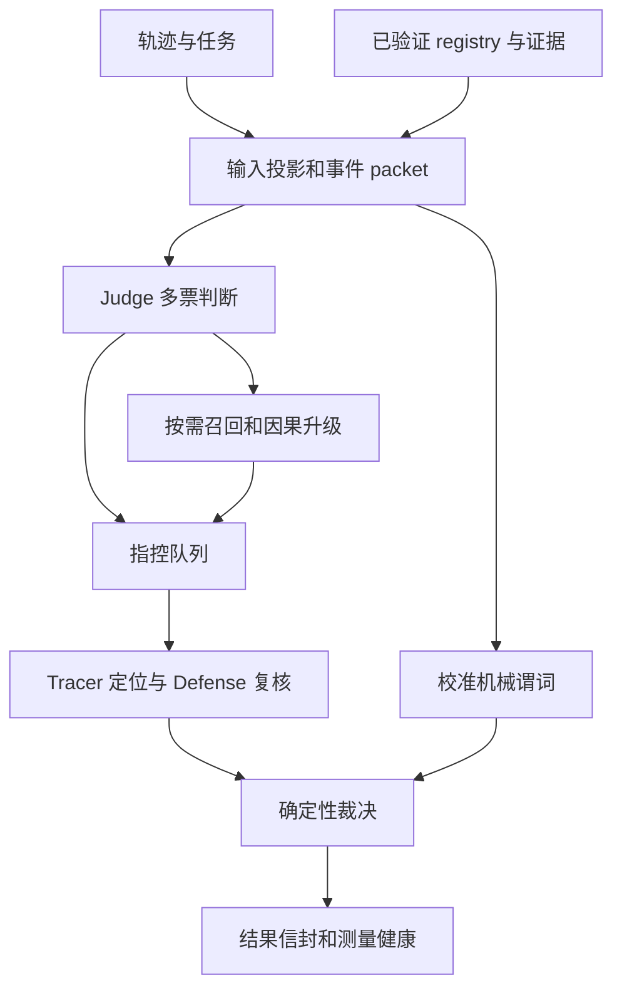
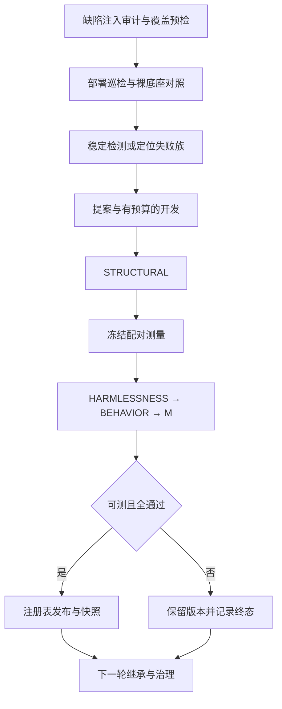

# 核心技术文档

更新：2026-09-24。本文描述当前实现及约束；历史实验、旧方案和数值统一见 [实验日志](experiment-log.md)。

## 🧭 仓库边界

依赖方向为 `experiments → detector`、`evolution → detector`。检测器不导入进化框架；进化只能通过经过验证的 registry 干预检测。实验编排负责冻结执行计划、收集结果和评估，不能替代准入门。

| 目录 | 内容 | 约束 |
| --- | --- | --- |
| detector/ | 检测、模型调用、证据、干预、结果、批处理 | 独立运行，不依赖 evolution |
| evolution/ | 失败诊断、候选开发、四门、发布、记忆、治理 | 候选经过评估才能进入部署版本 |
| experiments/ | 计划、运行、报告 | 使用统一检测结果信封 |
| scripts/ | 验证、预检、成本、研究轮和实验工具 | 新运行产物写 artifacts |
| datasets/protocols/ | 开发划分、测量协议、暴露记录 | 执行输入，不能作为旧日志删除 |
| datasets/raw/ | 本地原始数据 | 不修改，由 integrity.json 校验 |
| 各包 tests/、根 tests/ | 单元、跨包回归、必要夹具 | 不依赖旧 reports/output |
| docs/ | 本文、唯一实验日志 | README 是入口，不新增平行进度文档 |
| artifacts/ | 可生成的运行产物 | 不入 Git，旧缓存不能直接用于新代码 |

## 🔎 检测器模型

令轨迹为 X、证据快照为 E、部署干预为 R、配置为 C。检测输出 D(X,E,R,C) 包含终态、判定权威性、责任步骤及定位权威性、测量健康、成本和执行来源。判定、定位与服务可用性是不同维度。



### 输入与判错口径

`dataset.py` 分离任务输入和标签；`packet.py` 建立事件 ID、位置、工具观察、交付物及答案锚点。gold 只用于评估，不能参与判断或责任步骤映射。`semantics.py` 是各模型阶段共享的判错与定位规则。

可定罪对象包括结果错误、任务固定的交付动作/参数/次序/渠道违约、虚假完成、伪造归因与伪造验证。合法探索和未改变交付物的风格偏差不构成幻觉。观测冲突时，不得用模型世界知识挑边定罪，需要适用的独立证据快照裁决。诚实报告过程失败不自动等于结果性幻觉，例如 BFCL/041 与数据集标签有已知口径分歧。不得为通过预检改标签、种子或门限。

责任步骤是最早引入实质错误的 assistant 内容或动作。提交工具调用首次引入错误时可以是根因，仅重复已有错误时应追溯早先步骤；工具观察不是 assistant 本身的幻觉。内容步和动作步都可命中，但指标必须分列，不能将动作步命中解释为语义根因追踪成功。

### 执行与终态

`api.Detector` 编排阶段；`judge.py`、`recaller.py`、`step_tracer.py`、`defense.py` 各自校验模型输出。Judge 阳性和召回升级候选进入 hearing 队列；`adjudication.py` 校验证据引用、指控和确认步骤，计算终态。机械谓词的定罪能力受 `conviction_calibration.py` 和校准记录约束；证据型组件不能自行获得定罪权。

`interventions.py` 负责统一 schema、内容哈希、hook 和执行计划；`predicate_dsl.py`、`predicate_context.py` 定义可执行谓词及可用上下文。冻结阶段回放必须匹配证据身份，并拒绝覆盖待测干预的目标阶段。

| 维度 | 合同 | 解释 |
| --- | --- | --- |
| 终态 | verified_error / verified_clean / unresolved | 未决不等于 clean |
| 判定权威性 | authoritative / degraded_judge_only / invalid | 只有可信终态进入正式预测 |
| 定位权威性 | authoritative / degraded_localization_conflict | 独立于检测结论计量 |
| 未开始 | 批处理占位 not_started | 不是检测终态或阴性 |
| 版本 | detector.detection_result.v1 | 不匹配的缓存拒绝复用 |

`result.prediction_state` 同时检查 schema、authority、runtime_valid、state 与 occurrence_state，正式预测只返回 True、False 或 None。定位优先使用被定罪 hearing 的 tracer，其次是可用的 defense 确认，再次是指控步骤。tracer 比确认步骤更早本身不构成冲突；首 hearing 的镜像 tracer 与最终采纳步矛盾则降低定位权威性。旧定位文档曾混淆这些不同种类的不一致，这里按当前代码明确区分。

### 测量、故障与成本

`measurement.py` 统一健康分类与重测策略。error_type 和 code 都可能携带致命错误，必须同时检查。凭据、权限、请求、配额等致命故障不在同轮重试，修复环境后可在后续运行重测。暂时性服务错误允许同轮重试；耗尽案例或批次时限后不能重新申请完整预算。

`runner.py` 统一结果落盘、尝试记录、断点复用和调度；`runtime.py` 提供运行控制、deadline、原子写入和单写者保护。整例重试共享案例 deadline。成本优先使用 execution 请求观测，旧 providers/hearings 统计仅为下界，不能当成完整 token 总量。

## 🧬 自进化模型

部署版本与改进系统分离：部署状态 R_t 由 registry 表示；harness 清单记录门、能力、工具、记忆与运行编排的身份。候选在冻结的对照条件下评估，全部门通过才更新部署版本；拒绝或不可测时保留原版本。



### 模块职责

| 模块组 | 文件 | 职责 |
| --- | --- | --- |
| 循环 | engine.py、config.py、splits.py | 阶段顺序、预算、划分、审计、巡检、准入、治理 |
| 失败建模 | worksheet.py、mechanisms.py、route_failures.py | 稳定失败族、机制机会、定位错/缺、路径缺口 |
| 开发 | proposer.py、development.py、capability_planning.py | L0/L1 检查、修订、预算和反馈 |
| 研究入口 | research.py、scripts/run_research_round.py | 冻结机制研究、重复验证，不替代生产准入 |
| 晋升 | promotion.py、promotion_alignment.py、candidate_versions.py | 统一候选、协议冻结、自哈希、对照身份、晋升终态 |
| 门和指标 | gates.py、metrics.py、calibration.py | 结构、保护、行为、收益、定位、稳定性 |
| 后端 | backends.py、sandbox.py、capability_surface.py | 真实/模拟评估、缓存身份、受限执行 |
| 版本恢复 | registry.py、checkpoint.py、ledger.py | 部署、快照、断点 journal、追加哈希链 |
| 经验能力 | harness.py、memory.py、archive.py、gaps.py | 系统身份、经验、组件、开放缺口，不越过门判定 |
| 验证 | meta_eval.py、metamorphic.py、smoke.py | 归因、变形检查、离线闭环 |

### 核心不变量

1. STRUCTURAL 验证候选合同、执行边界、失败族和目标类型；结构失败不消耗真实候选测量。
2. HARMLESSNESS 检查保护集及覆盖，BEHAVIOR 要求实际触发且符合声明，M 衡量冻结收益集的决定性修复。收益不能抵消保护损伤。
3. detection、localization、joint 分别计量。定位分母包含漏检的 gold 阳性；只改标签不能伪装为定位修复。
4. unresolved、基础设施故障、覆盖不足、无可修机会分开记录。不可测不应写成机制被证伪，不进入永久负反馈。
5. 对照和候选使用冻结案例与角色，身份包含源码、配置、候选、证据和协议；不能通过换目录、裁门或改角色重新抽签。
6. 后续轮次读取新部署版本。缓存和断点核对身份，历史摘要不能作为新代码的结果复用。
7. 注册表输入与读取不能共享可变嵌套对象；发布拥有独立快照。同周期回滚选最后可用记录，同秒发布不能覆盖证据。
8. Ledger 采用哈希链和跨进程写锁，引擎单运行者锁是并发边界。ActiveRegistry 多文件不是数据库事务；active/state 不一致时拒绝加载，不静默接受。

### 审查结论与剩余边界

审查沿输入投影、API 编排、裁决/结果、测量、开发/门控、晋升、注册表/恢复展开，以完整离线测试及新增回归验证执行约束。本次未进行真实模型测量，不宣称形式化证明。

| 发现 | 风险 | 修复和证据 |
| --- | --- | --- |
| 致命错误只读优先字段 | code 中致命错误被遮蔽 | 两字段均识别，参数化信封测试 |
| 同轮重试包含 fatal_provider | 无效凭据重复消耗预算 | 禁止同轮重试，保留跨运行重测 |
| 注册表浅复制 | 外部修改 body/snapshots 绕过发布 | 输入、结果、状态深复制；内存/磁盘哈希测试 |
| 快照精确到秒且同周期回滚取最早 | 覆盖快照或恢复错误版本 | 唯一快照名；最后可用记录；固定时钟回归 |
| 验证指纹遗漏 experiments | 实验编排变更未进入验证源码身份 | 纳入源码清单；修改实验模块须改变哈希的回归 |
| 工具/测试依赖历史产物目录 | 清理文档破坏执行 | 驱动迁 scripts，划分迁 protocols，回放迁 fixtures |
| 旧文档与代码不同步 | 定位冲突口径、现状与计划混淆 | 当前合同集中本文，旧内容标为历史 |

静态结构检查覆盖 66 个顶层 Python 模块（detector 28、evolution 33、experiments 5），没有 detector 反向依赖 evolution 的导入。engine（5354 行）、promotion（2306 行）和 interventions（2084 行）仍是主要维护热点。

engine、backends、promotion、interventions 仍承担较多职责，后续物理拆包需逐接口迁移。本次保持公开 API 和冻结身份合同，先统一职责边界及输出入口。真实模型重复波动、定位标注歧义、机械谓词误报风险仍需实测与语义审计，不能用测试数量替代。

## 🛠️ 运行和维护

Python ≥3.10，运行时标准库，测试依赖 pytest。默认配置为 detector/configs/autodl.json，凭据从本地 .env 或进程环境读取，不写入日志。默认开发划分不是独立终审，历史暴露记录必须保留。

```bash
python -m pytest -q
python scripts/verify.py
python -m detector --help
python -m evolution --help
python -m experiments --help
python scripts/run_research_round.py --help
python scripts/cost_model_693.py --json artifacts/cost_model_693.json
```

verify.py 检查测试、入口、能力、mock 闭环、数据完整性和运行期间源码一致性，临时报告写入 artifacts/latest。成本工具从实验日志的命名 JSON 块读取冻结样本并保留 original_source；旧样本有选择偏差，不代表完整语料的最新成本。

新增实验先冻结输入、源码/配置身份、角色、预算和判据；结束后将日期、分母、结果、失败、中断、更正和成本追加到唯一实验日志。运行缓存不作为永久文档提交。算法文件按职责命名，日期放运行 ID；夹具只服务具体测试断言，不存放任意实验备份。
