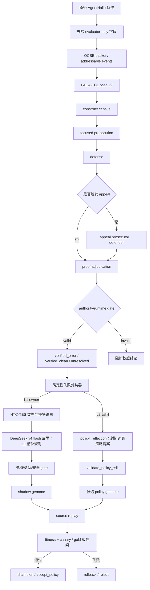

# 一轮检测与自进化审查流程

本文描述当前 SEHD v6 / PACA-TCL v3.5 / BCCSE v5 / HTC-TES v3 的一次完整运行。重点是数据如何流动、哪些模块被激活、哪些指标被计算，以及什么条件下结果或 edit 可以继续向下游传播。

## 1. 总体边界



“检测结果正确”与“进化 edit 合法”是两条不同的授权链。检测器必须先拿到 decision authority；edit 即使结构合法，也必须经过 source replay，必要时还要经过稳定 canary。任何一条链失败都不能修改 champion。

## 2. 检测阶段

### 2.1 输入隔离

`run_online_evolution()` 调用 `_run_detection_with_genome()` 时，输入记录先经过 `_detector_record()`。以下字段只允许 evaluator 使用，不进入 detector、反思 prompt 或 genome：

- `gold_label`
- `is_hallucination`
- `gold_explanation`
- `hallucination_step`
- `hallucination_reason`
- `outer_feedback`

这样可以保证“检测器看到轨迹，评估器看到标签”，而不是让标签泄漏进检测过程。

### 2.2 OCSE packet

轨迹被转换成可寻址的 packet：

- 每个事件有稳定的 `event_id`；
- 保留 source step、agent/tool interaction、输入输出和依赖关系；
- 后续 candidate、证据和责任定位只能引用 packet 中存在的 ID；
- 原始文本被当作证据，不当作系统指令。

这一层的作用是把“模型读到的一段文本”变成可以审计的事件图。

### 2.3 PACA-TCL 基础检测

基础层按以下顺序运行：

1. 候选扫描：从 F / Fa / P / S 四个轴寻找 claim、action、omission、adoption、tool-use 等潜在起点；
2. candidate census：选择最早可寻址 origin，记录依赖事件、候选类型和模块标签；
3. verifier route：将候选送到对应 verifier；
4. atomic verification：逐候选检查规范、违背、agent control、impact 和 counterfactual link；
5. boundary/defense：检查 ordinary failure、environment-caused、authorized action、recovery-before-impact 等边界；
6. propagation：确认 origin → consumption → material impact 是否真实成立。

基础层只产生证据和过程信号，不直接把一个模糊异常升级为最终幻觉结论。

### 2.4 v3.5 construct census 与 focused prosecution

v3.5 会再次建立 construct census，并对有风险的候选做 focused prosecution。两者的作用不同：

- construct census 负责覆盖完整性；
- focused prosecution 负责对候选的因果链做更集中、更严格的证明。

最终会合并基础 prosecution、construct census 和 focused audit。指标包括 candidate 数、prosecution coverage、defense coverage、证书字段完整度、quarantine 数以及责任事件。

### 2.5 defense 与 appeal

defense 不是简单的“没有发现错误”，而是要提供可引用的支持链或边界链。只有 prosecution 和 defense 都满足覆盖条件，proof court 才能把结果当作有权威的确定性判断。

当 appeal calibrator 判定争议足够高或 surviving origins 太多时，会触发：

1. appeal prosecutor 重新构造争议候选的错误证据；
2. appeal defender 看到 appeal prosecution 后提出对抗证据；
3. proof court 重新 adjudicate，并启用 consensus gate；
4. 若仍有多个 surviving origin，可能继续做 counterfactual localization。

当前的安全边界是：必要 appeal 未完成时，结果只能是 `unresolved + decision_authority=invalid`，不能复用 appeal 之前的结论。这是 fail-closed；本次 fresh run 的 SSL EOF 正是在这里被阻断的。

### 2.6 检测输出

检测输出至少包含：

- `state`: `verified_error`、`verified_clean` 或 `unresolved`；
- `runtime_valid`；
- `decision_authority`；
- `authority_failure_reasons`；
- `occurrence_state` 与 recovery/impact ledger；
- `responsible_step`；
- prosecution/defense/appeal 证据；
- provider/cache metadata；
- BCCSE 使用的 CRS 投影和 coverage 诊断字段。

如果 `runtime_valid=false` 或 authority 为 invalid，`resolve_authoritative_state()` 对下游暴露的是 `unresolved`，而不是把 proof 内部的 `verified_error` 当成可以进化的确定性结论。

## 3. 自进化阶段

### 3.1 genome snapshot

每个 evolution case 开始时记录：

- 当前 genome hash；
- generation；
- 当前 module rules；
- stable canary 集合；
- 本轮 budget 和历史 rejected edits；
- 当前 L2 policy genome（空基线或有已接受策略项）。

edit 先应用到 candidate/shadow genome，champion 暂时不变。

### 3.2 确定性归因

`attribute_failure()` 先将 detector 输出汇总成 `AttributionSignal`，包括：

- `error_type`；
- `trigger_source`；
- primary/secondary target module；
- attribution confidence；
- prosecution/defense coverage；
- CRS 五维投影；
- candidate count；
- detection state；
- responsible step 是否可用；
- process diagnostics（`localization_status`、`appeal_status`、
  `focused_quarantined_candidate_count`）。

signal 决定**是否触发**进化并提供遥测；**失败 owner 由确定性失败分类器
单独判定**（`failure_classifier.classify_failure()`）。它是检测记录可寻址
失败形状的纯确定性函数——不调用 LLM、不使用启发式；所有谓词测试都经过
`v6_contracts.L2_PREDICATES` 注册表，归因词表全局单源。输出为三元组
`layer / artifact / reason_code` 加可寻址证据。

分类优先级（先查最上游）：

| 优先级 | 失败形状 | 层 | artifact |
| --- | --- | --- | --- |
| 1 | provider 工件缺失/畸形 | L1 | owner 模块（candidate→`candidate_trigger`，error_certificate→`evidence_obligation`，defense_certificate→`clean_defense_boundary`；注册过的 `module_hint` 优先） |
| 2 | consensus gate 阻断非空候选 | L2 | `consensus_gate_policy` |
| 3 | 任一侧 coverage=complete 但该侧有效证书为 0（空壳 complete） | L2 | `coverage_validity_policy` |
| 4 | boundary 路径 verified_clean 而终态 unresolved | L2 | `boundary_consumption_policy` |
| 5 | 兜底：终态 unresolved → `no_actionable`；终态与法庭自身证书记账矛盾 → `detector_layer_out_of_scope` | — | — |

优先级 1 在最前面，是因为裁决层在输入工件损坏时根本无法正确观察事实；
优先级 2-4 都以 provider 输出良形为前提。

L1 owner 还要过 gold 极性闸：

- FN（gold=error、判决 clean）的 owner 必须在 `_FN_POLARITY_MODULES`（能
  收紧错误检测的模块集合）内；
- FP（gold=clean、判决 error）的 owner 必须在 `_FP_POLARITY_MODULES`（能
  放松或约束错误断言的模块集合）内；
- 跨极性的 owner 直接丢弃——归因永不站到 gold 的对面；
- unresolved 终态无极性，按原样接受。

非 L1 归因（L2 与 detector 层）不会被硬塞进任何 L1 模块：给不拥有失败的
模块派 edit 只会得到 no-edit 步骤或 no-effect replay。它们写入
`non_l1_failure_attributions` 遥测；其中 L2 归因把该案例直接路由到 L2
策略提案路径（见 3.5），不再走 L1 变异。

缺陷定性结论：boundary-终态矛盾与空壳 complete 属于裁决策略问题，归
L2；consensus gate 阻断的语义存疑（它是抗 false-positive 的设计，也可能
过严），因此不手工改动 gate 本身，`consensus_gate_policy` 是它的首批
进化候选。

默认 self-supervised 模式不使用 gold。只有显式启用 `use_gold` 或
`fitness_use_gold` 时，gold 才进入对应的评估路径；gold 只用于选择极性与
fitness 记帐，永不进入 skill 内容、策略内容或反思 prompt。

#### runtime-invalid 只作为遥测

detector 运行崩溃时产生 `runtime_invalid_signal()`：`should_evolve` 恒为
`False`，`diagnostic_only=True`。没有权威判决就没有 coverage、没有 CRS，
因此无法归因到任何模块，只记录“当前 genome 在这个 case 上跑不起来”。
异常文本会被归约成有限类别（`provider_timeout`、`provider_auth` 等），
防止原始 runtime 字符串（可能含泄漏的 label）进入 reflection prompt。

### 3.3 HTC-TES 类型路由

HTC-TES 根据 trace 将问题归为 factual、instructional、tool、reasoning、omission、adoption、contextual 或 unknown，并给出类型策略。

类型路由只对 L1 路径生效（L2 归因案例的 owner 是策略工件，不经过模块交集）。路由有两个约束：

1. 类型路由给出优先模块；
2. causal attributor 给出的模块是硬边界。

两者没有交集时，回退到已经由 causal attributor 限定的模块集合：既避免低置信度类型分类造成 `skip_route_conflict` 死路，又不允许 edit 越过因果归因边界。

### 3.4 DeepSeek 反思

所有 provider route 统一解析 endpoint、model、credential selector、temperature、max_tokens、retry 和 timeout。当前实验约束使用：

- endpoint：`https://api.deepseek.com`；
- wire model：`deepseek-v4-flash`；
- credential selector：`DEEPSEEK_API_KEY`。

若 route 没有显式配置 `total_timeout_seconds`，系统默认把单次
`timeout_seconds` 作为本次 provider 调用的总预算，避免 retries 把一次调用
扩展成多个完整 timeout 窗口。

反思 prompt 向 DeepSeek 提供：

- 当前目标 module 的规则；
- detection trace；
- attribution signal；
- rejected edit history；
- accepted edit summary；
- capacity guidance；
- HTC-TES type guidance；
- experience memory。

反思 prompt 包含一个受限的 `structured_runtime_observation`。它明确列出
当前运行实际产生的候选、控方/辩方证书、责任步骤、状态和各允许模块能够
影响的输出字段。这个对象不是 verdict，也不是 gold 代理；它的作用是把
“我认为哪里有问题”约束为“哪个可执行输出缺失或异常、由哪个模块拥有”。
这样可以减少单次 LLM 同时承担诊断、owner 路由、规则生成和反事实预测所
造成的过载。

experience memory 里每条记录的 outcome 都是结构化的（封闭词表），而不是自由文本：

- `outcome`：`improved` / `directional` / `no_effect` / `regressed` /
  `rejected` / `not_attempted` / `runtime_invalid`；
- `outcome_stage`：`mutation` / `structural_gate` / `source_replay` /
  `batch_commit` / `detection_runtime`；
- `promotable_evidence`：这条记录是否可以被引用为“确实改善了检测”。
  source replay 和 label-free batch commit 恒为 `False`——由被编辑的
  detector 自己生成的 replay 不能自证正确性；
- `diagnostic_only`：仅遥测，不构成任何证据。

因此 `get_reflection_summary()` 可以按 stage 聚合，告诉反思“**尝试通常卡在哪一阶段**”，
而不只是“失败了”。

每次独立反思请求返回一个 `no_edit` 或一个单模块 edit；CLI 可以对同一
failure observation 发起最多 5 次独立请求，再进行候选去重和 critic 选择。
合法 edit 要满足：

- 操作是 `add_rule`、`modify_rule` 或 `remove_rule`；
- target module 位于 attribution/type 允许集合；
- rule 是轨迹可观察的 if-then 局部规则；
- 不包含 case ID、gold、URL、内部 CRS/coverage 字段或跨模块控制语句；
- `expected_effect` 明确预测一个 source replay 可观察的变化。

`expected_effect` 只是反思假设，不是通过凭证。它用于审查 LLM 是否提出了可验证目标；真正是否产生变化仍由 detector replay 决定。

当前这一步是反思引擎重构的第一阶段，而不是完整的多 Agent 认证。现有流程
已经拆出 `failure_observation`（事实性运行输出观察）、多个
`intervention_proposal`（单模块、单动作规则假设）和 critic 选择；source
replay/evaluator 仍负责验证二者是否一致。多个请求提供搜索多样性，但不能
把同一模型的多数票当作独立正确性证据。

当前实现已进一步提供有限的协作反思路径：`reflection_candidate_count` 控制
独立 mutation 请求数（库 API 默认 1，CLI `--reflection-candidates` 默认 3，
范围 1..5）。候选按 target module、operation、rule content 和 rule index 去重；
候选超过一个时，critic 使用 `purpose=reflection_critic` 只选择最值得 replay
的候选，不改写规则，也不判断最终 verdict。选择结果、候选数量、原始/验证后
owner 和 provider cache 命中会写入 step 的 reflection audit。旧的单 edit JSON
仍可被兼容解析。

在协作反思之上还有**诊断-干预二级结构化管线**，解决单一反思调用
同时承担诊断、owner 路由、规则生成与反事实预测造成的过载问题（观测到
LLM 诊断正确却全部回退 no_edit 的失效模式）：

1. **诊断阶段**（`purpose=reflection_diagnosis`）：只诊断不写规则。输入
   与主反思相同，但只要求输出一个 JSON：失败输出字段、允许模块集合内
   可执行修复的 owner、以及干预提示（一个条件 + 一个模块局部动作）。
   `sanitize_diagnosis()` 把不受信的 LLM 输出约束为封闭词表：owner 必须
   在允许集合内，否则降级为不可执行；文本字段全部截断。
2. **定向生成阶段**：仅当所有主候选都是 no_edit 且诊断给出可执行 owner
   时触发。主反思 prompt 注入 `<targeted_diagnosis binding="true">` 指令，
   要求实现该干预（同一 owner、单条件子句、单动作），只有结构性不可能
   时才允许再次 no_edit。

诊断结果（含降级原因）写入 step 的 `reflection.diagnosis` 审计字段。
该管线只在主反思失败时消耗 1-2 次额外 mutation 调用，仍受
`max_mutation_calls` 硬上限约束。

runtime observation 包含 `court_balance`（裁决收支表）：幸存/被隔离
的错误证书数、defense 证书数、clean defense 覆盖的候选数等。反思 prompt
据此解读“谁支撑了判决”，把 edit 送到真正决定结果的模块，而不是下游症状。

所有 attribution、reflection、critic 和 conflict-gate provider 调用共享
`max_mutation_calls` 硬上限。CLI 参数为 `--max-mutation-calls`，默认 100；
耗尽后 fail-closed，并记录 `mutation_budget_exhausted`，避免候选数和 retry
次数造成调用量乘法失控。

### 3.5 L2 策略提案与策略 replay

当确定性分类器把失败归到 L2（见 3.2），该案例不进入 L1 规则变异，而是走
策略闭环。两条变异路径共用同一套门控纪律：结构验证 → source replay →
gold 极性/fitness → 接受或回滚。

1. **提案**：一次 `purpose=policy_reflection` 的反思调用。prompt 中的封闭
   词表（前提谓词、枚举动作、参数词表）在调用时从 `v6_contracts`
   （`L2_PREDICATES` / `L2_ACTIONS`）动态生成，不是复制的文本；输入还包含
   归因三元组、可寻址事实计数、当前策略集和被拒提案历史。模型只提出一条
   `precondition -> action(params)` 提案，或返回显式 no_proposal；gold 不
   进入 prompt。
2. **验证**：`parse_policy_proposal` 把响应解析成 `PolicyItem`（item_id 与
   source_case_id 由进化循环生成，身份不属于模型输出）；包装成
   `PolicyEdit(add_item)` 后，`validate_policy_edit` 检查封闭词表、容量上限
   12、语义去重、baseline 不可变与 weak/strong fitness 保护。
3. **应用**：`apply_policy_edit` 以不可变血统风格返回候选 `PolicyGenome`
   （parent_hash 链接）；工作策略基因组在验证通过前不变。
4. **source replay**：`_run_detection_with_genome(policy_genome=候选)` 对
   同一 source case 重新检测，策略项经 `adjudicate_case(policy_items=...)`
   转发到 proof court；引擎在所有 appeal/localization 阶段收敛之后，用产生
   当前判决的同一套证据束（收敛点法庭参数）重裁一次，策略只作用于终局边。
5. **效果门**：`policy_evaluation.fired` 必须非空，且终态改变或 effective
   coverage 改变；没有推动终局边的提案以 `reject_policy_no_effect` 拒绝。
6. **gold 极性门**：终态发生移动时，必须有 gold fitness 极性且
   `task_state_score` 严格上升，否则拒绝（`reject_policy_fitness`）；仅
   coverage 移动可无需 gold 接受。
7. **决策值**：`accept_policy` / `reject_policy_no_effect` /
   `reject_policy_fitness` / `skip_no_policy`（无 mutation route、反思调用
   失败、响应不可解析或 edit 非法均记 `skip_no_policy`）。

被拒候选只会以副本形式被 replay，拒绝即天然回滚。接受的策略进入工作
`policy_genome`，由 checkpoint 持久化（`policy_checkpoint.json` 与
`evolution_checkpoint.json` 的 `policy_genome` 字段）；每次提案决策连同归因、
事实、提案、`policy_evaluation`、replay_state 与策略基因组 hash 写入
`evolution_audit["l2_policy_audit"]`。

proof court 钩子语义：`adjudicate_proof_court(policy_items=,
boundary_path_state=)` 两个参数默认惰性，空策略集不改变默认裁决路径；
downgrade 只降不升（coverage 排名只能下降，`invalidate_coverage_claim`
置为 unresolved）；未知谓词/动作或非法参数 fail-closed 记入评估结果的
`skipped`，绝不生效；occurrence ledger 记录的是策略之前证据所建立的事实，
不随策略同步重算——这是设计语义，不是缺失的同步。

### 3.6 structural/type gate

结构 gate 检查：

- module 是否存在且 active；
- operation 是否允许；
- 模块容量是否已满；
- immutable baseline rule 是否被修改；
- if-then 规则是否过长、条件是否过多、动作是否多步；
- forbidden content；
- feature description firewall；
- type confidence 和 routing provenance；
- semantic duplicate/merge 条件；
- module cooldown、总 edit budget 和 convergence window。

这一层只回答“edit 是否可安全应用”，不回答“edit 是否有效”。

### 3.7 shadow apply 与 source replay

通过结构 gate 后，edit 被应用到 shadow genome。随后必须对同一个 source case 再跑一次完整 detector：

```text
baseline result + baseline signal
        ↓ apply edit to shadow genome
shadow result + shadow signal
        ↓ assess_source_fitness
no_effect / directional_evidence / local_improvement /
strong_improvement / worse
```

fitness 检查包括：

- authority/runtime 是否仍然有效；
- CRS complete 等必要诊断信号是否丢失；
- responsible step 是否被新 edit 丢掉（保持结论但丢失定位同样算 regression）；
- source 是否从 triggered 变成 stable；
- stable case 是否被新 edit 变成 triggered；
- 目标 module local score 是否至少跨过 epsilon；
- 在 gold fitness 模式下，task score 是否朝正确方向变化；
- 是否出现新的 failure trigger。

同一个结果没有发生可测变化时，必须是 `no_effect`，不能因为规则文字“听起来合理”而接受。

#### localization 打分按正确性而非“有没有输出”

`earliest_origin_tiebreak` 的 local score 曾经只看 `responsible_step` 非空，
于是“永远输出一个 origin”的规则也会被记成改进。现在按质量打分：

- 没有 origin → `0.0`；
- 有 gold 且是 error case → 以 gold 的正确性为准（对 `1.0` / 错 `0.0`）；
- 否则用 detector 自己的定位质量：`complete` `1.0` >
  `not_applicable` `0.8` > `failed_temporal_fallback` `0.2`。

注意 `responsible_step_correct` 只在 gold error case 上可信——没有提供
gold steps 时它同样是 `False`，直接当成“定位错误”会把所有 self-supervised
的定位分数清零。

### 3.8 canary、batch commit 与 rollback

source replay 通过后，若存在 stable canary，会对其做抽样 replay。canary 要求：

- before/after authoritative state 相同；
- child runtime valid；
- before/after 都不触发 evolution；
- 不发生 provider/authority 异常。

现在可以通过 `canary_case_ids` 预注册独立 label-free canary，并在 evolution sample 开始前建立稳定锚点。这解决了“5 个 evolution case 全部触发，所以根本没有 stable case 可供 canary”的结构性死路，但没有降低 canary 的非回归要求。

最后：

- gold-assisted `strong_improvement/local_improvement` 可以进入 commit；
- label-free `directional_evidence` 只有在独立 canary 保持稳定时，才能作为 provisional candidate；
- `no_effect`、`worse`、runtime error、canary regression 都回滚；
- label-free 运行永远不自动宣称最终 champion 或 accuracy gain。

### 3.9 逐案例 Skill 继承与运行时激活

在线进化不是先收集所有 edit 再统一应用。`fitness_batch_size` 固定为 1，
因此一个 source case 的 edit 只有在 source replay、必要的 canary/probe 流程
完成并进入 commit 后，才会成为下一个 case 的 `current_genome`：

```text
case N: current_genome
  -> apply edit -> shadow genome
  -> source replay -> commit
  -> champion_genome = current_genome = committed genome
case N+1: detect(current_genome)
```

checkpoint 恢复只恢复最后持久化的 committed champion；未完成验证的 shadow
不会被复活。每个标准检测入口仍要求显式传入 `--genome`，以避免 evolution
artifact 未经审计就静默改变生产检测。batch completion、prediction、summary
和 replica report 都记录 `genome_hash`，resume 也以该 hash 作为身份的一部分。

## 4. 本次 5/5 触发、0 接受的逐例解释

本次 replay 使用的是已保存的真实 detector 输出，并没有让每个 child genome 重新调用 detector；因此它是“真实轨迹输出的进化回放”，不是 fresh child-detector experiment。

| 案例 | 触发后路径 | 直接原因 | 判断 |
|---|---|---|---|
| BFCL/070 | add_rule → source replay | local score `0.3 → 0.3` | 正确拒绝 no-effect；回放输出未随 genome 改变 |
| BFCL/097 | add_rule → source replay | local score `0.3 → 0.3` | 正确拒绝 no-effect；同上 |
| BFCL/012 | add_rule → source replay | local score `0.3 → 0.3` | 正确拒绝 no-effect；同上 |
| BFCL/022 | type routing | route intersection empty | 机制死路；现已回退到 causal attribution route |
| BFCL/099 | mutation provider | SSL EOF | 传输失败；现有 fail-closed 行为正确，新增超时/计数可观测性 |

因此结论分层如下：

1. 不是三次 source fitness 门槛把有效 edit 误杀，而是回放 detector 返回了与 genome 无关的同一结果；
2. 其中一次是 HTC-TES 路由过硬，已修复为因果归因边界内的 fallback；
3. 其中一次是 provider transport，不是反思内容质量；
4. 真实 fresh run 还受到 appeal defender SSL EOF 影响，导致 authority invalid，不能进入进化；
5. 即使这五例中的 edit 真能关闭 source trigger，若没有独立 stable canary，label-free 模式也只能停留在 telemetry/provisional，不应直接成为 protected champion。现在通过 `canary_case_ids` 显式提供该锚点。

这里还要区分两个问题：canary/contrast 负责发现回归，不能单独证明新 verdict
正确；而 self-replay 负责暴露候选是否改变了可观测检测过程，也不能单独证明
正确性。后续反思引擎应把“可执行变化”和“正确性证据”拆成两个结构化产物，
不要用一个总分或一次 LLM 判断同时承担诊断、生成和认证。

## 5. 当前关键指标解释

- `triggered_cases`：`AttributionSignal.should_evolve=True` 的 evolution cases 数；不是错误标签数量。
- `edits_accepted`：真正进入 champion 的 edit 数；不是 LLM 生成数。
- `edits_rejected`：经过 proposal/结构/replay 后被拒绝的 edit 数；route conflict 和 provider invalid 通常属于 skip，不一定计入该数。
- `source_replays`：candidate genome 在源案例上的 detector replay 次数。
- `canary_cases`：用于非回归检查的 detector 次数。
- `provider_calls`：历史兼容字段，表示 detector-call 计数。
- `detector_calls`：明确的 detector/source/canary/probe 调用数。
- `mutation_calls`：attribution/reflection/critic/conflict-gate provider 调用数。
- `mutation_errors`：mutation provider 异常数。
- `mutation_budget_exhausted`：被 mutation-call 硬上限阻断的调用尝试数。
- `mutation_cache_hits`：mutation provider 从全局 cache 命中的次数。
- `total_provider_calls`：`detector_calls + mutation_calls`，用于审计总调用量。
- `authority_valid_rate` / `invalid_count`：post-hoc 指标只对显式 authority 且 runtime-valid 的输出计算；缺失 authority 的旧 artifact 记为 invalid，不计入 TP/TN/FP/FN。
- `champion_generation`：只有 commit 后才增加；候选或 rejected edit 不增加。
- `final_champion_claim`：本框架默认保持 false，最终 holdout 需要外部评估授权。
- `gate_decision`：逐 step 决策值。L1 取 accept / reject / skip_stable /
  skip_no_edit / halted；L2 策略步骤取 `accept_policy` /
  `reject_policy_no_effect` / `reject_policy_fitness` / `skip_no_policy`。
- `non_l1_failure_attributions`：非 L1（L2 与 detector 层）归因遥测，含
  case_id、layer、artifact、reason_code 与可寻址证据；用于核对失败是否被
  硬塞进不拥有它的 L1 模块。
- `l2_policy_accepts`：被接受的 L2 策略项数量。
- `l2_policy_audit`：逐条 L2 提案审计（决策值、原因、归因三元组、事实计数、
  提案、`policy_evaluation`、replay_state、策略基因组 hash）。
- `policy_genome`：运行结束时的工作 L2 策略基因组，同时持久化在
  `policy_checkpoint.json` 与 evolution checkpoint 内。

## 6. 审查时应优先检查的证据

1. `evolution_checkpoint.json`：是否在异常时保留 genome、step、budget 和 rollback 状态；
2. 每个 step 的 `edit_proposal` 与 `expected_effect`：LLM 是否提出了可验证目标；
3. `fitness_check.source_before/source_after`：child 结果是否真的由 child genome 产生；
4. source/canary 的 `genome_hash` 与 detector artifact 路径：排除 replay harness 固定返回 baseline 的假进化；
5. provider route payload：确认 model、temperature、max_tokens 和 timeout 与配置一致；
6. authority failure reasons：区分核心 proof 失败、必要 appeal 失败和辅助 provider 降级；
7. `l2_policy_audit` 与 `policy_checkpoint.json`：确认 L2 决策值、
   `policy_evaluation.fired` 与 replay 终态一致，被拒提案没有改变工作策略基因组；
8. `non_l1_failure_attributions`：确认非 L1 失败没有被硬路由进 L1 模块；
9. `detector_calls`、`mutation_calls`、`mutation_errors`、
   `mutation_budget_exhausted`：核对 detector replay、反思协作调用和预算阻断，
   不要把 detector replay 数误认为全部 API 调用数。

实验 harness 的 replay 模式也有明确边界：默认 live 模式会重新运行真实 detector 和 child genome；固定 prediction artifact 只能通过 `FIVE_CASE_REPLAY_MODE=stored_compat` 进入兼容审计，而且缺失显式 authority 时会被阻断。
