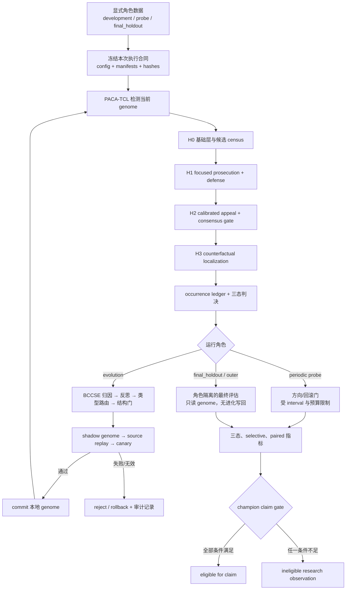
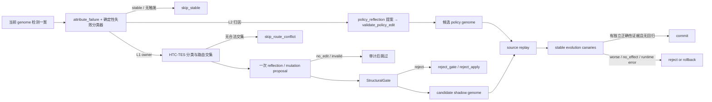

# SEHD v6 实验框架指南

本文面向第一次阅读仓库的人，解释当前代码实际实现了什么、一次实验如何从数据走到指标，以及哪些结论目前不能声称。SEHD v6 是研究原型，不是生产检测器；文中的 `champion` 只有通过最终 claim gate 才表示“可提出 champion 声明”，不能因为文件名叫 `champion_genome.json` 就自动成立。

## 1. 一张图看完整流程



关键思想是把三个问题分开：

1. 轨迹中是否真实发生了可归责事件？由 occurrence 证据回答。
2. 本次检测运行是否有权作出正式判决？由 `runtime_valid` 和 `decision_authority` 回答。
3. 一个进化后 genome 是否优于 baseline？由独立角色数据、paired 指标、置信区间、provenance 和治理条件共同回答。

## 2. 数据角色与分区

### 2.1 三种语义角色

| 角色 | 用途 | 开发期如何使用 | 能否单独支持 champion 声明 |
|---|---|---|---:|
| `development_pool` | 自进化材料总池 | evolution、source replay、canary、经验记忆可持续复用 | 否 |
| `gold_probe` | 开发池内固定小探针 | 按 `probe_interval` / `probe_budget` 周期打开，只作方向或回滚门 | 否 |
| `final_holdout`（别名 `outer`） | 实验结束的只读验证 | 开发期封存；结束时一次性或由外部治理开放 | 只有通过全部 claim gate 才可能 |

为什么大部分数据可以进入进化？因为本系统研究的是持续自进化；source replay 和经验记忆本来就是开发过程。把旧 validation/test 的大块数据永久冻结会让可学习材料快速枯竭，却不会自动带来更可信的最终结论。真正需要隔离的是一个足够、预注册且开发期未反复查看的 final holdout。

`gold_probe` 是 `development_pool` 的子集，但不进入 mutation-source 列表；它与 `final_holdout` 互斥。探针被重复查看后会产生适应风险，所以只能回答“当前方向是否值得继续/回滚”，不能回答“是否泛化”。分区由 `probe_size`、`holdout_size` 和 `seed` 固定，并记录 `development_case_count`、`probe_case_count`、`final_holdout_count` 和 `holdout_sealed`。

有 Gold 时，probe evaluator 用冻结标签做正确性 veto；无 Gold 时，同一
probe 退化为只检查 `runtime_valid` 和 `decision_authority` 的 process veto，
不会计算 clean/error 得分，也不会解除 provisional/claim 限制。

新 manifest 是 `development_pool_ids.json`、`probe_set_ids.json`、`final_holdout_ids.json`。旧 `stratified_evolution_set.json`、`validation_set_ids.json`、`test_set_ids.json`、`outer_set_ids.json` 仍可读取；validation/test 不必同时存在，也不再自动阻止开发池复用。

Final holdout 仍要求真实、可加载的 `source/id` 形式 `case_id`，`case_ref` 只能正向计算，manifest 必须与 partition 哈希绑定。历史 artifact 若没有真实 ID、哈希绑定或 sealing/custody 证据，不会被“升级”为合法最终证据。

### 2.2 阶段授权

正式调用在 provider call 前检查冻结配置：

- 所有执行要求 `execution_authorized=true`；
- 包含 D cases 的 evolve 要求 `D_execution_authorized=true`；
- probe 与 final evaluation 要求 D/effectiveness 正式阶段授权；
- final holdout/Outer 额外要求 `outer_execution_authorized=true`；
- `P0_diagnostic_only` 不能被当作 D、probe 或 final-holdout 授权。

当前仓库所指向的 PACA-TCL v3.5 配置是 `P0_diagnostic_only`，并且 `D_execution_authorized=false`。因此默认配置会主动拒绝正式 probe/final-holdout，也会拒绝包含 D cases 的 evolve。这是前置条件未满足，不是实验已经运行并失败。

### 2.3 数据集构建与案例账本

数据集构建脚本属于 `experiments/protocols` 的本地工作区，不是框架入口，也不随 `src/sehd_v6` 包发布；新实验的输入是按协议注册的 manifest（records 与角色 manifest），框架只消费显式提供的 records。

案例账本 `experiments/protocols/used_case_ledger.txt` 登记已经用于实验的案例 id（共 226 个）。任何新实验的开发池、mutation source、canary 与 probe 都必须排除账本中的全部案例，防止已消费案例被重复用作进化材料或声明证据。

## 3. PACA-TCL：从轨迹到判决

代码正式命名了 H1/H2/H3。为便于解释，本文把 `adjudicate_case()` 中进入 H1 前的基础阶段称为 H0；H0 是说明性名称，不是配置里的新增可调阶段。

### H0：数据包、基础边界与候选 census

H0 首先把原始记录构造成可引用事件的 OCSE packet。随后并行执行：

- layered v2 基础裁决路径；
- `construct_census_route` 候选构造。

结果再与 deterministic process census 合并。候选 census 的作用是列出“值得审理的可能起点”，不是直接判 error。构造视图如果不完整、provider 失败或失去 authority，会导致后续 fail closed，而不是把缺失候选当 clean。

### H1：逐候选起诉与独立抗辩

每个候选分别进行 focused prosecution；起诉证书需要覆盖：

1. norm/obligation；
2. origin event；
3. agent control/adoption；
4. propagation path；
5. impact on result；
6. counterfactual sufficiency。

结构或证据不合格的证书被 quarantine，并可携带缺失项反馈进行有限重试。Defense 与 focused prosecution 独立运行；只有针对同一机制、证据可寻址且通过校验的抗辩才可能压倒起诉。

例子：工具返回错误信息本身不是 agent hallucination。若 agent 没有采纳该信息，`external_unadopted` 抗辩可能成立；若 agent 把它当成事实并据此输出错误结果，则“采纳”事件可能成为可归责 origin。

### H2：校准上诉与 consensus gate

只有经 calibrator 选出的高优先级候选进入 appeal。Appeal prosecutor 提出补充起诉，informed defender 可以看到起诉材料后作答。

上诉不能凭空创造正式 positive：appeal-sourced error 必须得到 initial prosecution 对同一 source candidate 的独立因果支持。所需 appeal 运行失败时，结果会变成 `unresolved` 且 `decision_authority="invalid"`，不能回退使用一个看似 decisive 的初审结果。

### H3：发生确认之后的定位

H3 不重新决定“有没有 error”。它在已有多个 surviving origins 时做 pairwise counterfactual localization，比较哪个 origin 的修复更具因果充分性。若 ranking 不可用，代码退回确定性的 temporal earliest-origin 规则。

因此应把两个输出分开阅读：

- occurrence verdict：事件是否发生；
- responsible event/step：若发生，最应归责到哪里。

## 4. Occurrence ledger、三态与失效语义

### 4.1 权威字段优先级

共享 resolver `resolve_authoritative_state()` 采用 occurrence-first 顺序：

```text
top-level occurrence_state
  → proof_adjudication.occurrence_state
  → occurrence_ledger.occurrence_state/state
  → proof_adjudication.occurrence_ledger.occurrence_state/state
  → structured incident_state.occurrence_state
  → legacy incident_state / state
```

`incident_state` 和 `state` 是兼容字段；如果它们与真实 occurrence 字段冲突，occurrence 字段优先。`main._prediction_state()` 只是这个共享 resolver 的薄包装。

### 4.2 三态判决

| 状态 | 含义 |
|---|---|
| `verified_error` | 有通过证据、因果、materiality/commitment 和抗辩检查的 occurrence |
| `verified_clean` | 覆盖充分，且没有 surviving error；不能由“运行失败”推导 |
| `unresolved` | 证据、覆盖、审理流程或 authority 不足，无法作 decisive 判决 |

### 4.3 Runtime invalid 不是 clean

`runtime_valid=false`，或 top-level/proof `decision_authority="invalid"`，会让共享诊断 resolver 暴露 `unresolved`。更严格地，正式 evaluation 会整体拒绝这类行：只要有一案失效，就写 failure audit，不计算完整 metric scope。

这避免了两种错误：

- 把 provider/appeal/certificate 失败计成 `verified_clean`；
- 把失去 decision authority 的 occurrence 仍用于正式正确率。

### 4.4 抗辩、提交与恢复

- 被工具拒绝、没有形成状态改变的尝试，可由 `rejected_attempt_no_state_change` 抗辩；“尝试过错误动作”不自动等于 committed error。
- material difference、明确授权、正确且有证据支持、外部信息未被 agent 采纳等，必须由机制匹配的 defense 证明，不能用泛泛的“可能没问题”覆盖起诉。
- Recovery 是影响属性，不会抹掉已被证明发生的事件。`pre_impact_repaired` 与 `post_impact_residual` 会影响 impact 解释，但“后来修好”不等于“从未发生”。
- 反过来，仅有 harmless inefficiency、ordinary failure 或 process debt，而没有错误产出和因果传播，也不足以构成 benchmark positive。

## 5. BCCSE：逐案自进化如何工作



逐案步骤如下：

1. 用当前 genome 运行 PACA-TCL。
2. `attribute_failure()` 读取共享 occurrence-first 状态、证据覆盖和诊断信号，决定是否触发；失败 owner 由确定性失败分类器判定（优先级：provider 工件缺失/畸形 → L1；consensus gate 阻断 → `consensus_gate_policy`；空壳 complete → `coverage_validity_policy`；boundary 与终态矛盾 → `boundary_consumption_policy`；兜底 `no_actionable` / `detector_layer_out_of_scope`）。L1 owner 过 gold 极性闸；非 L1 归因写入 `non_l1_failure_attributions` 遥测。
3. HTC-TES 提取 trajectory features、分类类型，并将“类型允许模块”与“归因允许模块”求交集；交集为空时 `skip_route_conflict`。
4. Reflection 生成零或一个编辑提案；无 mutation provider 时记录 template/no-edit 行为，不伪造 LLM 改进。
5. `StructuralGate` 检查可观察的 if/when 条件、单一动作、模块权限、重复/泄漏/直接 verdict 等约束。
6. 编辑只先进入 candidate/shadow genome。
7. Source replay 在同一触发案例上比较 before/after。
8. 若 source assessment 可进入下一层，则在滚动的 stable development cases 上跑 canary；按注册 interval/accepted-edit 阈值还可打开预算内 gold probe，final holdout 始终不在此路径。
9. 只有 source replay 与 canary 通过，且没有 runtime/authority 回归时才进入下一层；否则 reject/rollback，并保存原因和 before/after hash。Gold 模式下，`strong_improvement` / `local_improvement` 可作为 development candidate 的选择证据，但仍不能替代 final holdout。无 Gold 模式下，`directional_evidence` 和 detector-local score 只能在 canary 非回归时进入 `provisional_label_free` working candidate；它保持 `fitness_status=none`、不可受 strong/weak 保护，也不能产生准确率或 champion 声明。周期 probe 只能继续或回滚，不能把 provisional 变成正式结论。

L2 策略路径与 L1 并列，共用同一套门控纪律：分类器把失败归到 L2 后，该案例走 `policy_reflection`（封闭词表从 `v6_contracts` 的 `L2_PREDICATES` / `L2_ACTIONS` 动态生成）→ `PolicyEdit(add_item)` → `validate_policy_edit`（词表/容量 12/去重/baseline 与 weak-strong 保护）→ 候选 policy genome → source replay（`adjudicate_case(policy_items=)` 在法庭收敛点用同一套证据束重裁，策略只作用于终局边）→ 效果门（`policy_evaluation.fired` 非空且终态或 effective coverage 变化）→ gold 极性门（终态移动时 `task_state_score` 必须严格上升）→ 接受或天然回滚。

L2 相关的结果字段与决策值：

- `gate_decision` 的 L2 取值：`accept_policy` / `reject_policy_no_effect` / `reject_policy_fitness` / `skip_no_policy`；
- `l2_policy_accepts`：被接受的策略项计数；
- `l2_policy_audit`：逐条提案审计（归因三元组、事实计数、提案、`policy_evaluation`、replay_state、策略基因组 hash），同时写入 `evolution_audit["l2_policy_audit"]`；
- `non_l1_failure_attributions`：非 L1 归因遥测；
- `policy_genome`：运行结束的工作策略基因组，持久化在 `policy_checkpoint.json` 与 evolution checkpoint 内；occurrence ledger 不随策略同步重算，属设计语义。

正式 CLI 强制 `fitness_batch_size=1`，因为多个编辑一起 replay 后无法把效果可靠归因给单条规则。`--no-fitness-check` 在正式 evolve 入口被拒绝。

代码内部的 `champion_genome` 表示当前 run 中已 commit 的本地 genome 快照，不等于正式 champion claim。后者还要经过独立 Outer 和统计/治理门。

## 6. Gold 与无 Gold 的边界

| 模式/参数 | Gold 可进入哪里 | 不能据此声称什么 |
|---|---|---|
| 默认 `evolve` | 不进入归因或 reflection；依靠 unresolved、coverage、CRS provenance 等自监督信号 | decisive 不等于 correct；不能自行选 error/clean 极性 |
| `--use-gold` | 显式启用 gold-enhanced attribution；运行合同记录该模式 | 仍不是独立 effectiveness 证据 |
| `--fitness-use-gold` | 只在 source fitness 选择中使用标签；除非同时 `--use-gold`，标签不进入归因/reflection prompt | 仍不能替代 final holdout |
| `evaluate` | 从冻结 baseline cache 读取 bool `gold_label`，仅用于指标 | 标签不会授权执行，也不会补足缺失 provenance |

无 gold 时，unresolved 的合法方向是 `unresolved_to_decisive`，不是默认 `unresolved_to_error`。Source replay 的 evidence-only 或方向性信号只能说明局部过程变化；在 stable canary 非回归时可形成 `provisional_label_free` working candidate，但不能称为 accuracy gain，也不能晋升正式 champion。

## 7. HTC-TES 的真实作用与非作用

HTC-TES 当前实际做三件事：

1. 把候选结构、归因、coverage/CRS provenance 等整理成 label-free trajectory features；
2. 分类为 FACTUAL、INSTRUCTIONAL、TOOL、REASONING、OMISSION、ADOPTION、CONTEXTUAL 或 UNKNOWN，并约束可编辑模块/策略；
3. 记录类型、方向、模块、feature description、source replay 结果和经验记忆，供后续 reflection 使用。

它不做以下事情：

- 不覆盖 PACA-TCL 的 occurrence 或最终 verdict；
- 不把分类 confidence 当 detector accuracy；
- 不证明 error-oriented/clean-oriented 两个方向都已优化；
- 不因为产生 experience record 就认定编辑成功；
- 不授权 probe/final holdout，也不授予 champion 身份。

## 8. Probe、Final Holdout 与旧别名

| 属性 | `probe` | `final_holdout` / `outer` |
|---|---|---|
| 数据关系 | development pool 内的固定子集；不作 mutation source | 与整个 development pool 互斥 |
| 开放频率 | 按 interval/预算，或累计 accepted edit 阈值 | 实验末一次，或外部治理控制 |
| 用途 | 在线方向检查、回滚门 | 最终泛化与 claim gate |
| Genome/经验/champion 写回 | 否 | 否 |
| Champion eligible | 永不 | 仅可能 |

`validation` 默认兼容映射到 probe；`test` 在旧 manifest 存在时仍可读，否则可回落到 probe；`outer` 映射到 final holdout。旧名字不会制造额外的数据禁区。

Final artifact 使用 `role_isolated_final_holdout_read_only` 语义。代码能保证角色检查、ID/ref/partition 哈希绑定和只读评估路径，但不能保证数据对操作者保密，也没有跨进程的一次性开启注册表。

因此 champion eligibility 还要求 `outer_custody_verified=true`。它是外部治理证明：Outer 没有参与开发，并按最终评估策略开放。代码记录这个 assertion，但无法独立证明其历史真实性。

## 9. 指标：三态优先，二分类只兼容

每次有效 evaluation 同时输出：

- `skill_three_state_confusion` / `baseline_three_state_confusion`；
- decisive-only TP/FP/TN/FN；
- `decision_coverage`；
- `selective_accuracy` 与 `selective_risk`；
- positive/negative unresolved rate；
- baseline→skill 的 3×3 `paired_transition_table`；
- dependency-free two-sided exact McNemar；
- paired net correctness gain rate 及其 95% interval。

历史二分类兼容视图仍保留，但明确标记 `legacy_unresolved_collapsed_to_binary_negative`。其中 negative unresolved 会落入 legacy TN；它只能用于兼容旧读者，不能被解释为 decisive clean。

### Paired CI 的含义

CI 不是 legacy F1 的区间。代码对 discordant pairs 中的 skill-win probability 使用 Wilson 95% interval，再转换成全体 paired cases 分母上的：

```text
(skill_only_correct - baseline_only_correct) / total_pairs
```

Artifact 记录 total denominator、discordant denominator，以及“条件于观察到的 discordant count”这一假设。少于 20 个 paired cases 时状态为 `insufficient_sample`，不能晋升。

## 10. Champion claim gate

只有同时满足下列条件，`eligible_for_champion_label` 才可能为 true：

1. 变化不只是 abstention/unresolved migration；
2. exact McNemar 显示显著的 paired correctness 正增益；
3. paired net-gain CI 完整且 lower bound > 0；
4. evaluation role 为 sealed `final_holdout`（或 `outer` 别名）；
5. critical provenance 完整；
6. `holdout_sealed=true` 且 `outer_custody_verified=true`。

任一条件不足都会产生具体 `blocking_reasons`，如：

- `state_changes_are_abstention_migrations_only`
- `no_significant_paired_correctness_gain`
- `paired_ci_insufficient_sample`
- `confidence_interval_does_not_support_positive_gain`
- `outer_evaluation_missing`
- `final_holdout_evaluation_missing`
- `final_holdout_not_sealed`
- `critical_provenance_incomplete`
- `outer_custody_unverified`

例子：6 个案例全部从 baseline wrong 变为 skill correct，exact McNemar 可以达到显著，但总 paired cases 少于 20，CI 仍标记 `insufficient_sample`，不能晋升。20 个有效 paired cases 也只是让统计门“可达”；仍必须是合法 Outer、provenance 完整且 custody 已外部验证。

## 11. Artifact 与可复现性

正式 artifact 尽可能记录：

- Python 源码目录 manifest hash；
- detector config hash；
- partition 与角色 manifest hash；
- case set hash、case sequence hash、逐 case 内容 manifest hash；
- genome 文件 hash、content hash 和 generation；
- provider route 的脱敏配置 hash；
- D/P0 baseline cache、construct census cache provenance。

关键来源缺失时，状态是 `not_reproducible`，不会生成占位 hash。Outer artifact 还记录 Outer manifest hash、授权字段、只读语义、custody assertion 和“无 durable one-shot registry”的审计限制。

## 12. 当前证据边界与运行清单

当前不能声称：

- PACA-TCL/BCCSE/HTC-TES 已达到生产可用；
- 5-case dry-run 证明了 detector effectiveness；
- 历史 Inner 指标或文件名为 champion 的 genome 已通过当前 claim gate；
- 类型分类或 experience coverage 等于 accuracy improvement；
- 已有合法、外部托管且一次性开放的 Outer 结果。

开始新实验前至少检查：

```text
[ ] config 的 execution_authorized / authorized_phase 与目标角色一致
[ ] D cases 已有 D_execution_authorized=true
[ ] 所有数据行有显式角色，所有 manifests 非空、唯一、互斥
[ ] genome lineage/hash 可严格 replay
[ ] baseline/census/provider/config/case provenance 完整
[ ] evolve 使用 source replay，fitness_batch_size=1
[ ] probe 与 final_holdout 互斥，development pool 除 probe 外可作 evolution source
[ ] 新实验的开发池/canary/probe 已排除 used_case_ledger.txt 全部案例
[ ] run contract 记录 probe_interval/probe_budget，probe 只作方向/回滚门
[ ] final holdout 使用真实 ID、哈希绑定 manifest、holdout_sealed=true 和 outer_execution_authorized=true
[ ] champion claim 另有 outer_custody_verified=true 的外部治理依据
[ ] 结论同时报告三态、selective、paired、CI 和 blocking reasons
```

常用入口（框架当前的实际入口；`src.sehd_v6.main` 已退役）：

```bash
# 单例检测（每份 record 一个 JSON，不含 gold 字段）
python -m src.sehd_v6.detector --config src/sehd_v6/configs/paca_tcl_detector_v3_5.json --record trajectory.json --case-id example --output-dir detector_output
# 独立自进化循环（records.jsonl：每行一个 case）
python -m src.sehd_v6.evolution --records records.jsonl --config src/sehd_v6/configs/paca_tcl_detector_v3_5.json --output-dir evolution_output
# 从上次结果继续
python -m src.sehd_v6.evolution --records records.jsonl --config src/sehd_v6/configs/paca_tcl_detector_v3_5.json --output-dir evolution_output_2 --initial-genome evolution_output/champion_genome.json --experience-memory evolution_output/htc_tes_experience_memory.json
# 从 checkpoint 目录恢复中断的运行
python -m src.sehd_v6.evolution --records records.jsonl --config src/sehd_v6/configs/paca_tcl_detector_v3_5.json --output-dir evolution_output --resume-from evolution_output
```

evolution CLI 的其他参数：`--mutation-route`（可选 mutation route JSON，缺省用 `SEHD_MUTATION_*` 环境变量）、`--use-gold` / `--fitness-use-gold` / `--use-gold-reflection`、`--module-cooldown`、`--max-edits`、`--convergence-window`、`--max-mutation-attempts`、`--reflection-candidates`（1..5，默认 3）、`--max-mutation-calls`（默认 100）、`--canary-limit`、`--census-root`、`--run-id`。

这些命令不会绕过授权检查。角色 manifest、probe/外分层隔离和 final-holdout 授权属于实验协议层，位于 `experiments/` 而不是框架入口内；需要按协议先注册与目标阶段相符的冻结配置和角色 manifests。

## 13. Decision Profile Calibration（决策阈值校准挂载点）

`experiments/analyze_decision_profile.py` 产出 `experiments/results/decision_profile_report.json`，其中两个字段的消费契约如下：

- `flip_band_case_ids`：已被 `experiments/run_decision_replicas.py` 主动消费，用于挑选 test-time-scaling 副本实验的案例预算。
- `metrics_by_tau`：**选择性判决（selective classification）校准挂载点**。每个条目的字段集 `tau / confusion / decision_coverage / selective_accuracy / unresolved_should_clean_rate / unresolved_should_error_rate` 视为稳定接口（由 `tests/test_decision_profile.py::test_metrics_for_tau_key_set_is_stable_interface` 钉死）。

当前状态：`metrics_by_tau` 仅有报告产出、无自动运行时消费方。未来接入位置：tau 选择/校准步骤（如副本触发带选择、champion 验收评审的操作点证据）。约束：任何校准步骤只能**只读**消费报告 JSON；模拟操作点永远不得回灌进确定性 proof court 终判（CRS 是诊断投影，不是判决引擎）。
