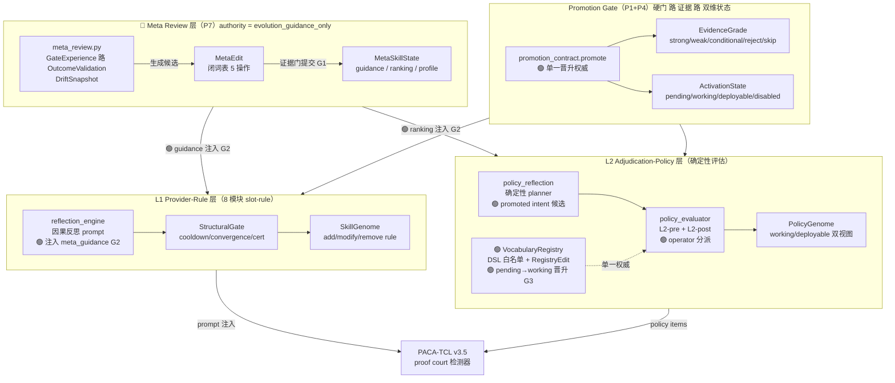
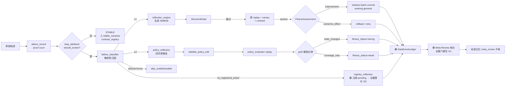
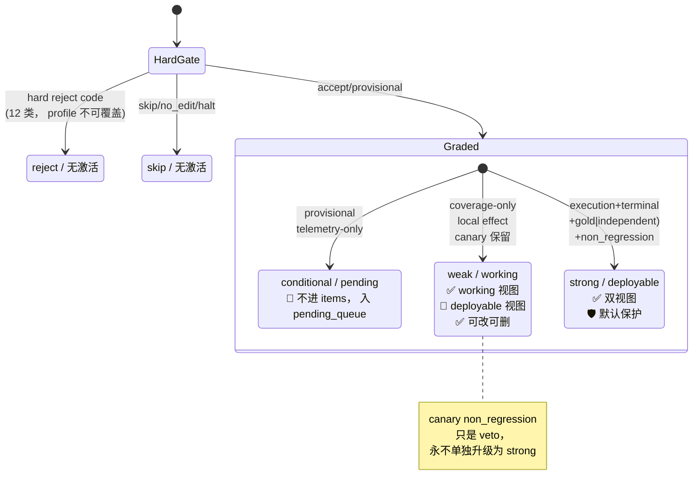
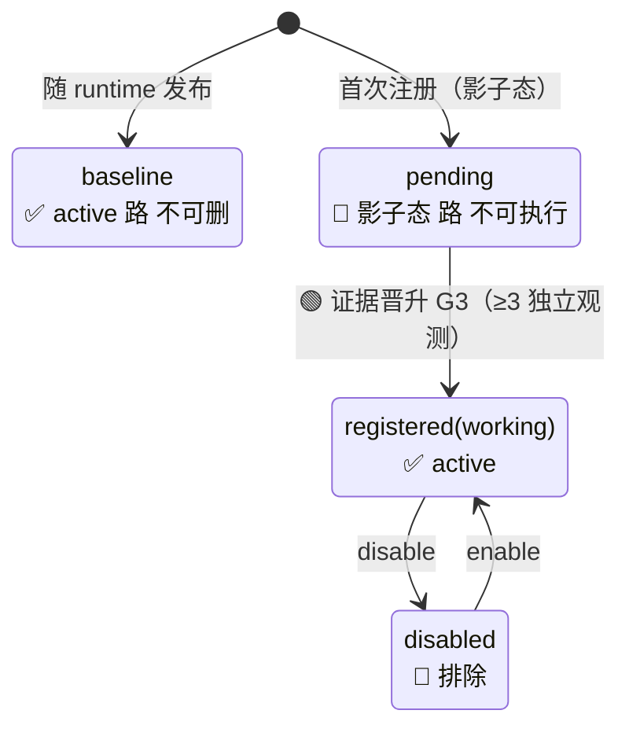
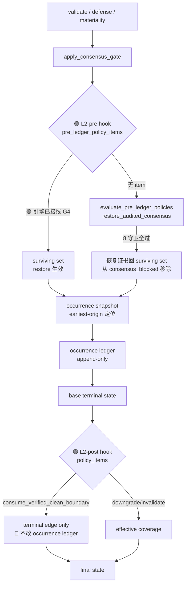
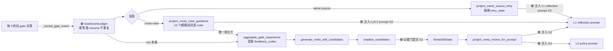
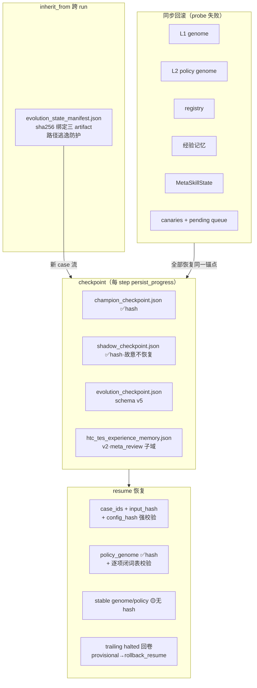

# SEHD v6 自进化框架可视化（第三轮审查后）

> 配套文档：`SEHD_V6_FRAMEWORK_TECHNICAL_REVIEW.md`（详细技术审查）。
> 基线：`main@5cc2a2c` + 第三轮审查修复（G1-G5 已全部落地）；测试 **806 passed**。
> 图例：🟢 已闭环 　🟡 部分/历史缺口（已修复见注）　🔴 未启动。

---

## 1. 三层自进化架构总览



---

## 2. 端到端数据流（一次 case 的进化闭环）



---

## 3. 晋升契约状态机（P1 + P4）



### Registry entry 状态机（P3A/P3B）



---

## 4. L2 双阶段执行（P2 + P9）



### L2-post 的 fail-closed 守卫（consume_verified_clean_boundary）

```text
必须同时满足（缺一则 fail-closed，记 skipped + route_result）：
  boundary_path_state == "verified_clean"
  且 boundary_authority_valid == true
  且 terminal_state == "unresolved"
  且 surviving_error_count == 0
  且 不修改 occurrence ledger
  且 记录 before/after + policy item + authority
```

### L2-pre 的 fail-closed 守卫（restore_audited_consensus）

```text
必须同时满足（缺一则 fail-closed）：
  consensus_gate_applied
  且 certificate_id ∈ blocked set
  且 audit_status == "pass"
  且 causal ∈ {causes_incorrect_result, propagates_to_incorrect_result}
  且 impact ∉ {process_only, process_debt}
  且 defense_status != "dominated"
  且 quarantine_status != "quarantined"
  且 authority valid
```

---

## 5. GateEvent → 反馈 → Meta（P5 + P7）——已闭环



---

## 6. 持久化 / 恢复 / 继承 / 回滚



---

## 7. 第三轮审查后达成度热力图


---

## 8. 遗留边界速查

| # | 边界 | 位置 | 状态 |
|---|---|---|---|
| **D1** | L1 action 仍是自然语言注入，执行证据依赖 provider 自报（fail-open） | `module_charter.py` / `skill_integration.py` | 🟡 架构改造方向，未启动 |
| **D2** | 动态词表的策略提议依赖注册时捕获的 intent；无 intent 的 promoted 条目仅可被引用 | `registry_promotion.py` | 🟡 已实现 intent 通道，无 intent 条目仍被动 |
| **D3** | stable genome/policy checkpoint 无 content_hash 校验 | `evolution_runner.py` | 🟡 加固建议 |
| **P10** | 连续运行 + 独立评测 | — | 🔴 未启动 |

> **第三轮结论**：G1-G5 五条断链已全部闭合（见 `EVOLUTION_FIXES_SUMMARY.md`），
> 自进化框架的「检测 → 归因 → 反思 → 回放 → 门控 → 反馈 → 元审查 → 证据门提交」
> 闭环在运行时代码中成立；剩余 D1-D3 为架构改造与加固方向，不阻断闭环。
